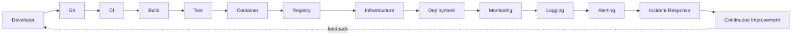
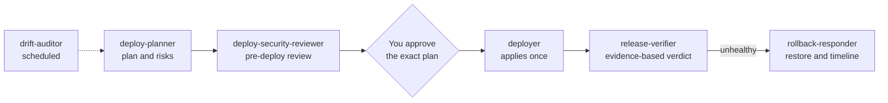
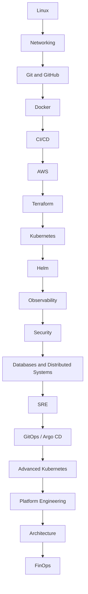

# DevOps Roadmap: Beginner to Senior

*A practical learning path for becoming a Senior DevOps / Cloud / Platform Engineer.*

## Your Instructor

<table>
  <tr>
    <td width="260" align="center" valign="top">
      
    </td>
    <td valign="top">

### Ubong Eduok

**Author and instructor - DevOps Roadmap: Beginner to Senior**

GitHub: [@mascot200](https://github.com/mascot200)

<!--
  TODO(instructor): add a short bio here: current role / company, years in DevOps, specialities,
  certifications, and contact links (LinkedIn, X, website, email).
  The portrait card is docs/images/ubong-eduok.png (tool icons: Devicon, MIT licence).
-->

</td>
  </tr>
</table>

This repository turns the roadmap into a **hands-on curriculum**. Every level is a folder. Every topic inside a level is one page that contains:

- a plain-English explanation and **why it matters** in production,
- a **real-world system example** (how companies and well-known open-source systems use it),
- **Mermaid diagrams** (rendered natively on GitHub),
- a **step-by-step guide** you can copy-paste in a sandbox,
- a realistic **scenario**, common mistakes and best practices,
- **4-6 tasks** with verifiable "done when" checks, and self-check questions.

Each level ends with a **capstone project**, and nine larger [projects](projects/README.md) chain the levels into one evolving production system.

## The lifecycle



## Levels

| Level | Title | Time | Topics | Capstone |
|------:|-------|------|-------:|----------|
| 0 | [What DevOps Actually Is](level-00-what-devops-is/README.md) | 1 week (reading + mapping) | 13 | [Capstone](level-00-what-devops-is/99-capstone-project.md) |
| 1 | [Linux Fundamentals](level-01-linux-fundamentals/README.md) | 2-4 weeks | 13 | [Capstone](level-01-linux-fundamentals/99-capstone-project.md) |
| 2 | [Networking](level-02-networking/README.md) | 2-4 weeks | 11 | [Capstone](level-02-networking/99-capstone-project.md) |
| 3 | [Git & GitHub](level-03-git-and-github/README.md) | 2-3 weeks | 13 | [Capstone](level-03-git-and-github/99-capstone-project.md) |
| 4 | [Docker](level-04-docker/README.md) | 2-3 weeks | 14 | [Capstone](level-04-docker/99-capstone-project.md) |
| 5 | [CI/CD](level-05-cicd/README.md) | 2-3 weeks | 12 | [Capstone](level-05-cicd/99-capstone-project.md) |
| 6 | [Cloud (AWS)](level-06-cloud-aws/README.md) | 4-6 weeks | 18 | [Capstone](level-06-cloud-aws/99-capstone-project.md) |
| 7 | [Terraform / Infrastructure as Code](level-07-terraform-iac/README.md) | 2-3 weeks | 9 | [Capstone](level-07-terraform-iac/99-capstone-project.md) |
| 8 | [Kubernetes](level-08-kubernetes/README.md) | 6-10 weeks | 19 | [Capstone](level-08-kubernetes/99-capstone-project.md) |
| 9 | [Helm](level-09-helm/README.md) | 1-2 weeks | 6 | [Capstone](level-09-helm/99-capstone-project.md) |
| 10 | [Observability](level-10-observability/README.md) | 3-4 weeks | 11 | [Capstone](level-10-observability/99-capstone-project.md) |
| 11 | [Security / DevSecOps](level-11-security-devsecops/README.md) | 3-4 weeks | 13 | [Capstone](level-11-security-devsecops/99-capstone-project.md) |
| 12 | [Advanced Networking](level-12-advanced-networking/README.md) | 3-4 weeks | 14 | [Capstone](level-12-advanced-networking/99-capstone-project.md) |
| 13 | [Databases & Distributed Systems](level-13-databases-distributed-systems/README.md) | 4-6 weeks | 15 | [Capstone](level-13-databases-distributed-systems/99-capstone-project.md) |
| 14 | [SRE](level-14-sre/README.md) | 3-4 weeks | 10 | [Capstone](level-14-sre/99-capstone-project.md) |
| 15 | [Disaster Recovery](level-15-disaster-recovery/README.md) | 2-3 weeks | 10 | [Capstone](level-15-disaster-recovery/99-capstone-project.md) |
| 16 | [Advanced Kubernetes](level-16-advanced-kubernetes/README.md) | 4-6 weeks | 10 | [Capstone](level-16-advanced-kubernetes/99-capstone-project.md) |
| 17 | [GitOps](level-17-gitops/README.md) | 2-3 weeks | 7 | [Capstone](level-17-gitops/99-capstone-project.md) |
| 18 | [Platform Engineering](level-18-platform-engineering/README.md) | 4-6 weeks | 10 | [Capstone](level-18-platform-engineering/99-capstone-project.md) |
| 19 | [Architecture](level-19-architecture/README.md) | Ongoing | 11 | [Capstone](level-19-architecture/99-capstone-project.md) |
| 20 | [Cost Optimization](level-20-cost-optimization/README.md) | 2-3 weeks | 9 | [Capstone](level-20-cost-optimization/99-capstone-project.md) |

## Guides

- [Recommended learning order](guides/learning-order.md)
- [Suggested timeline](guides/timeline.md)
- [The senior-level mindset](guides/senior-mindset.md)
- [Practical project progression](projects/README.md)

## Deployment agents and skills (Claude Code)

The roadmap teaches you to deploy by hand so you understand why every step exists. When you are ready to **ship real applications
with an AI pair-deployer**, use the companion toolkit:
**[`devops-deploy-toolkit`](https://github.com/mascot200/devops-deploy-toolkit)** - Claude Code agents, skills and scripts that
deploy to a VPS, AWS, Kubernetes or a GitOps cluster with one rule built into the code: **look first, change only when a human has
approved the plan.**



| Target | Skill | Roadmap lessons it builds on |
|--------|-------|------------------------------|
| Docker Compose on a VPS | `deploy-compose-vps` | [Docker Compose](level-04-docker/08-docker-compose.md), [Rollback](level-05-cicd/07-rollback.md) |
| AWS with Terraform | `deploy-terraform-aws` | [Terraform](level-07-terraform-iac/README.md), [Drift detection](level-07-terraform-iac/09-drift-detection.md) |
| Kubernetes with Helm | `deploy-helm-k8s` | [Helm](level-09-helm/README.md), [Probes](level-08-kubernetes/15-liveness-and-readiness-probes.md) |
| GitOps with Argo CD | `deploy-gitops-argocd` | [GitOps](level-17-gitops/README.md), [Rollback through Git](level-17-gitops/06-rollback-through-git.md) |
| Any of the above | `deploy-preflight`, `post-deploy-verify` | [CI/CD pipeline design](level-05-cicd/01-pipeline-design.md), [What to monitor](level-10-observability/11-what-to-monitor.md) |

```bash
git clone https://github.com/mascot200/devops-deploy-toolkit.git
cd your-app-repo && ../devops-deploy-toolkit/install.sh --dry-run   # then without --dry-run
```

Everything is dry-run by default, production needs an explicit confirmation, and floating tags such as `latest` are refused. The scripts
are tested with stub binaries and real local git; they have not been run against a live cloud account, so rehearse in staging first.
Full guide: [`docs/GUIDE.md`](https://github.com/mascot200/devops-deploy-toolkit/blob/main/docs/GUIDE.md).

## Recommended path (summary)



> Level numbers follow the roadmap document; the *learning order* above is the recommended sequence (for example Security and Databases come before SRE, and Advanced Kubernetes after GitOps). See the [learning-order guide](guides/learning-order.md).

## How to use this repository

1. Fork it (or copy a level into your own notes repo) so you can tick off tasks: change `- [ ]` to `- [x]`.
2. Work through one **running project** across the whole journey. The sample app used in all examples is **`shop-api`** (Node.js API + PostgreSQL + Redis + Nginx).
3. Use disposable sandboxes: local VMs, Docker, kind/minikube, LocalStack, or a small VPS. Anything that can cost money says so and ends with teardown steps.
4. Keep a *lab notebook*: for each task, write what you ran and what you saw. Explaining output is the skill.

## Repository layout

```text
devops-roadmap/
├── README.md
├── docs/TOPIC_TEMPLATE.md          # the structure every topic follows
├── docs/images/                    # instructor photo and other images
├── guides/                         # learning order, timeline, senior mindset
├── projects/                       # nine end-to-end projects
├── level-00-what-devops-is/
│   ├── README.md                   # level index and goals
│   ├── 01-sdlc.md                  # one file per topic
│   └── 99-capstone-project.md      # level capstone
├── level-01-linux-fundamentals/
└── ... level-20-cost-optimization/
```

## Senior-level mindset

Do not aim to become the person who knows 50 DevOps tools. Aim to become the engineer who can take a software application and independently make it production-ready: **secure, observable, scalable, highly available, automatically deployable, recoverable, and cost-efficient.**

## License

Released under the [MIT License](LICENSE) - Copyright (c) 2026 Ubong Eduok. You may use, copy, modify and share this material, including in
your own courses and projects, as long as the copyright and license notice are kept. Everything is provided "as is"; run labs in
sandboxes and read cost warnings before using real cloud accounts.
