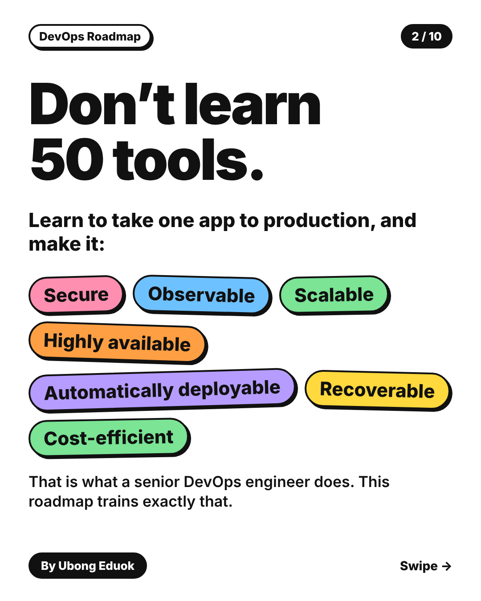
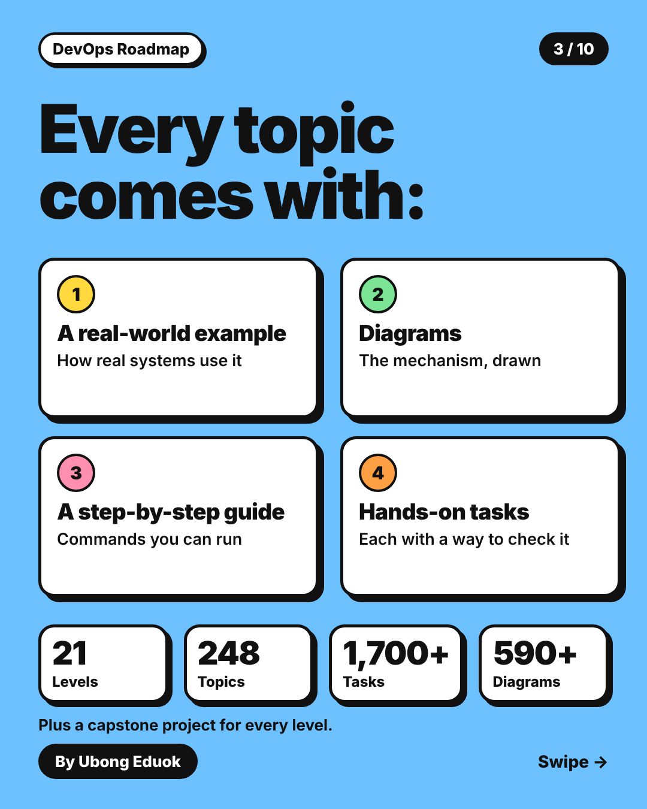
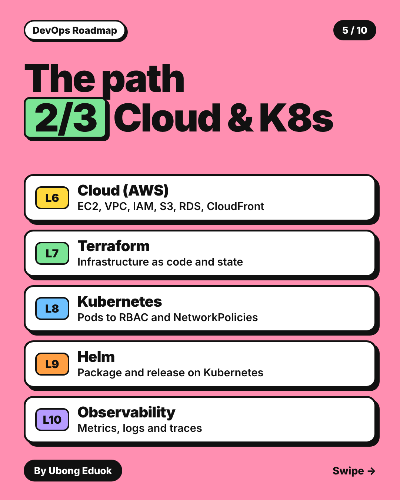
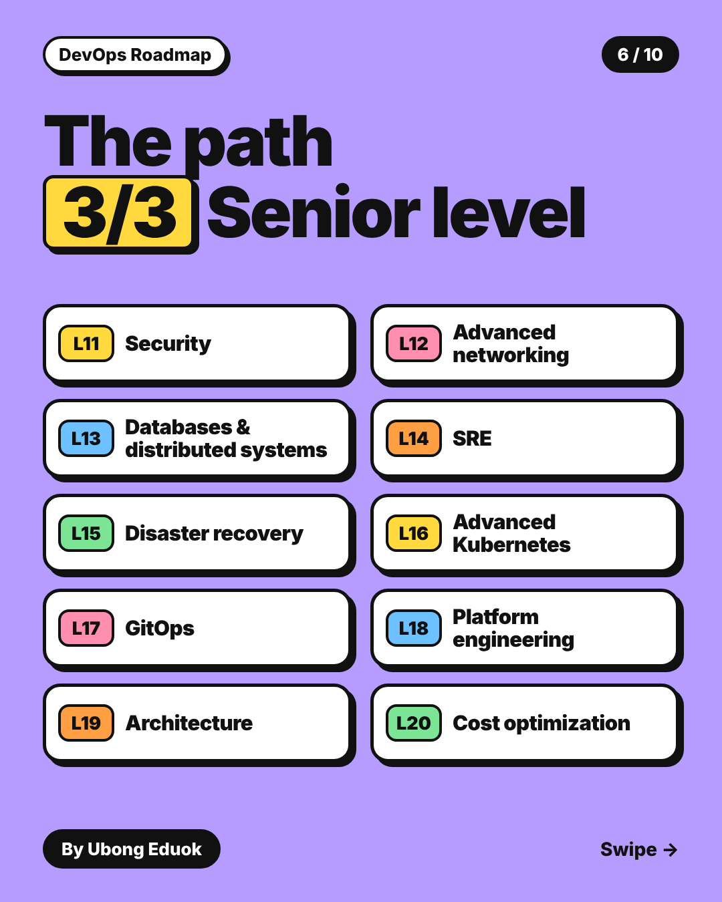
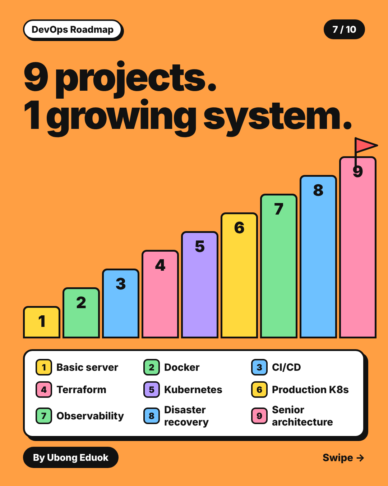
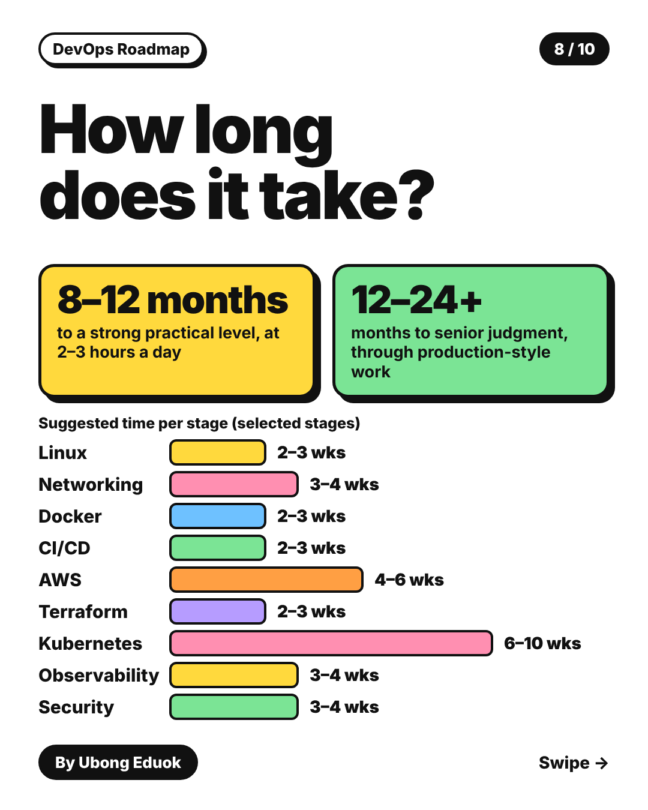
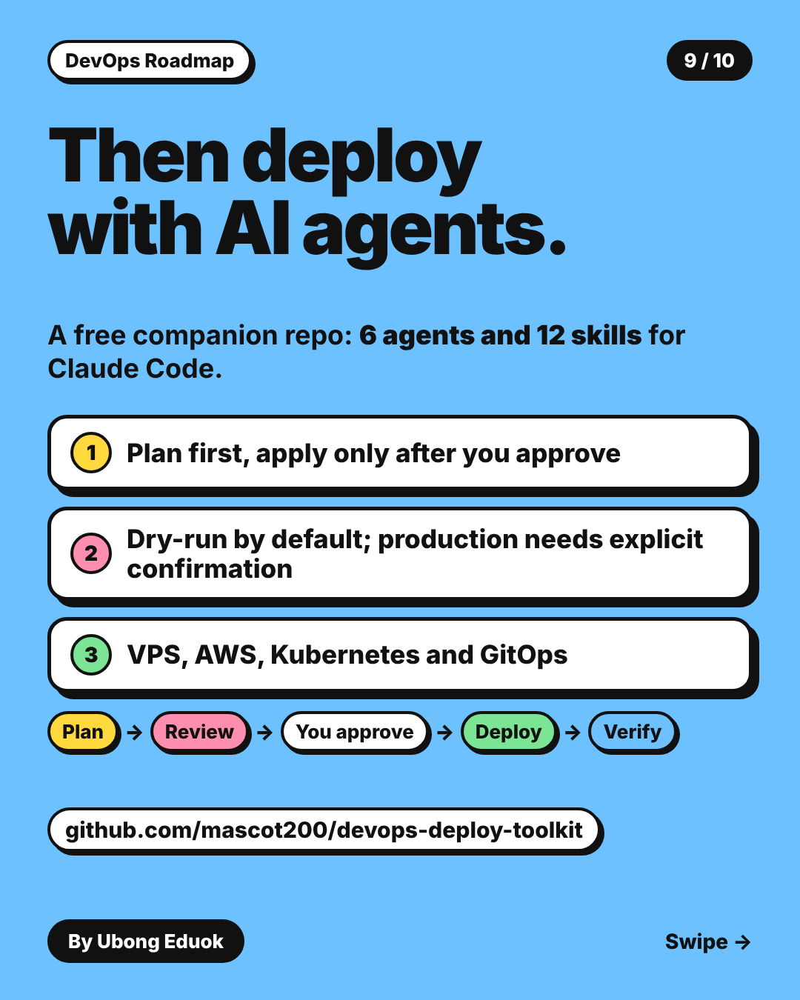

# DevOps Roadmap carousel

Ten slides, **1080 x 1350 px** (4:5). Every slide is its own PNG, so you can download and post them one by one.

| Where you post | Use |
|----------------|-----|
| Instagram, Facebook, X | The PNG slides below, in order 1 to 10 |
| LinkedIn | [`devops-roadmap-carousel.pdf`](devops-roadmap-carousel.pdf?raw=true) (upload it as a document) |

<table>
<tr><td align="center" valign="top" width="50%"> <b>1. Cover</b> <a href="slide-01-cover.png?raw=true">Download PNG</a></td><td align="center" valign="top" width="50%"> <b>2. Don't learn 50 tools</b> <a href="slide-02-dont-learn-50-tools.png?raw=true">Download PNG</a></td></tr>
<tr><td align="center" valign="top" width="50%"> <b>3. Every topic comes with</b> <a href="slide-03-every-topic-comes-with.png?raw=true">Download PNG</a></td><td align="center" valign="top" width="50%"> <b>4. The path 1/3: Foundations</b> <a href="slide-04-path-1-foundations.png?raw=true">Download PNG</a></td></tr>
<tr><td align="center" valign="top" width="50%"> <b>5. The path 2/3: Cloud and Kubernetes</b> <a href="slide-05-path-2-cloud-and-kubernetes.png?raw=true">Download PNG</a></td><td align="center" valign="top" width="50%"> <b>6. The path 3/3: Senior level</b> <a href="slide-06-path-3-senior-level.png?raw=true">Download PNG</a></td></tr>
<tr><td align="center" valign="top" width="50%"> <b>7. 9 projects, 1 growing system</b> <a href="slide-07-nine-projects.png?raw=true">Download PNG</a></td><td align="center" valign="top" width="50%"> <b>8. How long does it take?</b> <a href="slide-08-how-long-does-it-take.png?raw=true">Download PNG</a></td></tr>
<tr><td align="center" valign="top" width="50%"> <b>9. Then deploy with AI agents</b> <a href="slide-09-deploy-with-ai-agents.png?raw=true">Download PNG</a></td><td align="center" valign="top" width="50%"> <b>10. Start today. It's free.</b> <a href="slide-10-start-today.png?raw=true">Download PNG</a></td></tr>
</table>

**How to download one slide:** click *Download PNG* under it, or open the image and use the download button on GitHub.
Slide files are named `slide-NN-topic.png`, so they stay in order when you save them.

Single-image versions: [landscape 1200x630](../devops-roadmap-share-1200x630.png) and [square 1080x1080](../devops-roadmap-square-1080x1080.png).
