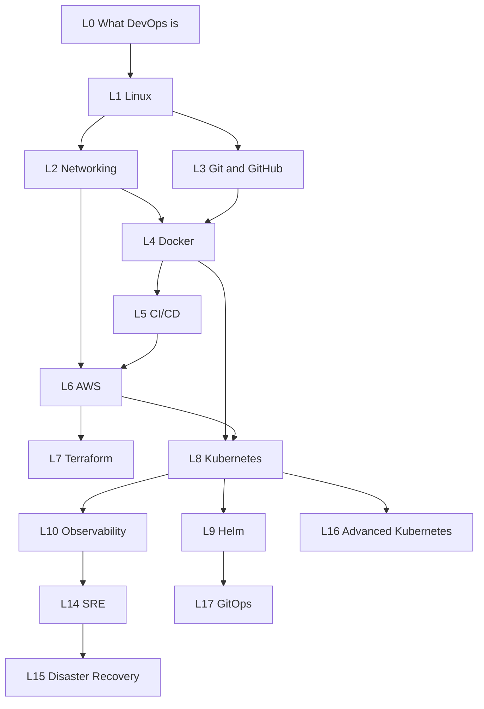
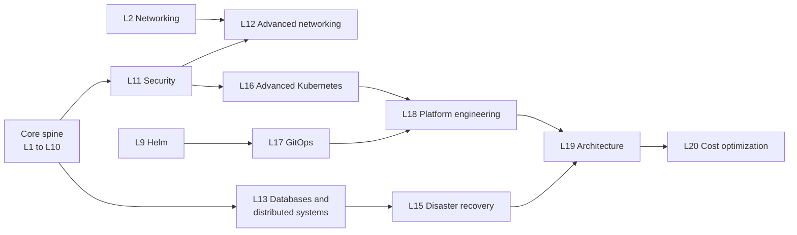

# Recommended Learning Order

> **Guide** · How to sequence the roadmap and why · ⏱ ~20 min read

The roadmap is a dependency chain, not a menu. Each stage gives you the vocabulary and the debugging skills the next stage assumes.
Skip a stage and you will not get an error message; you will get a tool you can type commands into but cannot reason about.
This guide explains the order, what each step depends on, what it unlocks, and where it lives in this repository.

> **Numbering note.** The classic roadmap lists 18 steps (1 Linux ... 18 FinOps). This repository splits a few of them into extra
> level folders, so **roadmap step numbers and repo level numbers differ**. Always use the folder names below when you navigate.

## 1. The order, step by step

| Roadmap step | Topic | Repo level folder(s) | Depends on | Unlocks |
|--------------|-------|----------------------|------------|---------|
| 0 | What DevOps actually is | [Level 0](../level-00-what-devops-is/README.md) | nothing | the vocabulary used everywhere else |
| 1 | Linux | [Level 1](../level-01-linux-fundamentals/README.md) | nothing | every server, container and node you will ever debug |
| 2 | Networking | [Level 2](../level-02-networking/README.md) | Linux (tools such as `ss`, `curl`, `tcpdump`) | load balancers, DNS, VPCs, Kubernetes Services |
| 3 | Git and GitHub | [Level 3](../level-03-git-and-github/README.md) | Linux shell | collaboration, pull requests, pipelines, GitOps |
| 4 | Docker | [Level 4](../level-04-docker/README.md) | Linux, networking | repeatable builds, Kubernetes workloads |
| 5 | CI/CD | [Level 5](../level-05-cicd/README.md) | Git, Docker | automated, repeatable delivery |
| 6 | AWS | [Level 6](../level-06-cloud-aws/README.md) | Linux, networking, IAM concepts | somewhere real to run things; Terraform has something to manage |
| 7 | Terraform | [Level 7](../level-07-terraform-iac/README.md) | AWS, Git | reviewable, repeatable infrastructure |
| 8 | Kubernetes | [Level 8](../level-08-kubernetes/README.md) | Linux, networking, Docker, cloud | orchestration, then Helm, GitOps, platforms |
| 9 | Helm | [Level 9](../level-09-helm/README.md) | Kubernetes | packaging and per-environment configuration |
| 10 | Observability | [Level 10](../level-10-observability/README.md) | a running system to observe | SRE, incident response, capacity planning |
| 11 | Security / DevSecOps | [Level 11](../level-11-security-devsecops/README.md) | Linux, Docker, cloud, CI/CD | safe defaults in every earlier layer |
| 12 | Databases and distributed systems | [Level 13](../level-13-databases-distributed-systems/README.md) | networking, Linux | reliability work that is not just stateless web servers |
| 13 | SRE | [Level 14](../level-14-sre/README.md) | observability | SLOs, error budgets, incident practice |
| 14 | GitOps / Argo CD | [Level 17](../level-17-gitops/README.md) | Kubernetes, Helm, Git | pull-based, auditable delivery |
| 15 | Advanced Kubernetes | [Level 16](../level-16-advanced-kubernetes/README.md) | Kubernetes, security | multi-team, hardened clusters |
| 16 | Platform engineering | [Level 18](../level-18-platform-engineering/README.md) | Kubernetes, GitOps, Terraform | self-service for other engineers |
| 17 | Architecture | [Level 19](../level-19-architecture/README.md) | everything above | trade-off judgment at system level |
| 18 | FinOps / cost optimization | [Level 20](../level-20-cost-optimization/README.md) | AWS, Kubernetes, observability | cost as an engineering property |

Two repo levels are not in the classic 18 steps; they slot in as companions:

- [Level 12: Advanced Networking](../level-12-advanced-networking/README.md) goes **alongside Security (Level 11)**. TLS, mTLS, VPNs,
  rate limiting and circuit breakers are security and reliability tools. Do the first half (OSI, DNS architecture, TLS) right after
  Level 11 and the second half (service mesh, connection pooling, circuit breakers) when you reach Level 16.
- [Level 15: Disaster Recovery](../level-15-disaster-recovery/README.md) goes **alongside SRE (Level 14)** and right after the
  database topics in [Level 13](../level-13-databases-distributed-systems/README.md). Backups you have never restored are a hope, not a plan.

The first diagram shows the core spine (Levels 0-10) and a few early branches. The second shows how the later levels hang off it:

## 2. Why each step sits where it does

**0. What DevOps is.** Read this first, but briefly. It gives you the words (CI/CD, IaC, SRE, DevSecOps) so later levels are not a
wall of jargon. It is context, not a skill to practise.

**1. Linux.** Every other tool in the roadmap runs on Linux or inside a Linux process. A container is a Linux process with
namespaces and cgroups. A Kubernetes node is a Linux machine. An EC2 instance is a Linux machine. When something goes wrong at
the lowest layer, the person who can read `journalctl`, `ss`, `top` and file permissions solves it; the person who cannot is stuck.
It unlocks everything.

**2. Networking.** Almost every production outage has a network component: DNS, a wrong CIDR, a security group, a certificate, a
load balancer health check. Networking depends on Linux for its tools (`ip`, `ss`, `dig`, `curl`, `tcpdump`). It unlocks VPC design,
load balancing, Kubernetes Services and Ingress, and reading any "connection refused versus timed out" symptom correctly.

**3. Git and GitHub.** Git depends only on a shell. It comes before CI/CD because a pipeline is triggered by Git events and
reads Git history. It comes before Terraform and GitOps because both treat a Git repository as the source of truth. You can learn it in
parallel with networking.

**4. Docker.** Needs Linux (processes, filesystems, users) and networking (ports, bridges, DNS). It unlocks reproducible builds and
is the unit Kubernetes schedules. Learn it before CI/CD because most pipelines build and ship images.

**5. CI/CD.** Needs Git (triggers, branches, tags) and Docker (what you build and ship). It unlocks the habit that changes the
profession: every change is built, tested and deployed the same way every time. It also supplies the vocabulary of deployment
strategies (rolling, blue/green, canary) that Kubernetes later implements for you.

**6. AWS.** Needs networking (a VPC is a network design exercise) and Linux (EC2). Taught after CI/CD so that when you reach cloud
you already know what you are deploying and how. It unlocks Terraform (nothing to automate without a cloud) and managed Kubernetes.
Always set a billing alarm first.

**7. Terraform.** Needs a cloud to manage, so it follows AWS, and Git for review workflows. It unlocks repeatable environments and
the habit of reviewing infrastructure as code. Doing AWS by hand first is deliberate: you should understand what the plan will
create before a tool creates it for you.

**8. Kubernetes.** The big one, covered in the warning below. It needs all four of Linux, networking, Docker and a cloud
context, because every Kubernetes failure is a failure in one of them wearing a different name. It unlocks Helm, GitOps, advanced
Kubernetes and platform engineering.

**9. Helm.** A thin layer over Kubernetes manifests: templating, values per environment, versioned releases. It cannot be learned
meaningfully without knowing the manifests it renders. It unlocks GitOps (Argo CD usually deploys Helm charts or Kustomize).

**10. Observability.** You can learn Prometheus on a laptop earlier, but it is placed here because you now have something
worth observing: a multi-service system on Kubernetes. It unlocks SRE (SLOs are measured from metrics) and incident response (you
cannot debug what you cannot see).

**11. Security / DevSecOps.** Security is a property of every earlier layer, so it is placed after you have built those layers. You
now have an SSH server to harden, images to scan, IAM roles to tighten, a pipeline to add gates to, and secrets to manage.
Recommended companion: [Level 12 Advanced Networking](../level-12-advanced-networking/README.md) (TLS, mTLS, rate limiting).

**12. Databases and distributed systems** (repo [Level 13](../level-13-databases-distributed-systems/README.md)). Needs networking
(replication is network traffic) and Linux (disks, memory). It comes late because the interesting lessons are about failure:
replication lag, split brain, idempotency. It unlocks SRE and disaster recovery, where the hard problems are almost always stateful.

**13. SRE** (repo [Level 14](../level-14-sre/README.md)). Needs observability: an SLO without an SLI is a slogan. It unlocks
principled reliability decisions, error budgets and good on-call practice. Pair it with
[Level 15 Disaster Recovery](../level-15-disaster-recovery/README.md): SRE tells you how reliable to be; DR is what you do when you
fall short.

**14. GitOps / Argo CD** (repo [Level 17](../level-17-gitops/README.md)). Needs Kubernetes, Helm and Git discipline. It replaces
"CI pushes to the cluster" with "the cluster pulls from Git", which is easier to audit and recover. You can take it before Advanced
Kubernetes if you prefer; the repo's numbering follows the roadmap's usual teaching order for the other topics.

**15. Advanced Kubernetes** (repo [Level 16](../level-16-advanced-kubernetes/README.md)). RBAC in depth, Pod security, operators,
CRDs, admission control, autoscaling and service mesh. Needs Level 8 solid and Level 11 for the security context.

**16. Platform engineering** (repo [Level 18](../level-18-platform-engineering/README.md)). You build tools for other engineers.
That only works if you have been the user of enough of the stack above to know what a good developer experience is.

**17. Architecture** (repo [Level 19](../level-19-architecture/README.md)). Everything is a trade-off here, so you need the previous
levels as concrete experience. It also feeds the [Senior-Level Mindset](senior-mindset.md) guide.

**18. FinOps and cost optimization** (repo [Level 20](../level-20-cost-optimization/README.md)). Cost is easiest to reason about
once you understand compute, storage, network egress, databases and Kubernetes capacity. You should keep an eye on cost from step 6
onwards; this level makes it systematic.

## 3. Do not rush into Kubernetes

Kubernetes is the most-requested skill on the roadmap and the one most often learned too early. It is not a first tool.
It is a distributed system that automates operations you already know how to do by hand.

- Without **Linux**, you cannot tell whether a pod is crashing because of memory limits (cgroups), permissions (UID and file mode),
  a full disk, or a missing library. `kubectl describe` shows symptoms; Linux explains them.
- Without **networking**, Services, Ingress, DNS and NetworkPolicies are magic. "Connection refused" and "timed out" mean different
  things, and you will not know which is which.
- Without **Docker**, you cannot write or debug the image the cluster runs. Half of all Kubernetes problems are image problems.
- Without **cloud basics**, you will not understand load balancers, persistent volumes, node groups or IAM for service accounts on
  EKS, GKE or AKS.

A good test before starting [Level 8](../level-08-kubernetes/README.md): without notes, can you (1) run an API and a database in
Docker Compose on a private network, (2) explain why a request to a closed port fails differently from one to a firewalled port, (3) read a
failing service's logs and ports on a Linux host, and (4) describe the path from a browser to an EC2 instance behind an ALB? If not,
spend another week on the earlier levels. You will save that week several times over.

## 4. If you only have time for X

| Your situation | Do these levels | Skip or defer | What you can honestly claim afterwards |
|----------------|-----------------|---------------|-----------------------------------------|
| 1 weekend | [L1](../level-01-linux-fundamentals/README.md) capstone, [L4](../level-04-docker/README.md) topics 1-8 | everything else | "I can run a service on Linux and in Docker Compose." |
| 1 month | L1, L2, L3, L4 | cloud and Kubernetes | "I can build and run a containerized app and explain how it is reached." |
| 3 months | L0-L5 | cloud, IaC, Kubernetes | "I can set up a tested, containerized app with a deploy pipeline." |
| 6 months | L0-L9, plus [L10](../level-10-observability/README.md) topics 1-4 | SRE, advanced topics | "I can deploy to AWS and Kubernetes with code and observe the result." |
| Cloud engineer track | L1, L2, L6, L7, L11, L20 | Kubernetes depth | "I can design and secure cloud infrastructure with Terraform." |
| Kubernetes/platform track | L1, L2, L4, L8, L9, L16, L17, L18 | cloud specifics | "I can operate and secure clusters and deliver through GitOps." |
| SRE track | L1, L2, L10, L13, L14, L15 | tool-specific levels | "I can define reliability targets, respond to incidents and recover." |
| Interview next week | L0, L2 topic 11, L4 topics 1-8, L3 topics 1-5, L8 topics 1-5 | the rest | broad vocabulary; be honest about depth |

For a calendar version, see the [Suggested Timeline](timeline.md). For the project sequence that ties the levels together, see
[Project 1](../projects/project-01-basic-server.md) and onwards.

## 5. Common ways to get the order wrong

- **Tool-first learning.** Starting with Terraform or Kubernetes because job posts mention them. You can copy examples but not debug them.
- **Skipping the manual way.** Doing everything with Helm and Terraform before you have ever deployed by hand. Do it by hand once,
  as in the [Level 1 capstone](../level-01-linux-fundamentals/99-capstone-project.md), then automate.
- **Reading only.** The roadmap's value is in the tasks and capstones. Every level has them; do them.
- **Leaving security and cost to the end.** Treat Level 11 and Level 20 as habits you start in Level 1 (non-root users, billing alarms) and formalise later.
- **Collecting certificates instead of systems.** One end-to-end system that you can explain is worth more than five badges. Follow the
  [nine projects](../projects/project-01-basic-server.md) to build that system gradually.
