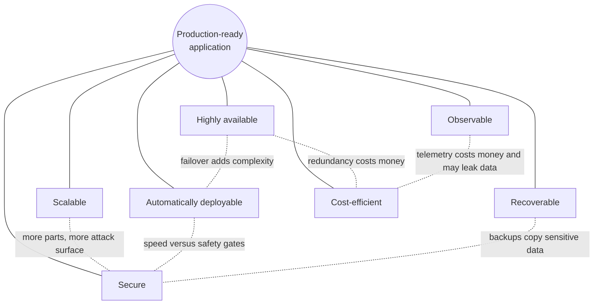

# The Senior-Level Mindset

> **Guide** · What separates a tool user from a senior engineer · ⏱ ~25 min read

Do not aim to know 50 tools. Aim to be able to **take a software application and independently make it production-ready**:
secure, observable, scalable, highly available, automatically deployable, recoverable, and cost-efficient.

Tools change every few years. The seven qualities do not. A senior engineer is someone who can look at an application they have
never seen, list what is missing against those seven, rank the gaps by risk, close the important ones, and explain what was left
open and why.

The strongest path to that skill is to **keep evolving one realistic production project** as you learn each technology. A single system
that you extend from a hand-built server to a hardened, observable, GitOps-delivered platform teaches you what isolated tutorials
cannot: how choices interact. This repository gives you that system in the [nine projects](../projects/project-01-basic-server.md),
built around the `shop-api` sample (Node.js API, PostgreSQL, Redis, Nginx).

## 1. The seven qualities and their tensions

No quality is free, and most pairs pull against each other. Examples:

| Tension | Example | How seniors handle it |
|---------|---------|-----------------------|
| Availability versus cost | Multi-AZ RDS doubles the database bill | Decide per service from the SLO. A checkout API earns multi-AZ; an internal admin tool may not. |
| Scalability versus complexity | Kubernetes and a service mesh for a service that fits on one VM | Start with the simplest thing that meets the next 12 months of load; know the trigger that forces a change. |
| Security versus delivery speed | Image scanning and approvals slow pipelines | Automate the gates so they are fast and consistent; block only on what matters (critical, fixable). |
| Observability versus cost and privacy | High-cardinality metrics and verbose logs are expensive and may hold personal data | Decide what you need to answer questions during an incident; sample, redact and set retention. |
| Recoverability versus security | Offsite backups copy sensitive data to another place | Encrypt, restrict access, and test restores. |
| Deployability versus stability | Deploy ten times a day | Use progressive delivery and fast rollback so frequent change is *safer* than rare change. |

## 2. How seniors think

**Trade-offs, not best practices.** "Best practice" is a default, not an argument. A senior says what they are optimising for, what
they are giving up, and under which conditions they would choose differently. Writing the decision down in an
[architecture decision record](../level-19-architecture/11-architecture-decision-records.md) makes the reasoning reviewable.

**Blast radius.** Before any change, ask: if this goes wrong, what breaks and for whom? Small blast radius means separate accounts and
environments, namespaces, per-service IAM roles, canary rollouts, and feature flags. Compare
[least-privilege IAM](../level-11-security-devsecops/02-least-privilege-iam.md) and
[canary deployments](../level-05-cicd/12-canary-deployments.md).

**Reversibility.** Prefer changes you can undo quickly. Know the rollback before you deploy. Treat one-way doors (dropping a column,
changing a primary key, deleting a bucket, rotating a key without a fallback) with extra ceremony: backups, expand/contract
migrations, a review, a rehearsal. See [rollback](../level-05-cicd/07-rollback.md) and
[database migrations](../level-05-cicd/09-database-migrations.md).

**Boring technology.** Every new technology spends from a limited "innovation budget" because it needs people who can operate it at 3 a.m.
Choose well-understood tools (PostgreSQL, Nginx, a managed load balancer) unless a new one solves a problem the old one cannot.
See [operational complexity](../level-19-architecture/06-operational-complexity.md).

**Write things down.** Runbooks, decision records, postmortems and README files make a team outlast any single person. A good
[postmortem](../level-14-sre/07-postmortems.md) is blameless and ends in tracked actions. Documentation is how seniors scale themselves.

**Measure before optimising, and define "good" first.** Reliability work starts with [SLIs](../level-14-sre/01-slis.md) and
[SLOs](../level-14-sre/02-slos.md), and capacity or cost work starts with data, not intuition.

**Assume failure.** Disks fill, certificates expire, regions have bad days, humans fat-finger. Design so that failure is
detected quickly, contained, and recovered from by a procedure someone has actually run. See
[failure scenario drills](../level-15-disaster-recovery/10-failure-scenario-drills.md).

**Communicate.** A senior engineer explains risk to non-engineers in money and time, writes an incident update that a manager can act
on, and says "I don't know yet, here is how I will find out".

## 3. Production-readiness review checklist

Use this checklist on any service, including your own projects. Each item links to where the repository teaches it. A "no" is not a
failure; it is a known, written-down risk with an owner.

### 3.1 Secure

- [ ] Servers are reachable only by SSH keys; root login and passwords are off ([Linux and SSH hardening](../level-11-security-devsecops/01-linux-and-ssh-hardening.md)).
- [ ] Every identity has least-privilege permissions; no long-lived keys where roles work ([least-privilege IAM](../level-11-security-devsecops/02-least-privilege-iam.md), [IAM](../level-06-cloud-aws/07-iam.md)).
- [ ] Only the load balancer is public; databases and caches are in private subnets ([security groups and policies](../level-11-security-devsecops/03-cloud-security-groups-and-policies.md), [VPC](../level-06-cloud-aws/04-vpc-and-subnets.md)).
- [ ] Secrets are never in Git, images or logs; they come from a secrets manager ([secrets management](../level-11-security-devsecops/04-secrets-management-and-encryption.md), [secrets scanning](../level-11-security-devsecops/11-secrets-scanning.md)).
- [ ] Containers run as non-root on minimal images and are scanned in CI ([non-root containers](../level-04-docker/11-non-root-containers.md), [image scanning](../level-11-security-devsecops/09-container-image-scanning.md)).
- [ ] Dependencies are scanned and updated ([dependency scanning](../level-11-security-devsecops/10-dependency-scanning.md)).
- [ ] Authentication and authorization are tested; the API is rate limited ([API security](../level-11-security-devsecops/08-api-security.md), [rate limiting](../level-12-advanced-networking/13-rate-limiting.md)).
- [ ] TLS everywhere users and services connect ([TLS](../level-12-advanced-networking/04-tls.md)).

### 3.2 Observable

- [ ] Metrics for the four golden signals (latency, traffic, errors, saturation) with dashboards ([what to monitor](../level-10-observability/11-what-to-monitor.md), [Prometheus](../level-10-observability/02-prometheus-and-promql.md)).
- [ ] Structured logs with correlation IDs, centrally searchable ([structured logging](../level-10-observability/05-structured-logging.md), [correlation IDs](../level-10-observability/07-correlation-ids.md)).
- [ ] Distributed traces across service hops ([tracing](../level-10-observability/08-distributed-tracing.md), [OpenTelemetry](../level-10-observability/09-opentelemetry.md)).
- [ ] Alerts page on symptoms tied to SLOs, not on every CPU spike ([SLOs](../level-14-sre/02-slos.md), [alert fatigue](../level-14-sre/08-alert-fatigue-reduction.md)).
- [ ] Application errors are captured with context ([Sentry](../level-10-observability/10-sentry.md)).

### 3.3 Scalable

- [ ] Stateless application tier; state lives in the database, cache or object storage ([scalability](../level-19-architecture/01-scalability.md), [horizontal and vertical scaling](../level-13-databases-distributed-systems/10-horizontal-and-vertical-scaling.md)).
- [ ] Autoscaling with tested limits and sensible requests ([Auto Scaling](../level-06-cloud-aws/02-auto-scaling.md), [HPA](../level-08-kubernetes/16-horizontal-pod-autoscaling.md)).
- [ ] Database indexes match the query patterns; connections are pooled ([PostgreSQL indexes](../level-13-databases-distributed-systems/01-postgresql-indexes.md), [connection pooling](../level-13-databases-distributed-systems/06-db-connection-pooling.md)).
- [ ] A load test has found the first bottleneck and capacity is planned ([capacity planning](../level-14-sre/09-capacity-planning.md), [performance](../level-19-architecture/04-performance.md)).

### 3.4 Highly available

- [ ] No single point of failure: at least two instances across two availability zones ([availability](../level-19-architecture/02-availability.md), [high availability](../level-00-what-devops-is/08-high-availability-and-scalability.md)).
- [ ] Health checks remove bad instances automatically ([health checks](../level-04-docker/12-health-checks.md), [probes](../level-08-kubernetes/15-liveness-and-readiness-probes.md), [ALB](../level-06-cloud-aws/14-alb.md)).
- [ ] Timeouts, retries with backoff, and circuit breakers protect against failing dependencies ([circuit breakers](../level-12-advanced-networking/14-circuit-breakers.md), [idempotency](../level-13-databases-distributed-systems/14-idempotency.md)).
- [ ] The database has a replica and a rehearsed failover ([replication](../level-13-databases-distributed-systems/04-replication.md), [failover](../level-15-disaster-recovery/05-failover.md)).
- [ ] Voluntary disruptions (node drains, deployments) do not cause downtime ([zero-downtime deployments](../level-05-cicd/08-zero-downtime-deployments.md)).

### 3.5 Automatically deployable

- [ ] Every change goes through a pull request, tests and a pipeline ([protected branches](../level-03-git-and-github/08-protected-branches-and-pull-requests.md), [pipeline design](../level-05-cicd/01-pipeline-design.md)).
- [ ] Infrastructure is code, reviewed and applied from CI with remote, locked state ([Terraform CI/CD](../level-07-terraform-iac/07-terraform-ci-cd.md), [state locking](../level-07-terraform-iac/08-state-locking.md)).
- [ ] The deployment strategy is chosen on purpose and a rollback is one command or one `git revert` ([rolling](../level-05-cicd/10-rolling-deployments.md), [blue/green](../level-05-cicd/11-blue-green-deployments.md), [rollback through Git](../level-17-gitops/06-rollback-through-git.md)).
- [ ] Environments are declared in Git and reconciled automatically ([continuous reconciliation](../level-17-gitops/03-continuous-reconciliation.md), [environment promotion](../level-17-gitops/04-environment-promotion.md)).
- [ ] Database migrations are backward compatible with the previous release ([database migrations](../level-05-cicd/09-database-migrations.md)).

### 3.6 Recoverable

- [ ] Backups run automatically, are encrypted, and a copy lives elsewhere ([backups](../level-15-disaster-recovery/01-backups.md), [offsite backups](../level-15-disaster-recovery/08-offsite-backups.md)).
- [ ] Point-in-time recovery is configured for the database ([backups and PITR](../level-13-databases-distributed-systems/05-backups-and-pitr.md)).
- [ ] **A restore has been tested** this quarter and timed ([testing backup restoration](../level-15-disaster-recovery/09-testing-backup-restoration.md)).
- [ ] RPO and RTO are written down and match the business need ([RPO](../level-15-disaster-recovery/06-rpo.md), [RTO](../level-15-disaster-recovery/07-rto.md)).
- [ ] An incident process exists: roles, severity levels, communication, a postmortem template ([incident management](../level-14-sre/05-incident-management.md), [on-call practices](../level-14-sre/06-on-call-practices.md)).
- [ ] The whole environment can be rebuilt from code ([disaster recovery architecture](../level-19-architecture/09-disaster-recovery-architecture.md)).

### 3.7 Cost-efficient

- [ ] Billing alarms, budgets and cost allocation tags exist ([FinOps](../level-20-cost-optimization/01-finops.md), [CloudWatch](../level-06-cloud-aws/18-cloudwatch.md)).
- [ ] Instances and pods are right-sized from real usage ([rightsizing](../level-20-cost-optimization/05-rightsizing.md), [requests and limits](../level-08-kubernetes/14-resource-requests-and-limits.md)).
- [ ] Steady load is covered by commitments; interruptible load uses spot ([Savings Plans](../level-20-cost-optimization/02-reserved-instances-and-savings-plans.md), [spot](../level-20-cost-optimization/03-spot-instances.md)).
- [ ] Storage has lifecycle policies; logs and metrics have retention limits ([storage lifecycle](../level-20-cost-optimization/06-storage-lifecycle-policies.md), [S3](../level-06-cloud-aws/08-s3.md)).
- [ ] Network egress and NAT costs are understood ([network egress costs](../level-20-cost-optimization/07-network-egress-costs.md)).
- [ ] Non-production environments shut down or scale down out of hours.

## 4. Signs you are ready for senior responsibilities

You are probably ready when most of these are true:

- You can take an unfamiliar service and produce a prioritised production-readiness review in a day, not a list of tools.
- When something breaks, you form a hypothesis, check it with data, and narrow the search rather than restarting things.
- You can explain a design to a new colleague *and* to a non-technical stakeholder, including what it costs and what can go wrong.
- You have caused an incident, handled it calmly, and written a postmortem that improved the system.
- People ask you "what could go wrong with this plan?" before changes, and your answers are specific.
- You choose boring technology by default, and when you pick something new you can name the trigger for revisiting the decision.
- You have rebuilt your environment from scratch from code, and restored from a backup, within a time you measured.
- You decline or defer work for good reasons and can say what you are trading off.
- You raise the level of the team: better runbooks, safer pipelines, mentoring, reviews that teach.

You do not need to know every tool. If you find yourself saying "I'd need to look at the docs", that is fine, provided you know what
to look for and how to verify what you find.

## 5. Self-assessment

Rate yourself honestly: **1** = I have heard of it, **2** = I followed a tutorial, **3** = I built it and can debug it,
**4** = I have operated it under failure, **5** = I can teach it and design it for others. A senior profile is mostly 3s and 4s, with some 5s, and no 1s on the basics.

| Quality | Evidence for a 3 or higher | Projects that prove it | Your score (1-5) |
|---------|----------------------------|------------------------|------------------|
| Linux and networking foundations | Debug a service that does not start and a connection that times out with only a shell | [Project 1](../projects/project-01-basic-server.md) | |
| Containers and delivery | A pipeline that tests, builds, scans and deploys your image, with a rollback | [Project 2](../projects/project-02-docker.md), [Project 3](../projects/project-03-cicd.md) | |
| Infrastructure as code | A VPC, load balancer and database from Terraform, destroyed and recreated | [Project 4](../projects/project-04-terraform.md) | |
| Orchestration | An app on Kubernetes with probes, autoscaling, RBAC and GitOps delivery | [Project 5](../projects/project-05-kubernetes.md), [Project 6](../projects/project-06-production-kubernetes.md) | |
| Observability | Find an injected fault using only dashboards, logs and traces | [Project 7](../projects/project-07-observability.md) | |
| Security | A threat-model-driven hardening, with scans failing the build | [Project 6](../projects/project-06-production-kubernetes.md), [Project 9](../projects/project-09-senior-architecture.md) | |
| Reliability and recovery | A measured RPO and RTO from a real restore and failover | [Project 8](../projects/project-08-disaster-recovery.md) | |
| Cost | A written cost estimate and a verified saving | [Project 9](../projects/project-09-senior-architecture.md) | |
| Communication | A postmortem and an architecture decision record you wrote | [Project 8](../projects/project-08-disaster-recovery.md), [Project 9](../projects/project-09-senior-architecture.md) | |

Use the lowest scores as your next study plan, and revisit the [suggested timeline](timeline.md) and
[learning order](learning-order.md) to schedule it.

## 6. A final exercise

Pick any application you have not built, such as an open-source web app. In one afternoon, write a one-page production-readiness review
using section 3: for each of the seven qualities, what it already has, the three biggest gaps, the order you would close them in, and what you would explicitly
not do yet. If you can write that page convincingly, you are thinking like a senior engineer.
