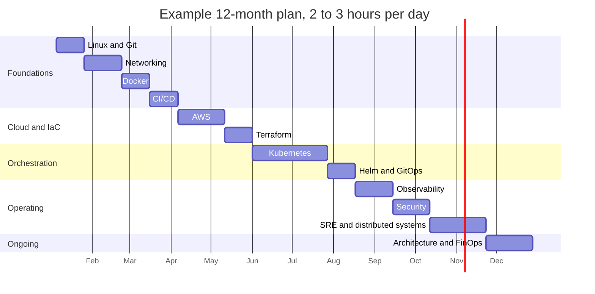
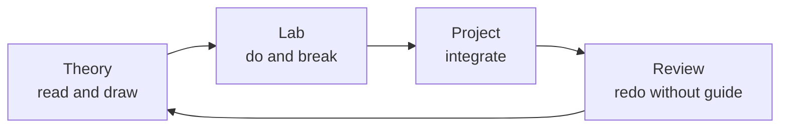

# Suggested Timeline

> **Guide** · How long each stage takes and what you should be able to show · ⏱ ~15 min read

Time estimates are the most abused numbers in learning roadmaps, so read this page as a **planning aid, not a promise**.
The ranges below assume you do the hands-on tasks and capstones in each level, not just read. If you only read, you will finish
sooner and be able to do much less.

## 1. Approximate time per stage

| Stage | Approx. time |
|-------|--------------|
| Linux | 2–3 weeks |
| Networking | 3–4 weeks |
| Docker | 2–3 weeks |
| CI/CD | 2–3 weeks |
| AWS | 4–6 weeks |
| Terraform | 2–3 weeks |
| Kubernetes | 6–10 weeks |
| Helm / GitOps | 2–3 weeks |
| Observability | 3–4 weeks |
| Security | 3–4 weeks |
| SRE / Distributed Systems | 4–6 weeks |
| Advanced Architecture | ongoing |

A focused learner studying 2–3 hours per day can reach a strong practical DevOps level in roughly 8–12 months.
Senior-level judgment usually requires 12–24+ months of serious hands-on, production-style work.

Why "judgment" takes longer than "skills": you can learn a tool in weeks, but knowing when not to use it, how it fails, and what it
costs to operate comes from living with systems through incidents, upgrades and growth. That is why the roadmap ends with an
ongoing stage and why the [Senior-Level Mindset](senior-mindset.md) guide focuses on habits rather than tools.

Stage names map to repo levels as follows (see the [learning order](learning-order.md) for the reasoning):

| Stage | Repo levels |
|-------|-------------|
| Linux | [L1](../level-01-linux-fundamentals/README.md) (after a skim of [L0](../level-00-what-devops-is/README.md)) |
| Networking | [L2](../level-02-networking/README.md) |
| Docker | [L4](../level-04-docker/README.md) (plus [L3](../level-03-git-and-github/README.md) Git, which runs in parallel with networking) |
| CI/CD | [L5](../level-05-cicd/README.md) |
| AWS | [L6](../level-06-cloud-aws/README.md) |
| Terraform | [L7](../level-07-terraform-iac/README.md) |
| Kubernetes | [L8](../level-08-kubernetes/README.md) |
| Helm / GitOps | [L9](../level-09-helm/README.md), [L17](../level-17-gitops/README.md) |
| Observability | [L10](../level-10-observability/README.md) |
| Security | [L11](../level-11-security-devsecops/README.md), [L12](../level-12-advanced-networking/README.md) |
| SRE / Distributed Systems | [L13](../level-13-databases-distributed-systems/README.md), [L14](../level-14-sre/README.md), [L15](../level-15-disaster-recovery/README.md) |
| Advanced Architecture | [L16](../level-16-advanced-kubernetes/README.md), [L18](../level-18-platform-engineering/README.md), [L19](../level-19-architecture/README.md), [L20](../level-20-cost-optimization/README.md) |

## 2. A plausible 12-month plan

This plan assumes about 2–3 hours per day, five or six days a week. It overlaps stages where topics are independent (for example, Git
alongside Networking), and it keeps practising earlier material by building the [nine projects](../projects/project-01-basic-server.md)
as you go. The Gantt chart is an example, not a rule: stretch any bar by 50 percent if your week is busy.

The bars add up to about 52 weeks. Because this is a one-year plan, nothing is idle; if you take a break or a stage runs long, shift the
later bars. Projects 1 to 9 are the spine that keeps the stages connected:

| Months | Stages | Project to build alongside |
|--------|--------|----------------------------|
| 1–2 | Linux, Git, Networking | [Project 1: Basic Server](../projects/project-01-basic-server.md) |
| 3 | Docker, CI/CD | [Project 2: Docker](../projects/project-02-docker.md), [Project 3: CI/CD](../projects/project-03-cicd.md) |
| 4–5 | AWS, Terraform | [Project 4: Terraform](../projects/project-04-terraform.md) |
| 6–8 | Kubernetes, Helm, GitOps | [Project 5: Kubernetes](../projects/project-05-kubernetes.md), [Project 6: Production Kubernetes](../projects/project-06-production-kubernetes.md) |
| 9 | Observability | [Project 7: Observability](../projects/project-07-observability.md) |
| 10–11 | Security, SRE, distributed systems | [Project 8: Disaster Recovery](../projects/project-08-disaster-recovery.md) |
| 12+ | Architecture, FinOps | [Project 9: Senior Architecture](../projects/project-09-senior-architecture.md) |

## 3. Weekly study rhythm

Consistency beats intensity. A rhythm that works for most people studying part-time:

| Day | Focus | Typical time |
|-----|-------|--------------|
| Mon | Theory: read one topic and draw its diagram from memory | 2 h |
| Tue | Theory plus lab: follow the step-by-step guide | 2–3 h |
| Wed | Lab: do the tasks, change a parameter, break it, fix it | 2–3 h |
| Thu | Lab: next topic, same pattern | 2–3 h |
| Fri | Project work: apply this week's topics to the running project | 2–3 h |
| Sat | Review: re-do one old task without the guide, then write notes | 2 h |
| Sun | Rest, or light reading | 0–1 h |

Rules of thumb:

- **About 30 percent theory, 60 percent lab, 10 percent review.** Most beginners invert this.
- **Write as you go.** A short note per topic ("what it is, how it fails, one command I will remember") becomes your runbook and your interview material.
- **Re-do a task from a month ago every week.** Spaced repetition applies to `kubectl` as much as to vocabulary.
- **Tear down cloud resources every session.** It protects your wallet and teaches the discipline that infrastructure as code makes cheap.

## 4. Adjusting for your time

Scale the plan, not the quality of the labs.

| Your availability | Multiply the durations by | Total to a strong practical level | Advice |
|-------------------|--------------------------|-----------------------------------|--------|
| Full time (6–8 h/day) | about 0.4 to 0.5 | roughly 4–6 months | Do not compress labs; compress waiting. Add one project per week. Beware burnout and shallow understanding. |
| 2–3 h/day (the baseline) | 1 | roughly 8–12 months | The plan above. |
| 1 h/day | about 2 to 2.5 | roughly 18–24 months | Keep the sequence but cut scope: do the topics, the Level capstones, and Projects 1, 2, 3, 5, 7. |
| Weekends only (5–8 h/week) | about 3 | roughly 2–3 years | Do one topic per weekend; finish a project per month; keep the cloud bill at zero between sessions. |

If you are short on time, the cheapest cuts are: advanced topics (Levels 12, 16, 18), breadth in observability tools, and optional
stretch goals. The most expensive cuts are the hands-on tasks and Linux/networking. See the table "If you only have time for X" in
the [learning order guide](learning-order.md).

If you already work in a related role (developer, sysadmin, QA), move quickly through the stages you know and spend the saved time
on the ones you have never seen in production, typically networking, cloud networking and Kubernetes.

## 5. Checkpoints: what you should be able to demonstrate

At each checkpoint, test yourself by doing the thing from a blank machine, not by rereading notes. A checkpoint is missed
if you cannot do it without the guide. Missing one is normal; add two weeks and repeat.

| Month | You should be able to demonstrate |
|-------|-----------------------------------|
| **2** | Provision a Linux VM, log in with SSH keys only, install and supervise a service with systemd, read its logs, and explain with `curl -v` what happens when you open a URL. Complete [Project 1](../projects/project-01-basic-server.md). Use Git branches and pull requests without fear. |
| **4** | Containerize an app with a multi-stage, non-root Dockerfile, run it with Compose, and have GitHub Actions test, build, scan and push the image on every merge ([Project 2](../projects/project-02-docker.md), [Project 3](../projects/project-03-cicd.md)). Explain a rolling deployment versus blue/green. |
| **6** | Build a VPC, subnets, ALB, EC2 and RDS with Terraform, with remote state, and destroy it cleanly ([Project 4](../projects/project-04-terraform.md)). Explain security groups, IAM roles and why you never use the root account. Know your monthly bill. |
| **9** | Run the app on Kubernetes with probes, resource limits, an HPA, Ingress and RBAC ([Project 5](../projects/project-05-kubernetes.md)); package it with Helm and deploy via Argo CD ([Project 6](../projects/project-06-production-kubernetes.md)); debug a `CrashLoopBackOff` and a failing readiness probe from first principles. |
| **12** | Add metrics, logs and traces, with alerts tied to an SLO ([Project 7](../projects/project-07-observability.md)). Restore a database from backup and fail over, with measured RPO and RTO ([Project 8](../projects/project-08-disaster-recovery.md)). Walk a reviewer through a production-readiness checklist for the whole platform ([Project 9](../projects/project-09-senior-architecture.md)) and defend the trade-offs. |

After month 12, work becomes less about new tools and more about operating real systems: on-call, incident reviews, capacity
planning and cost reviews. Those skills show up in the [Senior-Level Mindset](senior-mindset.md) guide.
