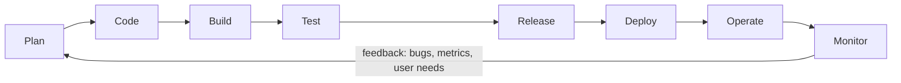
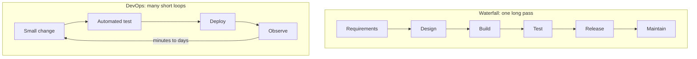

# L0.1 — Software Development Lifecycle (SDLC)

> **Level 0: What DevOps Actually Is** · Topic 1 of 13 · ⏱ ~2 hours · Difficulty: Beginner

## 1. What it is

The **Software Development Lifecycle (SDLC)** is the set of stages every piece of software passes through between
"someone has an idea" and "the idea is running in production and being looked after": **plan, design, build, test,
release, deploy, operate, monitor** — and then back to plan, because what you learn from running the software becomes
the next idea.

Teams have organised those stages in two broad ways. **Waterfall** does them once, in order, each stage finished and
signed off before the next starts. **Agile** (from the 2001 Agile Manifesto) does all of them over and over in small
slices — days or weeks long — so working software reaches users early and keeps improving. **DevOps** is the next step:
it takes the Agile loop and extends it past "code complete" so that deploying, operating and monitoring are part of the same
loop, owned by the same people, and automated wherever possible.

## 2. Why it matters in DevOps

DevOps is not a tool; it is the claim that **the shorter and more reliable your feedback loop, the better your software**.
Everything in the rest of this roadmap (CI/CD, IaC, observability, SRE) is a way of shortening or de-risking one segment of the loop.

- **Late feedback is expensive.** A bug found by a unit test in 30 seconds costs a retype. The same bug found by a customer
  three weeks later costs an incident, a hotfix, a postmortem and trust.
- **Big batches are risky.** Waterfall-style "release every six months" bundles thousands of changes. When the release breaks,
  nobody knows which change is guilty. Small, frequent releases make the cause obvious and the rollback small.
- **Handoffs hide work.** When developers "throw code over the wall" to an operations team, each side optimises for different
  goals (ship features vs. keep things stable) and nobody owns the whole outcome.
- **You are measured on the loop.** The four "DORA metrics" (from the DevOps Research and Assessment programme, summarised in the book
  *Accelerate*) are deployment frequency, lead time for changes, change failure rate and time to restore service. They measure the speed and stability of the loop.

## 3. Real-world system example

**Amazon and "you build it, you run it".** In a widely cited 2006 interview with ACM Queue, Amazon CTO Werner Vogels described
the principle that the team that builds a service also operates it, including carrying the pager. That collapses the
"build / run" handoff in the SDLC into one team and one feedback loop: if the service pages at 3 a.m., the people who can fix the
code are the ones woken up, so reliability gets designed in.

**Etsy, Netflix and Google** have all spoken publicly about deploying to production many times a day (or, for Netflix, relying on
automated deployment tooling such as Spinnaker) instead of in large scheduled releases. The common pattern: tiny changes,
automated tests, automated deploys, and strong monitoring so a bad change is spotted and reverted in minutes.

**The Linux kernel** is a non-company example of a mature SDLC: patches are proposed by email, reviewed by maintainers, tested
in the `linux-next` integration tree, released as release candidates (`-rc1`, `-rc2`...) on a roughly nine-to-ten-week rhythm, and bugs found
in the wild feed straight back into the next cycle.

## 4. Diagram

DevOps is usually drawn as an infinity loop: the left half is *Dev*, the right half is *Ops*, and there is no "done".



How the feedback loop compares between the two styles:



## 5. How it works

### The phases

| Phase | Question it answers | Typical outputs | Where DevOps touches it |
|-------|--------------------|-----------------|-------------------------|
| Plan | What problem are we solving? | tickets, user stories, priorities | Ops and security input on feasibility and risk |
| Design | How will it work? | diagrams, API contracts, ADRs | Design for failure, scaling, observability |
| Build (code) | Does the code exist? | commits, pull requests | Version control, trunk-based flow, code review |
| Test | Does it do what we meant? | unit, integration and end-to-end results | Automated in CI, see [CI/CD](02-ci-cd.md) |
| Release | Is this a versioned, shippable thing? | artifact, container image, release notes | Build once, promote the same artifact |
| Deploy | Is it running somewhere? | running service in an environment | Automated, repeatable, see [Deployment Strategies](07-deployment-strategies.md) |
| Operate | Is it running correctly? | uptime, capacity, on-call | Infrastructure as code, scaling, DR |
| Monitor | What is really happening? | metrics, logs, traces, alerts | See [Observability](10-observability.md) |

### Waterfall vs Agile vs DevOps

| | Waterfall | Agile (Scrum, Kanban) | DevOps |
|---|-----------|-----------------------|--------|
| Unit of work | The whole project | A sprint or a single card | A single small change |
| Release rhythm | Months to years | Every sprint (1-4 weeks) | On demand, often daily or more |
| Feedback arrives | After the release | After each sprint | After each commit, deploy and alert |
| Who deploys | Operations, after a handoff | Often still operations | The team, through an automated pipeline |
| Who is paged | Operations | Operations | The team that wrote it |
| Strength | Fixed-scope, regulated, hardware-bound work | Changing requirements | Fast, safe, repeatable delivery |
| Weakness | Late discovery of wrong requirements | Stops at "done" in the sprint | Needs automation and cultural change |

Waterfall is not "wrong": a satellite or pacemaker firmware has requirements that really are fixed and changes that really are costly.
The mistake is applying it to a web service that can be changed and rolled back in minutes.

### How DevOps shortens each feedback loop

| Loop | Slow version | Short version |
|------|-------------|---------------|
| Code to test result | QA tests the release branch next month | CI runs tests on every push (minutes) |
| Review to merge | Change board meets weekly | Pull request with automated checks (hours) |
| Merge to production | Manual runbook, maintenance window | Pipeline deploy (minutes) |
| Production to developer | Customer files a ticket | Alert and dashboard the team owns (seconds) |
| Failure to fix | Wait for the ops team | Rollback by pipeline, then fix forward |

## 6. Step-by-step guide

**Goal:** feel the difference between a long and a short feedback loop with a 5-minute local experiment.
**Prerequisites:** `git` and Node.js 18+ (`node --version`). No cloud, no cost. Works in any Linux/macOS shell or WSL2.

1. **Create a tiny "shop-api" module and a test.**
   ```bash
   mkdir -p ~/sdlc-demo && cd ~/sdlc-demo
   git init -q -b main
   git config user.email dev@example.com && git config user.name Dev
   cat > price.js <<'EOF'
   // shop-api: totals an order in cents
   exports.total = (items) => items.reduce((sum, i) => sum + i.cents * i.qty, 0);
   EOF
   cat > price.test.js <<'EOF'
   const test = require('node:test');
   const assert = require('node:assert');
   const { total } = require('./price');
   test('totals an order', () => {
     assert.strictEqual(total([{ cents: 500, qty: 2 }, { cents: 250, qty: 1 }]), 1250);
   });
   EOF
   node --test 2>&1 | grep -E '^# (pass|fail)'
   ```
   Expected: `# pass 1` and `# fail 0`.

2. **Make the test the first thing that runs on every commit.** A git `pre-commit` hook is the smallest possible "CI server": it gives feedback in under a second.
   ```bash
   cat > check.sh <<'EOF'
   #!/usr/bin/env bash
   set -euo pipefail
   echo "==> running tests"
   node --test
   EOF
   chmod +x check.sh
   printf '#!/usr/bin/env bash\nexec ./check.sh\n' > .git/hooks/pre-commit
   chmod +x .git/hooks/pre-commit
   git add . && git commit -m "feat: order total"
   ```
   You should see `==> running tests` and the TAP test output, followed by a successful commit.

3. **Introduce a bug and see how fast you learn about it.**
   ```bash
   sed -i.bak 's/i.cents \* i.qty/i.cents + i.qty/' price.js    # the "refactor" that breaks pricing
   time git commit -am "refactor: simplify total"
   echo "exit code: $?"
   ```
   The commit is **rejected** in well under a second with `753 !== 1250` in the output. The bug never leaves your laptop.
   (On macOS `sed -i.bak` works as written; `time` reports the loop length.)

4. **Compare with the "waterfall" version of the same bug.** Skip the hook for one commit and imagine what happens next:
   ```bash
   git commit --no-verify -am "refactor: simplify total"   # bypasses the check
   git log --oneline
   ```
   The wrong code is now in history. In a real team it would be merged, released next month, and found by a customer with a wrong invoice.
   The only difference between steps 3 and 4 is **where the feedback arrives**.

5. **Fix forward, small.** Revert the single guilty commit — easy precisely because the change was tiny.
   ```bash
   git revert --no-edit HEAD
   ./check.sh 2>&1 | grep -E '^# (pass|fail)'
   ```
   Expected: `# pass 1`, `# fail 0`.

6. **Map your loop.** Write the eight SDLC phases on paper and, next to each, write which command or file in this demo plays that part
   (plan = your commit message, build = `price.js`, test = `check.sh`, ...). Which phases have *nothing* in the demo? Those are the rest of this level.

## 7. Real-world scenario

*Illustrative, not a documented incident.* A team of eight ships `shop-api` quarterly. Each release is a 400-change branch merged
after a two-week "stabilisation" freeze, deployed on a Saturday night by a separate operations team following a 14-page runbook.
One Saturday the checkout endpoint starts returning `500` for orders over 100 items. Nobody knows which of the 400 changes did it;
bisecting takes six hours; the rollback also rolls back a security fix that had to ship. **Customers see the problem for most of a day.**

The team changes one thing at a time: tests run on every pull request, `main` is always deployable, the deploy becomes a pipeline
button, then a merge. A year later they deploy ten to twenty times a week. A similar bug now produces a failing alert within minutes
of a deploy, the guilty change is a 20-line diff, and `git revert` plus a pipeline run fixes it in under half an hour.
**Lesson:** the improvement was not heroics or new people; it was making the loop shorter and the batch smaller.

## 8. Common mistakes and best practices

**Don't**

- Equate "Agile" with "DevOps". Two-week sprints that still hand a release to operations are Agile, but not a shortened loop.
- Treat DevOps as a job title or a team that "does the deploys" — that rebuilds the wall you were removing.
- Measure only velocity (features shipped) and ignore stability (failures, time to restore).
- Skip the "operate and monitor" half: a deploy is not the finish line.
- Add automation on top of a broken process before simplifying the process.

**Do**

- Keep changes **small** and `main` always releasable.
- Make every phase **observable** (build time, test pass rate, deploy time, change failure rate).
- Shift feedback left: lint, tests and security checks before merge, not after release.
- Give teams ownership of their service end to end, including on-call.
- Use DORA's four metrics as a baseline and track the trend, not the absolute number.

## 9. Tasks

- [ ] **T1 — Run the feedback-loop experiment** *(≈20 min, beginner)*
  - **Goal:** see a bug caught at commit time instead of in production.
  - **Steps:**
    1. Follow steps 1-3 of the guide in a fresh directory.
    2. Note the time between "I made the mistake" and "I knew about it".
  - **Done when:** `git commit` fails with the `753 !== 1250` assertion and `git log` does not contain the broken commit.

- [ ] **T2 — Label the loop** *(≈30 min, beginner)*
  - **Goal:** connect the abstract phases to real artifacts.
  - **Steps:**
    1. Pick any repo you know (or `shop-api` from the guide).
    2. Create a table with the eight phases and, for each, the file, tool or person responsible today.
    3. Mark each phase manual, partly automated, or automated.
  - **Done when:** you have an 8-row table with at least three phases marked manual and a note on which one you would automate first.

- [ ] **T3 — Measure lead time from git history** *(≈30 min, intermediate)*
  - **Goal:** compute one DORA-style metric with a script.
  - **Steps:**
    1. In any repo with at least 10 commits run `git log --pretty='%h %ad %s' --date=short | head -20`.
    2. Count how many days passed between the first and last of those commits, and divide the number of commits by the days to get commits per day.
    3. Write one sentence on whether your repo's batch size is small or large.
  - **Done when:** you can state "commits per day" from the output and justify it in one sentence.

- [ ] **T4 — Add a second gate and break it** *(≈30 min, intermediate)*
  - **Goal:** extend the loop and watch it fail safely.
  - **Steps:**
    1. Add a `bash -n` or `node --check price.js` step to `check.sh` as a syntax gate.
    2. Introduce a syntax error in `price.js`.
    3. Try to commit, observe the failure, then fix it.
  - **Done when:** the commit is blocked by the new gate with a syntax error message, and succeeds after the fix.

- [ ] **T5 — Waterfall vs DevOps essay** *(≈30 min, intermediate)*
  - **Goal:** argue the trade-off like a senior engineer.
  - **Steps:**
    1. Pick two systems: one where waterfall is reasonable (for example embedded medical firmware) and one where it is not (a SaaS web app).
    2. For each, write 5 bullets covering cost of change, cost of failure, and ability to roll back.
  - **Done when:** your bullets explain *why* the same process is right for one and wrong for the other.

- [ ] **T6 — Prove it: draw and defend the loop** *(≈30 min, advanced)*
  - **Goal:** explain the SDLC and DevOps to someone new, from memory.
  - **Steps:**
    1. Without the guide, draw the DevOps loop and name the four DORA metrics.
    2. Pick one metric and name two practices from later levels of this roadmap that would improve it.
  - **Done when:** a teammate can restate the loop and the two practices from your explanation alone.

## 10. Self-check questions

1. Name the SDLC phases in order and say which ones DevOps adds responsibility for beyond "code complete".
2. Why are small, frequent releases usually safer than large, infrequent ones?
3. What is the difference between Agile and DevOps?
4. Give one situation in which waterfall is still a reasonable choice.
5. Which four metrics does DORA use to measure software delivery performance?

<details>
<summary>Answers</summary>

1. Plan, design, build, test, release, deploy, operate, monitor. DevOps adds ownership of deploy, operate and monitor to the development team and feeds the result back into planning.
2. The batch is small so the cause of a failure is obvious, rollback is cheap, and each release is a routine, practised event rather than a rare big one.
3. Agile organises *how development work is planned and delivered in iterations*; DevOps extends the loop through deployment, operations and monitoring, with automation and shared ownership.
4. When requirements are fixed and changes are physically or legally expensive: hardware, safety-critical or heavily regulated systems.
5. Deployment frequency, lead time for changes, change failure rate, and time to restore service.
</details>

## 11. Further reading

- *Accelerate* by Nicole Forsgren, Jez Humble and Gene Kim — the research behind the DORA metrics.
- *The Phoenix Project* (novel) and *The DevOps Handbook* by Gene Kim, Jez Humble, Patrick Debois and John Willis.
- The Agile Manifesto and its twelve principles (agilemanifesto.org).
- DORA research programme (dora.dev) — current State of DevOps reports.
- Next in this level: [CI/CD](02-ci-cd.md) automates the build-test-release half of this loop.

<!-- nav -->
---
[Level 0 index](README.md) · Next: [CI/CD](02-ci-cd.md) →
