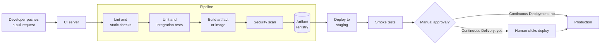
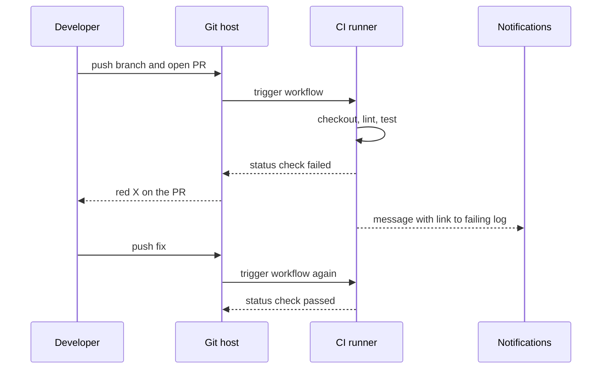

# L0.2 — CI/CD

> **Level 0: What DevOps Actually Is** · Topic 2 of 13 · ⏱ ~3 hours · Difficulty: Beginner

## 1. What it is

**Continuous Integration (CI)** means every developer merges small changes into a shared mainline (usually `main`) many times a day,
and every merge is automatically **built and tested** by a server. The point is to find out within minutes that your change
breaks someone else's, instead of discovering it during a painful "integration week".

**Continuous Delivery (CD)** extends CI so that every change that passes the automated checks produces a release-ready
artifact that *could* be deployed to production at the press of a button. **Continuous Deployment** (the other "CD") goes one step
further: if the checks pass, the change is deployed to production automatically, with no human button. The three terms are
often blurred; the table in section 5 separates them.

A **pipeline** is the automated assembly line that does this: a sequence of **stages** (lint, test, build, scan, deploy), each of which must pass before the next begins.

## 2. Why it matters in DevOps

- **Speed with safety.** A pipeline is how you ship ten times a day without ten times the risk: the same checks run, identically, on every change.
- **No "works on my machine".** The build happens on a clean, defined environment, not on a developer laptop with a lucky global install.
- **Repeatable releases.** If deploying requires someone to remember 14 manual steps, a Friday-evening deploy *will* eventually miss step 9.
- **Auditability.** The pipeline log answers "who deployed what, when, and which tests passed".
- **Everything else plugs into it.** Security scans ([DevSecOps](12-devsecops.md)), IaC applies ([Infrastructure as Code](03-infrastructure-as-code.md)) and deployment strategies ([Deployment Strategies](07-deployment-strategies.md)) all run as pipeline stages.
- Without CI, `main` is "usually broken"; without CD, releases are rare, scary and big, which brings you back to the problems in [SDLC](01-sdlc.md).

## 3. Real-world system example

**Kubernetes** runs a very large CI system for itself. Every pull request to `kubernetes/kubernetes` triggers automated jobs
through **Prow**, a CI/CD system the Kubernetes project built and open-sourced; results appear as status checks on the PR, and a PR cannot merge until
the required jobs pass. The project's test-results dashboard is **TestGrid**.

**GitHub** hosts the pattern for everyone else: **GitHub Actions** workflows live in `.github/workflows/*.yml` in the repository, run on
events such as `push` and `pull_request`, and post pass/fail checks on the PR. Combined with *branch protection* ("require status
checks before merging") the pipeline becomes a hard gate rather than a suggestion.

**Netflix** open-sourced **Spinnaker**, a continuous delivery platform that takes a built artifact and drives it through
environments using strategies such as red/black (blue/green) and canary, with automated analysis. Large organisations typically separate CI
("is this change good, and what artifact does it produce?") from CD ("how does this artifact reach production safely?").

## 4. Diagram

The classic pipeline, with the point where Delivery and Deployment differ:



What a failure looks like (fail fast, notify the author):



## 5. How it works

### CI vs Continuous Delivery vs Continuous Deployment

| | Continuous Integration | Continuous Delivery | Continuous Deployment |
|---|------------------------|---------------------|-----------------------|
| Trigger | Every push / PR | Every merge to `main` | Every merge to `main` |
| Automated up to | Build and test | A release-ready artifact deployed to a staging-like environment | Production |
| Production release | Not covered | Human decision (button, approval) | Automatic |
| Needs | Fast tests, shared mainline | CI plus deploy automation and strong test confidence | CD plus feature flags, canaries and monitoring |
| Risk control | Tests | Tests plus human judgement | Tests plus automated rollback and observability |

### Typical pipeline stages

| Stage | What happens | Fails the build when |
|-------|--------------|----------------------|
| Checkout | Fetch the exact commit | repo or credentials problem |
| Lint / static analysis | Style, type and bug-pattern checks | rule violation |
| Unit tests | Fast, isolated tests | any test fails |
| Integration tests | Service plus real database in a container | contract or wiring bug |
| Build | Compile and package: a binary, a tarball or a container image | build error |
| Scan | Dependency, image and secret scanning | vulnerabilities above policy |
| Publish | Push the artifact, tagged with the commit SHA, to a registry | registry/auth failure |
| Deploy | Roll out to staging, then production | health check fails |
| Verify | Smoke tests and post-deploy metrics | error rate rises |

### Principles worth memorising

1. **Build once, deploy many.** The artifact that passed the tests in CI is the same bytes that go to staging and production. Do not rebuild per environment.
2. **Keep `main` green.** A broken `main` is the team's top priority.
3. **Fail fast.** Cheap checks (lint) before expensive ones (end-to-end tests).
4. **Pipeline as code.** The pipeline definition is versioned alongside the application.
5. **Fast feedback.** Aim for CI results in roughly ten minutes or less; slow pipelines get bypassed.
6. **Same command locally and in CI.** Put the logic in a script or `make` target; the CI file only calls it.

## 6. Step-by-step guide

**Goal:** build a real 4-stage pipeline you can run locally, then wrap it in a GitHub Actions workflow.
**Prerequisites:** `git`, Node.js 18+ and (for step 6) a free GitHub account. No cost.

1. **Create a tiny project.**
   ```bash
   mkdir -p ~/ci-demo && cd ~/ci-demo
   git init -q -b main
   git config user.email dev@example.com && git config user.name Dev
   cat > price.js <<'EOF'
   exports.total = (items) => items.reduce((sum, i) => sum + i.cents * i.qty, 0);
   EOF
   cat > price.test.js <<'EOF'
   const test = require('node:test');
   const assert = require('node:assert');
   const { total } = require('./price');
   test('totals an order', () => {
     assert.strictEqual(total([{ cents: 500, qty: 2 }, { cents: 250, qty: 1 }]), 1250);
   });
   EOF
   ```

2. **Write the pipeline as one script (the logic).** Each stage runs only if the previous one succeeded because of `set -e`.
   ```bash
   cat > pipeline.sh <<'EOF'
   #!/usr/bin/env bash
   set -euo pipefail
   stage() { echo; echo "=== STAGE: $1 ==="; }

   stage lint
   node --check price.js && echo "syntax ok"

   stage test
   node --test 2>&1 | grep -E '^# (pass|fail)'

   stage build
   VERSION="$(git rev-parse --short HEAD)"
   mkdir -p dist
   tar -czf "dist/shop-api-${VERSION}.tgz" price.js
   ( cd dist && sha256sum "shop-api-${VERSION}.tgz" > "shop-api-${VERSION}.tgz.sha256" )
   ls -1 dist

   stage deploy-staging
   mkdir -p "$HOME/ci-demo-staging"
   tar -xzf "dist/shop-api-${VERSION}.tgz" -C "$HOME/ci-demo-staging"
   echo "deployed ${VERSION} to $HOME/ci-demo-staging"
   EOF
   chmod +x pipeline.sh
   printf 'dist/\n' > .gitignore
   git add . && git commit -qm "feat: order total and pipeline"
   ./pipeline.sh
   ```
   Expected output (the commit hash differs):
   ```text
   === STAGE: lint ===
   syntax ok

   === STAGE: test ===
   # pass 1
   # fail 0

   === STAGE: build ===
   shop-api-81c6170.tgz
   shop-api-81c6170.tgz.sha256

   === STAGE: deploy-staging ===
   deployed 81c6170 to /home/you/ci-demo-staging
   ```

3. **Watch the pipeline fail fast.** Break the code and re-run: later stages must not execute.
   ```bash
   sed -i.bak 's/i.cents \* i.qty/i.cents + i.qty/' price.js
   ./pipeline.sh; echo "exit code: $?"
   ```
   You should see `# fail 1`, **no** `STAGE: build`, and a non-zero exit code. Fix it with `git checkout price.js && rm price.js.bak`.

4. **Add the CI definition.** The workflow file only *calls* the script, so the same command works locally and in CI.
   ```bash
   mkdir -p .github/workflows
   cat > .github/workflows/ci.yml <<'EOF'
   name: ci
   on:
     push:
       branches: [main]
     pull_request:
   jobs:
     pipeline:
       runs-on: ubuntu-latest
       steps:
         - uses: actions/checkout@v4
         - uses: actions/setup-node@v4
           with:
             node-version: 22
         - name: Run the pipeline
           run: ./pipeline.sh
         - name: Keep the artifact
           uses: actions/upload-artifact@v4
           with:
             name: shop-api-build
             path: dist/
   EOF
   git add . && git commit -qm "ci: run pipeline on push and pull_request"
   ```

5. **Validate the YAML locally** before pushing (catches indentation mistakes):
   ```bash
   python3 -c "import yaml,sys; yaml.safe_load(open('.github/workflows/ci.yml')); print('yaml ok')" \
     || echo "install PyYAML (pip install pyyaml) or use an editor with YAML linting"
   ```

6. **Run it for real on GitHub.** Create an empty repo (for example `ci-demo`) on GitHub and push:
   ```bash
   git remote add origin git@github.com:<YOUR_USER>/ci-demo.git
   git push -u origin main
   ```
   Open the repo's **Actions** tab: the `ci` workflow should run and show a green check, with a `shop-api-build` artifact attached.
   Now open a pull request with a deliberately failing test and watch the red X appear on the PR.

7. **Make it Continuous *Delivery*.** Add a second job that deploys to an environment that requires approval (Settings, Environments, "Required reviewers"). Details are in [Level 3: Environments and Secrets](../level-03-git-and-github/12-environments-and-secrets.md);
   the full pipeline design is in [Level 5: Pipeline Design](../level-05-cicd/01-pipeline-design.md).

## 7. Real-world scenario

*Illustrative.* The `shop-api` team has tests, but they only run when someone remembers `npm test`. A developer merges a change to the
checkout code that works with their local Node 22 but uses an API missing from the production Node 18 image. Production crashes at start-up after a
Friday release. With CI, the same commit runs in a clean container pinned to the production Node version, the job turns red on the pull request, and merging is blocked by a required status check.
The team also adds the rule "build the image once in CI and deploy that exact image by digest". The next time a hotfix is needed, they deploy the already-tested image to staging, then production, instead of rebuilding.
**Lesson:** CI turned an environment-dependent surprise into a red check before merge; build-once removed a whole class of "it built differently" bugs.

## 8. Common mistakes and best practices

**Don't**

- Let `main` stay red, or merge with "I'll fix the test later".
- Rebuild the artifact separately for each environment.
- Put secrets in the workflow file or echo them into logs.
- Bake 40 minutes of end-to-end tests into every push; developers will route around the pipeline.
- Hide logic in click-ops CI settings that is not in version control.

**Do**

- Keep the pipeline definition in the repo and make the CI file a thin wrapper over a script or `make` target.
- Cache dependencies, run independent jobs in parallel, and run the slowest checks last.
- Tag artifacts with the commit SHA so any running version maps back to source.
- Require status checks via branch protection.
- Track pipeline duration and flakiness like any other production metric.

## 9. Tasks

- [ ] **T1 — Run the local pipeline** *(≈30 min, beginner)*
  - **Goal:** have a working four-stage pipeline on your machine.
  - **Steps:**
    1. Follow steps 1-2 of the guide.
    2. Run `./pipeline.sh` and read each stage's output.
  - **Done when:** the script ends with `deployed <hash> to ...` and `ls ~/ci-demo-staging` shows `price.js`.

- [ ] **T2 — Make it fail fast** *(≈20 min, beginner)*
  - **Goal:** prove later stages are skipped on failure.
  - **Steps:**
    1. Break `price.js` as in step 3.
    2. Run the pipeline and capture the exit code.
    3. Restore the file.
  - **Done when:** output contains `# fail 1`, does not contain `STAGE: build`, and the exit code is non-zero.

- [ ] **T3 — Wire it to GitHub Actions** *(≈45 min, intermediate)*
  - **Goal:** get a green check from a real hosted runner.
  - **Steps:**
    1. Complete steps 4-6 of the guide.
    2. Open the failing run's log for a deliberately broken PR and find the failing line.
  - **Done when:** the Actions tab shows one green run on `main` and one red run on a PR, plus the uploaded `shop-api-build` artifact.

- [ ] **T4 — Add a gate: lint plus a version stamp** *(≈30 min, intermediate)*
  - **Goal:** extend the pipeline.
  - **Steps:**
    1. Add a stage that fails if any `.js` file contains the string `console.log` (use `grep -rn --include='*.js' 'console.log' . && exit 1 || true` as a starting point and adjust).
    2. Add a stage that writes a `dist/VERSION` file containing the commit SHA.
  - **Done when:** adding a `console.log` line makes the pipeline fail, and `dist/VERSION` matches `git rev-parse --short HEAD`.

- [ ] **T5 — Delivery vs Deployment on paper** *(≈30 min, intermediate)*
  - **Goal:** pick the right model for a given system.
  - **Steps:**
    1. For three systems (a banking mobile app, an internal wiki, a public marketing site) say whether you would choose Continuous Delivery or Continuous Deployment.
    2. For each, list the one safety mechanism you would require first (feature flags, canary, approvals, automated rollback).
  - **Done when:** each choice has a justification that references risk of failure and speed of rollback.

- [ ] **T6 — Prove it: pipeline from a blank page** *(≈45 min, advanced)*
  - **Goal:** produce the pipeline without the guide.
  - **Steps:**
    1. In a new directory write a project, tests, `pipeline.sh` and a CI workflow from memory.
    2. Add a checksum file next to the artifact and a final stage that verifies it with `sha256sum -c`.
    3. Explain "build once, deploy many" using your own pipeline.
  - **Done when:** your pipeline runs green, fails on a broken test, and you can explain which stage a security scan would add.

## 10. Self-check questions

1. What is the difference between Continuous Delivery and Continuous Deployment?
2. Why does "build once, deploy many" matter?
3. A pipeline takes 55 minutes and developers have started merging without waiting for it. What do you do?
4. Why should the CI configuration call a script instead of containing all the logic?
5. What makes a status check a real gate rather than advice?

<details>
<summary>Answers</summary>

1. In Delivery every passing change is releasable but a human triggers production; in Deployment passing changes go to production automatically.
2. Rebuilding for each environment can produce different bytes; deploying the same tested artifact means production runs exactly what was tested.
3. Treat it as a production problem: profile stages, parallelise, cache, move slow end-to-end tests to a later or nightly stage, keep a fast required subset, and re-enforce required checks.
4. The same command works on a laptop and in CI, the logic is testable and portable between CI vendors, and the CI file stays simple.
5. Branch protection with required status checks, so a red pipeline physically blocks merging.
</details>

## 11. Further reading

- *Continuous Delivery* by Jez Humble and David Farley — the foundational book.
- GitHub Actions documentation (docs.github.com/actions) — workflow syntax and events.
- Kubernetes project docs on Prow and TestGrid (kubernetes.io and the `kubernetes/test-infra` repository).
- Spinnaker documentation (spinnaker.io).
- Deep dive in this roadmap: [Level 5: Designing a CI/CD Pipeline End to End](../level-05-cicd/01-pipeline-design.md).

<!-- nav -->
---
← Previous: [Software Development Lifecycle (SDLC)](01-sdlc.md) · [Level 0 index](README.md) · Next: [Infrastructure as Code](03-infrastructure-as-code.md) →
