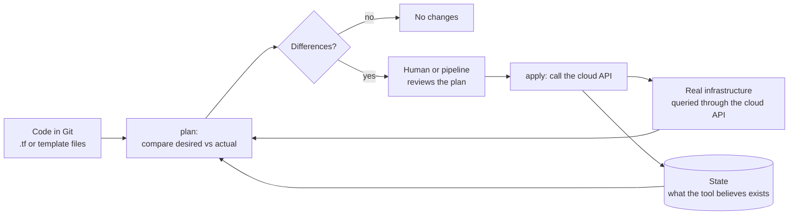
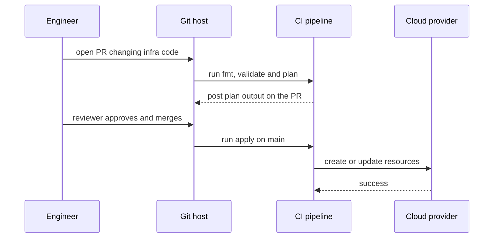

# L0.3 — Infrastructure as Code

> **Level 0: What DevOps Actually Is** · Topic 3 of 13 · ⏱ ~3 hours · Difficulty: Beginner

## 1. What it is

**Infrastructure as Code (IaC)** means describing servers, networks, databases, load balancers and permissions in **text files**
that live in version control, and using a tool to create and change the real infrastructure from those files — instead of clicking
through a cloud console or typing one-off commands over SSH.

IaC tools come in two styles. **Imperative** code lists the *steps* ("create a bucket, then attach a policy"). **Declarative** code
describes the *end state* ("a bucket named `shop-assets` exists with this policy") and lets the tool work out the steps by comparing
what you asked for with what currently exists. Most modern tools — **Terraform**, **AWS CloudFormation**, **Kubernetes manifests** — are declarative.

## 2. Why it matters in DevOps

- **Reproducible environments.** Staging and production are built from the same code, so "it works in staging" means something.
- **Review and history.** An infrastructure change becomes a pull request: reviewed, tested, and recorded with an author and a reason in `git log`. The 3 a.m. question "who changed the firewall?" has an answer.
- **Disaster recovery.** If a region is lost you rebuild from code instead of from someone's memory (see [Disaster Recovery](09-disaster-recovery.md)).
- **Speed and consistency.** A new environment is a command, not a two-week ticket. Manual "snowflake" environments drift apart and nobody can recreate them.
- **Foundation for everything else.** CI/CD can deploy infrastructure, [immutable infrastructure](05-immutable-infrastructure.md) needs images and servers built from code, and platform teams expose IaC as self-service ([Platform Engineering](13-platform-engineering.md)).

## 3. Real-world system example

**AWS CloudFormation** is Amazon's own IaC service. You write a template (JSON or YAML) describing resources; CloudFormation creates a **stack**,
tracks every resource in it, and can preview modifications with **change sets** before applying. It is declarative: update the template and CloudFormation computes the difference.

**Terraform** (HashiCorp) is the most widely used multi-cloud IaC tool. A project declares *providers* (AWS, Google Cloud, Azure, Cloudflare, GitHub, Kubernetes
and thousands more are published in the public Terraform Registry) and *resources*. Its workflow is `terraform plan` (show the diff) then `terraform apply`,
and it keeps a **state** file mapping your code to real resource IDs. In 2023 HashiCorp changed Terraform's licence from open source to the Business Source Licence, and the community forked the last open-source version as
**OpenTofu** under the Linux Foundation; the two share the same core language and workflow for most beginner use.

**Kubernetes** itself is declarative infrastructure: you submit YAML describing the desired number of replicas, and controllers continuously
work to make reality match it. That "desired state plus reconciliation" idea is the same one Terraform applies at plan/apply time.

## 4. Diagram

How a declarative tool turns code into reality:



IaC in a team workflow:



## 5. How it works

### Imperative vs declarative

| | Imperative | Declarative |
|---|-----------|-------------|
| You write | The steps | The desired end state |
| Run it twice | May fail or duplicate things | Second run changes nothing |
| Drift (someone edits by hand) | Unnoticed until it breaks | Next plan shows the difference |
| Examples | Bash scripts using `aws` CLI, ad-hoc `kubectl run` | Terraform, CloudFormation, Kubernetes YAML |
| Good for | One-off tasks, glue | Anything you need to maintain over time |

### Common tools

| Tool | Language | Notes |
|------|----------|-------|
| Terraform / OpenTofu | HCL (HashiCorp Configuration Language) | Multi-cloud, plan/apply workflow, state file |
| AWS CloudFormation | YAML / JSON | AWS only, stacks and change sets, AWS manages the state |
| AWS CDK, Pulumi | TypeScript, Python, Go... | Real programming languages that generate the declarative plan |
| Azure Bicep | Bicep | Azure native |
| Kubernetes manifests, Helm | YAML | Declarative desired state for cluster workloads |
| Ansible | YAML playbooks | Mostly [configuration management](04-configuration-management.md), also provisioning |

### The core vocabulary

- **Provider:** plugin that talks to one platform's API.
- **Resource:** one thing to create (a VM, a bucket, a DNS record).
- **State:** the tool's record of which real resource each declaration maps to. Treat it as sensitive and store it remotely with locking.
- **Plan:** the computed diff. **Apply:** carrying it out.
- **Drift:** the real world no longer matches the code (a console click, an autoscaler, a hotfix).
- **Module:** a reusable bundle of resources (for example "a VPC with three subnets").

Full detail lives in [Level 7: Terraform and IaC](../level-07-terraform-iac/01-providers-and-resources.md).

## 6. Step-by-step guide

**Goal:** (A) feel why declarative beats imperative using a 15-line shell "mini-Terraform", then (B) run real Terraform against the harmless `local` provider.
**Prerequisites:** a Linux/macOS shell. Part B needs Terraform or OpenTofu (`terraform version`); skip it if you cannot install either. **Cost: none** (nothing touches a cloud).

### Part A — a mini declarative tool in shell

The "cloud" is just the directory `fake-cloud/`; each sub-directory is a "bucket".

1. **Set up and try the imperative way.**
   ```bash
   mkdir -p ~/iac-demo && cd ~/iac-demo && mkdir -p fake-cloud
   cat > imperative.sh <<'EOF'
   #!/usr/bin/env bash
   set -e
   mkdir fake-cloud/shop-assets
   mkdir fake-cloud/shop-logs
   echo "created"
   EOF
   chmod +x imperative.sh
   ./imperative.sh
   ./imperative.sh; echo "exit code: $?"
   ```
   The first run prints `created`. The second fails with `mkdir: cannot create directory 'fake-cloud/shop-assets': File exists` and exit code `1`.
   An imperative script describes *how*, so it only works from one starting point.

2. **Write the declarative version: desired state in a file, a script that computes the difference.**
   ```bash
   rm -rf fake-cloud && mkdir fake-cloud
   cat > desired.txt <<'EOF'
   # one resource name per line
   shop-assets
   shop-logs
   EOF
   cat > apply.sh <<'EOF'
   #!/usr/bin/env bash
   set -euo pipefail
   DESIRED="${1:-desired.txt}"
   CLOUD=fake-cloud
   mkdir -p "$CLOUD"

   to_create()  { comm -13 <(ls "$CLOUD" | sort) <(grep -v '^#' "$DESIRED" | sort); }
   to_destroy() { comm -23 <(ls "$CLOUD" | sort) <(grep -v '^#' "$DESIRED" | sort); }

   create=$(to_create); destroy=$(to_destroy)
   if [ -z "$create$destroy" ]; then echo "No changes. Infrastructure matches desired state."; exit 0; fi

   echo "Plan:"
   for r in $create;  do echo "  + create  $r"; done
   for r in $destroy; do echo "  - destroy $r"; done

   [ "${APPLY:-no}" = "yes" ] || { echo "(plan only: re-run with APPLY=yes to apply)"; exit 0; }
   for r in $create;  do mkdir "$CLOUD/$r"; done
   for r in $destroy; do rmdir "$CLOUD/$r"; done
   echo "Apply complete."
   EOF
   chmod +x apply.sh
   ./apply.sh
   ```
   Expected: a plan showing `+ create shop-assets` and `+ create shop-logs`, and "plan only".

3. **Apply, then apply again.**
   ```bash
   APPLY=yes ./apply.sh
   ./apply.sh
   ```
   First prints `Apply complete.`; the second prints `No changes. Infrastructure matches desired state.` That second line is **idempotency** — running it again is safe.

4. **Change the desired state: add one resource.**
   ```bash
   echo "shop-backups" >> desired.txt
   ./apply.sh                # plan: + create shop-backups only
   APPLY=yes ./apply.sh
   ```

5. **Simulate drift: someone deletes a resource by hand.**
   ```bash
   rmdir fake-cloud/shop-logs
   ./apply.sh
   ```
   The plan shows `+ create shop-logs`: the tool noticed the real world no longer matched the code. Apply it to heal the drift.

6. **Simulate an unmanaged change: someone creates something outside the code.**
   ```bash
   mkdir fake-cloud/mystery-bucket
   ./apply.sh
   ```
   Expected `- destroy mystery-bucket`. Real tools differ here (Terraform ignores resources it does not manage; this toy treats desired state as the whole truth), which is why real tools keep a state file.

### Part B — the same idea with real Terraform

7. **Write a configuration using the `local` provider** (it manages files on your disk).
   ```bash
   mkdir -p ~/tf-demo && cd ~/tf-demo
   cat > main.tf <<'EOF'
   terraform {
     required_providers {
       local = {
         source  = "hashicorp/local"
         version = "~> 2.5"
       }
     }
   }

   variable "service_name" {
     type    = string
     default = "shop-api"
   }

   resource "local_file" "motd" {
     filename = "${path.module}/out/motd.txt"
     content  = "Welcome to ${var.service_name}\n"
   }
   EOF
   terraform init
   terraform plan
   ```
   The plan ends with a line similar to `Plan: 1 to add, 0 to change, 0 to destroy.`

8. **Apply, re-plan, change, and drift-check.**
   ```bash
   terraform apply -auto-approve
   cat out/motd.txt                     # Welcome to shop-api
   terraform plan                       # No changes. Your infrastructure matches the configuration.
   echo "hacked by hand" > out/motd.txt
   terraform plan                       # shows the file will be replaced: drift detected
   terraform apply -auto-approve        # the code wins
   cat out/motd.txt
   ```

9. **Clean up.**
   ```bash
   terraform destroy -auto-approve
   cd ~ && rm -rf ~/tf-demo ~/iac-demo
   ```

### Reference: the same bucket in CloudFormation (read only, do not run without a billing alarm)

```yaml
AWSTemplateFormatVersion: "2010-09-09"
Resources:
  AssetsBucket:
    Type: AWS::S3::Bucket
    Properties:
      BucketName: shop-assets-example-12345   # bucket names are globally unique
      VersioningConfiguration:
        Status: Enabled
```

## 7. Real-world scenario

*Illustrative.* An engineer opens the AWS console during an incident and widens a security group to `0.0.0.0/0` on port 5432 "just to test a
connection", intending to revert it. They forget. Three months later a routine IaC pipeline runs `terraform plan` on a schedule and the plan shows
**one change: security group rule will be removed**. The reviewer investigates and finds the rule had been added by hand and had left the production database open to the internet.
The team applies the plan (closing it), adds an alert for console-made security-group changes, and records the incident in the repo's docs.
**Lesson:** because the desired state is in version control, drift is a visible diff rather than an invisible risk, and the fix is the same workflow as any other change.

## 8. Common mistakes and best practices

**Don't**

- Edit infrastructure in the console "just this once" and not update the code.
- Commit state files or secrets to Git; state often contains sensitive values.
- Apply from a laptop with no review for production.
- Put everything in one giant file/state; a mistake then has a huge blast radius.
- Run `apply` on a plan you have not read.

**Do**

- Store state remotely with locking (S3 with native locking or equivalent, see [Level 7: State and Remote Backends](../level-07-terraform-iac/04-state-and-remote-backends.md)).
- Run `fmt`, `validate` and `plan` in CI on every pull request and apply only from `main`.
- Pin provider and module versions.
- Split by environment and by lifecycle (network separate from application).
- Schedule drift detection and treat unexpected diffs as incidents.

## 9. Tasks

- [ ] **T1 — Run the mini-Terraform** *(≈30 min, beginner)*
  - **Goal:** see plan, apply and no-op in one tool.
  - **Steps:**
    1. Complete Part A steps 1-3.
  - **Done when:** the second `./apply.sh` prints `No changes. Infrastructure matches desired state.` and `ls fake-cloud` lists both directories.

- [ ] **T2 — Heal drift** *(≈20 min, beginner)*
  - **Goal:** show that declarative tools detect and fix manual changes.
  - **Steps:**
    1. Delete one directory in `fake-cloud/` by hand.
    2. Run `./apply.sh` and read the plan, then apply.
  - **Done when:** the plan names exactly the missing resource and after apply `ls fake-cloud` is complete again.

- [ ] **T3 — Extend the tool** *(≈40 min, intermediate)*
  - **Goal:** add a feature to the toy tool.
  - **Steps:**
    1. Extend `desired.txt` lines to `name size` (for example `shop-assets 10`) and store the size in a file `fake-cloud/<name>/size`.
    2. Make the plan show `~ update shop-assets (size 10 -> 20)` when the size differs, and apply it.
  - **Done when:** changing a size in `desired.txt` produces an `update` line in the plan and the file on disk changes only after `APPLY=yes`.

- [ ] **T4 — Real Terraform or OpenTofu** *(≈45 min, intermediate)*
  - **Goal:** use a real plan/apply cycle on the `local` provider.
  - **Steps:**
    1. Complete Part B steps 7-9.
    2. Add a second `local_file` resource that writes the service name to `out/name.txt`, then plan and apply.
  - **Done when:** `terraform plan` shows `1 to add` for the new file only, and `terraform plan` after apply shows `No changes`.

- [ ] **T5 — Break it: state loss** *(≈30 min, intermediate)*
  - **Goal:** understand why state matters.
  - **Steps:**
    1. After an apply, rename `terraform.tfstate` to `terraform.tfstate.bak`.
    2. Run `terraform plan` and read it.
    3. Restore the state file and confirm the plan is clean again.
  - **Done when:** you can explain why, without state, Terraform wanted to create a resource that already exists.

- [ ] **T6 — Prove it: explain declarative vs imperative** *(≈30 min, advanced)*
  - **Goal:** teach the concept back.
  - **Steps:**
    1. Without the guide, write an imperative script and a declarative equivalent for "ensure directory `/tmp/x` exists with mode 0750".
    2. Run each twice and record the outputs.
    3. Write 3 sentences on which you would trust to run every hour from cron.
  - **Done when:** the declarative version succeeds silently twice while the imperative one fails or duplicates, and your explanation names idempotency.

## 10. Self-check questions

1. What is the difference between declarative and imperative IaC?
2. What does a Terraform state file contain, and why must it be protected?
3. What is drift and how do you detect it?
4. Why put infrastructure code through pull requests?
5. How does CloudFormation differ from Terraform in where state lives?

<details>
<summary>Answers</summary>

1. Imperative describes the steps; declarative describes the end state and the tool calculates the steps.
2. The mapping from your resources to real resource IDs and their attributes, which can include secrets; losing it makes the tool forget what it manages, leaking it exposes sensitive values.
3. Drift is real infrastructure diverging from code; `terraform plan` (ideally on a schedule in CI) or CloudFormation drift detection shows it.
4. Review, tests (`plan`), history, and a single audited path to production.
5. CloudFormation state is managed by AWS inside the stack; Terraform keeps its own state file that you must store, lock and secure.
</details>

## 11. Further reading

- Terraform documentation (developer.hashicorp.com/terraform) and OpenTofu documentation (opentofu.org).
- AWS CloudFormation User Guide (docs.aws.amazon.com).
- *Terraform: Up and Running* by Yevgeniy Brikman.
- *Infrastructure as Code* by Kief Morris.
- Deep dive: [Level 7: Providers and Resources](../level-07-terraform-iac/01-providers-and-resources.md); related: [Infrastructure Automation](06-infrastructure-automation.md).

<!-- nav -->
---
← Previous: [CI/CD](02-ci-cd.md) · [Level 0 index](README.md) · Next: [Configuration Management](04-configuration-management.md) →
