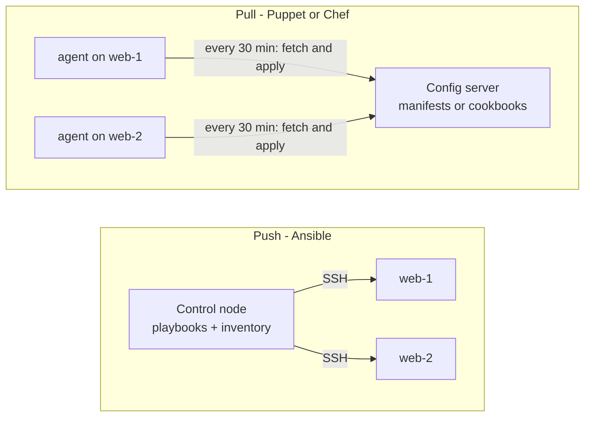
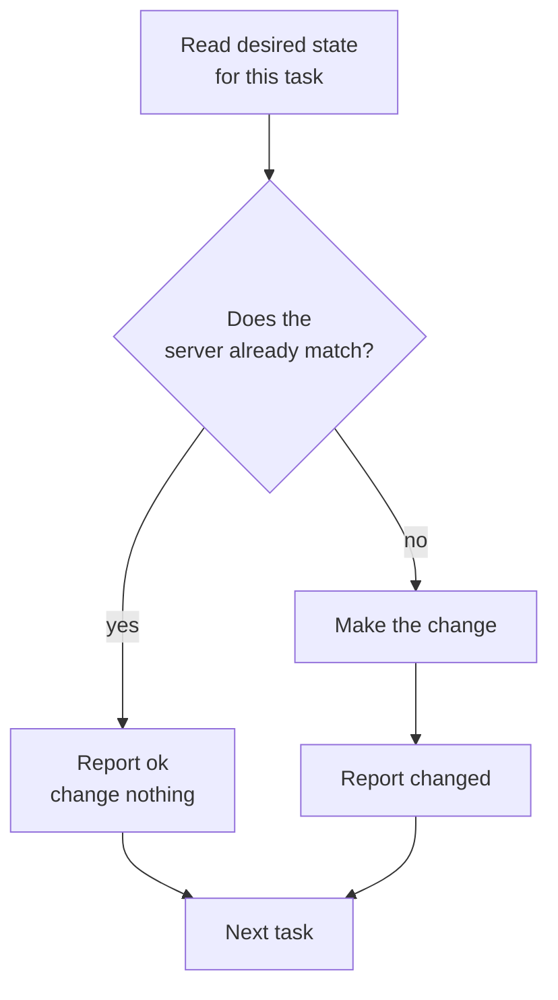

# L0.4 — Configuration Management

> **Level 0: What DevOps Actually Is** · Topic 4 of 13 · ⏱ ~3 hours · Difficulty: Beginner

## 1. What it is

**Configuration management (CM)** is the practice of describing what a server should look like *inside* — which packages are installed,
which config files exist with which contents and permissions, which services are running, which users exist — in code, and having a tool
make every server match that description.

Where [Infrastructure as Code](03-infrastructure-as-code.md) is mostly about **creating** machines and cloud resources, configuration management is about
**what is on them**. The best-known tools are **Ansible**, **Chef**, **Puppet** and **SaltStack**. They share three ideas:

- **Desired state:** you declare "package `nginx` is installed, service `nginx` is running", not "run `apt install nginx`".
- **Idempotency:** applying the same configuration twice produces the same result as applying it once — the second run changes nothing.
- **Convergence:** whatever state the server started in, running the tool brings it to the desired state.

## 2. Why it matters in DevOps

- **Servers drift.** Someone hot-fixes `nginx.conf` at 2 a.m. on server 7 of 20. Six months later server 7 behaves differently and nobody knows why.
- **Manual setup does not scale.** Following a wiki page on 200 machines produces 200 slightly different machines.
- **Audit and security.** CM can prove "SSH root login is disabled on every host" and re-enforce it automatically.
- **Recovery.** A replacement server is rebuilt from the same code in minutes.
- **It teaches idempotency**, the property every safe automation needs: re-running after a partial failure must not make things worse. The same idea appears in Terraform, Kubernetes controllers and database migrations.
- Today much configuration happens at image-build time instead; see [Immutable Infrastructure](05-immutable-infrastructure.md) for when you stop configuring live servers at all.

## 3. Real-world system example

**Ansible** (created by Michael DeHaan, now maintained by Red Hat) is agentless: the control machine connects to servers over SSH, runs small modules, and
reports each task as `ok`, `changed` or `failed`. Teams commonly use it to bootstrap fleets of Linux hosts, patch them and configure applications.
Core modules such as `apt`, `copy`, `file` and `service` are designed to be idempotent: they check current state before acting and report `changed` only when they changed something.

**Puppet** (Puppet Labs) and **Chef** (Chef Software, now part of Progress) are agent-based, "pull" models: an agent on each node periodically fetches its
catalogue/recipes from a server, compares with the node, and corrects drift. Both have a long track record in large fleets, and companies such as Meta (Facebook) have spoken publicly about using Chef to manage very large server populations.

**Cloud images** use a lighter form of the same idea: `cloud-init` on AWS, Azure and Google Cloud instances reads user data at first boot to create users, write files and run commands — a "configure once, at birth" model.

## 4. Diagram

Push model (Ansible) and pull model (Puppet/Chef) side by side:



What happens on each run (convergence):



## 5. How it works

### Tool comparison

| | Ansible | Puppet | Chef | Salt |
|---|---------|--------|------|------|
| Language | YAML playbooks (Jinja2 templates) | Puppet DSL (declarative) | Ruby DSL (recipes, cookbooks) | YAML states |
| Agent needed | No (SSH) | Yes (usually) | Yes (usually) | Yes (or SSH) |
| Model | Push | Pull | Pull (or push with `knife`) | Both |
| Learning curve | Lowest | Medium | Medium-high (Ruby) | Medium |
| Typical use | Ad-hoc, bootstrap, app deploy, network gear | Large long-lived fleets with compliance | Same | Event-driven, remote execution |

### Idempotency in practice

| Non-idempotent (imperative) | Idempotent (desired state) |
|-----------------------------|----------------------------|
| `echo "PORT=3000" >> app.env` (adds a line every run) | `lineinfile: line="PORT=3000"` (adds it only if missing) |
| `useradd deploy` (fails on the second run) | `user: name=deploy state=present` |
| `apt-get install nginx` then `systemctl start nginx` | `package: state=present`, `service: state=started enabled=true` |
| `mkdir /opt/app` (errors if present) | `file: path=/opt/app state=directory` |

Rules for writing idempotent automation:

1. **Check, then change.** Test the current state; act only when it differs.
2. **Report truthfully.** Say `changed` only when you changed something. A "changed" count of 0 on a re-run is the success criterion.
3. **Avoid raw commands** (`shell`, `command`) when a purpose-built module exists; if you must use one, add `creates:` / `when:` guards.
4. **Don't let two resources own the same thing.** If task A writes the whole file and task B appends a line, they will undo each other forever ("flapping").

### Ansible vocabulary

- **Inventory:** the list of hosts and groups. **Playbook:** YAML that maps hosts to tasks. **Task:** one call to a module. **Module:** the unit of work (`apt`, `copy`, `lineinfile`, `service`).
- **Handler:** a task that runs only when notified by a change (for example "reload nginx" after the config file changed).
- **Check mode:** `--check --diff` shows what *would* change without changing it.

## 6. Step-by-step guide

**Goal:** build a tiny configuration-management tool in shell, prove it is idempotent and that it heals drift, then see the same thing in Ansible.
**Prerequisites:** a Linux/macOS shell (the `stat -c` flag is GNU; on macOS use `stat -f %Lp` or run it in a container). Part B needs Ansible (`pip install ansible-core`). **Cost: none**; everything happens under a local directory.

### Part A — idempotent shell building blocks

1. **Create the helper library.** Each function checks state, changes only if needed, and reports `ok` or `changed`.
   ```bash
   mkdir -p ~/cm-demo && cd ~/cm-demo
   cat > ensure.sh <<'EOF'
   #!/usr/bin/env bash
   CHANGED=0
   report() { echo "[$1] $2"; [ "$1" = "changed" ] && CHANGED=$((CHANGED+1)); true; }

   ensure_dir() {            # ensure_dir PATH MODE
     if [ -d "$1" ] && [ "$(stat -c %a "$1")" = "$2" ]; then report ok "dir $1"; return; fi
     mkdir -p "$1" && chmod "$2" "$1" && report changed "dir $1 (mode $2)"
   }
   ensure_line() {           # ensure_line FILE LINE
     touch "$1"
     if grep -qxF -- "$2" "$1"; then report ok "line in $1: $2"
     else echo "$2" >> "$1"; report changed "line in $1: $2"; fi
   }
   ensure_file() {           # ensure_file DEST CONTENT  (owns the WHOLE file)
     if [ -f "$1" ] && [ "$(cat "$1")" = "$2" ]; then report ok "file $1"
     else printf '%s\n' "$2" > "$1"; report changed "file $1"; fi
   }
   EOF
   ```

2. **Describe the desired state of a `shop-api` host** (under `server/`, standing in for `/`).
   ```bash
   cat > configure.sh <<'EOF'
   #!/usr/bin/env bash
   set -euo pipefail
   source ./ensure.sh
   ROOT="${ROOT:-server}"
   ensure_dir  "$ROOT/etc/shop-api" 750
   ensure_dir  "$ROOT/var/log/shop-api" 755
   ensure_file "$ROOT/etc/shop-api/app.env" "PORT=3000"
   ensure_line "$ROOT/etc/shop-api/allowed_hosts" "example.com"
   ensure_line "$ROOT/etc/shop-api/allowed_hosts" "www.example.com"
   echo "summary: $CHANGED changed"
   EOF
   chmod +x configure.sh
   ./configure.sh
   ```
   Expected: five `[changed]` lines and `summary: 5 changed`.

3. **Run it again.** This is the idempotency test.
   ```bash
   ./configure.sh
   ```
   Expected: five `[ok]` lines and `summary: 0 changed`.

4. **Cause drift, then converge.** Simulate a 2 a.m. hand edit and a bad permission change:
   ```bash
   echo "PORT=9999" > server/etc/shop-api/app.env
   chmod 777 server/etc/shop-api
   ./configure.sh
   cat server/etc/shop-api/app.env
   ```
   Expected: `[changed] dir server/etc/shop-api (mode 750)` and `[changed] file ...app.env`, the rest `ok`, and `PORT=3000` restored.

5. **See "flapping" — two resources fighting over one file.** This is the classic non-idempotent bug.
   ```bash
   cat > flap.sh <<'EOF'
   source ./ensure.sh
   ensure_file server/f "A=1"
   ensure_line server/f "B=2"
   echo "changed=$CHANGED"
   EOF
   bash flap.sh; bash flap.sh
   ```
   Both runs print `changed=2`: the file is rewritten and the line re-appended every time, so the tool can never converge. Fix it by making one resource own the file (`ensure_file server/f $'A=1\nB=2'`).

### Part B — the same thing in Ansible

6. **Install Ansible and write a playbook** (`localhost`, no SSH needed).
   ```bash
   python3 -m venv ~/cm-demo/venv && . ~/cm-demo/venv/bin/activate
   pip install ansible-core
   cd ~/cm-demo
   cat > playbook.yml <<'EOF'
   - name: Configure shop-api host (local demo)
     hosts: localhost
     connection: local
     gather_facts: false
     vars:
       root: "{{ lookup('env', 'HOME') }}/cm-demo/ansible-server"
     tasks:
       - name: Config directory exists
         ansible.builtin.file:
           path: "{{ root }}/etc/shop-api"
           state: directory
           mode: "0750"

       - name: App environment file
         ansible.builtin.copy:
           dest: "{{ root }}/etc/shop-api/app.env"
           content: "PORT=3000\n"
           mode: "0640"

       - name: Allowed host is listed
         ansible.builtin.lineinfile:
           path: "{{ root }}/etc/shop-api/allowed_hosts"
           line: example.com
           create: true
           mode: "0640"
   EOF
   ansible-playbook -i localhost, playbook.yml
   ```
   The recap at the end looks similar to `localhost : ok=3 changed=3 unreachable=0 failed=0`.

7. **Re-run, then preview a change in check mode.**
   ```bash
   ansible-playbook -i localhost, playbook.yml        # changed=0
   echo "PORT=9999" > ~/cm-demo/ansible-server/etc/shop-api/app.env
   ansible-playbook -i localhost, playbook.yml --check --diff
   ```
   The re-run recap shows `changed=0`. The check-mode run shows a diff `-PORT=9999 / +PORT=3000` and `changed=1` without modifying the file. Drop `--check` to apply.

8. **Clean up.**
   ```bash
   deactivate; cd ~ && rm -rf ~/cm-demo
   ```

## 7. Real-world scenario

*Illustrative.* The `shop-api` team runs twelve VMs. A critical OpenSSH vulnerability is announced and a security engineer needs `PermitRootLogin no` everywhere, today.
Without CM they SSH into twelve machines, and edit twelve files; two hosts are missed, and one has a typo that locks everyone out until console access is arranged.
With a playbook containing `lineinfile: regexp='^#?PermitRootLogin' line='PermitRootLogin no'` and a handler that reloads `sshd` only if the file changed, they run
`--check --diff` first (the diff shows ten hosts will change, two already compliant), apply to one canary host, then the rest. The recap says `changed=10`, and a second run says `changed=0`.
**Lesson:** idempotent, previewable change turns an emergency fleet-wide edit into a routine, verifiable operation.

## 8. Common mistakes and best practices

**Don't**

- Use `shell`/`command` for everything — you throw away idempotency and `--check` support.
- Make manual edits on managed servers; the next run will revert them, or worse, nothing will and they become invisible drift.
- Let two tasks own the same file or setting.
- Store plaintext secrets in playbooks or repos (use Ansible Vault or a secret manager, see [DevSecOps](12-devsecops.md)).
- Test only by running against production.

**Do**

- Make `changed=0` on a second run your acceptance test.
- Use `--check --diff` to preview, and test roles on a throwaway VM or container first.
- Keep roles small and single-purpose; parameterise with variables.
- Run CM on a schedule (or in CI) to detect drift.
- Prefer baking stable configuration into images when you can: [Immutable Infrastructure](05-immutable-infrastructure.md).

## 9. Tasks

- [ ] **T1 — Prove idempotency** *(≈25 min, beginner)*
  - **Goal:** see a second run change nothing.
  - **Steps:**
    1. Complete Part A steps 1-3.
  - **Done when:** the first run reports `summary: 5 changed` and the second reports `summary: 0 changed`.

- [ ] **T2 — Heal drift** *(≈20 min, beginner)*
  - **Goal:** show convergence from a bad state.
  - **Steps:**
    1. Delete `server/var/log/shop-api` and change the mode of `server/etc/shop-api` to `700`.
    2. Run `./configure.sh`.
  - **Done when:** only the two affected resources report `[changed]` and a following run reports `0 changed`.

- [ ] **T3 — Add a new resource type** *(≈40 min, intermediate)*
  - **Goal:** extend the library correctly.
  - **Steps:**
    1. Write `ensure_symlink LINK TARGET` that does nothing when the link already points at the target (`readlink`) and reports truthfully.
    2. Use it to link `server/opt/shop-api/current` to `releases/v1`.
    3. Run twice.
  - **Done when:** first run reports `changed`, the second `ok`, and changing the target to `releases/v2` reports `changed` once.

- [ ] **T4 — Fix the flapping bug** *(≈20 min, intermediate)*
  - **Goal:** diagnose a non-idempotent configuration.
  - **Steps:**
    1. Reproduce `flap.sh` and confirm `changed=2` on every run.
    2. Fix it so a second run reports `changed=0` without losing either line.
  - **Done when:** starting from `rm -f server/f`, two consecutive runs of the fixed script print a non-zero `changed=` then `changed=0`, and the file still contains both lines.

- [ ] **T5 — Ansible check mode** *(≈40 min, intermediate)*
  - **Goal:** use Ansible's preview and idempotency.
  - **Steps:**
    1. Complete Part B steps 6-7.
    2. Add a `handler` named `announce` that runs `ansible.builtin.debug` only when `app.env` changed, and `notify` it from the copy task.
  - **Done when:** the handler runs on the first run and drift correction, and is absent from a clean second run.

- [ ] **T6 — Prove it: harden SSH config safely** *(≈45 min, advanced)*
  - **Goal:** write idempotent hardening without the guide.
  - **Steps:**
    1. Using your `ensure_*` functions (or Ansible) manage a copy of an `sshd_config` file in a scratch directory: `PermitRootLogin no`, `PasswordAuthentication no`.
    2. Make it handle the case where the setting exists with a different value (replace, not append duplicates).
    3. Run it three times and from three different starting files (empty, already correct, wrong values).
  - **Done when:** every starting state converges to the same file and each re-run reports 0 changes; explain why `echo ... >> sshd_config` would fail this test.

## 10. Self-check questions

1. What does idempotent mean, and how do you test that a playbook is?
2. What is the difference between push (Ansible) and pull (Puppet/Chef) models?
3. Why is `shell: echo "x" >> file` a bad configuration-management task?
4. What is a handler and why is it useful?
5. How does configuration management relate to immutable infrastructure?

<details>
<summary>Answers</summary>

1. Applying it repeatedly yields the same end state with no further changes; run it twice and verify the second run reports zero changes (and test from several starting states).
2. Push: a control node connects out to servers and applies changes when you run it. Pull: agents on each server periodically fetch their desired state and apply it themselves, so drift is corrected continuously.
3. It appends on every run, is not checkable in check mode, and reports a change every time.
4. A task that runs only when another task reported a change — for example reloading a service only when its config file changed — so restarts happen exactly when needed.
5. CM mutates long-lived servers into the desired state; immutable infrastructure instead builds the configured result into an image and replaces servers. CM is often used inside the image build.
</details>

## 11. Further reading

- Ansible documentation (docs.ansible.com) — "Getting started" and the module index.
- Puppet documentation (puppet.com/docs) and Chef documentation (docs.chef.io).
- *Ansible: Up and Running* by Rene Cannon and Bas Meijer (or the later edition).
- Next in this level: [Immutable Infrastructure](05-immutable-infrastructure.md). Broader context: [Infrastructure Automation](06-infrastructure-automation.md).

<!-- nav -->
---
← Previous: [Infrastructure as Code](03-infrastructure-as-code.md) · [Level 0 index](README.md) · Next: [Immutable Infrastructure](05-immutable-infrastructure.md) →
