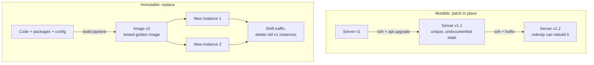
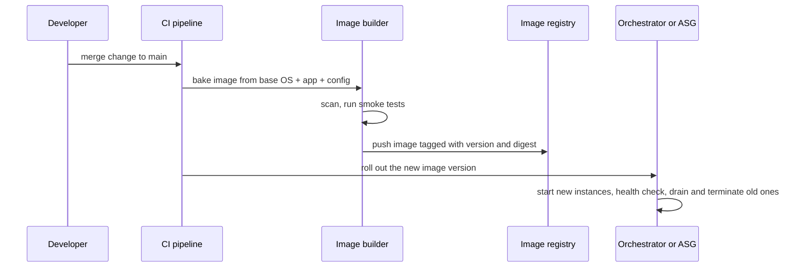

# L0.5 — Immutable Infrastructure

> **Level 0: What DevOps Actually Is** · Topic 5 of 13 · ⏱ ~3 hours · Difficulty: Beginner

## 1. What it is

**Immutable infrastructure** means you never change a running server (or container) after it has been created. To change anything — a security patch,
a config value, a new application version — you **build a new image, start fresh instances from it, shift traffic over, and throw the old instances away**.
The slogan is *replace, don't patch*.

The opposite is **mutable infrastructure**, where you log in (or run a [configuration-management](04-configuration-management.md) tool) and modify long-lived servers in place. Over months each such server collects
unique history — a hand-edited file, a package someone installed to debug, a half-applied upgrade. Operators call these **pets** (named, hand-cared-for, irreplaceable)
versus **cattle** (numbered, identical, replaced when sick). A **golden image** is the pre-baked, tested machine or container image that all the cattle start from.

## 2. Why it matters in DevOps

- **No snowflakes, no drift.** Every instance of version 42 is byte-for-byte the same, so "it only fails on web-3" stops being a category of bug.
- **Predictable deploys and easy rollback.** Rolling back is starting instances from the previous image; there is no un-patching.
- **Security.** Patching means baking a new image through a pipeline and rolling it out; an attacker's changes on a box disappear when the box is replaced.
- **Scaling and self-healing.** Autoscaling groups and Kubernetes can only add or replace capacity quickly if a new instance needs no manual setup ([High Availability and Scalability](08-high-availability-and-scalability.md)).
- **Testability.** You test the image that you will ship; there is no "and then we configure it in production" step.

The cost: you need an image-build pipeline, good observability, and state kept *outside* the instance (databases, object storage, volumes).

## 3. Real-world system example

**Netflix** has been publicly associated with the "bake an image, launch from it" approach on AWS since its early cloud migration: it
built tooling (Aminator, later Spinnaker's bake stage) to bake Amazon Machine Images (AMIs) and deploy new versions as fresh Auto Scaling groups, rather than patching running instances.

**Containers and Kubernetes** make this the default. A container image is immutable and identified by a digest; a Kubernetes **Deployment**
rolls out a change by creating new Pods from the new image and deleting old ones. You do not `ssh` into a Pod to upgrade nginx.

**Immutable operating systems.** AWS **Bottlerocket**, Fedora CoreOS and Flatcar Container Linux ship a minimal OS image with a read-only root filesystem and update by switching to a whole new OS image (often A/B partitions), not by installing packages one at a time.

**HashiCorp Packer** is the commonly used open-source tool for building golden machine images (AMIs, Azure images, GCE images, VM images, and container images) from one template.

## 4. Diagram

Mutable vs immutable change flow:



The image pipeline:



## 5. How it works

### Mutable vs immutable

| | Mutable (pets) | Immutable (cattle) |
|---|---------------|--------------------|
| Upgrade | Patch the running server | Build new image, replace servers |
| Change is applied by | `ssh`, Ansible against live hosts | A pipeline that builds an image |
| Server lifetime | Years | Hours to weeks |
| Identity | Hand-picked names (`db-prod-alice`) | Numbered or generated (`web-7f9c`) |
| Drift risk | High | Low (change means replace) |
| Rollback | Reverse the patch (risky) | Re-deploy the previous image |
| Debugging | Log in and poke around | Read logs and metrics; reproduce from the same image |
| State | On the box | Outside: managed DB, S3, EBS/EFS volumes |

### Pieces you need

1. **A repeatable image build** — Packer, a `Dockerfile`, cloud-native image builders. See [Level 4: Images and Layers](../level-04-docker/02-images-and-layers.md).
2. **An image registry/catalogue** with versions and digests (ECR, Docker Hub, AMI IDs).
3. **An orchestrator or auto-scaling mechanism** to roll instances (Kubernetes, ASG, instance refresh).
4. **Externalised state and config** — environment variables, secrets managers, parameter stores, managed databases.
5. **Centralised logs and metrics**, because the instance that failed will be gone ([Observability](10-observability.md)).
6. **Exceptions you accept:** databases and other stateful systems are often still long-lived and upgraded carefully (replicas, snapshots, managed services).

### Pets vs cattle checklist

- Can you delete any one server right now without a meeting? (cattle)
- Would you notice if its disk contents were reset to the image? (pet if yes)
- Is its name meaningful and does it have a history only one person knows? (pet)

## 6. Step-by-step guide

**Goal:** model immutable releases with plain directories and a symlink: build once, never edit, switch atomically, roll back instantly, and detect tampering.
A container variant at the end shows the same idea with Docker.
**Prerequisites:** a Linux/macOS shell with `sha256sum` (macOS: `shasum -a 256` and `ln -sfn` + `mv`). **Cost: none.**

1. **Create the build script.** A release is created once; trying to overwrite it is an error.
   ```bash
   mkdir -p ~/immutable-demo && cd ~/immutable-demo
   cat > build_release.sh <<'EOF'
   #!/usr/bin/env bash
   # Build a new immutable release: a directory that is created once and never edited.
   set -euo pipefail
   VERSION="$1"; MESSAGE="$2"
   DIR="releases/$VERSION"
   [ ! -e "$DIR" ] || { echo "release $VERSION already exists - releases are immutable, pick a new version"; exit 1; }
   mkdir -p "$DIR"
   echo "<h1>shop-api $VERSION</h1><p>$MESSAGE</p>" > "$DIR/index.html"
   ( cd "$DIR" && sha256sum index.html > MANIFEST.sha256 )
   chmod -R a-w "$DIR"
   echo "built $DIR"
   EOF
   ```

2. **Create the activation script.** "Deploy" is a pointer switch plus an integrity check. `mv -T` replaces the symlink atomically, so no request ever sees a half-switched state.
   ```bash
   cat > activate.sh <<'EOF'
   #!/usr/bin/env bash
   set -euo pipefail
   VERSION="$1"
   [ -d "releases/$VERSION" ] || { echo "no such release: $VERSION"; exit 1; }
   ( cd "releases/$VERSION" && sha256sum -c --quiet MANIFEST.sha256 ) \
     || { echo "release $VERSION failed integrity check, refusing to activate"; exit 1; }
   ln -sfn "releases/$VERSION" current.tmp
   mv -T current.tmp current
   echo "active: $(readlink current)"
   EOF
   chmod +x build_release.sh activate.sh
   ```

3. **Build and activate v1.**
   ```bash
   ./build_release.sh v1 "first release"
   ./activate.sh v1
   cat current/index.html
   ```
   Expected: `built releases/v1`, `active: releases/v1`, `<h1>shop-api v1</h1><p>first release</p>`.

4. **Try to "patch" v1 — the system refuses.**
   ```bash
   ./build_release.sh v1 "quick fix"; echo "exit code: $?"
   ```
   Expected: `release v1 already exists - releases are immutable, pick a new version` and exit code `1`. The only way forward is a new version.

5. **Ship the fix as v2 (replace, don't patch), then roll back.**
   ```bash
   ./build_release.sh v2 "patched openssl"
   ./activate.sh v2 && cat current/index.html     # v2 is live
   ./activate.sh v1 && cat current/index.html     # instant rollback to v1
   ```
   v1 was never touched, so rollback is just moving the pointer.

6. **Simulate a hand-edit ("pet" behaviour) and see it caught.**
   ```bash
   chmod -R u+w releases/v2
   echo "<!-- debug left behind -->" >> releases/v2/index.html
   ./activate.sh v2; echo "exit code: $?"
   ```
   Expected: `index.html: FAILED`, `release v2 failed integrity check, refusing to activate`, exit code `1`. The checksum manifest is the toy version of an image digest: bytes changed, identity changed.

7. **Container variant (needs Docker; output is similar to the following).** The same discipline applies: never `docker exec` to patch.
   ```bash
   docker run -d --name web --read-only --tmpfs /var/cache/nginx --tmpfs /var/run --tmpfs /tmp -p 8080:80 nginx:1.27
   docker exec web sh -c 'echo hacked > /usr/share/nginx/html/index.html'   # fails: Read-only file system
   docker rm -f web                                                        # "patch" = replace: run a new image tag
   ```
   `--read-only` makes the container filesystem immutable at runtime. A change means a new image tag and a new container. More in [Level 4: Containers](../level-04-docker/03-containers.md).

8. **Clean up.**
   ```bash
   chmod -R u+w releases; cd ~ && rm -rf ~/immutable-demo
   ```

## 7. Real-world scenario

*Illustrative.* A critical OpenSSL vulnerability is announced. In the **mutable** shop, a runbook says to `apt upgrade` forty web servers one by one. Five hosts have custom-built OpenSSL
from years ago and the upgrade silently skips them; one reboot hangs on a hand-edited `fstab`. The incident lasts a day and ends with a list of servers nobody dares touch.
In the **immutable** shop, a one-line base-image bump triggers the pipeline: it rebuilds the golden image, runs the test suite and a vulnerability scan, and
rolls the new image out via a rolling instance refresh (see [Deployment Strategies](07-deployment-strategies.md)). Forty old instances are terminated; the fleet is uniform again in about an hour,
and rollback would have been "re-deploy yesterday's image".
**Lesson:** the patch is the same; the difference is that the immutable shop applies it the same way it applies any deploy.

## 8. Common mistakes and best practices

**Don't**

- `ssh` in "just to fix it" and leave the change on the instance: it disappears at the next replacement and nobody learns why.
- Store persistent state (uploads, sessions, databases) on instance-local disks.
- Bake secrets into images.
- Use mutable tags like `latest` in production; pin versions or digests.
- Treat immutability as dogma for databases: you still need a careful upgrade path for stateful systems.

**Do**

- Build images in CI, scan them, and promote the *same* image from staging to production.
- Keep debug access short-lived and audited (ephemeral shell sessions), never as an upgrade path.
- Rebuild images regularly, even without code changes, to pick up base-image security patches.
- Ship logs and metrics off-box.
- Name instances by role and ID; automate their replacement.

## 9. Tasks

- [ ] **T1 — Build, switch, roll back** *(≈25 min, beginner)*
  - **Goal:** run the immutable release workflow.
  - **Steps:**
    1. Complete guide steps 1-5.
  - **Done when:** `current` points to v1 after rollback, `releases/v2` still exists untouched, and you can show `readlink current`.

- [ ] **T2 — Catch tampering** *(≈20 min, beginner)*
  - **Goal:** prove the integrity check works.
  - **Steps:**
    1. Complete guide step 6.
    2. Run `sha256sum -c releases/v2/MANIFEST.sha256` from inside `releases/v2` to see the failure directly.
  - **Done when:** activation is refused with a non-zero exit code and `sha256sum` prints `FAILED`.

- [ ] **T3 — Add a pointer history for rollback** *(≈40 min, intermediate)*
  - **Goal:** make rollback a command.
  - **Steps:**
    1. Modify `activate.sh` to append `<timestamp> <version>` to `history.log` after each successful activation.
    2. Write `rollback.sh` that reads the previous version from `history.log` and activates it.
  - **Done when:** after activating v1, v2, then running `./rollback.sh`, `readlink current` shows `releases/v1`.

- [ ] **T4 — Container immutability (Docker)** *(≈30 min, intermediate)*
  - **Goal:** see `--read-only` in action.
  - **Steps:**
    1. Run the container in guide step 7 and try to write to a path in the image.
    2. Show a path that *is* writable (the `--tmpfs` mounts) and explain why those paths must be writable.
  - **Done when:** the write to the image path fails with `Read-only file system` while the write to `/tmp` succeeds.

- [ ] **T5 — Pet or cattle audit** *(≈30 min, intermediate)*
  - **Goal:** apply the vocabulary to a real system.
  - **Steps:**
    1. List ten servers or services you know (a laptop-hosted lab counts).
    2. For each, answer: can it be deleted and recreated automatically? Where does its state live?
    3. Pick the worst "pet" and write down what it would take to make it cattle.
  - **Done when:** you have a table of ten rows and a three-step plan for the worst offender.

- [ ] **T6 — Prove it: patch a fleet immutably** *(≈45 min, advanced)*
  - **Goal:** demonstrate "replace, don't patch" end to end without the guide.
  - **Steps:**
    1. Build three releases from scratch with your own scripts; run an artificial "fleet" of 3 symlinked directories (`web-1`, `web-2`, `web-3`) each pointing at v1.
    2. Roll them to v2 one at a time, verifying integrity before each switch.
    3. Roll all three back.
    4. Explain what you would add to make this safe for a real fleet (health checks, traffic draining).
  - **Done when:** at no point is any release directory modified, and you can show the symlink state of all three hosts at each step.

## 10. Self-check questions

1. What does "replace, don't patch" mean?
2. What is a golden image and who builds it?
3. Explain pets vs cattle with one example each.
4. Where must state live in an immutable setup, and why?
5. Why is the `latest` tag a bad fit for immutable infrastructure?

<details>
<summary>Answers</summary>

1. Never modify a running instance; build a new image with the change, launch fresh instances from it and terminate the old ones.
2. A pre-built, tested machine or container image that every instance starts from; produced by an automated pipeline (for example Packer or a Docker build in CI).
3. Pet: a hand-maintained database server named `db-alice` with years of manual edits. Cattle: web instance `web-7f9c` launched from image v42 that can be deleted and recreated at any time.
4. Outside the instance — managed databases, object storage, network volumes — because instances are disposable and local state is lost on replacement.
5. It is mutable: the same tag can point at different bytes over time, so you cannot say exactly what is running or roll back reliably. Use version tags or digests.
</details>

## 11. Further reading

- *Infrastructure as Code* by Kief Morris — chapters on immutable servers and server images.
- HashiCorp Packer documentation (developer.hashicorp.com/packer).
- Bottlerocket (github.com/bottlerocket-os) and Fedora CoreOS documentation for immutable OS design.
- Kubernetes documentation on Deployments (kubernetes.io/docs).
- See also: [Infrastructure as Code](03-infrastructure-as-code.md) and [Level 4: Images and Layers](../level-04-docker/02-images-and-layers.md).

<!-- nav -->
---
← Previous: [Configuration Management](04-configuration-management.md) · [Level 0 index](README.md) · Next: [Infrastructure Automation](06-infrastructure-automation.md) →
