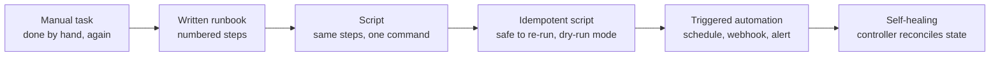
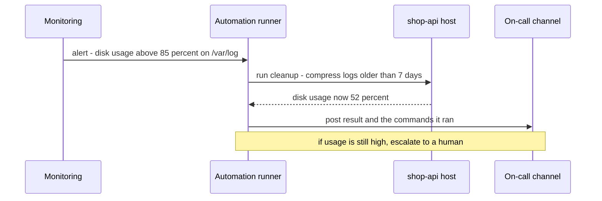

# L0.6 — Infrastructure Automation

> **Level 0: What DevOps Actually Is** · Topic 6 of 13 · ⏱ ~3 hours · Difficulty: Beginner

## 1. What it is

**Infrastructure automation** means replacing manual, repeated operations work — creating servers, installing software, rotating certificates, restarting stuck services, onboarding a new engineer —
with code that a machine runs the same way every time. A person *decides* what should happen once; a script, a pipeline or a tool *does* it a thousand times.

Automation sits one level above the topics you have just read. [Infrastructure as Code](03-infrastructure-as-code.md) describes *what* infrastructure should exist, and
[Configuration Management](04-configuration-management.md) describes *how a server should be configured*. Infrastructure automation is the broader habit of asking, for every task someone does by hand twice:
"can this become code, run by a trigger, with a record of what it did?" The enemy it fights is **toil** — manual, repetitive, automatable operational work that scales linearly with the size of the system and produces no lasting value.

## 2. Why it matters in DevOps

- **Speed with safety.** A person typing 14 commands into a production terminal will eventually mistype one. A script runs the same 14 commands identically, and a reviewer can read it first.
- **Toil eats the team.** If every new service adds two hours of weekly manual work, headcount must grow with the service count. Automation breaks that link.
- **Knowledge stops living in heads.** A runbook that exists only as "ask Priya" is an outage waiting for Priya's holiday. Code is documentation that is guaranteed to be tried.
- **Auditability.** Automated changes leave logs, pull requests and pipeline runs. Manual changes leave "I think I ran something around 3 a.m."
- **3 a.m. response.** Common incidents (disk full, stuck queue, expired certificate) can be fixed by a safe automated action instead of a half-asleep engineer.

The trap on the other side: automation that nobody understands, that is not idempotent, or that can delete production at machine speed. Good automation is small, readable, testable and reversible.

## 3. Real-world system example

**Google SRE and toil.** The public *Site Reliability Engineering* book defines toil as manual, repetitive, automatable, tactical work without enduring value, and describes a goal of keeping SRE toil below roughly half of an engineer's time so that the rest goes to engineering that reduces future toil. The same book describes Google's evolution from hand-run operations to automation systems. This idea is the origin of the "eliminate toil" priority you will meet in [Site Reliability Engineering](11-sre.md).

**Amazon / AWS.** Amazon's public engineering writing describes pushing teams towards fully automated deployment pipelines, so that releasing software is a push-button (or fully automatic) event rather than a manual procedure. AWS itself exposes every capability as an API, which is what makes tools like Terraform, CloudFormation and the AWS CLI possible in the first place.

**Kubernetes controllers.** Kubernetes is automation of operations in a literal form: a **controller** is a loop that compares desired state with actual state and acts. A Deployment controller replaces dead Pods, a node lifecycle controller reacts to failed nodes, and the Horizontal Pod Autoscaler adds replicas under load. Work that a human operator once did at 3 a.m. is now a reconciliation loop.

**GitHub Actions and Ansible** show the two common shapes: *event-driven* automation (a push triggers a workflow) and *push-based task automation* (a playbook run from a laptop or CI against a list of hosts).

## 4. Diagram

From a manual runbook to automation you can trust:



How an alert becomes a fixed problem without a human in the loop for the routine case:



## 5. How it works

### Scripts vs tools

| | Ad-hoc script (bash, Python) | Purpose-built tool (Terraform, Ansible, Kubernetes, Puppet) |
|---|---|---|
| Good for | Glue, one-off jobs, small repeated chores | Managing large, long-lived sets of resources |
| State awareness | You write the checks yourself | Built in: compares desired vs actual, plans changes |
| Idempotency | Only if you make it so | Core design principle for most modules |
| Learning cost | Low | Medium to high |
| Failure mode | Works on your laptop, copy-pasted into five variants | Over-engineering a ten-line job |
| Rule of thumb | Start here for a task you have done twice | Move here when the script grows its own state tracking and retries |

### The properties of good automation

1. **Idempotent** — running it twice gives the same result as running it once. "Ensure the directory exists" is idempotent; "append a line to the file" is not, unless it checks first.
2. **Declarative where possible** — describe the end state ("3 replicas of version 42") and let the tool work out the steps.
3. **Dry-run / plan mode** — show what would change before changing it (`terraform plan`, `ansible --check`, `kubectl diff`).
4. **Observable** — it logs what it did, exits non-zero on failure, and notifies someone.
5. **Safe by default** — least privilege credentials, a blast-radius limit (one host, then ten), a confirmation for destructive steps.
6. **Version-controlled and reviewed** — in Git, changed through pull requests ([Level 3: Protected Branches and Pull Requests](../level-03-git-and-github/08-protected-branches-and-pull-requests.md)).

### Runbook to code: the ladder

| Rung | What you have | Example |
|---|---|---|
| 0 | Tribal knowledge | "SSH in and restart it, you'll know" |
| 1 | Written runbook | Numbered steps in a wiki |
| 2 | Script next to the runbook | `restart_worker.sh` in the repo |
| 3 | Idempotent script with dry-run | Checks state first, prints what it would do |
| 4 | Triggered automation | Cron job, CI workflow, alert webhook runs it |
| 5 | Self-healing system | A controller or autoscaler keeps the state correct continuously |

You do not need every task at rung 5. Move up the ladder in proportion to how often the task happens and how costly a mistake is.

### What to automate first

Score candidates by **frequency × time per run × risk of human error**. Typical winners: environment creation, deploys, certificate renewal, user onboarding and offboarding, log cleanup, backup verification, and routine "restart the stuck thing" actions.

## 6. Step-by-step guide

**Goal:** take a manual runbook ("set up a new `shop-api` host") and turn it into an idempotent script with a dry-run mode, then use it to detect and fix drift.
**Prerequisites:** a Linux/macOS shell with bash. The script only touches a sandbox directory under your home, never real system paths. **Cost: none.**

1. **Read the manual runbook you are about to automate.** Imagine it lives in a wiki:
   ```text
   Runbook: new shop-api host
   1. Create /etc/shop-api, /var/log/shop-api and /srv/shop-api/releases
   2. Make the log directory private (mode 750)
   3. Create /etc/shop-api/env containing NODE_ENV, PORT and REDIS_URL
   4. Do not add a setting twice!
   ```
   Step 4 is a clue: this runbook already knows that running it twice is dangerous. That is an idempotency requirement hiding in prose.

2. **Create the script.** The helpers `ensure_dir` and `ensure_line` check current state before acting, and every action honours `--dry-run`.
```bash
mkdir -p ~/automation-demo && cd ~/automation-demo
cat > provision.sh <<'EOF'
#!/usr/bin/env bash
# provision.sh - turn the "new shop-api host" runbook into idempotent code.
# Usage: ./provision.sh [--dry-run] <target-dir>
set -euo pipefail

DRY_RUN=0
if [ "${1:-}" = "--dry-run" ]; then DRY_RUN=1; shift; fi
ROOT="${1:?usage: provision.sh [--dry-run] <target-dir>}"
CHANGES=0

say()    { printf '%-9s %s\n' "$1" "$2"; }
change() { CHANGES=$((CHANGES + 1)); }

ensure_dir() {                      # ensure_dir <path> <mode>
  if [ -d "$1" ]; then say ok "dir $1"; return; fi
  say CHANGE "create dir $1"; change
  [ "$DRY_RUN" -eq 1 ] || { mkdir -p "$1"; chmod "$2" "$1"; }
}

ensure_line() {                     # ensure_line <file> <line>
  if [ -f "$1" ] && grep -qxF -- "$2" "$1"; then say ok "line in $1: $2"; return; fi
  say CHANGE "append to $1: $2"; change
  [ "$DRY_RUN" -eq 1 ] || echo "$2" >> "$1"
}

ensure_dir  "$ROOT/etc/shop-api" 755
ensure_dir  "$ROOT/var/log/shop-api" 750
ensure_dir  "$ROOT/srv/shop-api/releases" 755
ensure_line "$ROOT/etc/shop-api/env" "NODE_ENV=production"
ensure_line "$ROOT/etc/shop-api/env" "PORT=3000"
ensure_line "$ROOT/etc/shop-api/env" "REDIS_URL=redis://10.0.1.20:6379"

echo "---"
echo "changes needed/applied: $CHANGES (dry-run=$DRY_RUN)"
EOF
chmod +x provision.sh
```

3. **Dry-run first.** Nothing is created; the script only reports what it would do.
```bash
./provision.sh --dry-run host1
ls host1 2>&1 | head -1
```
   Expected: six `CHANGE` lines, the summary `changes needed/applied: 6 (dry-run=1)`, and `ls` reports that `host1` does not exist.

4. **Apply it.**
```bash
./provision.sh host1
find host1 -type f -o -type d | sort
cat host1/etc/shop-api/env
```
   Expected: the same six `CHANGE` lines with `dry-run=0`, the directory tree under `host1/`, and the three settings in the env file.

5. **Run it again — this is the idempotency test.**
```bash
./provision.sh host1
```
   Expected: every line starts with `ok` and the summary says `changes needed/applied: 0`. A script that is safe to re-run can be scheduled, retried after a failure, and used on hosts in unknown states.

6. **Introduce drift and detect it.** Someone "fixes" the port by hand on the host.
```bash
sed -i.bak 's/PORT=3000/PORT=3001/' host1/etc/shop-api/env     # works on GNU and macOS sed
./provision.sh --dry-run host1
```
   Expected: one `CHANGE append to host1/etc/shop-api/env: PORT=3000` line. The dry run just acted as a drift detector.

7. **Notice the weakness.** Apply it for real and look at the file.
```bash
./provision.sh host1
cat host1/etc/shop-api/env
```
   Expected: the file now contains *both* `PORT=3001` and `PORT=3000`. The script is idempotent but not *convergent*: it adds missing lines but does not replace wrong ones. This is precisely the gap that Ansible's `lineinfile`, Puppet resources and Terraform fill with real state comparison. Fixing this in the script is task T3 below.

8. **Measure the toil you removed.** If the manual runbook takes 10 minutes and you build 20 hosts a year, that is about 3.3 hours of repetitive work plus the cost of mistakes. The script took you maybe 30 minutes. Write down this calculation; it is how you justify automation to a team.

9. **Clean up.**
```bash
cd ~ && rm -rf ~/automation-demo
```

## 7. Real-world scenario

*Illustrative.* The `shop-api` team's on-call engineer is paged roughly twice a week because the `/var/log` volume on the API hosts fills up. Each time the fix is the same eight commands from a wiki page:
find the big log, compress old files, delete archives older than 14 days, check disk usage, post in the channel. Each page costs 30 minutes plus a sleep-disrupted night.

First the team moves the wiki steps into a script in the repository, reviewed by two colleagues, who spot a missing check that would have compressed a log file still being written (rung 2). Then they add a dry-run mode and make it idempotent (rung 3).
Finally a monitoring alert at 85 percent disk usage triggers the script via a runner and posts the commands and the result in the on-call channel (rung 4). If usage is still over 85 percent afterwards, a human is paged.

Within a month the pages drop to near zero. The root cause (an unbounded debug log) is then fixed properly, because now someone has time. **Lesson:** automation does not replace diagnosis; it clears the toil that was consuming the time needed for diagnosis.

## 8. Common mistakes and best practices

**Don't**

- Automate a broken process: a faster bad deploy is still a bad deploy. Understand and simplify the manual steps first.
- Write scripts that are only safe to run once, or that can only be run from one person's laptop.
- Give an automation runner administrator access to everything "to make it work".
- Skip dry-run and logging; you will want both the first time it does something surprising.
- Automate without an owner. Orphaned scripts rot silently and then fail during the incident they were written for.
- Keep secrets inside scripts or in shell history ([Level 5: Secrets and Environment Variables](../level-05-cicd/05-secrets-and-environment-variables.md)).

**Do**

- Automate things you have done at least twice, in order of frequency × time × risk.
- Keep automation in Git, reviewed like application code, with a README that says what triggers it and who owns it.
- Make every script idempotent, log what it changes, and exit non-zero on failure.
- Start with small blast radius (one host or a canary), then widen.
- Keep a manual escape hatch and know how to turn the automation off.
- Re-measure toil quarterly: what are people still doing by hand?

## 9. Tasks

- [ ] **T1 — Build and run the provisioner** *(≈25 min, beginner)*
  - **Goal:** turn a short runbook into an idempotent script.
  - **Steps:**
    1. Complete guide steps 1-5 in a fresh sandbox directory.
    2. Run the script a third time and confirm the summary says `0` changes.
  - **Done when:** the first real run reports 6 changes and the second and third report 0, and you can show the output of both.

- [ ] **T2 — Extend the runbook** *(≈30 min, beginner)*
  - **Goal:** add steps without breaking idempotency.
  - **Steps:**
    1. Add `ensure_dir "$ROOT/srv/shop-api/shared" 755` and a new env line `LOG_LEVEL=info`.
    2. Run with `--dry-run` and confirm only the two new items are reported.
    3. Apply, then run again.
  - **Done when:** the dry-run lists exactly two `CHANGE` lines and the following real run reports `0` changes.

- [ ] **T3 — Make it converge (fix the drift bug)** *(≈45 min, intermediate)*
  - **Goal:** replace a wrong value instead of appending a duplicate.
  - **Steps:**
    1. Write `ensure_setting <file> <KEY> <value>` that replaces an existing `KEY=...` line, or appends one if the key is missing, and only counts a change when the file would actually differ.
    2. Use it for `NODE_ENV`, `PORT` and `REDIS_URL`.
    3. Reproduce guide step 6 and verify the script now fixes `PORT=3001` back to `3000` with no duplicate key.
  - **Done when:** after drift and one real run, `grep -c '^PORT=' host1/etc/shop-api/env` prints `1` and the value is `3000`, and a second run reports `0` changes.

- [ ] **T4 — Break it and add a safety rail** *(≈30 min, intermediate)*
  - **Goal:** see how automation fails, then limit the blast radius.
  - **Steps:**
    1. Run `./provision.sh` with no arguments and then with a read-only target (`mkdir ro && chmod 555 ro && ./provision.sh ro/host`).
    2. Observe the exit codes with `echo $?`.
    3. Add a guard that refuses to run if the target directory is `/` or empty, and add a `--yes` requirement when the target already exists with files in it.
  - **Done when:** both failure cases exit non-zero with a clear message, and `./provision.sh /` is refused.

- [ ] **T5 — Schedule it and measure toil** *(≈40 min, intermediate)*
  - **Goal:** move up the ladder from script to triggered automation, and quantify the benefit.
  - **Steps:**
    1. Create a cron entry (`crontab -e`) or a GitHub Actions workflow with a `schedule:` trigger that runs the script in `--dry-run` every hour against `host1` and writes the output to `drift.log`.
    2. Introduce drift by hand and wait for (or manually trigger) a run.
    3. Write a short toil calculation: task, frequency per month, minutes per run, minutes saved per month.
  - **Done when:** `drift.log` shows a `CHANGE` line caused by your manual edit, and you have a toil table with at least three of your own recurring tasks ranked by frequency × time × risk.

- [ ] **T6 — Prove it: runbook to automation, unaided** *(≈60 min, advanced)*
  - **Goal:** demonstrate the whole ladder on a task you choose.
  - **Steps:**
    1. Pick a real recurring chore from your own work or lab (for example "rotate and compress app logs" or "create a new dev user with an SSH key").
    2. Write the manual runbook, then script it, then make it idempotent with a dry-run, then add a trigger.
    3. Without looking at this page, explain to someone (or in writing) what each rung added and how you would test that it is safe to run twice.
  - **Done when:** the repository contains the runbook, script and trigger, a second run changes nothing, and your written explanation names idempotency, dry-run and blast radius.

## 10. Self-check questions

1. What is toil, and what makes a task a good automation candidate?
2. What does idempotent mean, and why does it matter for automation that can be retried?
3. When would you write a script instead of reaching for a tool such as Ansible or Terraform, and when would you switch?
4. Why is a dry-run or plan mode more than a convenience?
5. What are the risks of automating a bad manual process?

<details>
<summary>Answers</summary>

1. Toil is manual, repetitive, automatable operational work that grows with the system and leaves nothing lasting behind. Good candidates happen often, take real time and have a high cost of human error.
2. Running the operation repeatedly gives the same end state as running it once. Retries after partial failure, scheduled re-runs and use on hosts in unknown states are only safe if the automation is idempotent.
3. A script suits glue and small repeated jobs you have done a couple of times. Switch to a tool when the script starts tracking state, handling retries and ordering, and managing many resources, because the tool already does those things well.
4. It shows the planned change for review before it is applied, turns the automation into a drift detector, and builds trust so people allow it to run unattended.
5. You make the bad process faster and harder to question, spread its flaws across more systems, and hide the problem behind a script nobody wants to touch. Simplify first, then automate.
</details>

## 11. Further reading

- *Site Reliability Engineering* (Google, free at sre.google/books) — the chapter on eliminating toil, and the one on automation.
- *Infrastructure as Code* by Kief Morris — patterns for automating infrastructure changes.
- *The Phoenix Project* and *The DevOps Handbook* — narrative and reference on removing manual work from delivery.
- Ansible documentation (docs.ansible.com) and Terraform documentation (developer.hashicorp.com/terraform) for tool-based automation.
- See also: [Configuration Management](04-configuration-management.md), [Immutable Infrastructure](05-immutable-infrastructure.md) and [Level 1: Network and Transfer Commands](../level-01-linux-fundamentals/05-network-transfer-commands.md) for the shell skills scripts rely on.

<!-- nav -->
---
← Previous: [Immutable Infrastructure](05-immutable-infrastructure.md) · [Level 0 index](README.md) · Next: [Deployment Strategies](07-deployment-strategies.md) →
