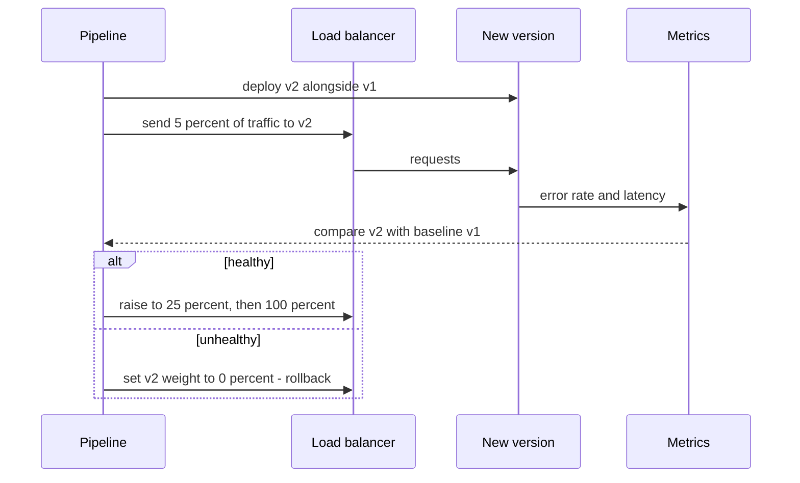

# L0.7 — Deployment Strategies

> **Level 0: What DevOps Actually Is** · Topic 7 of 13 · ⏱ ~3 hours · Difficulty: Beginner

## 1. What it is

A **deployment strategy** is the plan for how a new version of software replaces the old one on live infrastructure: how many instances change at once, how traffic moves, what users see in between, and how you go back if it goes wrong.
The code is the same in every strategy; what changes is the **blast radius** (how many users a bad version can hurt), the **downtime** (if any), and the **cost** (extra capacity needed while two versions exist).

This page is an overview of five approaches: **recreate**, **rolling**, **blue/green**, **canary**, and **feature flags**. Level 5 covers the first four in depth, with real pipelines:
[Rolling Deployments](../level-05-cicd/10-rolling-deployments.md), [Blue/Green Deployments](../level-05-cicd/11-blue-green-deployments.md), [Canary Deployments](../level-05-cicd/12-canary-deployments.md) and [Zero-downtime Deployments](../level-05-cicd/08-zero-downtime-deployments.md).

A related but separate idea: **deploying** (putting code on servers) is not the same as **releasing** (exposing a feature to users). Feature flags split these two, which is why they appear in this list.

## 2. Why it matters in DevOps

- **Deploys are the most common cause of incidents.** Most outages follow a change; the strategy decides whether a bad change hurts 1 percent of users for 2 minutes or everyone for 40.
- **Rollback speed is a business metric.** The time from "this is broken" to "this is fixed" is mostly determined by how easily you can return to the previous version ([Level 5: Rollback](../level-05-cicd/07-rollback.md)).
- **Frequency depends on fear.** Teams that can deploy safely do it often in small steps; teams that dread deploys batch changes and make each one riskier.
- **Cost trade-offs are real.** Blue/green doubles capacity during a release; recreate needs none but takes the service down.
- **The strategy constrains other design choices**: database migrations, session handling and API compatibility all have to work while two versions run together.

## 3. Real-world system example

**Kubernetes Deployments** use **rolling updates** by default: new Pods are created from the new image while old ones are terminated gradually, controlled by `maxSurge` and `maxUnavailable`, with readiness probes deciding when a new Pod may receive traffic. Setting the strategy type to `Recreate` gives the first strategy on this page.

**AWS** documents several of these patterns directly: Elastic Beanstalk supports rolling, immutable and blue/green style deployments; AWS CodeDeploy supports in-place (rolling) and blue/green deployments, with options for linear and canary traffic shifting on Lambda and ECS; Route 53 weighted records and Application Load Balancer weighted target groups are common building blocks for canary and blue/green.

**Feature flags** are used widely at large web companies. Facebook/Meta, GitHub and many others have written publicly about rolling out features gradually behind flags and dark-launching code before announcing it. Commercial and open-source flag systems exist (LaunchDarkly, Unleash, and the CNCF OpenFeature specification), and the idea is plain enough to implement as a config file, as you will do below.

**Automated canary analysis.** Netflix and Google jointly developed and open-sourced Kayenta, a canary analysis service integrated with Spinnaker, which compares metrics from a canary against a baseline to decide whether to promote it. Tools such as Argo Rollouts and Flagger bring the same pattern to Kubernetes.

## 4. Diagram

Where traffic goes during each strategy:

```mermaid
flowchart TD
    subgraph RC["Recreate"]
        direction LR
        rc1["v1 x4 running"] --> rc2["all stopped<br/>DOWNTIME"] --> rc3["v2 x4 running"]
    end
    subgraph RL["Rolling"]
        direction LR
        rl1["v1 v1 v1 v1"] --> rl2["v2 v1 v1 v1"] --> rl3["v2 v2 v1 v1"] --> rl4["v2 v2 v2 v2"]
    end
    subgraph BG["Blue and green"]
        direction LR
        bg1["Users to blue v1<br/>green v2 idle"] --> bg2["Switch router<br/>users to green v2"]
        bg2 --> bg3["blue v1 kept<br/>for instant rollback"]
    end
    subgraph CA["Canary"]
        direction LR
        ca1["5 percent v2<br/>95 percent v1"] --> ca2["25 percent v2"] --> ca3["100 percent v2"]
    end
```



The canary decision loop, which is what makes canaries safer than a plain gradual rollout:



## 5. How it works

| Strategy | How it works | Downtime | Extra capacity | Rollback speed | Best for / watch out for |
|---|---|---|---|---|---|
| **Recreate** | Stop all old, start all new | Yes | None | Slow (redeploy old) | Dev/test, batch workers, apps that cannot run two versions at once |
| **Rolling** | Replace instances a few at a time | No (with health checks) | Small (`maxSurge`) | Medium (roll back the same way) | Default for stateless services. Two versions run at once, so APIs and DB schemas must be compatible |
| **Blue/green** | Build a full second environment, switch traffic atomically | No | Double during the switch | Fast (flip back) | Quick, clean cutover and rollback. Costs capacity. Shared database changes remain the hard part |
| **Canary** | Send a small percent of real traffic to the new version, watch metrics, widen | No | Small | Fast (set weight to 0) | High-traffic services with good metrics. Needs observability and traffic splitting |
| **Feature flag** | Code ships turned off; a runtime switch exposes it, possibly per user or percent | No | None | Instant (flip flag) | Decoupling deploy from release, A/B tests, kill switches. Flags need cleanup or they become debt |

### Ideas that apply to every strategy

1. **Health checks gate traffic.** A new instance gets no requests until its readiness check passes ([High Availability and Scalability](08-high-availability-and-scalability.md)).
2. **Backward compatibility.** While two versions overlap, v2 must tolerate v1's data and requests, and v1 must tolerate v2's. For databases this leads to the **expand/contract** pattern: add new columns first, deploy, then remove old ones later ([Level 5: Database Migrations](../level-05-cicd/09-database-migrations.md)).
3. **Define "bad" before you deploy.** Choose the metrics (error rate, p95 latency, a business metric) and thresholds that trigger a rollback, so the decision is not made at 2 a.m. with adrenaline.
4. **Rollback is a feature.** Practice it. A rollback that has never been tried is a hope.
5. **Combine them.** A common recipe: rolling update of the code, behind a canary stage, with the risky behaviour behind a feature flag.

## 6. Step-by-step guide

**Goal:** simulate all five strategies on your laptop with two tiny `shop-api` versions and a toy router whose weights you control. You will see the traffic split change in real numbers.
**Prerequisites:** Python 3.8+ and `curl`. Everything listens on `127.0.0.1`. **Cost: none.** Use one terminal for the servers and another for commands, or add `&` as shown.

1. **Create the app (one file, started with a version label and port).**
```bash
mkdir -p ~/deploy-demo && cd ~/deploy-demo
cat > app.py <<'EOF'
# app.py - a tiny "shop-api" instance. Usage: python3 app.py <version> <port>
import json, sys
from http.server import BaseHTTPRequestHandler, HTTPServer

VERSION, PORT = sys.argv[1], int(sys.argv[2])

class H(BaseHTTPRequestHandler):
    def do_GET(self):
        if self.path == "/health":
            body, code = b"ok", 200
        elif self.path == "/checkout":
            with open("flags.json") as f:       # feature flag, re-read on every request
                flags = json.load(f)
            flow = "new-checkout" if flags.get("new_checkout") else "old-checkout"
            body, code = json.dumps({"version": VERSION, "flow": flow}).encode(), 200
        else:
            body, code = json.dumps({"service": "shop-api", "version": VERSION}).encode(), 200
        self.send_response(code)
        self.send_header("Content-Length", str(len(body)))
        self.end_headers()
        self.wfile.write(body)
    def log_message(self, *a):
        pass

HTTPServer(("127.0.0.1", PORT), H).serve_forever()
EOF
echo '{"new_checkout": false}' > flags.json
```

2. **Create the toy router.** It is a load balancer in 20 lines: it re-reads `routes.json` on every request, so editing the file changes traffic instantly.
```bash
cat > router.py <<'EOF'
# router.py - a toy load balancer. Re-reads routes.json on EVERY request,
# so changing the file changes where traffic goes (no restart needed).
import json, random, urllib.request
from http.server import BaseHTTPRequestHandler, HTTPServer

class H(BaseHTTPRequestHandler):
    def do_GET(self):
        with open("routes.json") as f:
            routes = json.load(f)            # {"9001": 90, "9002": 10}
        ports = [p for p, w in routes.items() if w > 0]
        weights = [routes[p] for p in ports]
        port = random.choices(ports, weights)[0]
        try:
            with urllib.request.urlopen(f"http://127.0.0.1:{port}{self.path}", timeout=2) as r:
                body, code = r.read(), 200
        except Exception:
            body, code = b"502 bad gateway - no healthy backend", 502
        self.send_response(code)
        self.send_header("Content-Length", str(len(body)))
        self.end_headers()
        self.wfile.write(body)
    def log_message(self, *a):
        pass

HTTPServer(("127.0.0.1", 8080), H).serve_forever()
EOF
```

3. **Start v1 live and v2 idle ("blue" and "green"), and define a helper that counts which version answered 100 requests.**
```bash
python3 app.py v1 9001 &
python3 app.py v2 9002 &
echo '{"9001": 100, "9002": 0}' > routes.json
python3 router.py &
sleep 1
count() { for i in $(seq 1 ${1:-100}); do curl -s localhost:8080/ ; echo; done | sort | uniq -c; }
count 100
```
   Expected: `100 {"service": "shop-api", "version": "v1"}`. Version v2 is running (and could be smoke-tested directly on `localhost:9002`) but has no users.

4. **Blue/green: flip all traffic at once, then flip back.**
```bash
echo '{"9001": 0, "9002": 100}' > routes.json; count 100      # cut over to green
echo '{"9001": 100, "9002": 0}' > routes.json; count 100      # instant rollback to blue
```
   Expected: first `100 ... "v2"`, then `100 ... "v1"`. The rollback took one file write because the old version was still running.

5. **Canary: send roughly 10 percent to v2, then widen.**
```bash
echo '{"9001": 90, "9002": 10}' > routes.json; count 100
echo '{"9001": 50, "9002": 50}' > routes.json; count 100
echo '{"9001": 0,  "9002": 100}' > routes.json; count 100
```
   Expected (similar to, since selection is random): about `90 v1 / 10 v2`, then about `50 / 50`, then `100 v2`. In production, between each step you would check error rate and latency before widening.

6. **Rolling: replace instances in a pool, a few at a time.** Add a second instance of each version (four backends), and move through states where old and new coexist.
```bash
python3 app.py v1 9003 &
python3 app.py v2 9004 &
echo '{"9001":1,"9003":1,"9002":0,"9004":0}' > routes.json; count 40   # all v1
echo '{"9001":0,"9003":1,"9002":1,"9004":0}' > routes.json; count 40   # one replaced
echo '{"9001":0,"9003":0,"9002":1,"9004":1}' > routes.json; count 40   # all v2
```
   Expected: `40 v1`, then a mix of both versions (roughly 20/20), then `40 v2`. The mixed middle state is what makes API and database compatibility essential.

7. **Recreate: stop everything, then start the new version, and observe the gap.** Stop all four backends, probe, restart v2, probe again.
```bash
pkill -f "app.py"                                    # everything is down
curl -s -o /dev/null -w "during recreate: HTTP %{http_code}\n" localhost:8080/
python3 app.py v2 9002 &
echo '{"9002": 100}' > routes.json; sleep 1
curl -s -o /dev/null -w "after recreate:  HTTP %{http_code}\n" localhost:8080/
```
   Expected: `during recreate: HTTP 502`, then `after recreate:  HTTP 200`. The 502 window is the downtime: no instance existed to serve requests. (`routes.json` is reduced to the single restarted backend only to keep the demo simple.)

8. **Feature flag: ship the code dark, release it with a config change.** `v2` is running, but the new checkout flow is off.
```bash
curl -s localhost:8080/checkout; echo
echo '{"new_checkout": true}' > flags.json
curl -s localhost:8080/checkout; echo
echo '{"new_checkout": false}' > flags.json          # kill switch, no redeploy
curl -s localhost:8080/checkout; echo
```
   Expected: `"flow": "old-checkout"`, then `"flow": "new-checkout"`, then `"flow": "old-checkout"` again. The binary never changed; only the flag did. That is the difference between deploying and releasing.

9. **Clean up.**
```bash
pkill -f "app.py"; pkill -f "router.py"
cd ~ && rm -rf ~/deploy-demo
```

## 7. Real-world scenario

*Illustrative.* The `shop-api` team ships a new pricing calculation. They deploy with a plain rolling update to all 12 instances during the lunchtime peak. Within three minutes the error rate climbs to 8 percent: v2 rounds currency differently, and
half-migrated carts are rejected by the other version, because v1 and v2 disagree on a field in the cart JSON. The rolling update has already replaced 8 of 12 instances, and the rollback takes another 6 minutes. About a third of checkout attempts failed during those nine minutes.

The post-incident fixes are not "be more careful". The team (1) puts the new calculation behind a flag defaulting to off, so the code deploys everywhere but is released to nobody;
(2) adds a canary stage that sends 5 percent of traffic to the new version for 10 minutes and aborts if the 5xx rate exceeds the baseline by more than 1 percentage point; (3) makes the cart JSON change backward compatible, so v1 and v2 can run together.
The next pricing change is released to 1 percent of customers by flag, a rounding bug shows up in the metrics, the flag goes back to off in seconds, and nobody is paged. **Lesson:** strategy choice, flags and compatibility rules turn a deploy from a gamble into a controlled experiment.

## 8. Common mistakes and best practices

**Don't**

- Deploy to everyone at once with no health gate and no rollback plan.
- Assume rollback is free: a destructive database migration cannot be undone by redeploying the old code.
- Run a canary with no metrics. Sending 5 percent of traffic to a version nobody is watching is just a slow, partial outage.
- Leave feature flags in the code forever; stale flags multiply the states you must test.
- Forget about long-lived connections, in-flight requests and background jobs when you terminate old instances: drain them first.
- Pick blue/green when your database change is not backward compatible; the two environments share the data.

**Do**

- Use a rolling update with readiness checks as your baseline for stateless services.
- Add canaries or progressive delivery as traffic and risk grow, with automatic rollback criteria.
- Write backward-compatible changes (expand/contract) so any two adjacent versions can coexist.
- Separate deploy from release with flags for risky or visible changes; give each flag an owner and an expiry date.
- Keep the previous version's artifact available and rehearse the rollback.
- Record the deployed version in your logs and metrics, so you can correlate a problem with a release ([Observability](10-observability.md)).

## 9. Tasks

- [ ] **T1 — Run the strategy simulator** *(≈30 min, beginner)*
  - **Goal:** reproduce blue/green and canary traffic splits.
  - **Steps:**
    1. Complete guide steps 1-5.
    2. Save the three `count` outputs from step 5 into a file `canary.txt`.
  - **Done when:** `canary.txt` shows approximately 90/10, 50/50 and 0/100 splits, and you can explain why the numbers are not exactly 90 and 10.

- [ ] **T2 — Measure downtime** *(≈25 min, beginner)*
  - **Goal:** quantify the downtime of recreate versus the others.
  - **Steps:**
    1. Run `while true; do curl -s -o /dev/null -w "%{http_code}\n" localhost:8080/; sleep 0.1; done | uniq -c` in a second terminal.
    2. Perform a blue/green flip and watch the output: no `502`.
    3. Perform the recreate sequence from guide step 7 and watch the output.
  - **Done when:** the blue/green flip shows only `200` lines and the recreate shows a run of `502` lines whose length you can convert to seconds.

- [ ] **T3 — Automate a gated canary** *(≈50 min, intermediate)*
  - **Goal:** write the decision loop as code.
  - **Steps:**
    1. Write `canary.sh` that moves weights 10, 25, 50, 100 in turn, and at each step requests `/` 50 times counting non-200 responses.
    2. If more than 2 responses fail, set weights back to `{"9001": 100, "9002": 0}` and exit 1.
    3. Add a `/health`-style failure to v2 (for example start v2 with an environment variable that makes `/` return 500) to test the abort path.
  - **Done when:** with a healthy v2 the script ends at 100 percent v2, and with the broken v2 it aborts at the first step and leaves `routes.json` pointing 100 percent at v1.

- [ ] **T4 — Break compatibility, then fix it** *(≈40 min, intermediate)*
  - **Goal:** feel why overlapping versions must be compatible.
  - **Steps:**
    1. Change v2 to rename the JSON key `service` to `name` in the `/` response.
    2. Write a tiny client loop that parses the response expecting `service` and run it through a 50/50 split.
    3. Fix it with an expand/contract approach: v2 returns both keys, then later remove the old one.
  - **Done when:** the client shows failures during the 50/50 split with the rename and zero failures with both keys present.

- [ ] **T5 — Per-user feature flag** *(≈40 min, intermediate)*
  - **Goal:** release to a percentage of users deterministically.
  - **Steps:**
    1. Extend `flags.json` to `{"new_checkout_percent": 20}` and have `/checkout` read a `user` query parameter.
    2. Hash the user ID to a number from 0 to 99 (for example with `zlib.crc32`) and enable the new flow when the number is below the percent.
    3. Request `/checkout?user=1` through `/checkout?user=100` and count flows; request the same user twice.
  - **Done when:** about 20 of the 100 users get `new-checkout`, and each individual user gets the same answer every time.

- [ ] **T6 — Prove it: choose and defend a strategy** *(≈45 min, advanced)*
  - **Goal:** pick the right strategy for different situations without notes.
  - **Steps:**
    1. For each situation choose a strategy and justify it in two sentences: (a) a nightly batch job, (b) a stateless API with 40 instances, (c) a payments service with a non-backward-compatible schema change, (d) a UI redesign to be tested with 5 percent of users.
    2. For each, state the metric that triggers rollback and how you would roll back.
    3. Re-run the simulator for one of the cases to demonstrate the traffic movement.
  - **Done when:** you have four written answers with strategy, rollback trigger and rollback method, and a live demo of one of them.

## 10. Self-check questions

1. What is the difference between deploying and releasing?
2. What problem does blue/green solve that rolling does not, and what does it cost?
3. Why do rolling and canary strategies require backward-compatible changes?
4. What makes a canary more than "a slow rollout"?
5. When would recreate be an acceptable choice?

<details>
<summary>Answers</summary>

1. Deploying places new code on servers; releasing exposes behaviour to users. Feature flags let you deploy first and release later, independently, and reverse a release without a deploy.
2. Blue/green gives an atomic cutover and an immediate rollback, because the whole old environment is still running. It costs double capacity during the switch and does not solve shared database changes.
3. During the transition both versions serve traffic and share data and APIs, so each must handle what the other produces.
4. The canary receives real traffic while its health is compared against a baseline with defined thresholds, and a failure automatically stops or reverses the rollout.
5. When brief downtime is acceptable or unavoidable: development and test environments, batch jobs, or software that cannot run two versions at the same time.
</details>

## 11. Further reading

- Kubernetes documentation on Deployments and rolling updates (kubernetes.io/docs).
- *Continuous Delivery* by Jez Humble and David Farley — chapters on deployment pipelines and release strategies.
- Martin Fowler's articles on BlueGreenDeployment, CanaryRelease and FeatureToggle (martinfowler.com).
- AWS CodeDeploy and Elastic Beanstalk documentation on deployment types (docs.aws.amazon.com).
- OpenFeature specification (openfeature.dev) for a vendor-neutral feature flag API.
- See also: [Level 5: Rolling Deployments](../level-05-cicd/10-rolling-deployments.md) and [Immutable Infrastructure](05-immutable-infrastructure.md).

<!-- nav -->
---
← Previous: [Infrastructure Automation](06-infrastructure-automation.md) · [Level 0 index](README.md) · Next: [High Availability and Scalability](08-high-availability-and-scalability.md) →
