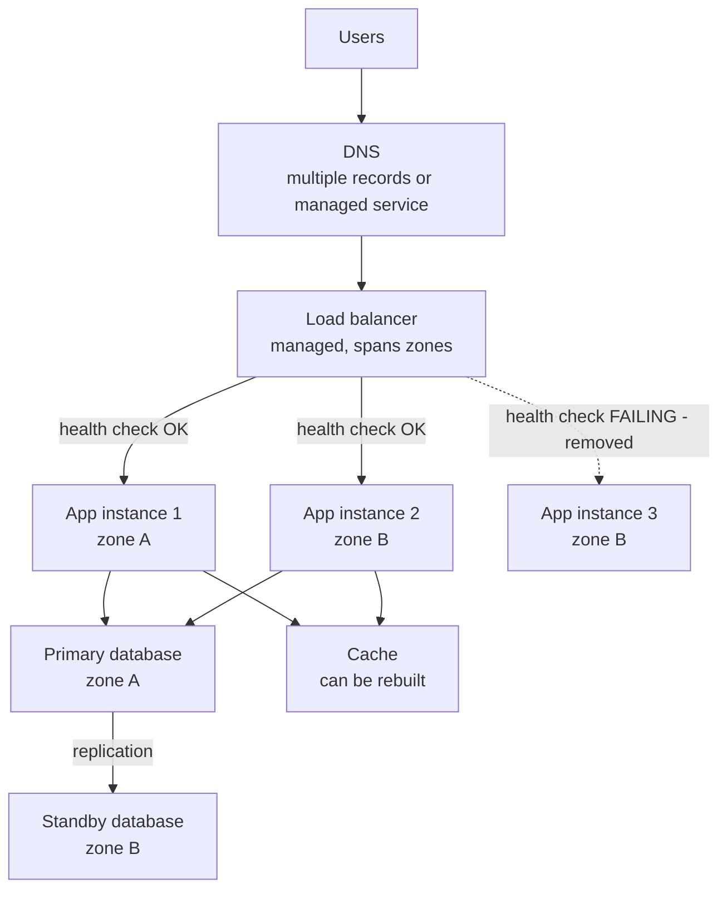
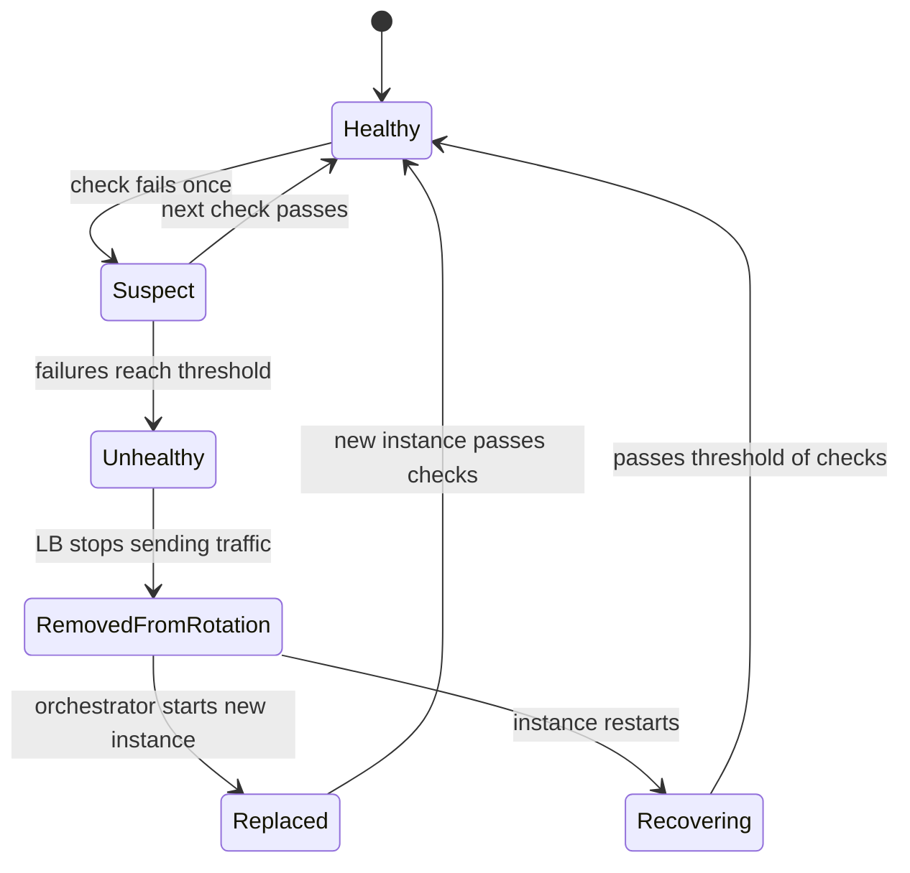

# L0.8 — High Availability and Scalability

> **Level 0: What DevOps Actually Is** · Topic 8 of 13 · ⏱ ~3 hours · Difficulty: Beginner

## 1. What it is

**High availability (HA)** means a service keeps working when parts of it fail. You get it by **redundancy** — running more than one of every component that matters — plus automatic detection and failover so that traffic stops going to the broken piece.
The thing HA fights is the **single point of failure (SPOF)**: any one component whose failure takes the whole service down (one server, one database, one load balancer, one DNS provider, one engineer who holds the only password).

**Scalability** is the ability to handle more load by adding resources. You can scale **vertically** (a bigger machine: more CPU and RAM) or **horizontally** (more machines behind a load balancer). The two ideas are related but different:
a service on one huge server is scalable up to a point but not highly available, and three small servers behind a load balancer are both. The glue is the **health check**: a small, cheap request ("are you OK?") that a load balancer, orchestrator or monitor sends to every instance so unhealthy ones are removed from rotation.

## 2. Why it matters in DevOps

- **Hardware, networks and software fail constantly at scale.** Disks die, availability zones lose power, deploys introduce bugs, certificates expire. The design question is not "will it fail" but "what happens when it does".
- **Availability is arithmetic, and it is unforgiving.** Every extra "nine" cuts allowed downtime by 10x (see the table below), and adds cost and complexity.
- **Traffic is spiky.** Marketing emails, product launches and Black Friday multiply load. If you can only scale vertically and manually, you will find out about the limit during the spike.
- **Hidden SPOFs cause the famous outages**: a single DNS provider, a single region, one shared database, one expired certificate on a single load balancer.
- **Everything else in DevOps leans on it:** rolling deployments need spare capacity ([Deployment Strategies](07-deployment-strategies.md)), immutable infrastructure needs replaceable instances ([Immutable Infrastructure](05-immutable-infrastructure.md)), and SLOs are set against it ([Site Reliability Engineering](11-sre.md)).

## 3. Real-world system example

**AWS Regions and Availability Zones.** AWS publicly documents that each Region consists of multiple, isolated Availability Zones (AZs), each with independent power, cooling and networking, and that you should spread workloads across at least two AZs to survive the loss of one.
An Application Load Balancer, an Auto Scaling group and a Multi-AZ RDS database are exactly this idea: duplicates in separate failure domains plus health checks and automatic replacement. See [Level 6: Auto Scaling](../level-06-cloud-aws/02-auto-scaling.md) and [Level 6: Application Load Balancer](../level-06-cloud-aws/14-alb.md).

**Kubernetes** applies it inside a cluster: a Deployment keeps N replicas; the kubelet's **liveness** probe restarts a stuck container; a **readiness** probe removes a Pod from a Service's endpoints until it can serve; the Horizontal Pod Autoscaler adds or removes replicas based on load ([Level 8: Liveness and Readiness Probes](../level-08-kubernetes/15-liveness-and-readiness-probes.md), [Level 8: Horizontal Pod Autoscaling](../level-08-kubernetes/16-horizontal-pod-autoscaling.md)).

**Netflix** has publicly described designing for failure rather than hoping for success. It popularised **Chaos Monkey**, which randomly terminates production instances to prove that the system survives instance loss, and later the broader "Simian Army" and chaos engineering practice. The lesson is the habit: you only know a redundancy works if you have watched it work.

**Stateless web tier, stateful data tier.** Almost every large web architecture scales the stateless web/API tier horizontally and treats the database specially (replicas, failover, sharding, managed services), because state is what is hard to duplicate. See [Level 13: Horizontal and Vertical Scaling](../level-13-databases-distributed-systems/10-horizontal-and-vertical-scaling.md).

## 4. Diagram

A highly available architecture with no single point of failure at the application level:



What a health check does when an instance fails:



## 5. How it works

### Availability in numbers

Allowed downtime for a given availability target (rounded):

| Availability | Per year | Per 30-day month |
|---|---|---|
| 99% ("two nines") | 3.65 days (87.6 hours) | 7.2 hours |
| 99.9% ("three nines") | 8.76 hours | 43 minutes |
| 99.95% | 4.4 hours | 22 minutes |
| 99.99% ("four nines") | 52.6 minutes | 4.3 minutes |
| 99.999% ("five nines") | 5.3 minutes | 26 seconds |

Components in **series** (all must work) multiply: two services of 99% each in a chain give 0.99 × 0.99 = 98.01%. Components in **parallel** (any one is enough) multiply the *failure* probabilities:
two independent 99% servers give 1 − 0.01 × 0.01 = 99.99%. The word "independent" carries the weight: two instances on the same host, same rack, same AZ, or sharing one database are not independent.

### Finding single points of failure

Walk the request path and ask of every box: "if this vanished right now, what would happen?"

| Layer | Typical SPOF | Typical fix |
|---|---|---|
| Compute | One server | 2+ instances in different zones, autoscaling group |
| Entry point | One load balancer or one public IP | Managed load balancer across zones, anycast or multiple IPs |
| DNS | A single provider | Managed DNS with many name servers, sometimes two providers |
| Database | Single instance | Replicas plus automatic failover ([Disaster Recovery](09-disaster-recovery.md)) |
| Network | One AZ, one link | Multi-AZ subnets, redundant gateways |
| People and process | One person holds the knowledge or credentials | Runbooks, shared access, on-call rotation |
| Dependencies | A third-party API with no fallback | Timeouts, retries with limits, circuit breakers, degraded mode |

### Vertical vs horizontal scaling

| | Vertical (scale up) | Horizontal (scale out) |
|---|---|---|
| How | Bigger instance | More instances |
| Simplicity | Very simple: no code change | Needs a load balancer and stateless design |
| Limit | Largest machine available; usually a restart | Practically far higher |
| Availability | Still one machine: a SPOF | Survives loss of an instance |
| Cost curve | Gets steeply more expensive at the top | Roughly linear |
| Good for | Databases (at first), quick fixes, legacy apps | Web/API tiers, workers, caches |

**Stateless is the key to scaling out.** If a request can be handled by any instance, you can add and remove instances freely. Sessions, uploads and cached data must live somewhere shared (Redis, a database, object storage), not in one instance's memory or disk.

### Health checks: shallow vs deep, liveness vs readiness

- **Liveness**: "is the process alive or hopelessly stuck?" If not, restart it.
- **Readiness**: "can it accept traffic right now?" If not (still warming up, dependency down, draining for a deploy), stop sending traffic but do not necessarily restart it.
- **Shallow** checks (`/health` returns 200) are cheap and tell you the process answers. **Deep** checks (touch the database and cache) tell you more but can cause a cascade: if the database is slow and every instance's health check fails, the load balancer may remove *all* instances. A common compromise is a shallow liveness check and a readiness check that tests only what the instance truly needs, with sensible thresholds and timeouts.
- Tune the **interval, timeout and threshold** (for example check every 5 seconds, fail after 3 misses, recover after 2 passes): too sensitive causes flapping, too lax delays failover.

Graceful shutdown matters as much as health checks: on termination an instance should stop accepting new requests, finish in-flight ones, and then exit (**connection draining**).

## 6. Step-by-step guide

**Goal:** build a three-instance web tier behind Nginx on your laptop, kill an instance while sending traffic, and watch the redundancy absorb it. Then restore it and see it rejoin.
**Prerequisites:** Python 3, `curl`, and Nginx installed locally (`sudo apt install nginx` / `brew install nginx`; the system service need not be running). The demo uses its own config and its own directory under your home, on `127.0.0.1:8080`. **Cost: none.**

1. **Create the instance code.** Each instance announces its name.
```bash
mkdir -p ~/ha-demo/logs ~/ha-demo/tmp && cd ~/ha-demo
cat > backend.py <<'EOF'
# backend.py - one web instance. Usage: python3 backend.py <name> <port>
import sys
from http.server import BaseHTTPRequestHandler, HTTPServer

NAME, PORT = sys.argv[1], int(sys.argv[2])

class H(BaseHTTPRequestHandler):
    def do_GET(self):
        body = b"ok\n" if self.path == "/health" else f"hello from {NAME}\n".encode()
        self.send_response(200)
        self.send_header("Content-Length", str(len(body)))
        self.end_headers()
        self.wfile.write(body)
    def log_message(self, *a):
        pass

HTTPServer(("127.0.0.1", PORT), H).serve_forever()
EOF
```

2. **Create an Nginx config with three upstreams and passive health checking.** `max_fails` and `fail_timeout` mark a server as unavailable after failed attempts; `proxy_next_upstream` retries the request on another server so the user does not see the failure.
```bash
cat > nginx.conf <<'EOF'
worker_processes 1;
pid nginx.pid;
error_log logs/error.log warn;
events { worker_connections 128; }
http {
  access_log off;
  client_body_temp_path tmp/body; proxy_temp_path tmp/proxy; fastcgi_temp_path tmp/fcgi;
  uwsgi_temp_path tmp/uwsgi; scgi_temp_path tmp/scgi;
  upstream shop_api {
    server 127.0.0.1:9001 max_fails=1 fail_timeout=5s;
    server 127.0.0.1:9002 max_fails=1 fail_timeout=5s;
    server 127.0.0.1:9003 max_fails=1 fail_timeout=5s;
  }
  server {
    listen 127.0.0.1:8080;
    location / {
      proxy_pass http://shop_api;
      proxy_next_upstream error timeout http_502 http_503;
      proxy_connect_timeout 1s;
    }
  }
}
EOF
```

3. **Start three instances and Nginx. Save the process IDs so you can kill one precisely.**
```bash
python3 backend.py web-1 9001 & echo $! > web-1.pid
python3 backend.py web-2 9002 & echo $! > web-2.pid
python3 backend.py web-3 9003 & echo $! > web-3.pid
sleep 1
nginx -p "$PWD" -c nginx.conf
count() { for i in $(seq 1 ${1:-30}); do curl -s localhost:8080/; done | sort | uniq -c; }
count 30
```
   Expected: traffic is spread across all three, similar to `10 hello from web-1`, `10 hello from web-2`, `10 hello from web-3`. (Open source Nginx round-robins by default.)

4. **Fail an instance — simulate a crash.**
```bash
kill "$(cat web-2.pid)"
for i in 1 2 3 4 5 6; do curl -s -o /dev/null -w "%{http_code} " localhost:8080/; done; echo
count 30
```
   Expected: `200 200 200 200 200 200` — users never saw an error, because Nginx retried the failed attempt on another server and then stopped sending to web-2 for `fail_timeout`. Then the count shows only `web-1` and `web-3` (about 15 each). This is redundancy plus failure detection working together.

5. **Restore the instance and watch it rejoin.**
```bash
python3 backend.py web-2 9002 & echo $! > web-2.pid
sleep 6
count 30
```
   Expected: after the 5-second `fail_timeout` expires, Nginx tries web-2 again and all three share traffic again. (Open source Nginx does *passive* checks only, learning from real failures. Active probing is available in Nginx Plus and in HAProxy, ALB, Envoy and Kubernetes.)

6. **Find the SPOF you did not remove.** Everything is behind one Nginx process.
```bash
kill "$(cat nginx.pid)"; sleep 0.5
curl -s -o /dev/null -w "HTTP %{http_code}\n" localhost:8080/ || echo "connection refused - the load balancer is a SPOF"
```
   Expected: `connection refused` (curl prints `HTTP 000`). Three redundant web servers, and one load balancer takes the entire service down. In the cloud you remove this SPOF with a managed multi-AZ load balancer; on your own servers with two load balancers and a floating IP or DNS failover.

7. **Check your arithmetic with a health endpoint probe.** A simple health-check loop is what every load balancer is doing:
```bash
nginx -p "$PWD" -c nginx.conf
for p in 9001 9002 9003; do
  printf "port %s: " "$p"; curl -s -m 1 -o /dev/null -w "%{http_code}\n" "localhost:$p/health" || true
done
```
   Expected: `200` for each live instance. A dead one prints `000`. An orchestrator uses exactly this signal (with thresholds) to decide to replace an instance.

8. **Clean up.**
```bash
kill "$(cat nginx.pid)" 2>/dev/null; kill $(cat web-1.pid web-2.pid web-3.pid) 2>/dev/null
cd ~ && rm -rf ~/ha-demo
```

## 7. Real-world scenario

*Illustrative.* On a Friday sale, the `shop-api` team's traffic grows from 200 to 2,000 requests per second. They run two API instances in a single availability zone, so one zone event or one crash halves capacity. At 1,400 requests per second, instance A runs out of memory and is killed by the OS.
The load balancer removes it after three failed health checks (15 seconds), and the entire load lands on instance B, which promptly falls over too: a **cascading failure**. The site is down for 12 minutes until a human starts two more instances by hand.

The post-mortem fixes are mostly arithmetic and automation: run at least three instances across two AZs so any one can fail with capacity to spare ("N+1"); use an autoscaling group with CPU and request-rate targets so new instances are launched automatically;
add a readiness check so a new instance receives traffic only after it has warmed up; set memory limits and a graceful shutdown; and run a load test before every sale to find the real ceiling. The next sale, an instance dies at peak, nobody notices, and the autoscaler replaces it in three minutes.
**Lesson:** HA is capacity planning plus automation. Two of anything leaves no headroom; failure of one must not overload the other.

## 8. Common mistakes and best practices

**Don't**

- Call a system "highly available" because it has two servers on the same host, rack or zone, or sharing one database.
- Put a load balancer, NAT gateway, database or DNS record in the path and forget that it is a single point of failure too.
- Make health checks so deep that a slow dependency makes every instance report unhealthy (the whole fleet is removed at once).
- Store sessions or uploads on local disk if you intend to scale out.
- Forget capacity headroom: if losing one of two instances overloads the other, you do not have redundancy.
- Trust failover you have never exercised.

**Do**

- Draw the request path and hunt SPOFs explicitly, layer by layer.
- Spread instances across failure domains (zones, racks, regions as needed) and keep N+1 or better capacity.
- Make services stateless, keep state in managed, replicated stores, and externalise sessions.
- Use separate liveness and readiness checks with thresholds, timeouts and connection draining.
- Autoscale on a meaningful metric, with minimum and maximum limits and cool-downs.
- Test failure on purpose (kill instances in staging, then carefully in production) and load-test before big events.
- Set availability targets from user needs and cost, not by chasing nines ([Level 14: SLOs](../level-14-sre/02-slos.md)).

## 9. Tasks

- [ ] **T1 — Build the redundant web tier** *(≈30 min, beginner)*
  - **Goal:** run three instances behind a load balancer.
  - **Steps:**
    1. Complete guide steps 1-3.
    2. Run `count 60` and record the distribution.
  - **Done when:** `count 60` shows three distinct instance names with roughly 20 responses each.

- [ ] **T2 — Kill an instance, observe, restore** *(≈25 min, beginner)*
  - **Goal:** watch failure absorbed and recovery.
  - **Steps:**
    1. Complete guide steps 4-5 while running `while true; do curl -s -o /dev/null -w "%{http_code}\n" localhost:8080/; sleep 0.2; done | uniq -c` in another terminal.
    2. Note any non-200 responses.
  - **Done when:** the status loop shows only `200` throughout the failure and recovery, and the instance names in `count` change as predicted.

- [ ] **T3 — Do the availability math** *(≈25 min, beginner)*
  - **Goal:** compute, don't guess.
  - **Steps:**
    1. Compute the availability of a chain: load balancer (99.99%) → app tier of 3 independent instances (each 99%, any one suffices) → single database (99.9%).
    2. Recompute with a standby database that fails over perfectly (independent 99.9% pair).
    3. Convert both answers into minutes of downtime per year.
  - **Done when:** you have two numbers with working shown, and you can say which component dominates the downtime in each case.

- [ ] **T4 — Break the health check design** *(≈40 min, intermediate)*
  - **Goal:** see why bad health checks are dangerous.
  - **Steps:**
    1. Change `backend.py` so that every path, including `/`, returns HTTP 503 when a file named `dependency_down` exists in the current directory. This simulates a deep health check that depends on a shared database.
    2. Restart the instances, then run `touch dependency_down` so all three fail at once while all three processes are still alive (`ps` shows them).
    3. Request `localhost:8080/` and observe what the user sees. Then `rm dependency_down` and confirm recovery after the `fail_timeout`.
  - **Done when:** you reproduced a total outage (HTTP 502 or 503 from the balancer) with every process alive, and wrote down a fix (for example separate liveness from readiness, degrade gracefully when the dependency is down, or have the balancer fail open when no target is healthy).

- [ ] **T5 — Remove the load balancer SPOF** *(≈50 min, intermediate)*
  - **Goal:** two load balancers, so Nginx dying is survivable.
  - **Steps:**
    1. Create a second Nginx config listening on `127.0.0.1:8081` with its own pid file and logs directory.
    2. Write a tiny client script that tries 8080, and if the connection fails, tries 8081.
    3. Kill the first Nginx and confirm the client keeps working.
  - **Done when:** requests succeed with the first load balancer dead, and you can explain what real systems use instead of a client-side fallback (floating IP, anycast, DNS failover, or a managed load balancer).

- [ ] **T6 — Prove it: SPOF review of a real system** *(≈45 min, advanced)*
  - **Goal:** audit a real architecture without the guide.
  - **Steps:**
    1. Draw the request path for the `shop-api` stack: DNS → Nginx → Node.js API → PostgreSQL and Redis.
    2. Mark every SPOF, rate each by likelihood and impact, and propose a fix with its cost (extra instances, managed service, replication).
    3. Choose a target availability and show with arithmetic whether your proposal meets it.
  - **Done when:** you have a labelled diagram, a ranked SPOF list with fixes, and a short written justification of the chosen target.

## 10. Self-check questions

1. What is a single point of failure? Give three examples that people forget.
2. Why are two servers in the same availability zone not fully redundant?
3. Contrast vertical and horizontal scaling, and say which one improves availability.
4. What is the difference between liveness and readiness checks?
5. Why can a deep health check make an outage worse?
6. What is N+1 capacity?

<details>
<summary>Answers</summary>

1. A component whose failure stops the whole service. Often forgotten: the load balancer, the DNS provider, the primary database, a shared cache, an expiring certificate, one person holding the only credentials, a single availability zone.
2. They share fate: a power, network or cooling event in the zone takes both down. Independent failure domains are what make redundancy count.
3. Vertical adds resources to one machine (simple but bounded, still a SPOF); horizontal adds machines behind a balancer (more complex, scales further, and survives instance loss), so horizontal improves availability.
4. Liveness asks whether the process should be restarted; readiness asks whether it should receive traffic right now. A not-ready instance is taken out of rotation without being killed.
5. If the check depends on a shared dependency that becomes slow, every instance fails the check at once and the load balancer removes the whole fleet, turning a degraded service into a total outage.
6. Enough capacity to handle peak load even after losing one instance (or zone), so a single failure does not overload the survivors.
</details>

## 11. Further reading

- *Site Reliability Engineering* (Google, free at sre.google/books) — chapters on embracing risk and load balancing.
- AWS Well-Architected Framework, Reliability pillar (docs.aws.amazon.com/wellarchitected).
- *Designing Data-Intensive Applications* by Martin Kleppmann — fault tolerance and replication.
- Nginx documentation for `ngx_http_upstream_module` (nginx.org/en/docs).
- Kubernetes documentation on probes and Deployments (kubernetes.io/docs).
- See also: [Level 19: Availability](../level-19-architecture/02-availability.md) and [Level 19: Scalability](../level-19-architecture/01-scalability.md).

<!-- nav -->
---
← Previous: [Deployment Strategies](07-deployment-strategies.md) · [Level 0 index](README.md) · Next: [Disaster Recovery](09-disaster-recovery.md) →
