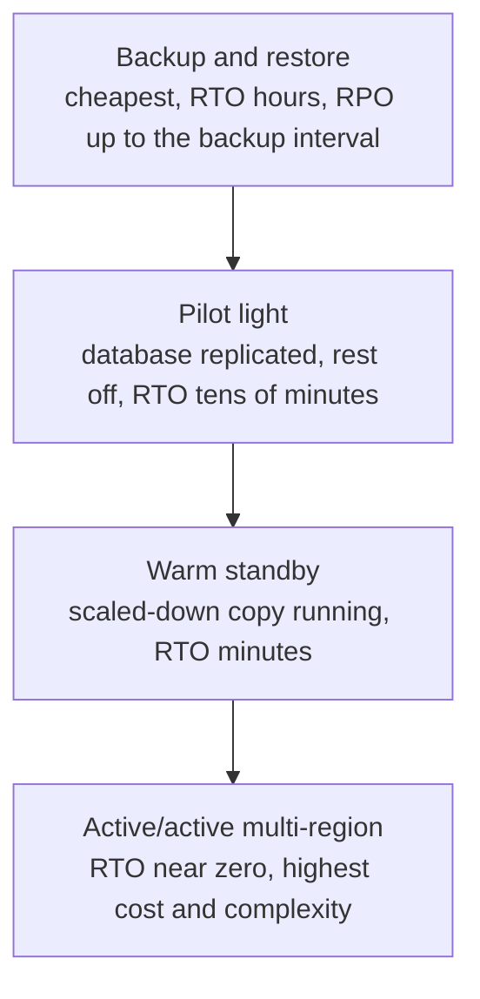

# L0.9 — Disaster Recovery

> **Level 0: What DevOps Actually Is** · Topic 9 of 13 · ⏱ ~3 hours · Difficulty: Beginner

## 1. What it is

**Disaster recovery (DR)** is the set of plans, tools and rehearsed procedures that bring a service and its data back after a serious failure: a deleted database, a corrupted disk, ransomware, a lost cloud region, a bad deploy that wrote garbage for six hours.
It answers two business questions, each with its own acronym:

- **RPO — Recovery Point Objective:** how much *data* can we afford to lose, measured in time? An RPO of 15 minutes means that after recovery, the newest data may be up to 15 minutes old.
- **RTO — Recovery Time Objective:** how long can the service be *down*? An RTO of 1 hour means we must be serving again within one hour of the disaster.

The two basic tools are **backups** (copies of data stored somewhere else, from which you can restore) and **failover** (switching to a standby copy of the system, in another zone or region, that is already running or can be started quickly).
**High availability** ([High Availability and Scalability](08-high-availability-and-scalability.md)) handles small, frequent failures automatically; **disaster recovery** handles the big, rare ones, including those caused by people and by software, where redundancy alone does not help (a replica faithfully copies your accidental `DELETE`).

This page is the overview; the practical depth is in Level 15: [Backups](../level-15-disaster-recovery/01-backups.md), [Failover](../level-15-disaster-recovery/05-failover.md), [RPO](../level-15-disaster-recovery/06-rpo.md) and [RTO](../level-15-disaster-recovery/07-rto.md).

## 2. Why it matters in DevOps

- **Redundancy is not a backup.** Replication copies mistakes and malicious changes instantly. Only a point-in-time copy can take you back to "before the mistake".
- **Untested backups are not backups.** The common discovery during a disaster is that the backup job has been failing for months, or that nobody knows the restore procedure.
- **RPO and RTO turn a vague wish ("we should be safe") into numbers** that engineering can design for and the business can pay for. Tighter numbers cost much more.
- **Compliance and contracts** often require specific retention, off-site copies and tested recovery.
- **Ransomware and account compromise** make offline or immutable, separately-credentialed copies a security control, not just an ops one ([Level 15: Off-site Backups](../level-15-disaster-recovery/08-offsite-backups.md)).

## 3. Real-world system example

**GitLab.com, January 2017.** GitLab has publicly documented a production database incident in which an engineer, while working on a replication problem, removed data from the wrong database server. Several backup and replication mechanisms turned out not to be working as expected,
and the team ultimately restored from a snapshot that was hours old, losing some hours of recent database data (such as issues and comments; Git repositories were not affected). GitLab published a candid post-mortem and streamed the recovery. The widely quoted lesson is that having several backup methods is worthless if none of them is verified by an actual restore.

**AWS disaster recovery strategies.** AWS publishes a whitepaper describing four DR patterns of increasing cost and decreasing recovery time: **backup and restore**, **pilot light** (core pieces such as the database kept running in the recovery region, the rest switched off), **warm standby** (a scaled-down but fully functional copy always running), and **multi-site active/active**.
Managed services expose the building blocks: RDS automated backups and point-in-time recovery, EBS and RDS snapshots, S3 cross-region replication, and Route 53 failover routing. See [Level 6: RDS and Aurora](../level-06-cloud-aws/10-rds-and-aurora.md).

**PostgreSQL** itself documents continuous archiving and point-in-time recovery (PITR): base backups plus a stream of write-ahead log (WAL) files let you replay the database to any moment, e.g. one minute before the bad `DROP TABLE`. Tools such as pgBackRest and WAL-G are widely used for this in production ([Level 13: Backups and Point-in-Time Recovery](../level-13-databases-distributed-systems/05-backups-and-pitr.md)).

## 4. Diagram

RPO and RTO on a timeline:


The DR spectrum, trading cost for speed:



## 5. How it works

### Backups: what makes one trustworthy

| Property | Question to ask |
|---|---|
| **Frequency** | Is it at least as often as the RPO? (Hourly backups cannot promise a 5-minute RPO.) |
| **Consistency** | Is the backup a valid database state (snapshot or backup API), not a file copy taken mid-write? |
| **Location** | Is a copy outside the failure domain: another region, another account, offline? |
| **Immutability and access** | Can an attacker or a mistake with the production credentials also delete the backups? |
| **Retention** | How far back can you go? (A corruption noticed two weeks later needs two-week-old data.) |
| **Encryption** | Are backups encrypted, and are the keys stored somewhere that survives the disaster? |
| **Restore tested** | When did you last restore it end to end and time it? |

A widely used rule of thumb is **3-2-1**: three copies of the data, on two different kinds of storage, with one off-site.

### Backup types

- **Logical** (`pg_dump`, `mysqldump`): portable SQL or archive files; slower to restore on large data; good for small databases and migrations.
- **Physical / snapshot** (volume snapshots, `pg_basebackup`): fast to take and restore; tied to the same engine version and platform.
- **Continuous / PITR** (WAL archiving, binlogs): replay to any second; lowest RPO.
- **Full vs incremental:** a full copy is simple; incrementals save space and time but need the chain intact to restore.

### Failover

Failover means redirecting users from a failed primary to a standby. Ingredients: a replica with up-to-date data, a way to *detect* failure reliably, a way to *promote* the replica to primary, and a way to *redirect* traffic (DNS, load balancer, virtual IP).
Automatic failover shortens RTO but risks **split brain** (two nodes both believing they are primary) and **failing over on a false alarm**; many teams automate within a region and keep cross-region failover as a deliberate, human-triggered decision. After failover comes **failback**: returning to the original site safely.

### Choosing RPO/RTO

Start from the cost of downtime and data loss per hour for each service, then choose tiers: the checkout path may need RPO of minutes and RTO under an hour, while an internal reporting dashboard can tolerate RPO of a day and RTO of several days. Different services deserve different targets.

## 6. Step-by-step guide

**Goal:** simulate a small production database with a live writer, take backups, destroy the database, restore from the latest backup, and *measure* the actual data loss (RPO) and restore time (RTO).
**Prerequisites:** Python 3 (its standard `sqlite3` module, which includes an online-backup API). Everything runs in a directory under your home. **Cost: none.** The real-database variant with PostgreSQL appears at the end of the guide.

1. **Create the working directory and the three scripts.**
```bash
mkdir -p ~/dr-demo && cd ~/dr-demo
cat > writer.py <<'EOF'
# writer.py - pretend to be shop-api: write one order every 0.2 s. Ctrl-C or kill to stop.
import sqlite3, time

db = sqlite3.connect("shop.db", isolation_level=None)   # autocommit: every insert is durable
db.execute("PRAGMA journal_mode=WAL")
db.execute("CREATE TABLE IF NOT EXISTS orders (id INTEGER PRIMARY KEY, created REAL)")
while True:
    db.execute("INSERT INTO orders (created) VALUES (?)", (time.time(),))
    n = db.execute("SELECT count(*) FROM orders").fetchone()[0]
    with open("written.count", "w") as f:       # the "truth" we compare against after the disaster
        f.write(str(n))
    time.sleep(0.2)
EOF
cat > backup.py <<'EOF'
# backup.py - consistent online backup using SQLite's backup API (safe while writer runs).
import sqlite3, sys, time, os

os.makedirs("backups", exist_ok=True)
dest = f"backups/shop-{int(time.time())}.db"
src = sqlite3.connect("shop.db")
dst = sqlite3.connect(dest)
src.backup(dst)
dst.close()
rows = sqlite3.connect(dest).execute("SELECT count(*) FROM orders").fetchone()[0]
print(f"backup {dest}: {rows} orders")
EOF
cat > restore.py <<'EOF'
# restore.py - restore the newest backup into shop.db, verify it, and report what was lost.
import glob, os, shutil, sqlite3, time

t0 = time.time()
latest = sorted(glob.glob("backups/shop-*.db"))[-1]
for ext in ("", "-wal", "-shm"):
    if os.path.exists("shop.db" + ext):
        os.remove("shop.db" + ext)
shutil.copy(latest, "shop.db")
db = sqlite3.connect("shop.db")
assert db.execute("PRAGMA integrity_check").fetchone()[0] == "ok", "backup is corrupt!"
restored = db.execute("SELECT count(*) FROM orders").fetchone()[0]
written = int(open("written.count").read())
newest = db.execute("SELECT max(created) FROM orders").fetchone()[0]
print(f"restored from {latest}")
print(f"orders restored: {restored}, orders written before disaster: {written}")
print(f"data lost: {written - restored} orders  (about {(written - restored) * 0.2:.1f} s of data = actual RPO)")
print(f"restore took {time.time() - t0:.2f} s of copy + verify  (actual RTO is this plus detection and human time)")
EOF
```

2. **Start the "application" and take two backups while it is running.**
```bash
python3 writer.py & echo $! > writer.pid
sleep 2; python3 backup.py
sleep 2; python3 backup.py
sleep 1.5
```
   Expected (counts vary): `backup backups/shop-<timestamp>.db: 10 orders`, then a later one with about `20 orders`. The writer keeps writing after the last backup; that is the data at risk.

3. **Disaster strikes.** Kill the application and destroy the database, as a bad migration, a deleted volume or ransomware might.
```bash
kill -9 "$(cat writer.pid)"
rm -f shop.db shop.db-wal shop.db-shm
ls
```
   Expected: `shop.db` is gone. `backups/` and `written.count` remain (`written.count` is only our measuring stick; in reality you would not know the number).

4. **Restore and measure.**
```bash
python3 restore.py
```
   Expected (similar to):
   ```text
   restored from backups/shop-1791506834.db
   orders restored: 20, orders written before disaster: 28
   data lost: 8 orders  (about 1.6 s of data = actual RPO)
   restore took 0.00 s of copy + verify  (actual RTO is this plus detection and human time)
   ```
   The loss equals the writes since the last backup. Backing up more often shrinks the RPO; here the data is tiny, so restore is instant. With 500 GB it would not be, which is why you *time* restores.

5. **Prove the restored data is usable and that the application can continue.**
```bash
python3 -c "import sqlite3; print(sqlite3.connect('shop.db').execute('SELECT count(*), max(id) FROM orders').fetchone())"
```
   Expected: a pair such as `(20, 20)`. Start `python3 writer.py &` again and it continues from there.

6. **Real database variant (PostgreSQL; commands shown for reference, output varies).** On a database named `shop` with Docker or a local server:
```bash
# backup (custom format, compressed, restorable in parallel)
pg_dump -Fc -h localhost -U postgres -f shop.dump shop
# "disaster"
dropdb -h localhost -U postgres shop
# restore into a fresh database
createdb -h localhost -U postgres shop
pg_restore -h localhost -U postgres -d shop --no-owner shop.dump
psql -h localhost -U postgres -d shop -c "SELECT count(*) FROM orders;"
```
   A dump is a *logical backup with an RPO equal to the dump interval*. For a lower RPO, you add WAL archiving and point-in-time recovery ([Level 13](../level-13-databases-distributed-systems/05-backups-and-pitr.md)).

7. **Clean up.**
```bash
pkill -f "writer.py" 2>/dev/null; cd ~ && rm -rf ~/dr-demo
```

## 7. Real-world scenario

*Illustrative.* The `shop-api` team keeps PostgreSQL on a managed instance with daily snapshots and believes it is covered. A developer runs a data-cleanup script against production instead of staging, and `UPDATE orders SET status = 'cancelled'` hits every row at 14:05. The replica copies the change within a second; failover would only move the damage to a second machine.
The team recognises the failure mode from their DR plan: this is a logical error, so they need point-in-time recovery rather than failover. They restore the database to a new instance at the state of 14:04 using the managed service's PITR, validate row counts, point the application at the new instance, and then
copy back only the orders placed between 14:04 and the switch. Total time to service: 55 minutes (their RTO is 60); data lost: zero, because the write-ahead log was archived continuously (their RPO is 5 minutes).

What made it work was an earlier game day: they had restored the same database once, measured 40 minutes, and written down the exact commands. **Lesson:** match the recovery tool to the failure (hardware loss needs failover; human error needs a point-in-time copy), and rehearse before you need it.

## 8. Common mistakes and best practices

**Don't**

- Treat replication, RAID or a Multi-AZ setting as a backup.
- Store backups only in the same account, region or server as the data they protect.
- Assume a successful backup *job* means a restorable backup.
- Pick RPO/RTO numbers that nobody has costed or tested.
- Keep the restore instructions (or the encryption keys) only on the system that is down.
- Give production application credentials permission to delete backups.

**Do**

- Define RPO and RTO per service, with the business, and write them down.
- Follow 3-2-1, keep at least one copy immutable or offline, and use separate credentials for backups.
- Automate backups, monitor them (alert when the newest backup is older than the RPO), and test restores on a schedule.
- Keep a runbook for each failure type: instance loss, data corruption, zone loss, region loss, account compromise.
- Run game days: actually restore, actually fail over, time it, fix what you learn ([Level 15: Failure Scenario Drills](../level-15-disaster-recovery/10-failure-scenario-drills.md)).
- Record the actual RPO/RTO achieved in each test and compare with the targets.

## 9. Tasks

- [ ] **T1 — Backup, destroy, restore** *(≈30 min, beginner)*
  - **Goal:** run a full DR cycle and see the RPO.
  - **Steps:**
    1. Complete guide steps 1-5.
    2. Record the "data lost" and "restore took" lines.
  - **Done when:** `shop.db` is restored from a backup, `restore.py` reports a loss in orders, and you can state the measured RPO in seconds.

- [ ] **T2 — Shrink the RPO** *(≈30 min, beginner)*
  - **Goal:** see the cost of tighter RPO.
  - **Steps:**
    1. Run the cycle again but take a backup every second with `while true; do python3 backup.py; sleep 1; done` in another terminal.
    2. Kill the writer and delete the database, then restore.
    3. Compare the lost-orders number and count how many backup files you accumulated per minute.
  - **Done when:** the lost data is about one second or less, and you can state the trade-off (storage and I/O cost against data loss).

- [ ] **T3 — Backup retention and pruning** *(≈40 min, intermediate)*
  - **Goal:** keep backups bounded without losing history.
  - **Steps:**
    1. Write `prune.sh` that keeps the newest 5 backups plus the oldest one of each minute older than 5 minutes (a toy grandfather-father-son policy), and deletes the rest.
    2. Run it with a `--dry-run` flag that only prints what it would delete.
  - **Done when:** after pruning, `ls backups` matches your policy and the dry run listed exactly the files that were later removed.

- [ ] **T4 — A corrupt backup** *(≈35 min, intermediate)*
  - **Goal:** discover why you verify.
  - **Steps:**
    1. Truncate the newest backup: `truncate -s 1000 backups/<newest>.db`.
    2. Run `restore.py` and observe the failure or the integrity check.
    3. Change `restore.py` to verify each backup newest-first and restore the newest one that passes.
  - **Done when:** the modified script skips the broken file, restores the previous good backup and prints which one it used and why.

- [ ] **T5 — Write a mini DR plan for shop-api** *(≈45 min, intermediate)*
  - **Goal:** turn RPO and RTO into a design.
  - **Steps:**
    1. List the components of `shop-api` (Node.js API, PostgreSQL, Redis, uploaded images, secrets).
    2. For each, state the RPO and RTO you would choose, the backup or replication method, and where the copy is stored.
    3. Note which failures each design survives: instance loss, data deletion, zone loss, region loss.
  - **Done when:** you have a table with one row per component and a column showing which of the four failure types is covered, with at least one honest "not covered" entry.

- [ ] **T6 — Prove it: a timed restore drill** *(≈60 min, advanced)*
  - **Goal:** demonstrate recovery unaided and report real numbers.
  - **Steps:**
    1. Without the guide, build a database with a live writer, automated backups, and a monitor that alerts (prints a warning) if the newest backup is older than a threshold.
    2. Trigger a disaster of your choice (delete the file, truncate a table) and recover.
    3. Write a three-line report: actual RPO, actual RTO (including how long it took you to notice), and the one change that would improve each.
  - **Done when:** you recovered the database, the monitor fired when you stopped backups, and your report names measured numbers rather than estimates.

## 10. Self-check questions

1. Define RPO and RTO, and say what costs more: a smaller RPO or a larger one?
2. Why is a replica not a backup?
3. What is the 3-2-1 backup rule?
4. Name the four AWS DR strategies in order of cost.
5. Why must restores be tested, and what should you measure?

<details>
<summary>Answers</summary>

1. RPO is how much data (as time) you can lose; RTO is how long you can be down. A smaller RPO or RTO costs more, because it needs more frequent copies, standby capacity or continuous replication.
2. A replica copies every change instantly, including mistakes and deletions, so it cannot take you back to an earlier state. It protects against hardware failure; a backup (or PITR) protects against data errors.
3. Keep three copies of the data, on two different kinds of storage, with one copy off-site.
4. Backup and restore, pilot light, warm standby, multi-site active/active.
5. Backups can fail silently or be unrestorable. Measure whether the restore succeeds, how long it takes (actual RTO), and how much data is missing (actual RPO), and compare with the targets.
</details>

## 11. Further reading

- AWS whitepaper "Disaster Recovery of Workloads on AWS: Recovery in the Cloud" (docs.aws.amazon.com).
- PostgreSQL documentation, chapters "Backup and Restore" and "Continuous Archiving and Point-in-Time Recovery" (postgresql.org/docs).
- GitLab's public post-mortem of the January 2017 database incident (search "GitLab.com database incident" on about.gitlab.com).
- *Site Reliability Engineering* (Google, sre.google/books) — the chapter on data integrity.
- See also: [Level 15: Backups](../level-15-disaster-recovery/01-backups.md) and [Level 15: Testing Backup Restoration](../level-15-disaster-recovery/09-testing-backup-restoration.md).

<!-- nav -->
---
← Previous: [High Availability and Scalability](08-high-availability-and-scalability.md) · [Level 0 index](README.md) · Next: [Observability](10-observability.md) →
