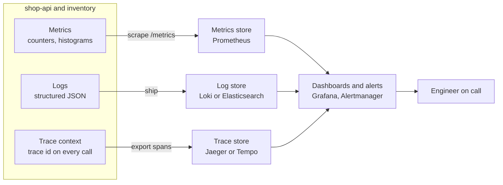
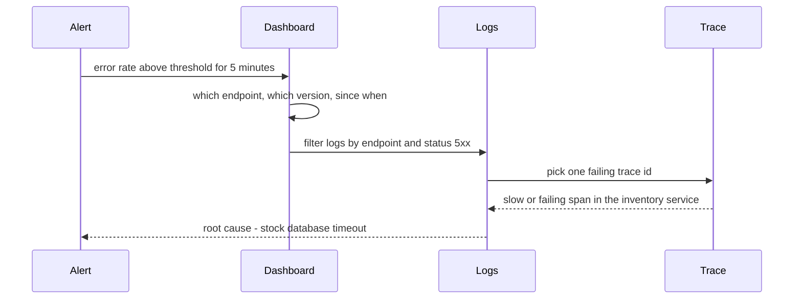

# L0.10 — Observability

> **Level 0: What DevOps Actually Is** · Topic 10 of 13 · ⏱ ~3 hours · Difficulty: Beginner

## 1. What it is

**Observability** is how well you can understand what a running system is doing, and why, from the data it emits — without having to ship new code to find out. In practice that data comes in three main forms, often called the **three pillars**:

- **Metrics** — numbers measured over time (requests per second, error rate, CPU, queue depth). Cheap to store and great for dashboards and alerts: they tell you *that* something is wrong.
- **Logs** — timestamped records of individual events ("order 4411 failed: stock database timeout"). They tell you *what happened* in detail.
- **Traces** — the path of one request as it crosses services, with the time spent in each step. They tell you *where* in a chain of services the time or the error came from.

**Monitoring** and observability are related but not identical. Monitoring watches for *known* failure modes: you decide in advance what to measure and alert on ("page me if the error rate exceeds 2 percent"). Observability is the property that lets you investigate *unknown* problems:
you can slice rich data by any attribute (customer, version, region) and ask questions you did not think of beforehand. Monitoring is something you do; observability is something your system has. You need both.

This page is an overview. The detail lives in Level 10: start with [The Three Pillars](../level-10-observability/01-three-pillars.md).

## 2. Why it matters in DevOps

- **You cannot fix what you cannot see.** In distributed systems "the site is slow" could be any of a dozen causes; without data, debugging is guessing.
- **Mean time to detect and to resolve (MTTD, MTTR)** are dominated by how fast you can find the cause, not by how fast you can type the fix.
- **Deploys need feedback.** Canary and rollback decisions are made on metrics ([Deployment Strategies](07-deployment-strategies.md)); SLOs are measured from them ([Site Reliability Engineering](11-sre.md)).
- **Immutable, autoscaled instances disappear.** The server that failed may be gone, so logs and metrics must live off the box ([Immutable Infrastructure](05-immutable-infrastructure.md)).
- **Alert quality decides sleep quality.** Good signals produce few, actionable pages; poor ones produce noise, and engineers start ignoring alerts.

## 3. Real-world system example

**Prometheus and Grafana.** Prometheus, originally built at SoundCloud and now a graduated project of the Cloud Native Computing Foundation (CNCF), is the de facto standard for metrics in Kubernetes environments. It **scrapes** an HTTP `/metrics` endpoint on each target at a regular interval, stores the time series, and evaluates alert rules; Grafana draws the dashboards.
The text format you will emit below is that format. See [Level 10: Prometheus and PromQL](../level-10-observability/02-prometheus-and-promql.md).

**Google Dapper and distributed tracing.** Google published a 2010 paper describing Dapper, its internal distributed tracing system, which attaches an identifier to a request and propagates it across every service call. That design inspired open-source systems such as Zipkin and Jaeger and, in the end, the vendor-neutral **OpenTelemetry** standard (a CNCF project formed from the merger of OpenTracing and OpenCensus) for metrics, logs and traces ([Level 10: Distributed Tracing](../level-10-observability/08-distributed-tracing.md), [Level 10: OpenTelemetry](../level-10-observability/09-opentelemetry.md)).

**Netflix** has publicly described building its own telemetry platforms, including Atlas, an in-memory dimensional time-series system it open-sourced, because the volume of metrics from a large streaming platform demands special engineering. The general lesson is that observability data itself becomes a large system that must be designed, budgeted and operated.

**The ELK and Loki families** (Elasticsearch/Logstash/Kibana, and Grafana Loki) are common ways to collect and search logs from many hosts and containers in one place ([Level 10: Log Aggregation with Loki](../level-10-observability/06-loki-log-aggregation.md)).

## 4. Diagram

How telemetry flows from your service to people:



The debugging path: metrics say that, logs say what, traces say where.



## 5. How it works

### The three pillars compared

| | Metrics | Logs | Traces |
|---|---|---|---|
| Data | Numbers aggregated over time | Discrete event records | A tree of timed spans for one request |
| Question answered | Is something wrong? How bad? | What exactly happened? | Where did the time or error come from? |
| Volume and cost | Low, bounded by series count | High, grows with traffic | Medium, usually sampled |
| Good for | Dashboards, alerts, SLOs, capacity | Debugging, audit, forensics | Latency analysis across services |
| Example | `http_requests_total{status="500"}` | `{"level":"error","msg":"stock timeout"}` | 268 ms request: 3 ms in API, 266 ms in inventory |
| Pitfall | High-cardinality labels blow up storage | Unstructured text is hard to query | Missing propagation breaks the chain |

### Ideas worth knowing from day one

- **Golden signals / RED / USE.** For a service watch latency, traffic, errors and saturation (the Google SRE "four golden signals"); a common request-service shorthand is RED (Rate, Errors, Duration); for resources it is USE (Utilisation, Saturation, Errors). Detail in [Level 10: What to Monitor](../level-10-observability/11-what-to-monitor.md).
- **Structured logs.** Log JSON (key/value fields), not sentences, so machines can filter by `status` or `customer_id` ([Level 10: Structured Logging](../level-10-observability/05-structured-logging.md)).
- **Correlation / trace IDs.** Generate an ID at the edge and pass it through every service call and every log line so one request can be reassembled ([Level 10: Correlation IDs](../level-10-observability/07-correlation-ids.md)).
- **Cardinality.** Every unique combination of label values is a separate time series. Labels like `user_id` or `request_id` on metrics will melt a metrics store; put such detail in logs and traces.
- **Percentiles, not averages.** Averages hide the slow tail. Track p50, p95, p99 latency; histograms make that possible.
- **Alert on symptoms, not causes.** Page on "users are seeing errors or slowness" and use dashboards to investigate causes like "CPU at 90 percent".
- **Monitoring vs observability, in one line:** dashboards show you the problems you predicted; high-quality, queryable telemetry helps you with the ones you did not.

## 6. Step-by-step guide

**Goal:** run two tiny services, generate load, and use all three signals to find a real failure: read **metrics** to see the problem exists, **logs** to see what failed, and a **trace id** to follow one request across both services.
**Prerequisites:** Python 3 and `curl`. Ports 9001 and 9002 on `127.0.0.1`. **Cost: none.**

1. **Create the services.** One file runs either role. The `api` service calls the `inventory` service; `inventory` is slow and fails about 15 percent of the time. Both write JSON logs, count requests, and pass an `X-Trace-Id` header.
```bash
mkdir -p ~/obs-demo && cd ~/obs-demo
cat > svc.py <<'EOF'
# svc.py - two tiny services in one file.  python3 svc.py api 9001   |   python3 svc.py inventory 9002
# Each request emits: a structured JSON log line (LOGS), counters/latency in /metrics (METRICS),
# and a trace_id passed between services so one request can be followed end to end (TRACES).
import json, random, sys, time, urllib.request, uuid
from http.server import BaseHTTPRequestHandler, HTTPServer

ROLE, PORT = sys.argv[1], int(sys.argv[2])
STATS = {"requests_total": 0, "errors_total": 0, "duration_ms_sum": 0.0}
BUCKETS = [100, 250, 500, 1000]                       # latency histogram upper bounds in ms
HIST = {b: 0 for b in BUCKETS}

def log(**fields):
    print(json.dumps({"ts": round(time.time(), 3), "service": ROLE, **fields}), flush=True)

class H(BaseHTTPRequestHandler):
    def do_GET(self):
        if self.path == "/metrics":
            lines = [f"shop_requests_total {STATS['requests_total']}",
                     f"shop_errors_total {STATS['errors_total']}",
                     f"shop_request_duration_ms_sum {STATS['duration_ms_sum']:.1f}"]
            lines += [f'shop_request_duration_ms_bucket{{le="{b}"}} {HIST[b]}' for b in BUCKETS]
            body, code = ("\n".join(lines) + "\n").encode(), 200
        else:
            start = time.time()
            trace_id = self.headers.get("X-Trace-Id") or uuid.uuid4().hex[:8]
            code, msg = 200, "ok"
            if ROLE == "inventory":
                time.sleep(random.uniform(0.05, 0.3))
                if random.random() < 0.15:
                    code, msg = 500, "stock database timeout"
            else:
                req = urllib.request.Request("http://127.0.0.1:9002/stock", headers={"X-Trace-Id": trace_id})
                try:
                    urllib.request.urlopen(req, timeout=2).read()
                except Exception as e:
                    code, msg = 502, f"inventory call failed: {e}"
            ms = (time.time() - start) * 1000
            STATS["requests_total"] += 1
            STATS["duration_ms_sum"] += ms
            if code >= 500:
                STATS["errors_total"] += 1
            for b in BUCKETS:
                if ms <= b:
                    HIST[b] += 1
            log(trace_id=trace_id, path=self.path, status=code, duration_ms=round(ms), msg=msg)
            body = json.dumps({"status": code, "trace_id": trace_id}).encode()
        self.send_response(code)
        self.send_header("Content-Length", str(len(body)))
        self.end_headers()
        self.wfile.write(body)
    def log_message(self, *a):
        pass

HTTPServer(("127.0.0.1", PORT), H).serve_forever()
EOF
```

2. **Start both services, sending their logs to files (as a log shipper would collect them).**
```bash
python3 svc.py inventory 9002 > inventory.log & echo $! > inventory.pid
python3 svc.py api 9001 > api.log & echo $! > api.pid
sleep 1
```

3. **Generate traffic.**
```bash
for i in $(seq 1 40); do curl -s -o /dev/null localhost:9001/order; done
```

4. **Metrics: is something wrong, and how bad?** The `/metrics` endpoint uses the Prometheus text format.
```bash
curl -s localhost:9001/metrics
```
   Expected (numbers vary run to run):
   ```text
   shop_requests_total 40
   shop_errors_total 8
   shop_request_duration_ms_sum 7782.4
   shop_request_duration_ms_bucket{le="100"} 3
   shop_request_duration_ms_bucket{le="250"} 34
   shop_request_duration_ms_bucket{le="500"} 40
   shop_request_duration_ms_bucket{le="1000"} 40
   ```
   Read it: error rate is `8 / 40 = 20 percent` (an alert would have fired). Buckets are cumulative: 34 of 40 requests finished within 250 ms, so the slowest ones are in the 250-500 ms range. Average latency `7782 / 40 ≈ 195 ms`. The metrics tell you *that* there is a problem but not *why*.

5. **Logs: what failed?** Filter the structured logs for server errors.
```bash
head -2 api.log
grep -c '"status": 502' api.log
grep '"status": 502' api.log | head -2
```
   Expected: JSON lines with `trace_id`, `status`, `duration_ms`; a count of failures matching the metric (for example `8`); and messages like `inventory call failed: HTTP Error 500: Internal Server Error`. The API is failing because its dependency failed, but you still do not know *which part* of the time or error belonged to which service.

6. **Traces: follow one request across both services.** Pick a failing request's trace id, and search both logs for it.
```bash
TRACE=$(grep '"status": 502' api.log | head -1 | python3 -c "import sys,json; print(json.loads(sys.stdin.readline())['trace_id'])")
echo "trace id: $TRACE"
grep -h "$TRACE" api.log inventory.log
```
   Expected: two lines with the same `trace_id`, similar to (the order may differ):
   ```text
   {"ts": 1791506909.957, "service": "api", "trace_id": "ec99e54f", "path": "/order", "status": 502, "duration_ms": 268, "msg": "inventory call failed: HTTP Error 500: Internal Server Error"}
   {"ts": 1791506909.956, "service": "inventory", "trace_id": "ec99e54f", "path": "/stock", "status": 500, "duration_ms": 266, "msg": "stock database timeout"}
   ```
   Now you can see the whole story: the API spent 268 ms, of which 266 ms was the inventory service, which failed with a stock database timeout. A real tracing system (Jaeger, Tempo) draws exactly this as a waterfall of spans, using the same propagated ID idea, and OpenTelemetry automates the propagation.

7. **Ask a question you did not plan for.** Because the logs are structured, new questions are cheap. Which requests were slow *and* successful?
```bash
python3 - <<'EOF'
import json
for line in open("api.log"):
    r = json.loads(line)
    if r["status"] == 200 and r["duration_ms"] > 250:
        print(r["trace_id"], r["duration_ms"])
EOF
```
   Expected: possibly few or zero lines (the services are at most about 300 ms). Change the threshold and the filter and you have done what "observability" means: querying existing data in a new way without redeploying. Had the logs been plain sentences, this would have required regular expressions and guesswork.

8. **Clean up.**
```bash
kill "$(cat api.pid)" "$(cat inventory.pid)"
cd ~ && rm -rf ~/obs-demo
```

## 7. Real-world scenario

*Illustrative.* At 09:10 an alert fires: the checkout error rate is 6 percent, above the 2 percent threshold for five minutes. The on-call engineer opens the dashboard (**metrics**): errors started at 09:02, only on `POST /checkout`, and only for version `2.14.0`, which was deployed at 09:00.
She filters the **logs** for `service=shop-api status=500 version=2.14.0` and sees the message `redis: connection pool exhausted`. She picks one failing `trace_id` and opens the **trace**: the checkout request spends 30 seconds waiting on a Redis call inside a new loop that fetches cart items one at a time.

She rolls back to 2.13.x (the canary had only covered 5 percent for two minutes, too short to see a pool problem), error rate returns to baseline at 09:18, and the next day the team fixes the loop, adds a connection-pool saturation metric and extends the canary window. Total time to understand the problem: about six minutes, because every signal pointed to the next one. Without a trace id on the logs, it would have been guesswork across four services. **Lesson:** the value is in the connections between signals: metric to log to trace, joined by consistent labels and IDs.

## 8. Common mistakes and best practices

**Don't**

- Collect everything and look at nothing: dashboards nobody reads and alerts nobody trusts.
- Alert on every CPU spike or on causes. Page only on conditions where a human must act now.
- Put high-cardinality values (user IDs, request IDs, raw URLs) into metric labels.
- Log secrets, tokens, full card numbers or personal data.
- Log unstructured sentences that you will need regular expressions to parse.
- Rely on averages for latency.
- Keep logs only on the server that may be destroyed.

**Do**

- Instrument the four golden signals (or RED) for every service from the start.
- Emit structured logs with a consistent set of fields: timestamp, level, service, version, trace_id.
- Propagate a trace/correlation ID across every hop, including queues and background jobs.
- Record the deployed version in metrics and logs so you can compare before and after a release.
- Link every alert to a dashboard and a runbook, and review alerts that fired without action.
- Budget for observability data: retention, sampling, and cost are design decisions.

## 9. Tasks

- [ ] **T1 — Run the three signals** *(≈30 min, beginner)*
  - **Goal:** observe metrics, logs and a trace id for the same failure.
  - **Steps:**
    1. Complete guide steps 1-6.
    2. Write down for the same failing request: its metric contribution, its log line, and its trace id lines in both services.
  - **Done when:** you can show `shop_errors_total` from `/metrics`, the matching count from `grep -c`, and two log lines sharing one `trace_id`.

- [ ] **T2 — Compute SLI numbers from raw data** *(≈30 min, beginner)*
  - **Goal:** derive availability and p95 latency from the logs.
  - **Steps:**
    1. Send 200 requests.
    2. Using Python on `api.log`, compute the success rate and the 95th-percentile `duration_ms`.
    3. Compare with the average latency from the metrics and explain the difference.
  - **Done when:** you have a success percentage and a p95 value, and your explanation says why p95 is larger than the mean.

- [ ] **T3 — Add a new metric and a new log field** *(≈40 min, intermediate)*
  - **Goal:** instrument something yourself.
  - **Steps:**
    1. Add a `version` field (read from an environment variable `APP_VERSION`, default `1.0.0`) to every log line and a `shop_build_info{version="..."} 1` line to `/metrics`.
    2. Restart the services with `APP_VERSION=1.1.0` and send traffic.
    3. Query the logs for lines by version.
  - **Done when:** `curl localhost:9001/metrics` shows the build info metric and `grep '"version": "1.1.0"' api.log` returns lines.

- [ ] **T4 — Break the trace and repair it** *(≈35 min, intermediate)*
  - **Goal:** feel why propagation matters.
  - **Steps:**
    1. Remove the `X-Trace-Id` header from the `api` call to inventory.
    2. Reproduce a failure and try to connect the API log line to the inventory log line using only timestamps.
    3. Restore the header and compare how long each method takes.
  - **Done when:** you can state, from your own attempt, why timestamp matching becomes unreliable under concurrent load (run two `curl` loops at once to see).

- [ ] **T5 — Write a symptom-based alert** *(≈45 min, intermediate)*
  - **Goal:** turn a metric into a useful alert.
  - **Steps:**
    1. Write `alert.sh` that fetches `/metrics` twice, 10 seconds apart, computes the error rate over that interval from the counters, and prints `ALERT` if it exceeds 5 percent.
    2. Run it while a `curl` loop is generating traffic.
    3. Explain why you compare counters over an interval instead of using the cumulative totals.
  - **Done when:** the script prints `OK` with a healthy service (change `0.15` to `0` in `svc.py` and restart `inventory`), prints `ALERT` with the failing one, and your explanation mentions that counters only increase.

- [ ] **T6 — Prove it: diagnose an unknown failure** *(≈50 min, advanced)*
  - **Goal:** use signals to find a cause you were not told.
  - **Steps:**
    1. Ask a friend (or change the code yourself without looking) to add a hidden fault: for example, `inventory` becomes slow only for requests with `path=/order?sku=42`.
    2. Using only `/metrics`, logs and trace ids, identify which requests are affected and what the cause is.
    3. Write the investigation as three bullet points: what the metric showed, what the logs narrowed it to, what the trace id proved.
  - **Done when:** you identified the faulty condition without reading the source, and your write-up names which signal answered which question.

## 10. Self-check questions

1. Name the three pillars and the question each one answers best.
2. What is the difference between monitoring and observability?
3. Why should you not put `user_id` in a metric label?
4. What is a trace/correlation ID and where must it be propagated?
5. Why are percentiles better than averages for latency?

<details>
<summary>Answers</summary>

1. Metrics: is something wrong and how bad. Logs: what exactly happened. Traces: where in the chain of services the time or error arose.
2. Monitoring checks for known failure modes with predefined dashboards and alerts. Observability is the property of having rich, queryable telemetry so you can investigate unknown problems and ask new questions without changing the code.
3. Each unique label value creates a separate time series; thousands or millions of users would explode storage and query cost. Put per-user detail in logs or traces instead.
4. A unique identifier created at the edge of a request and passed on every call and logged by every service (HTTP headers, message metadata, job arguments), so all the signals for one request can be joined.
5. Averages hide the slow tail; a few very slow requests (which real users notice) barely move the mean, while p95 and p99 show what the unluckiest users experience.
</details>

## 11. Further reading

- *Site Reliability Engineering* (Google, free at sre.google/books) — the chapter on monitoring distributed systems (the four golden signals).
- *Observability Engineering* by Charity Majors, Liz Fong-Jones and George Miranda.
- Prometheus documentation (prometheus.io/docs) and Grafana documentation (grafana.com/docs).
- OpenTelemetry documentation (opentelemetry.io/docs).
- Google's paper "Dapper, a Large-Scale Distributed Systems Tracing Infrastructure" (2010).
- See also: [Level 10: Structured Logging](../level-10-observability/05-structured-logging.md) and [Level 10: Sentry](../level-10-observability/10-sentry.md).

<!-- nav -->
---
← Previous: [Disaster Recovery](09-disaster-recovery.md) · [Level 0 index](README.md) · Next: [Site Reliability Engineering](11-sre.md) →
