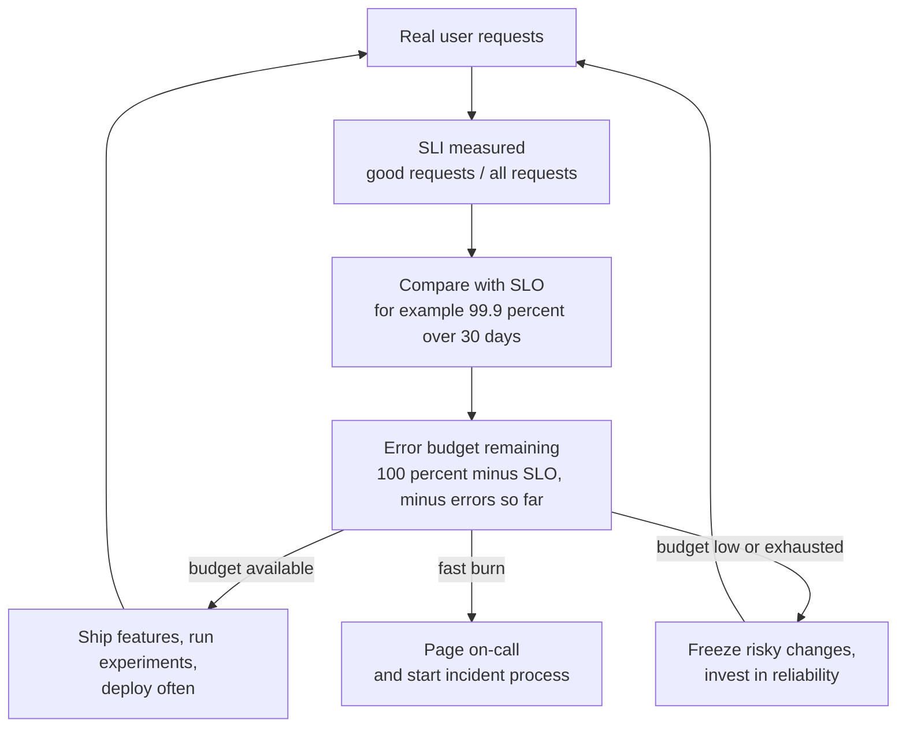

# L0.11 — Site Reliability Engineering

> **Level 0: What DevOps Actually Is** · Topic 11 of 13 · ⏱ ~3 hours · Difficulty: Beginner

## 1. What it is

**Site Reliability Engineering (SRE)** is an approach to operations that treats reliability as a software engineering problem. It began at Google, where a team of software engineers was asked to run production systems and responded by writing software to do it.
Its signature idea is to make reliability *measurable* and then manage it with numbers instead of arguments:

- An **SLI (Service Level Indicator)** is a measurement of how the service is behaving, such as "the percentage of HTTP requests that succeed" or "the percentage of requests faster than 300 ms".
- An **SLO (Service Level Objective)** is the target for an SLI over a time window: "99.9 percent of requests succeed over 30 days".
- An **SLA (Service Level Agreement)** is a *contract* with customers, usually with financial consequences, built on a looser target than the internal SLO.
- An **error budget** is the amount of unreliability the SLO allows: 100 percent minus the SLO. A 99.9 percent SLO leaves 0.1 percent of requests (or about 43 minutes per 30 days) as budget to "spend" on deploys, experiments and failures.
- **Toil** is manual, repetitive, automatable operational work with no lasting value ([Infrastructure Automation](06-infrastructure-automation.md)). SRE aims to cap it and engineer it away.

## 2. Why it matters in DevOps

- **It ends the oldest argument in tech.** Developers want to ship fast; operations wants stability. An error budget lets data decide: budget left means ship; budget gone means slow down and fix reliability.
- **100 percent is the wrong target.** Each extra nine costs far more and slows delivery, and users cannot tell the difference between 99.99 and 99.999 percent when their own phone or ISP is less reliable. The SLO says how reliable is *enough*.
- **It focuses alerting on user pain.** Alerts based on SLO burn rate tell you when users are affected, instead of paging on every CPU spike ([Observability](10-observability.md)).
- **It makes ops work visible and finite.** Tracking toil and capping it gives teams a principled way to say "automate this" ([Infrastructure Automation](06-infrastructure-automation.md)).
- **It builds a learning culture.** Blameless post-mortems and incident practices turn outages into improvements rather than blame.

## 3. Real-world system example

**Google.** The free book *Site Reliability Engineering* (2016) and its follow-up *The Site Reliability Workbook* describe Google's practice publicly. Key published ideas: the error budget as a shared tool between product and SRE teams; a guideline that SREs spend no more than about half their time on toil, with the rest on engineering work;
SLO-based alerting using burn rates over multiple time windows; and blameless post-mortems. Google also describes the model *"class SRE implements interface DevOps"* — SRE is one concrete way to do what DevOps advocates.

**Cloud provider SLAs.** AWS, Google Cloud and Microsoft Azure each publish SLAs for their services that state a monthly uptime percentage and the service credit a customer receives if the provider falls below it. These external SLAs sit underneath the providers' tighter, internal SLOs, which is the typical relationship: the SLO is stricter than the SLA so the team is warned before the contract is breached.

**Kubernetes and Prometheus.** The open-source tooling to *measure* SLIs is mainstream: Prometheus histograms for latency and counters for errors, Grafana dashboards, and projects such as Sloth and Pyrra that generate SLO recording rules and burn-rate alerts. See [Level 14: SLOs](../level-14-sre/02-slos.md) and [Level 14: Error Budgets](../level-14-sre/04-error-budgets.md).

## 4. Diagram

How SLI, SLO and the error budget drive decisions:



How the budget is spent during a month:


## 5. How it works

### The vocabulary, side by side

| Term | Question it answers | Example for `shop-api` | Who sets it |
|---|---|---|---|
| **SLI** | What do we measure? | Share of `POST /checkout` requests returning non-5xx in under 500 ms | Engineering, from user journeys |
| **SLO** | How good must it be? | 99.9 percent of checkouts good, over a rolling 30 days | Product and engineering together |
| **Error budget** | How much can fail? | 0.1 percent: about 43 minutes of full outage per 30 days | Derived from the SLO |
| **SLA** | What have we promised, with what penalty? | 99.5 percent monthly, service credits below that | Business and legal |
| **Burn rate** | How fast are we spending the budget? | 14.4x means a 30-day budget is gone in about 2 days | Computed from live metrics |

### Choosing good SLIs

Pick indicators users feel: **availability** (did it work), **latency** (was it fast enough), and where relevant **correctness**, **freshness** and **durability**. Measure as close to the user as practical (load balancer or client), and use a *ratio of good events to valid events* so the number is easy to compare with a target.

### Burn-rate alerting (the idea)

If you page whenever "error rate > 0.1 percent" you wake up for blips that cost nothing. If you page only when the monthly SLO is already lost, it is too late. The published approach alerts on the **rate of budget consumption**:
a high burn rate over a short window (for example 14.4x over one hour, which consumes 2 percent of a 30-day budget) pages immediately; a slower burn (for example 1x over three days) opens a ticket. Detail in [Level 14: Alert Fatigue Reduction](../level-14-sre/08-alert-fatigue-reduction.md).

### What an SRE team does besides numbers

- **Incident response and on-call** with defined roles and practice ([Level 14: Incident Management](../level-14-sre/05-incident-management.md), [On-call Practices](../level-14-sre/06-on-call-practices.md)).
- **Blameless post-mortems** that find system causes and track follow-up actions ([Level 14: Postmortems](../level-14-sre/07-postmortems.md)).
- **Capacity planning** and load testing ([Level 14: Capacity Planning](../level-14-sre/09-capacity-planning.md)).
- **Toil reduction:** automating the repeatable, with a toil budget.
- **Production readiness reviews:** checking a service has monitoring, rollbacks, runbooks and sensible limits before it launches.

### SRE and DevOps

DevOps is a culture and set of practices: shared ownership between development and operations, automation, fast feedback. SRE is a specific, prescriptive implementation of those ideas with job roles, metrics (SLOs) and rules (error budgets, toil caps). You can do DevOps without a team called SRE, and you can have an "SRE" team that does not do SRE.
The real test is whether reliability work is driven by data and owned by engineers who can change the code.

## 6. Step-by-step guide

**Goal:** compute an SLI, an SLO status, an error budget and a burn rate from 30 days of (illustrative) traffic data, then see how choosing a different SLO changes the decision.
**Prerequisites:** Python 3. No network. **Cost: none.**

1. **Generate 30 days of illustrative hourly traffic.** The data contains normal background errors (about 0.05 percent), a bad-deploy incident on day 12, and errors rising again on the last day.
```bash
mkdir -p ~/sre-demo && cd ~/sre-demo
cat > gen.py <<'EOF'
# gen.py - make 30 days of hourly request counts for shop-api (illustrative data, fixed seed).
import csv, random
random.seed(7)
with open("traffic.csv", "w", newline="") as f:
    w = csv.writer(f)
    w.writerow(["day", "hour", "total", "errors"])
    for day in range(1, 31):
        for hour in range(24):
            total = int(random.uniform(8000, 12000) * (1.5 if 9 <= hour <= 21 else 0.4))
            errors = int(total * random.uniform(0.0002, 0.0008))      # normal: about 0.05 percent
            if day == 12 and 14 <= hour <= 16:                         # an incident: bad deploy
                errors = int(total * 0.12)
            if day == 30 and hour >= 20:                               # today: errors rising again
                errors = int(total * 0.01)
            w.writerow([day, hour, total, errors])
EOF
python3 gen.py
head -3 traffic.csv
```
   Expected: `day,hour,total,errors` followed by rows such as `1,0,3718,1`. 720 rows in total (`wc -l` prints 721).

2. **Write the SLO calculator.**
```bash
cat > budget.py <<'EOF'
# budget.py - SLO, error budget and burn rate from traffic.csv.   python3 budget.py [slo_percent]
import csv, sys

SLO = float(sys.argv[1]) if len(sys.argv) > 1 else 99.9
rows = list(csv.DictReader(open("traffic.csv")))
total = sum(int(r["total"]) for r in rows)
errors = sum(int(r["errors"]) for r in rows)

sli = 100 * (total - errors) / total                  # the SLI: percent of good requests
allowed = total * (100 - SLO) / 100                   # the error budget, in requests
spent = 100 * errors / allowed

print(f"window: {len(rows)} hours, {total:,} requests, {errors:,} errors")
print(f"SLI (success rate): {sli:.3f}%   SLO target: {SLO}%")
print(f"error budget: {allowed:,.0f} failed requests allowed, {errors:,} used = {spent:.0f}% of budget")
print("status:", "BUDGET EXHAUSTED - freeze risky releases, work on reliability" if spent >= 100
      else "WARNING - slow down" if spent >= 75 else "OK - budget available, ship features")

# burn rate: how fast are we spending the budget right now compared with the pace that exactly uses it up?
last = rows[-4:]
t4, e4 = sum(int(r["total"]) for r in last), sum(int(r["errors"]) for r in last)
burn = (e4 / t4) / ((100 - SLO) / 100)
print(f"burn rate over last 4 hours: {burn:.1f}x  (1.0 = on pace to use exactly the whole budget in the window)")
if burn >= 14.4:
    print("PAGE: at this rate a 30-day budget is gone in about 2 days")
elif burn >= 1:
    print("TICKET: burning faster than sustainable")
EOF
```

3. **Evaluate the 99.9 percent SLO.**
```bash
python3 budget.py 99.9
```
   Expected (the data uses a fixed random seed, so you should see this):
   ```text
   window: 720 hours, 7,097,897 requests, 9,023 errors
   SLI (success rate): 99.873%   SLO target: 99.9%
   error budget: 7,098 failed requests allowed, 9,023 used = 127% of budget
   status: BUDGET EXHAUSTED - freeze risky releases, work on reliability
   burn rate over last 4 hours: 9.9x  (1.0 = on pace to use exactly the whole budget in the window)
   TICKET: burning faster than sustainable
   ```
   Read it: the service delivered 99.873 percent, which is *below* the 99.9 percent target; the budget is overspent (127 percent), mostly because of the three-hour incident on day 12. The policy answer is: pause risky feature releases until the incident window ages out and reliability work is done.

4. **Change the objective and watch the decision change.** The SLO is a business choice, not a fact of nature.
```bash
python3 budget.py 99.5
python3 budget.py 99.99
```
   Expected: at 99.5 percent the same data uses about 25 percent of the budget (`OK - budget available`); at 99.99 percent it uses over 1,000 percent and the last four hours burn at about 99x, which triggers the `PAGE` line. Same system, same traffic, three different conclusions. Which SLO is right depends on what users need and what the business will pay for.

5. **Find where the budget went.** Which days consumed it?
```bash
python3 - <<'EOF'
import csv, collections
errs = collections.Counter()
for r in csv.DictReader(open("traffic.csv")):
    errs[int(r["day"])] += int(r["errors"])
total = sum(errs.values())
for day, n in errs.most_common(3):
    print(f"day {day:2d}: {n:5d} errors = {100*n/total:.0f}% of all errors")
EOF
```
   Expected: day 12 (the incident) accounts for about 63 percent of all errors, with day 30 (about 5 percent) next. Here the budget is dominated by a few bad hours, not a steady trickle, which is typical and tells you to invest in deploy safety and rollback rather than in general hardening.

6. **Do the toil arithmetic.** Suppose the team's on-call spends 12 hours a week on manual restarts and cleanups out of a 40-hour week. That is 30 percent toil for one person. Write down which of those tasks would you automate first and what is the break-even (hours to automate versus hours saved per month). You practised this in [Infrastructure Automation](06-infrastructure-automation.md).

7. **Clean up.**
```bash
cd ~ && rm -rf ~/sre-demo
```

## 7. Real-world scenario

*Illustrative.* The `shop-api` team and the product manager disagree. The PM wants to launch a new recommendations feature on Thursday; the SRE-minded engineers worry about stability after a rough month. Before the SLO, this was a shouting match. With the 99.9 percent SLO agreed in advance, they open the dashboard: 127 percent of the 30-day error budget is spent, mostly from one bad deploy.
The pre-agreed policy says that when the budget is exhausted, only reliability fixes and security patches ship until it recovers. The PM is unhappy but the rule was signed up to months earlier, and nobody has to argue about whose opinion is better.

The team uses the freeze productively: they add automated rollback to the pipeline, a canary stage ([Deployment Strategies](07-deployment-strategies.md)), and a burn-rate alert. Nine days later the incident ages out of the rolling window, the budget is back to 60 percent, and the recommendations feature ships behind a feature flag.
Two months later a similar bad deploy is caught by the canary at 5 percent of traffic and costs 3 percent of the budget. **Lesson:** error budgets convert reliability from a feeling into a shared, pre-agreed decision rule.

## 8. Common mistakes and best practices

**Don't**

- Set the SLO to 100 percent (it is unachievable and unaffordable) or copy a number because it sounds impressive.
- Choose SLIs because they are easy to measure (CPU, memory) instead of because users feel them.
- Make the SLA equal to the SLO: you want internal warning before the contract is breached.
- Use the error budget to punish people; it is a planning tool.
- Create dozens of SLOs per service. A few well-chosen ones are enough.
- Let "SRE" become a rename of the operations team that still does everything by hand.

**Do**

- Start with two SLIs per user-facing service (availability and latency) and one SLO each; refine later.
- Agree the *consequences* of an exhausted budget in advance, with product, engineering and management.
- Alert on burn rate, link alerts to runbooks, and review alert noise regularly.
- Measure toil, put a cap on it, and spend the freed time on automation and design improvements.
- Write blameless post-mortems with tracked action items, and share them.
- Revisit SLOs quarterly: too easy to hit means you are over-investing; always missed means the target or the system needs to change.

## 9. Tasks

- [ ] **T1 — Compute an error budget** *(≈25 min, beginner)*
  - **Goal:** run the calculator and interpret it.
  - **Steps:**
    1. Complete guide steps 1-3.
    2. Write the SLI, the SLO and the percentage of budget used in one sentence each.
  - **Done when:** you can state, without looking, that the budget is overspent and why.

- [ ] **T2 — Convert SLOs to minutes** *(≈20 min, beginner)*
  - **Goal:** make nines tangible.
  - **Steps:**
    1. Compute allowed downtime per 30 days for 99 percent, 99.9 percent, 99.95 percent, 99.99 percent and 99.999 percent.
    2. Compare with how long it takes a human to notice, diagnose and fix a typical incident (say 20 minutes).
  - **Done when:** you have a five-row table and a sentence saying which SLOs cannot be met without automated recovery.

- [ ] **T3 — Find the incident without being told** *(≈30 min, intermediate)*
  - **Goal:** use the data to find budget consumers.
  - **Steps:**
    1. Extend the step 5 script to print the top 5 *hours* by errors with the day and hour.
    2. Remove the incident by editing `gen.py` (delete the day-12 block), regenerate and re-run `budget.py 99.9`.
  - **Done when:** the top hours correspond to day 12, and without the incident the 99.9 percent SLO is met (about half of the budget is used).

- [ ] **T4 — Implement multi-window burn-rate alerting** *(≈50 min, intermediate)*
  - **Goal:** page on fast burn, ticket on slow burn.
  - **Steps:**
    1. Modify `budget.py` to compute burn over the last 1 hour and the last 6 hours.
    2. Print `PAGE` only if both exceed 14.4x (this reduces false alarms from short blips), and `TICKET` if the 6-hour burn exceeds 6x.
    3. Test with the data as generated and with the last 6 rows edited to zero errors.
  - **Done when:** the script pages on the original data's final-day spike only when both windows are high and stays quiet when you zero out the final rows.

- [ ] **T5 — Write an SLO document** *(≈45 min, intermediate)*
  - **Goal:** define SLIs and SLOs for a real service.
  - **Steps:**
    1. Choose a service you run or know (or `shop-api`) and list three user journeys.
    2. For each, define an SLI as "good events / valid events", a target, and a measurement point.
    3. State the policy: what happens at 50 percent, 100 percent of budget consumed.
  - **Done when:** the document fits one page, contains no SLI that users cannot feel, and has a written consequence for an exhausted budget.

- [ ] **T6 — Prove it: SRE versus DevOps, explained and demonstrated** *(≈45 min, advanced)*
  - **Goal:** explain the relationship and show the mechanism without notes.
  - **Steps:**
    1. Regenerate the data with your own incident and your own SLO and run the calculator.
    2. Explain in writing how SRE implements DevOps ideas: shared ownership, automation, measurement, feedback.
    3. Present one decision that the error budget makes that an opinion could not.
  - **Done when:** your explanation names SLI, SLO, error budget and toil correctly, and the demo output backs up the decision you describe.

## 10. Self-check questions

1. Define SLI, SLO, SLA and error budget, and how they relate.
2. Why is a 100 percent SLO a bad idea?
3. What is a burn rate, and why alert on it rather than on a raw error rate?
4. What is toil, and what rough limit does Google's SRE book suggest?
5. How does SRE relate to DevOps?

<details>
<summary>Answers</summary>

1. An SLI measures behaviour (for example success ratio); an SLO is the target for that SLI over a window; an SLA is a contract, usually looser than the SLO, with consequences when missed; the error budget is the allowed unreliability, 100 percent minus the SLO.
2. It is practically unreachable, costs more with each extra nine, freezes change (every deploy is a risk), and users cannot perceive the difference beyond the reliability of their own devices and networks.
3. Burn rate is the speed at which the error budget is consumed relative to the sustainable pace. It tells you whether current errors threaten the SLO and how urgently, so you page on real user-impacting trends and ignore harmless blips.
4. Manual, repetitive, automatable, tactical work with no enduring value that scales with service growth. The book suggests keeping it to roughly 50 percent of an SRE's time at most.
5. DevOps is the culture and set of practices (shared ownership, automation, fast feedback); SRE is a concrete implementation with defined roles, SLOs, error budgets and toil limits. "Class SRE implements interface DevOps."
</details>

## 11. Further reading

- *Site Reliability Engineering: How Google Runs Production Systems* (free at sre.google/books) — Chapters on service level objectives, eliminating toil, and embracing risk.
- *The Site Reliability Workbook* (free at sre.google/books) — practical chapters on implementing SLOs and alerting on SLOs.
- *Implementing Service Level Objectives* by Alex Hidalgo.
- Sloth and Pyrra project documentation for generating SLO rules for Prometheus.
- See also: [Level 14: SLIs](../level-14-sre/01-slis.md), [Level 14: SLAs](../level-14-sre/03-slas.md) and [Observability](10-observability.md).

<!-- nav -->
---
← Previous: [Observability](10-observability.md) · [Level 0 index](README.md) · Next: [DevSecOps](12-devsecops.md) →
