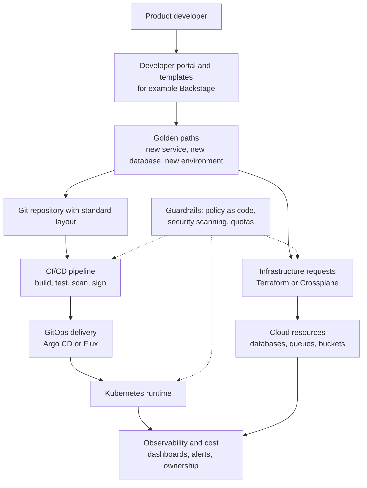
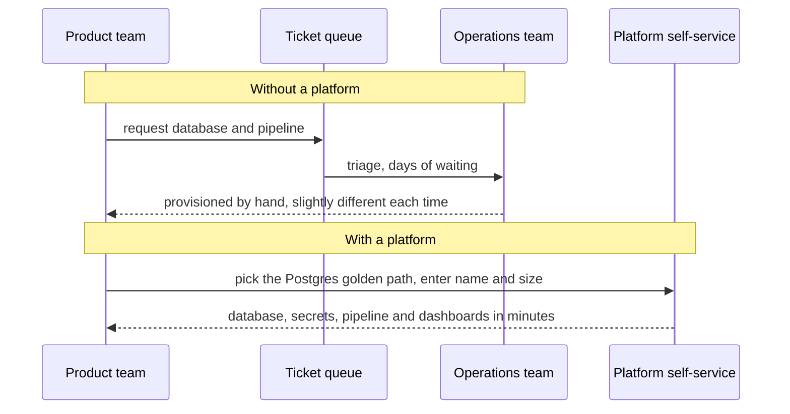

# L0.13 — Platform Engineering

> **Level 0: What DevOps Actually Is** · Topic 13 of 13 · ⏱ ~3 hours · Difficulty: Beginner

## 1. What it is

**Platform engineering** is the practice of building and running an **internal developer platform (IDP)**: a curated set of tools, templates, automation and documentation that lets product developers get what they need to build, ship and run software — a new service, a database, a pipeline, a dashboard — **by themselves, quickly and safely**, without filing tickets or becoming experts in every underlying technology.

The platform team treats the platform as a **product** and its developers as **customers**. Its flagship deliverable is the **golden path** (also called a *paved road*): the opinionated, well-supported, easiest way to do a common task — for example "create a new HTTP service": one command or one form produces a repository, a container build, a CI/CD pipeline, monitoring, a deployment, and an entry in the service catalog, all following company standards.
Teams are free to leave the path, but the path is so convenient that most do not want to.

## 2. Why it matters in DevOps

- **"You build it, you run it" has a cognitive-load limit.** Asking every product team to master Kubernetes, Terraform, cloud IAM, observability, and security scanning slows everyone down. A platform absorbs that complexity once.
- **Fewer tickets, faster delivery.** Self-service replaces waiting days for an operations team to create a database or a namespace.
- **Consistency and security by default.** Standards (non-root containers, scanning, tagging, logging, ownership) are baked into the template instead of enforced by nagging ([DevSecOps](12-devsecops.md)).
- **Less duplication.** Without a platform, twelve teams build twelve slightly different deployment pipelines, each with its own bugs.
- **Operational leverage.** A small platform team can improve the delivery experience of hundreds of engineers.

The trade-off: a platform is software that must be built, maintained and supported. A badly run platform becomes a bottleneck and a source of resentment rather than relief.

## 3. Real-world system example

**Spotify and Backstage.** Spotify built an internal developer portal called **Backstage** to tackle a fragmented ecosystem of tools and services, and open-sourced it in 2020; it is now a CNCF project. Backstage offers a **software catalog** (who owns what), **software templates** (golden paths that scaffold new services),
and a plugin system for CI, docs and cloud tooling. Spotify has publicly written about "golden paths" as the supported way to create and run services. See [Level 18: Backstage](../level-18-platform-engineering/08-backstage.md) and [Level 18: Golden Paths](../level-18-platform-engineering/04-golden-paths.md).

**Netflix** has publicly described the notion of a "paved road": centrally supported tooling and libraries that most teams use because it makes shipping and operating services easier, while teams with unusual needs can go off-road and accept more responsibility.

**Kubernetes-based platforms.** Many organisations assemble IDPs from open-source parts: Kubernetes for runtime, Argo CD or Flux for delivery ([Level 17: GitOps](../level-17-gitops/01-desired-state-management.md)), Terraform or Crossplane for cloud resources ([Level 18: Crossplane](../level-18-platform-engineering/09-crossplane.md)),
Backstage as the front door, and policy engines for guardrails ([Level 18: Policy as Code](../level-18-platform-engineering/07-policy-as-code.md)). The CNCF has published a platforms white paper and a platform engineering maturity model describing this approach.

**Team Topologies.** The book *Team Topologies* (Matthew Skelton and Manuel Pais) popularised the idea of a **platform team** that provides internal services to **stream-aligned teams** (product teams), through self-service "X-as-a-Service" interaction, to reduce cognitive load. Many platform engineering programmes cite it as their organisational model.

## 4. Diagram

An internal developer platform, from the developer's point of view and below:



How a team's work splits with and without a platform:



## 5. How it works

### Building blocks of an IDP

| Block | What it gives developers | Examples |
|---|---|---|
| **Developer portal** | One front door: catalog, docs, templates, status | Backstage, Port, Cortex |
| **Software catalog** | Who owns each service, its dependencies, runbooks, on-call | Backstage `catalog-info.yaml` |
| **Golden paths / templates** | One-click creation of well-formed services and infrastructure | Backstage software templates, cookiecutter, internal CLIs |
| **Self-service infrastructure** | Request a database, queue or environment without a ticket | Terraform modules, Crossplane, Kratix |
| **Delivery automation** | Standard pipelines and GitOps deployment | GitHub Actions, Argo CD, Flux |
| **Guardrails** | Security and cost rules enforced automatically | OPA Gatekeeper, Kyverno, policy-as-code, quotas |
| **Observability and cost** | Dashboards, alerts and spend per service, out of the box | Prometheus, Grafana, OpenTelemetry, cost tools |

### DevOps team vs platform team

| | "DevOps team" (anti-pattern: a silo) | Platform team (as a product) |
|---|---|---|
| Relationship to product teams | Does operations *for* them, takes tickets | Builds tools they use *themselves* |
| Scaling | Headcount grows with the number of services | Tooling scales; team stays small |
| Ownership | Ops owns running the apps | Product teams own running their apps; platform owns the platform |
| Success metric | Tickets closed | Adoption, developer satisfaction, lead time, reliability of the platform |
| Mindset | Gatekeeper | Product team with customers, roadmap and feedback |

Important framing: **platform engineering does not replace DevOps; it is one way of delivering DevOps at scale.** The cultural goals (shared ownership, automation, fast feedback) are the same; the platform packages the practices so every team does not reinvent them. SRE ([Site Reliability Engineering](11-sre.md)) often partners with the platform team on reliability standards.

### Principles of a good platform

1. **Treat it as a product.** Talk to users, publish a roadmap, measure adoption and satisfaction, deprecate with care.
2. **Make the golden path the easiest path.** Do not mandate it by decree if you can win by convenience; but make it good enough that skipping it needs a reason.
3. **Self-service with guardrails.** Autonomy for teams, safety limits built in.
4. **Opinionated but not a cage.** Provide escape hatches and a way to contribute improvements back.
5. **Start small.** Solve the most painful, most common problem first (often "create a deployable service").
6. **Measure outcomes.** Time to first deploy for a new service, deployment frequency, lead time for changes, onboarding time, number of tickets. These link to the **DORA metrics** (deployment frequency, lead time for changes, change failure rate, time to restore) from the DevOps research programme.
7. **Run the platform like production.** It needs SLOs, on-call, documentation and a support channel.

## 6. Step-by-step guide

**Goal:** build a miniature golden path: a script that creates a new, conformant service in one command, a conformance checker that enforces the platform's minimum standards, and a tiny software catalog listing who owns what. This is the same idea as a Backstage template plus catalog, at a size you can read in five minutes.
**Prerequisites:** Bash, Python 3 and `curl`. Docker is *not* required (the generated Dockerfile is only written, not built). **Cost: none.**

1. **Create the golden path script.** One command produces a service with an app, a hardened Dockerfile, a CI workflow and a catalog entry. Names are validated; existing services are never overwritten.
```bash
mkdir -p ~/platform-demo && cd ~/platform-demo
cat > new-service.sh <<'EOF'
#!/usr/bin/env bash
# new-service.sh - the "golden path": one command gives a team a service that is already
# containerised, health-checked, CI-ready and registered in the catalog.
# Usage: ./new-service.sh <service-name> <owning-team>
set -euo pipefail
NAME="${1:?usage: new-service.sh <name> <team>}"
TEAM="${2:?usage: new-service.sh <name> <team>}"
[[ "$NAME" =~ ^[a-z][a-z0-9-]{2,30}$ ]] || { echo "name must be lowercase letters, digits, dashes"; exit 1; }
DIR="services/$NAME"
[ ! -e "$DIR" ] || { echo "service $NAME already exists"; exit 1; }
mkdir -p "$DIR/.github/workflows"

cat > "$DIR/app.py" <<PY
# $NAME - generated from the platform golden path
import json, os
from http.server import BaseHTTPRequestHandler, HTTPServer

class H(BaseHTTPRequestHandler):
    def do_GET(self):
        if self.path == "/health":
            body = b"ok"
        else:
            body = json.dumps({"service": "$NAME", "owner": "$TEAM"}).encode()
        self.send_response(200)
        self.send_header("Content-Length", str(len(body)))
        self.end_headers()
        self.wfile.write(body)
    def log_message(self, fmt, *args):
        print(json.dumps({"service": "$NAME", "msg": fmt % args}), flush=True)

HTTPServer(("0.0.0.0", int(os.environ.get("PORT", "8000"))), H).serve_forever()
PY

cat > "$DIR/Dockerfile" <<DOCKER
FROM python:3.12-slim
WORKDIR /app
COPY app.py .
USER 10001
EXPOSE 8000
HEALTHCHECK CMD python -c "import urllib.request; urllib.request.urlopen('http://127.0.0.1:8000/health')"
CMD ["python", "app.py"]
DOCKER

cat > "$DIR/.github/workflows/ci.yml" <<CI
name: ci
on: [push, pull_request]
jobs:
  build:
    runs-on: ubuntu-latest
    steps:
      - uses: actions/checkout@v4
      - run: python -m py_compile app.py
      - run: docker build -t $NAME:\${{ github.sha }} .
CI

cat > "$DIR/catalog-info.yaml" <<CAT
apiVersion: backstage.io/v1alpha1
kind: Component
metadata:
  name: $NAME
  description: Generated from the golden path
spec:
  type: service
  lifecycle: experimental
  owner: $TEAM
CAT

echo "created $DIR  (owner: $TEAM)"
find "$DIR" -type f | sort
EOF
chmod +x new-service.sh
```

2. **Create two services with one command each.** This is the self-service moment: no ticket, no waiting.
```bash
./new-service.sh orders payments-team
./new-service.sh recommendations growth-team
```
   Expected: `created services/orders  (owner: payments-team)` followed by the four generated files (`.github/workflows/ci.yml`, `Dockerfile`, `app.py`, `catalog-info.yaml`), and the same for `recommendations`.

3. **Run a generated service to prove the path produces something that works.**
```bash
PORT=8765 python3 services/orders/app.py & SRV=$!
sleep 1
curl -s localhost:8765/; echo
curl -s localhost:8765/health; echo
kill $SRV
```
   Expected: `{"service": "orders", "owner": "payments-team"}` then `ok` (the generated app also prints a JSON log line for each request: structured logging by default, a small [Observability](10-observability.md) win from the template).

4. **Add the guardrail: a conformance check.** The platform defines the minimum standard; the check enforces it for every service, including hand-made ones that did not use the path.
```bash
cat > conformance.sh <<'EOF'
#!/usr/bin/env bash
# conformance.sh - check every service under services/ meets the platform's minimum standard.
set -u
EXIT=0
for d in services/*/; do
  n=$(basename "$d"); bad=0
  for f in Dockerfile catalog-info.yaml .github/workflows/ci.yml; do
    [ -f "$d/$f" ] || { echo "FAIL $n: missing $f"; bad=1; }
  done
  grep -q '^USER ' "$d/Dockerfile" 2>/dev/null || { echo "FAIL $n: Dockerfile has no USER (runs as root)"; bad=1; }
  grep -q '^  owner: .' "$d/catalog-info.yaml" 2>/dev/null || { echo "FAIL $n: no owner in catalog-info.yaml"; bad=1; }
  [ "$bad" -eq 0 ] && echo "ok   $n" || EXIT=1
done
exit "$EXIT"
EOF
chmod +x conformance.sh
./conformance.sh; echo "exit=$?"
```
   Expected: `ok   orders`, `ok   recommendations`, `exit=0`.

5. **Simulate a team that went off the golden path, and see the cost.**
```bash
mkdir -p services/legacy && printf 'FROM ubuntu\n' > services/legacy/Dockerfile
./conformance.sh; echo "exit=$?"
```
   Expected: four `FAIL legacy: ...` lines (no catalog entry, no CI workflow, runs as root, no owner), then `ok   orders`, `ok   recommendations`, `exit=1`. The off-path service is not forbidden, but it is visible, and every missing item is something the golden path would have given it for free. That is the persuasive power of a platform: the compliant way is also the quickest.

6. **Build the catalog view.** The catalog answers "who owns this?" at 3 a.m. Read every `catalog-info.yaml` and list service and owner.
```bash
for f in services/*/catalog-info.yaml; do
  awk '/^  name:/{n=$2} /^  owner:/{o=$2} END{printf "%-18s %s\n", n, o}' "$f"
done
```
   Expected: `orders             payments-team` and `recommendations    growth-team`. Backstage does this at scale with a UI and relationships between components, APIs and teams.

7. **Check the guardrail is idempotent and safe.** The golden path refuses to overwrite.
```bash
./new-service.sh orders payments-team; echo "exit=$?"
./new-service.sh Bad_Name growth-team; echo "exit=$?"
```
   Expected: `service orders already exists` with `exit=1`; then `name must be lowercase letters, digits, dashes` with `exit=1`.

8. **Clean up.**
```bash
cd ~ && rm -rf ~/platform-demo
```

## 7. Real-world scenario

*Illustrative.* A company with 40 engineers and 12 services has one "DevOps team" of three people. New services take two weeks to launch because each needs a repository, a pipeline, a Kubernetes namespace, a database and dashboards, all requested via tickets. Every service looks a little different; two run as root; nobody knows who owns four of them. The DevOps team is exhausted and the product teams are frustrated.

The company re-forms the DevOps team as a platform team with a product owner. They interview developers and find "create a new service" is the most painful flow. In six weeks they ship version 1 of a golden path: a template that creates the repository, pipeline, Kubernetes manifests, a Postgres instance on request, and a catalog entry.
Time from "idea" to "running in staging" drops from two weeks to under a day. A conformance check in CI tags the older services that are not on the path, and over two quarters most migrate voluntarily because they want the free dashboards and one-click rollbacks.
Three months in, a new critical CVE needs a base-image patch: the platform team changes one template and a bot opens pull requests across all services built from it. **Lesson:** the platform works when it removes real friction, is adopted voluntarily and gives the organisation one place to improve things for everyone.

## 8. Common mistakes and best practices

**Don't**

- Rebrand the operations team as "the platform team" and keep taking tickets. That is the old silo with a new name.
- Build the platform in isolation for a year, then announce it. Nobody will use what they were not asked about.
- Mandate the platform without making it better than the alternatives; you will get workarounds and shadow IT.
- Build everything yourself. Reuse open-source and managed building blocks; build only the glue and the experience.
- Create a one-size-fits-all cage with no escape hatch, or an unopinionated toolbox with no golden path.
- Neglect documentation and support for the platform itself.

**Do**

- Start with the most common, most painful developer journey and deliver value in weeks.
- Treat developers as customers: interviews, surveys, a roadmap, release notes.
- Measure adoption, time to first deploy, onboarding time, DORA metrics and developer satisfaction.
- Bake security, observability, ownership and cost tagging into the templates.
- Keep the platform small, composable and well-documented; give it SLOs and an on-call rotation.
- Let teams contribute improvements back (inner-source).

## 9. Tasks

- [ ] **T1 — Build and use the golden path** *(≈30 min, beginner)*
  - **Goal:** create two conformant services with one command each.
  - **Steps:**
    1. Complete guide steps 1-4.
    2. Run `./conformance.sh` and confirm both services pass.
  - **Done when:** `./conformance.sh` prints `ok` for both services and exits 0.

- [ ] **T2 — Find the friction the path removes** *(≈25 min, beginner)*
  - **Goal:** quantify the value of self-service.
  - **Steps:**
    1. List every manual step required to create a new service from scratch by hand (repo, Dockerfile, pipeline, health check, ownership record, logging).
    2. Estimate minutes for each, then compare with the time `new-service.sh` takes.
    3. Multiply by the number of services your team creates per year.
  - **Done when:** you have a table with a before/after estimate and an annual hours-saved figure.

- [ ] **T3 — Extend the template** *(≈40 min, intermediate)*
  - **Goal:** add a standard to the path and enforce it.
  - **Steps:**
    1. Change `new-service.sh` to also generate a `README.md` with the service name, owner and a "how to run" section.
    2. Add a `README.md` check to `conformance.sh`.
    3. Run the checker; notice that existing services now fail, and write a one-line migration note.
  - **Done when:** new services pass the extended check, old ones fail with a clear message, and the migration note says how to fix them.

- [ ] **T4 — Break the path and fix it** *(≈35 min, intermediate)*
  - **Goal:** experience guardrails catching a mistake.
  - **Steps:**
    1. In `services/orders/Dockerfile`, remove the `USER` line.
    2. Run `./conformance.sh` and read the failure.
    3. Restore it, then change `new-service.sh` so that the generated Dockerfile pins the base image by version and add a check that fails on `:latest` or an untagged `FROM`.
  - **Done when:** the checker catches the root container and the unpinned base image, and both pass again after your fixes.

- [ ] **T5 — Wire it into CI** *(≈45 min, intermediate)*
  - **Goal:** make the guardrail run on every change.
  - **Steps:**
    1. Put the demo in a Git repository on GitHub.
    2. Add a workflow `.github/workflows/conformance.yml` that runs `./conformance.sh` on `pull_request`.
    3. Open a pull request that adds a non-conformant service and watch the check fail; fix it and watch it pass.
  - **Done when:** you have a red pull request check and a green one, with a link or screenshot description of each.

- [ ] **T6 — Prove it: platform product plan** *(≈60 min, advanced)*
  - **Goal:** design a platform increment as a product.
  - **Steps:**
    1. Interview two developers (or role-play): what is slowest or most annoying about shipping a service?
    2. Pick one journey and write a one-page plan: the golden path, the guardrails it includes, the metric you will use to judge success, and how you will handle teams that do not adopt it.
    3. Without notes, explain the difference between a platform team and a ticket-driven operations team, in terms of ownership and success metrics.
  - **Done when:** you have the one-page plan with a measurable goal, and your explanation covers product mindset, self-service, ownership and DORA-style metrics.

## 10. Self-check questions

1. What is an internal developer platform, and who are its customers?
2. What is a golden path? Does it force teams to use it?
3. How does a platform team differ from a traditional "DevOps team" that takes tickets?
4. Name three building blocks of an IDP.
5. How would you know a platform is succeeding?

<details>
<summary>Answers</summary>

1. A curated set of self-service tools, templates and automation for building, deploying and running software. Its customers are the company's own developers (product teams).
2. The supported, easiest, opinionated way to do a common task (such as creating a service). It is meant to win through convenience; teams can leave it but accept more responsibility.
3. The platform team builds products and self-service tooling that product teams use themselves, with an adoption-based, product mindset; the ticket-driven team performs operations for others, so its workload grows with the number of services and it becomes a bottleneck.
4. For example: a developer portal, a software catalog, golden-path templates, self-service infrastructure, standard pipelines/GitOps delivery, policy guardrails, built-in observability.
5. By outcomes and adoption: shorter time to first deploy and onboarding, higher deployment frequency and shorter lead time, lower change failure rate, fewer tickets, and good developer satisfaction scores.
</details>

## 11. Further reading

- *Team Topologies* by Matthew Skelton and Manuel Pais.
- CNCF Platforms White Paper and Platform Engineering Maturity Model (tag-app-delivery.cncf.io).
- Backstage documentation (backstage.io/docs).
- *Accelerate* by Nicole Forsgren, Jez Humble and Gene Kim — the research behind DORA metrics.
- *Platform Engineering* by Camille Fournier and Ian Nowland (O'Reilly).
- See also: [Level 18: Internal Developer Platforms](../level-18-platform-engineering/01-internal-developer-platforms.md), [Level 18: Service Catalogs](../level-18-platform-engineering/05-service-catalogs.md) and [Site Reliability Engineering](11-sre.md).

<!-- nav -->
---
← Previous: [DevSecOps](12-devsecops.md) · [Level 0 index](README.md) · Next: [Level capstone project](99-capstone-project.md) →
