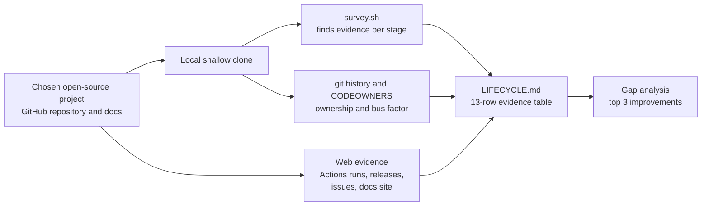
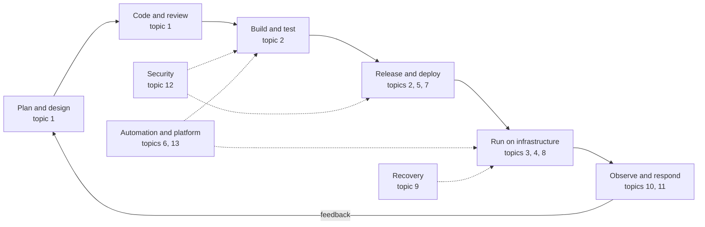

# L0 Capstone — Lifecycle Map of a Real Open-Source Project

> **Level 0: What DevOps Actually Is** · Capstone · ⏱ ~6 hours

## 1. Goal and outcome

You have read thirteen topics that describe one continuous lifecycle: how an idea becomes code ([SDLC](01-sdlc.md)), is built and shipped ([CI/CD](02-ci-cd.md)), runs on infrastructure that is defined, configured, replaced and automated
([IaC](03-infrastructure-as-code.md), [Configuration Management](04-configuration-management.md), [Immutable Infrastructure](05-immutable-infrastructure.md), [Infrastructure Automation](06-infrastructure-automation.md)),
is released with a chosen strategy ([Deployment Strategies](07-deployment-strategies.md)), stays up and scales ([High Availability and Scalability](08-high-availability-and-scalability.md)), survives disasters ([Disaster Recovery](09-disaster-recovery.md)),
is watched ([Observability](10-observability.md)), is run against reliability targets ([SRE](11-sre.md)), is defended ([DevSecOps](12-devsecops.md)) and is made easy for developers to use ([Platform Engineering](13-platform-engineering.md)).

In this capstone you will **map that lifecycle onto a real open-source project you know**: for every one of the thirteen stages, find where it lives (which files, tools, services), who owns it (which people, teams or roles), how healthy it is, and what you would improve.

**Outcome:** a single document, `LIFECYCLE.md`, containing

- a one-page diagram of the project's delivery lifecycle,
- a 13-row evidence table (stage, where it lives, tools, owner, evidence link, maturity 0-3, gap),
- an end-to-end trace of one real change from pull request to release,
- an ownership and bus-factor analysis,
- a ranked list of three improvements, each tied to one of the topics.

No code is deployed. The skill you are building is the one used on day one of any DevOps job: **reading an unfamiliar system and explaining how it is built, shipped, run and owned.**

## 2. Architecture

The work is a research pipeline: evidence goes in, a lifecycle map comes out.



The lifecycle you are mapping (the loop the project must complete for every change). Cross-cutting concerns are shown as rails around it:



## 3. Prerequisites and cost

- **Skills:** having completed (or at least read) Level 0 topics 1-13. You do not need to know the project's programming language.
- **Tools:** `git`, a terminal with `grep`/`find`/`awk`, a web browser, and a Markdown editor. The GitHub CLI (`gh`) is optional but handy.
- **Accounts:** none required; a free GitHub account is useful for browsing Actions logs on some projects.
- **Cost:** **free**. You only clone a repository (use `--depth` to keep it small) and read public pages. You do not run or deploy the project.
- **Choosing the project:** pick one you use or admire, that is actively developed in the open, with public CI and releases, and that is big enough to have interesting operations but small enough that you can navigate it.
  Good candidates are well-known infrastructure projects such as Prometheus, Grafana, Caddy, Gitea, Argo CD, or Traefik, or a mid-sized application or library you depend on. Do not assume what any project contains; the survey will show you. Avoid giant monorepos for a first pass.
- **Time plan:** M1 30 min, M2 45 min, M3 90 min, M4 120 min, M5 45 min, M6 60 min.

## 4. Build it step by step

### Milestone 1 — Choose the project and take a first look (≈30 min)

1. Pick the project and create a workspace. Replace `<ORG>/<REPO>` with the real GitHub path.
```bash
mkdir -p ~/lifecycle-map && cd ~/lifecycle-map
git clone --depth 200 https://github.com/<ORG>/<REPO>.git project
cd project
ls
```
   Expected: the repository's top-level files. Note the languages, directories such as `docs/`, `.github/`, `deploy/`, `charts/`, `scripts/`, `cmd/` or `src/`.

2. Capture the vital signs: how active it is and who works on it.
```bash
git log --since="90 days ago" --oneline | wc -l                 # commits in the last 90 days (within the shallow history)
git shortlog -sn --no-merges --since="1 year ago" | head -10     # top contributors
git tag --sort=-creatordate | head -5                           # most recent releases (tags may be fetched on demand)
```
   Expected: counts and names that vary by project. Write them in your notes; you will use them for the bus-factor analysis.

3. Start `LIFECYCLE.md` with a one-paragraph description: what the project does, who uses it, whether it is a library, a service, a CLI or a platform, and how it reaches users (container image, package, binary, hosted service). **This decides what "deploy" and "operate" mean** for every other stage. A CLI tool is "deployed" by publishing binaries; a hosted service by rolling out to servers.

### Milestone 2 — Survey the repository for evidence (≈45 min)

1. Save the survey script. It searches the checkout for files and text that signal each of the 13 stages.
```bash
cd ~/lifecycle-map
cat > survey.sh <<'EOF'
#!/usr/bin/env bash
# survey.sh - find evidence of each lifecycle stage in a repository checkout.
# Usage: ./survey.sh <path-to-repo>
set -u
R="${1:?usage: survey.sh <repo-dir>}"
[ -d "$R" ] || { echo "not a directory: $R"; exit 1; }

# files(label, find-expressions...) - list up to 4 matching paths
files() {
  label="$1"; shift
  out=$(cd "$R" && find . \( -path ./.git -o -path ./node_modules -o -path ./vendor \) -prune -o -type f \( "$@" \) -print 2>/dev/null | head -4 | tr '\n' ' ')
  printf '  %-26s %s\n' "$label" "${out:-(none found)}"
}
# text(label, regex, include-glob) - list up to 3 files whose content matches
text() {
  label="$1"; re="$2"; inc="${3:-*.md}"
  out=$(grep -rIliE --exclude-dir=.git --exclude-dir=node_modules --exclude-dir=vendor --include="$inc" "$re" "$R" 2>/dev/null | head -3 | sed "s|^$R/||" | tr '\n' ' ')
  printf '  %-26s %s\n' "$label" "${out:-(none found)}"
}

echo "== 1 SDLC ==";                  files "contribution rules" -name CONTRIBUTING.md -o -name CODEOWNERS -o -name MAINTAINERS -o -name GOVERNANCE.md
                                      files "issue/PR templates" -path '*ISSUE_TEMPLATE*' -o -name 'pull_request_template.md' -o -name PULL_REQUEST_TEMPLATE.md
                                      files "design records/changelog" -ipath '*adr*' -o -name CHANGELOG.md -o -ipath '*proposal*'
echo "== 2 CI/CD ==";                 files "pipelines" -path '*/.github/workflows/*' -o -name .gitlab-ci.yml -o -name Jenkinsfile -o -path '*/.circleci/*' -o -name azure-pipelines.yml
echo "== 3 Infrastructure as Code =="; files "IaC" -name '*.tf' -o -name Chart.yaml -o -name kustomization.yaml -o -name 'template.yaml' -o -name Pulumi.yaml
echo "== 4 Configuration mgmt ==";    files "config mgmt" -name '*.ansible*' -o -name playbook*.yml -o -name '*.pp' -o -name '.env.example' -o -name 'config*.yaml' -o -name 'config*.toml'
echo "== 5 Immutable infra ==";       files "images" -name Dockerfile -o -name 'Dockerfile.*' -o -name Containerfile -o -name '*.pkr.hcl' -o -name '.goreleaser*'
echo "== 6 Automation ==";            files "task runners" -name Makefile -o -name Taskfile.yml -o -name justfile -o -path '*/scripts/*' -o -name renovate.json -o -name dependabot.yml -o -name .pre-commit-config.yaml
echo "== 7 Deployment strategies =="; files "release process" -iname 'RELEASING*' -o -iname 'RELEASE*.md' -o -name '.goreleaser*'
                                      text  "canary/rollout/flags" 'canary|blue.?green|rolling update|feature flag|rollout' '*.md'
echo "== 8 HA and scalability ==";    text  "HA / scaling docs" 'high.availability|horizontal(ly)? scal|replica|failover|load balanc' '*.md'
                                      text  "health endpoints" '/healthz|/readyz|/health|livenessProbe|readinessProbe|HEALTHCHECK' '*'
echo "== 9 Disaster recovery ==";     text  "backup/restore docs" 'backup|restore|disaster|snapshot' '*.md'
echo "== 10 Observability ==";        text  "metrics/tracing/logs" 'prometheus|/metrics|opentelemetry|otel|structured log' '*'
                                      files "dashboards/alerts" -ipath '*dashboard*' -o -ipath '*alert*' -o -ipath '*grafana*'
echo "== 11 SRE ==";                  files "runbooks/postmortems" -ipath '*runbook*' -o -ipath '*postmortem*' -o -ipath '*incident*'
                                      text  "SLO / on-call" 'SLO|error budget|on-call|oncall' '*.md'
echo "== 12 DevSecOps ==";            files "security policy/scanning" -name SECURITY.md -o -name dependabot.yml -o -iname '*codeql*' -o -iname '*trivy*' -o -iname '*gitleaks*'
                                      text  "SBOM/signing/scan" 'sbom|cosign|sigstore|govulncheck|trivy|snyk|gosec|bandit' '*'
echo "== 13 Platform engineering =="; files "dev experience" -name devcontainer.json -o -name catalog-info.yaml -o -iname 'docker-compose*.y*ml' -o -name Tiltfile -o -name .tool-versions
EOF
chmod +x survey.sh
```

2. Run it and keep the output.
```bash
./survey.sh project | tee survey-output.txt
```
   Expected (similar in shape; contents depend on the project):
   ```text
   == 2 CI/CD ==
     pipelines                  ./.github/workflows/ci.yml ./.github/workflows/release.yml
   == 5 Immutable infra ==
     images                     ./Dockerfile
   == 11 SRE ==
     runbooks/postmortems       (none found)
   ```
   Read the output as a *starting hypothesis*, not as fact. A match tells you where to look; "(none found)" may mean the stage is absent, lives in another repository (a separate `infra`, `docs` or `website` repo), or uses a name the script does not know. Always confirm by reading.

3. For every `(none found)`, search the project's organisation page and documentation site for a related repository (for example `<project>-infra`, `<project>-operator`, `<project>-docs`) and record it as the true location of that stage.

### Milestone 3 — Trace one real change end to end (≈90 min)

This is the heart of the capstone: follow a single change through the lifecycle.

1. On GitHub, open the project's **Pull requests**, filter by *Closed* and *merged*, and choose a small, recent pull request that changed code. Record its number and author.
2. Walk the stages and write down evidence for each (link or filename):
   1. **SDLC** ([topic 1](01-sdlc.md)): Was there an issue first? How was it discussed? Who reviewed and approved it? Which template or rule (`CONTRIBUTING.md`, `CODEOWNERS`) applied?
   2. **CI** ([topic 2](02-ci-cd.md)): Which checks ran on the pull request (tests, lint, build, security scans)? Open one run and read which jobs and steps executed and how long they took. Which checks were *required* before merge?
   3. **Merge to release:** After merging, what happened on the default branch? Find the workflow triggered by the push and any release workflow.
   4. **Artifact and release** ([topics 5 and 7](05-immutable-infrastructure.md)): In which release did this change ship? Find it in the Releases page or `CHANGELOG`. What artifacts were published (binaries, container image, packages), and are they versioned, signed or accompanied by checksums?
   5. **Deploy strategy** ([topic 7](07-deployment-strategies.md)): How does it reach users? For a library: a package registry and semantic versions. For a service: look for release candidates (`-rc`), staged rollouts, feature flags or documented upgrade paths, and note which of recreate, rolling, blue/green, canary or flag the project's own hosted instance (if any) or its documented upgrade procedure resembles.
3. Draw the trace as a Mermaid `flowchart` or `sequenceDiagram` in `LIFECYCLE.md`, using the actual names of the jobs and files you saw. A diagram of the real pipeline with real job names is worth far more than a generic one.

Try also to **run one pipeline step locally**: find a command used by CI (a `make test`, `npm test`, `go test`, `pytest` or a `docker build`), install the prerequisites listed in the contributing guide, and run it. If it fails, that is a finding about the developer experience ([topic 13](13-platform-engineering.md)).

### Milestone 4 — Examine the operational and security stages (≈120 min)

For each question, record the answer *and the evidence* (file path or URL), or write "not public" if the information would live in a private system.

| Topic | Questions to answer from the repository and docs |
|---|---|
| 3 IaC | Is infrastructure for running or testing the project defined as code (Terraform, Helm chart, Kubernetes manifests, CloudFormation)? Where? Is it in the same repo? |
| 4 Config | How is configuration supplied (flags, files, environment)? Are there defaults, validation and an example file? Is there a documented way to manage config across environments? |
| 5 Immutable | Is the deployable unit an immutable artifact (image, binary)? Is it pinned by digest or tag? What base image, and is the runtime user non-root? |
| 6 Automation | What is automated: build, test, release, dependency updates, changelog, stale issue handling? What looks manual? |
| 8 HA / scale | Does the documentation describe running multiple instances, replication, clustering, load balancing, health endpoints, resource limits? What is the single point of failure in the documented design? |
| 9 DR | Is there documentation for backup and restore, upgrade rollback, data migration? What are the implied RPO and RTO? |
| 10 Observability | Does it expose metrics, structured logs, traces (look for `/metrics`, OpenTelemetry, log format docs)? Are dashboards or alert rules shipped? |
| 11 SRE | Are there SLOs, runbooks, an incident or postmortem process, or on-call mention? (Many open-source projects will have none; record that honestly. Hosted-service projects may publish a status page.) |
| 12 DevSecOps | Is there `SECURITY.md` with a reporting process? Which scanners and dependency bots run in CI? Are releases signed, with an SBOM or provenance? How are secrets handled in CI (look for `secrets.` references)? |
| 13 Platform | What helps contributors and users onboard: a dev container, a Compose file, make targets, templates, a docs site, a CLI scaffold? What is the time-to-first-build for a newcomer? |

Useful commands:
```bash
cd ~/lifecycle-map/project
ls .github/workflows                                    # what pipelines exist
grep -rhn "uses:" .github/workflows | sed 's/.*uses: *//' | sort | uniq -c | sort -rn | head   # which actions and scanners CI relies on
grep -rn "secrets\." .github/workflows | head           # which secrets CI uses (names only)
grep -n "^FROM\|^USER\|HEALTHCHECK" Dockerfile 2>/dev/null          # image hygiene
```
Expected: lists vary. Remember: you are reading *names* of secrets and actions, never their values.

### Milestone 5 — Ownership map and bus factor (≈45 min)

1. Find the declared owners:
```bash
cat CODEOWNERS .github/CODEOWNERS docs/CODEOWNERS 2>/dev/null | head -30
ls MAINTAINERS* GOVERNANCE* OWNERS* 2>/dev/null
```
2. Compare declared owners with actual activity:
```bash
git shortlog -sn --no-merges --since="1 year ago" | head -10
git shortlog -sn --no-merges --since="1 year ago" -- .github/workflows | head -5     # who changes the pipeline
git shortlog -sn --no-merges --since="1 year ago" -- Dockerfile docs | head -5        # who changes images and docs
```
3. For each of the 13 stages, assign an **owner type**: a named team or file (`CODEOWNERS` rule), a role (release manager, maintainer), a bot (Dependabot, release automation), a vendor (GitHub, a cloud provider) or "unowned".
4. Compute a simple **bus factor** for the delivery pipeline: how many people account for most of the last year's changes to `.github/workflows` and release scripts? If one person accounts for more than about 70 percent, that stage has a single point of failure ([topic 8](08-high-availability-and-scalability.md): people can be a SPOF too).

### Milestone 6 — Write `LIFECYCLE.md` and the gap analysis (≈60 min)

Assemble your document with this structure. Fill the table with your evidence.

````markdown
# Lifecycle map — <PROJECT NAME>

## 1. What it is and how it reaches users
(2-4 sentences. Library, service, CLI or platform? How is it distributed?)

## 2. Lifecycle diagram
(Mermaid diagram from Milestone 3, using real job and file names.)

## 3. Evidence table
| # | Stage | Where it lives (paths / URLs) | Tools | Owner | Maturity 0-3 | Gap or risk |
|---|-------|-------------------------------|-------|-------|--------------|-------------|
| 1 | SDLC | CONTRIBUTING.md, issue templates | GitHub PRs | maintainers via CODEOWNERS | 3 | ... |
| 2 | CI/CD | .github/workflows/*.yml | GitHub Actions | ... | ... | ... |
| 3 | Infrastructure as Code | ... | ... | ... | ... | ... |
| 4 | Configuration management | ... | ... | ... | ... | ... |
| 5 | Immutable infrastructure | ... | ... | ... | ... | ... |
| 6 | Infrastructure automation | ... | ... | ... | ... | ... |
| 7 | Deployment strategies | ... | ... | ... | ... | ... |
| 8 | High availability and scalability | ... | ... | ... | ... | ... |
| 9 | Disaster recovery | ... | ... | ... | ... | ... |
| 10 | Observability | ... | ... | ... | ... | ... |
| 11 | SRE | ... | ... | ... | ... | ... |
| 12 | DevSecOps | ... | ... | ... | ... | ... |
| 13 | Platform engineering | ... | ... | ... | ... | ... |

Maturity scale: 0 = absent, 1 = manual or informal, 2 = documented and partly automated, 3 = automated, reviewed and measured.

## 4. One change traced end to end
(PR number, checks, release, artifacts; link evidence.)

## 5. Ownership and bus factor
(Declared vs actual owners; single points of failure among people.)

## 6. Top 3 improvements
1. (Stage, problem, proposed change, topic reference, expected benefit, effort S/M/L)
2. ...
3. ...

## 7. What I could not determine
(Stages whose evidence is private or missing; how you would find out.)
````

Rules for the maturity score: score what you can *see*, not what you assume. Where evidence is private, write "unknown" rather than 0. Be fair: a small volunteer project with a score of 1 on SRE is normal, and the right improvement is rarely "add everything".

## 5. Tasks

- [ ] **T1 — Choose, clone and profile the project** *(≈30 min, beginner; Milestone 1; topic 1)*
  - **Goal:** pick a suitable project and record its vital signs.
  - **Steps:**
    1. Choose a project that meets the criteria in section 3 and clone it with `--depth`.
    2. Run the three commands from Milestone 1 and write the numbers into `LIFECYCLE.md`.
    3. Write the one-paragraph description including how it reaches users.
  - **Done when:** `LIFECYCLE.md` has section 1 filled in and states whether the project is a library, service, CLI or platform.

- [ ] **T2 — Run the survey and verify its findings** *(≈45 min, beginner; Milestone 2; topics 2-6)*
  - **Goal:** convert raw matches into verified evidence.
  - **Steps:**
    1. Create and run `survey.sh`; save `survey-output.txt`.
    2. Open at least five files the survey reported and confirm each is really evidence for the stage (or discard it).
    3. For each `(none found)`, search for another repository or a different filename convention, and record the result.
  - **Done when:** every one of the 13 stages has either confirmed evidence (path or URL) or a written note saying it is absent or private.

- [ ] **T3 — Trace one change from pull request to release** *(≈90 min, intermediate; Milestone 3; topics 1, 2, 5, 7)*
  - **Goal:** produce a diagram of the project's real delivery path.
  - **Steps:**
    1. Pick a recently merged pull request and gather evidence for review, CI checks, merge, release and artifacts.
    2. Open one CI run and list its jobs with durations.
    3. Draw the path as Mermaid using real job names, and note which delivery strategy the release process resembles and why.
  - **Done when:** section 4 of `LIFECYCLE.md` contains a rendering Mermaid diagram plus links to the pull request, a CI run and the release, and names the strategy.

- [ ] **T4 — Assess the operational stages** *(≈75 min, intermediate; Milestone 4; topics 3, 4, 8, 9, 10, 11)*
  - **Goal:** judge how the project handles running, scaling, recovering and watching software.
  - **Steps:**
    1. Answer the Milestone 4 table questions for IaC, configuration, HA, DR, observability and SRE.
    2. Name the single point of failure in the documented deployment.
    3. State the implied RPO and RTO for a user who runs the project, or explain why none can be inferred.
  - **Done when:** each of the six stages in your evidence table has a maturity score, evidence, and a named gap or an explicit "unknown (private)".

- [ ] **T5 — Assess security, automation and developer experience** *(≈60 min, intermediate; Milestone 4; topics 5, 6, 12, 13)*
  - **Goal:** judge supply chain security, automation and onboarding.
  - **Steps:**
    1. List every security control you can find: scanners, dependency bots, signing, `SECURITY.md`, branch protection signals.
    2. Check the image or binary for pinning and the runtime user.
    3. Time yourself: how long from `git clone` to a successful local build or test run, following only the project's documents?
  - **Done when:** the table rows for 5, 6, 12 and 13 are complete, and you have a time-to-first-build figure with the steps that cost the most time.

- [ ] **T6 — Map ownership and bus factor** *(≈45 min, intermediate; Milestone 5; topics 1, 6, 8, 11)*
  - **Goal:** show who owns each stage, declared and real.
  - **Steps:**
    1. Gather `CODEOWNERS`/`MAINTAINERS` and the `git shortlog` data for pipeline, image and docs paths.
    2. Assign an owner type to each of the 13 stages.
    3. Calculate the share of the top contributor for the pipeline directory and call out any single-person dependency.
  - **Done when:** the Owner column in your table is filled for all 13 rows, section 5 includes the share figure, and at least one risk is stated in plain words.

- [ ] **T7 — Prove it: present the map and defend three improvements** *(≈60 min, advanced; Milestone 6; all 13 topics)*
  - **Goal:** demonstrate you can read a real system and propose improvements, without notes.
  - **Steps:**
    1. Finish `LIFECYCLE.md` including the gap analysis and the "could not determine" section.
    2. Present the document for five minutes (to a friend, a recorded video or a written blog-style summary) without reading the table aloud: tell the story of one change from idea to running software and name the owner at each hop.
    3. Defend your three improvements: for each, say which topic's practice supports it, what it would cost, and what could go wrong. Optionally open a genuine issue or documentation pull request with the project for one of them, following their contribution rules.
  - **Done when:** all seven sections of `LIFECYCLE.md` are complete, you can explain every row of the table out loud, and each improvement links a stage, an observed gap and a concrete proposal.

## 6. Verification checklist

- [ ] `LIFECYCLE.md` has all seven sections and the table has 13 rows (no stage skipped).
- [ ] Every table row cites at least one path or URL as evidence, or explicitly says "unknown (private)".
- [ ] The Mermaid diagram renders (paste into any Mermaid preview) and uses real job and file names from the project.
- [ ] You traced one real merged pull request through review, CI, merge, release and artifact, with links.
- [ ] The owner column distinguishes people, roles, bots and vendors, and the bus-factor figure is calculated from `git shortlog` output you can reproduce.
- [ ] You identified the project's single point of failure (technical or human) and stated its likely RPO/RTO impact.
- [ ] Each of the three improvements names the stage, the evidence of the gap, the proposed change, the effort and a risk.
- [ ] You can answer, without notes: "What is the difference between deploying and releasing in this project?" and "What would break first if the busiest maintainer vanished?"
- [ ] You did not copy any secret values, tokens or personal data into your notes.

## 7. Teardown

There is nothing running and nothing in the cloud. Remove the local workspace when you are done (keep `LIFECYCLE.md` somewhere safe first, for example in your own notes repository):
```bash
cp ~/lifecycle-map/LIFECYCLE.md ~/ 2>/dev/null     # keep your deliverable
cd ~ && rm -rf ~/lifecycle-map
```
If you opened an issue or pull request with the project, keep it open and respond to maintainers; that is a real contribution.

## 8. Stretch goals and what to learn next

**Stretch goals**

- Repeat the exercise for a second project of a different type (a library versus a hosted service) and compare maturity profiles. Which stages differ and why?
- Score the project against the four DORA metrics using public data: deployment frequency (release cadence), lead time for changes (PR open to release), change failure rate (reverted or hotfix releases) and time to restore (time from a bug report to a patch release).
- Write the SLO the project's maintainers would need to promise if they offered a hosted version, and list the observability they would have to add.
- Take one of your three improvements and implement a small, real piece of it: a `SECURITY.md`, a Dependabot configuration, a pinned base image, a missing health check or a runbook page.
- Map the same lifecycle onto the `shop-api` sample used across this roadmap, and keep the table: you will fill it in with real tools as you progress through the levels.

**What to learn next**

The lifecycle you have mapped is the *why* of every level that follows. Next, you will get hands-on with the foundation under all of it, starting with the operating system most of these systems run on: [Level 1: Linux Filesystem Hierarchy](../level-01-linux-fundamentals/01-filesystem-hierarchy.md). From there the roadmap revisits each of the thirteen topics in depth:
networking ([Level 2](../level-02-networking/01-ip-mac-arp-dhcp.md)), Git and CI foundations ([Level 3](../level-03-git-and-github/01-branching-and-merging.md)), containers ([Level 4](../level-04-docker/01-docker-internals.md)), pipelines and deployment strategies ([Level 5](../level-05-cicd/01-pipeline-design.md)),
Infrastructure as Code ([Level 7](../level-07-terraform-iac/01-providers-and-resources.md)), observability ([Level 10](../level-10-observability/01-three-pillars.md)), security ([Level 11](../level-11-security-devsecops/01-linux-and-ssh-hardening.md)),
SRE ([Level 14](../level-14-sre/01-slis.md)), disaster recovery ([Level 15](../level-15-disaster-recovery/01-backups.md)) and platform engineering ([Level 18](../level-18-platform-engineering/01-internal-developer-platforms.md)).

<!-- nav -->
---
← Previous: [Platform Engineering](13-platform-engineering.md) · [Level 0 index](README.md) · Next level: [Level 1 — Linux Fundamentals](../level-01-linux-fundamentals/README.md) →
