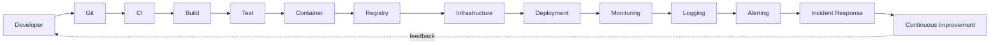

# Level 0 — What DevOps Actually Is

> **Goal:** Understand how development, infrastructure, deployment, security, monitoring and operations form one continuous lifecycle.

| | |
|---|---|
| **Recommended time** | 1 week (reading + mapping) |
| **Topics** | 13 |
| **Practice / capstone** | Map the lifecycle onto a real open-source project you know: where does each stage live, and who owns it? |

## The DevOps lifecycle

DevOps connects software development, infrastructure, deployment, security, monitoring and operations into one continuous lifecycle.

## Topics

| # | Topic | What you will learn |
|---|-------|---------------------|
| 1 | [Software Development Lifecycle (SDLC)](01-sdlc.md) | SDLC phases, Agile vs waterfall, how DevOps shortens feedback loops |
| 2 | [CI/CD](02-ci-cd.md) | continuous integration, continuous delivery vs deployment, pipeline stages |
| 3 | [Infrastructure as Code](03-infrastructure-as-code.md) | declarative vs imperative, version-controlled infra, Terraform/CloudFormation overview |
| 4 | [Configuration Management](04-configuration-management.md) | Ansible/Chef/Puppet, idempotency, desired state on servers |
| 5 | [Immutable Infrastructure](05-immutable-infrastructure.md) | replace don't patch, golden images, pets vs cattle |
| 6 | [Infrastructure Automation](06-infrastructure-automation.md) | automating provisioning, scripts vs tools, eliminating toil, runbooks to code |
| 7 | [Deployment Strategies](07-deployment-strategies.md) | recreate, rolling, blue/green, canary, feature flags (overview; detail in Level 5) |
| 8 | [High Availability and Scalability](08-high-availability-and-scalability.md) | redundancy, SPOF, horizontal vs vertical scaling, health checks |
| 9 | [Disaster Recovery](09-disaster-recovery.md) | backups, RPO/RTO, failover (overview; detail in Level 15) |
| 10 | [Observability](10-observability.md) | metrics, logs, traces, monitoring vs observability (overview; detail in Level 10) |
| 11 | [Site Reliability Engineering](11-sre.md) | SLOs, error budgets, toil, how SRE relates to DevOps (detail in Level 14) |
| 12 | [DevSecOps](12-devsecops.md) | shift-left security, scanning in pipelines, supply chain (detail in Level 11) |
| 13 | [Platform Engineering](13-platform-engineering.md) | internal developer platforms, golden paths, DevOps vs platform teams (detail in Level 18) |
| ★ | [Level capstone project](99-capstone-project.md) | Map the lifecycle onto a real open-source project you know: where does each stage live, and who owns it? |

## How to work through this level

1. Read each topic in order: *what it is → why it matters → real-world example → diagram → guide*.
2. Do **every task** in the topic's *Tasks* section and tick the box (`- [x]`) in your own fork or notes.
3. Answer the *Self-check questions* without looking, then reveal the answers.
4. Finish with the **capstone project**, which combines all topics of the level.
5. Move on only when you can do the capstone's *Prove it* task without the guide.

## Topic flow

---
[Roadmap home](../README.md) · [Level 1 — Linux Fundamentals](../level-01-linux-fundamentals/README.md) →
