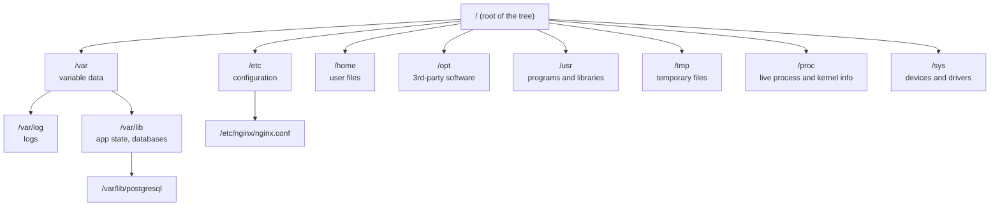
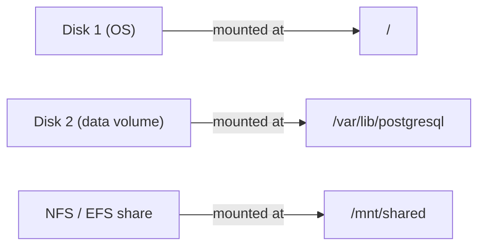

# L1.1 — Linux Filesystem Hierarchy

> **Level 1: Linux Fundamentals** · Topic 1 of 13 · ⏱ ~3 hours · Difficulty: Beginner

## 1. What it is

Linux organizes everything — programs, configuration, logs, devices and even live kernel data — into **one tree
that starts at `/`** (called "root", not to be confused with the `root` user). There are no drive letters like
`C:\`. Other disks and network shares are *mounted* onto directories inside this single tree.

The layout follows a convention called the **Filesystem Hierarchy Standard (FHS)**, so an Nginx server on
Ubuntu and a PostgreSQL server on Debian put their files in predictable places. Once you know the map, you can
walk onto an unfamiliar server and find the config, the logs and the data in under a minute.

## 2. Why it matters in DevOps

- **Incident response:** "Where are the logs?" and "Why is the disk full?" are the first questions of almost every outage.
- **Automation:** Ansible, Terraform provisioners, Dockerfiles and systemd units all hard-code these paths.
- **Security:** you must know which paths are writable by whom (`/tmp` is world-writable; `/etc` must not be).
- **Containers:** a container is largely "a process with its own `/`". Understanding the tree is understanding images and volumes.

## 3. Real-world system example

**A Kubernetes worker node.** If you SSH into a node you will find the FHS used exactly as designed:

| Path | What Kubernetes-related software keeps there |
|------|----------------------------------------------|
| `/etc/kubernetes/` | kubelet and control-plane configuration (on kubeadm-built clusters) |
| `/var/lib/kubelet/` | pod volumes, kubelet state |
| `/var/lib/containerd/` | container images and writable layers (containerd runtime) |
| `/var/log/pods/`, `/var/log/containers/` | container log files that log shippers read |
| `/proc`, `/sys` | read by `node_exporter` to produce CPU, memory, disk and network metrics for Prometheus |

The same logic applies to a single Nginx server: config in `/etc/nginx/`, logs in `/var/log/nginx/`, web content
in `/var/www/` or `/usr/share/nginx/`, and the binary in `/usr/sbin/nginx`.

## 4. Diagram



Mounting extra storage into the same tree:



## 5. How it works

| Directory | Purpose | DevOps examples |
|-----------|---------|-----------------|
| `/etc` | System-wide **configuration** (text files) | `/etc/ssh/sshd_config`, `/etc/nginx/`, `/etc/hosts`, `/etc/systemd/system/` |
| `/var` | **Variable** data that grows or changes | `/var/log` (logs), `/var/lib` (databases, Docker data), `/var/spool`, `/var/cache` |
| `/home` | One directory per human user | `/home/deploy/.ssh/authorized_keys` |
| `/root` | Home directory of the `root` user | not under `/home` on purpose |
| `/opt` | Self-contained **optional** third-party software | `/opt/myapp/`, vendor agents |
| `/usr` | Installed programs, libraries, docs (mostly read-only) | `/usr/bin`, `/usr/sbin`, `/usr/lib`, `/usr/local` (your own installs) |
| `/bin`, `/sbin`, `/lib` | On modern distros these are symlinks into `/usr` | |
| `/tmp` | Scratch space, world-writable, often cleared on reboot | build temp files; never store anything you need |
| `/proc` | **Virtual** filesystem: kernel and process info, no real disk | `/proc/cpuinfo`, `/proc/meminfo`, `/proc/<PID>/` |
| `/sys` | **Virtual** filesystem: devices, drivers, kernel tunables | `/sys/class/net/`, cgroup files |
| `/dev` | Device files | `/dev/sda`, `/dev/null`, `/dev/urandom` |
| `/run` | Runtime data since boot (PID files, sockets) — in RAM | `/run/docker.sock`, `/run/nginx.pid` |
| `/mnt`, `/media` | Manually / automatically mounted media | temporary mounts |
| `/boot` | Kernel and bootloader files | keep it from filling up with old kernels |

Useful rules of thumb:

- **Config lives in `/etc`, state lives in `/var`, binaries live in `/usr`.** If you remember only one thing, remember this.
- Anything under `/proc` and `/sys` costs no disk space; files there often show size `0`.
- When "the disk is full", the culprit is almost always `/var/log`, `/var/lib/docker` or `/tmp`.

## 6. Step-by-step guide

**Prerequisites:** any Linux shell. Fastest safe sandbox:
`docker run -it --rm ubuntu:24.04 bash` (or a VM / WSL2 / a cheap VPS).

1. **See the top of the tree.**
   ```bash
   ls -l /
   ```
   Look for `etc`, `var`, `usr`, `proc`, `sys`. On modern distros `bin -> usr/bin` shows the symlinks.

2. **Find out what is mounted where.**
   ```bash
   df -h
   findmnt --real
   ```
   Expect a line for `/`; on a real server you may also see `/boot` or a data volume.

3. **Explore configuration in `/etc`.**
   ```bash
   ls /etc | head -30
   cat /etc/os-release
   cat /etc/hosts
   ```
   `os-release` tells you the distribution and version — the first thing you check on an unknown server.

4. **Look at data that changes in `/var`.**
   ```bash
   ls /var
   sudo ls -lh /var/log        # may need: apt-get update && apt-get install -y sudo (in a bare container)
   du -sh /var/* 2>/dev/null | sort -h | tail
   ```
   The last command shows which `/var` subdirectory is biggest.

5. **Read live kernel data from `/proc`.**
   ```bash
   head -5 /proc/meminfo
   grep -m1 "model name" /proc/cpuinfo
   cat /proc/uptime
   ls /proc/self/          # the process you are running right now
   ```
   `free` and `uptime` are just friendly front-ends for these files.

6. **Inspect your own process via `/proc/<PID>`.**
   ```bash
   echo "my shell PID is $$"
   ls -l /proc/$$/cwd /proc/$$/exe
   cat /proc/$$/status | head -10
   ```

7. **Create your own safe app layout the FHS way.**
   ```bash
   sudo mkdir -p /opt/myapp /etc/myapp /var/log/myapp /var/lib/myapp
   echo 'PORT=8080' | sudo tee /etc/myapp/myapp.env
   ls -R /opt/myapp /etc/myapp /var/log/myapp /var/lib/myapp
   ```
   Binary in `/opt`, config in `/etc`, logs in `/var/log`, data in `/var/lib` — what every packaged service does.

## 7. Real-world scenario

**"The API is returning 500s and nobody can log in."** An on-call engineer SSHes in and runs `df -h`:
`/` is at 100%. Using `du -sh /var/* | sort -h` they discover `/var/log/app/` is 38 GB — debug logging was left
on and nothing rotates the file. They truncate the file (`: > /var/log/app/app.log`, safer than `rm` while a process holds it open),
the app recovers, then they add a `logrotate` rule and a disk-usage alert at 80%.
**Lesson:** knowing that growing data lives under `/var` turned a vague outage into a 2-minute fix, and the follow-up
was prevention, not heroics.

## 8. Common mistakes and best practices

**Don't**

- Put application data in `/tmp` (cleared on reboot, world-writable).
- Edit files in `/usr` or `/bin` by hand — package upgrades will overwrite them.
- `rm` a huge log file that a running process still has open: the space is not freed until the process closes it.
- Store secrets in world-readable files in `/etc` or in a home directory.

**Do**

- Keep **config in `/etc`**, **state in `/var/lib`**, **logs in `/var/log`**, **your own installs in `/opt` or `/usr/local`**.
- Put databases and Docker data on their own volume so a full log directory can't stop the database.
- Monitor disk usage per mount and alert before 100%.
- Treat `/proc` and `/sys` as read-only observability endpoints unless you know exactly what you are tuning.

## 9. Tasks

- [ ] **T1 — Draw the map from memory** *(≈20 min, beginner)*
  - **Goal:** internalize the top-level directories.
  - **Steps:**
    1. Run `ls /` in a container or VM.
    2. Without looking at this page, write one sentence for each of `/etc`, `/var`, `/usr`, `/opt`, `/home`, `/tmp`, `/proc`, `/sys`.
    3. Compare with section 5 and fix mistakes.
  - **Done when:** you can state the purpose of all eight directories correctly.

- [ ] **T2 — Identify a server** *(≈20 min, beginner)*
  - **Goal:** gather the facts you need on an unfamiliar machine.
  - **Steps:**
    1. Print the distribution/version (`cat /etc/os-release`).
    2. Print kernel and architecture (`uname -a`).
    3. Print CPU count and memory from `/proc` (`nproc`, `grep MemTotal /proc/meminfo`).
  - **Done when:** you have a 4-line "server profile" (OS, kernel, CPUs, RAM) written down.

- [ ] **T3 — Find the space hog** *(≈30 min, intermediate)*
  - **Goal:** locate the largest directories like you would in an incident.
  - **Steps:**
    1. Run `sudo du -xh / --max-depth=2 2>/dev/null | sort -h | tail -15`.
    2. Identify the top 3 consumers and say what each is for.
    3. Create a 500 MB junk file in `/var/tmp` (`fallocate -l 500M /var/tmp/junk`) and find it again using only `du`.
    4. Delete the junk file.
  - **Done when:** your `du` pipeline points at `/var/tmp` as the new big directory, and you removed the file.

- [ ] **T4 — Lay out an app the FHS way** *(≈30 min, intermediate)*
  - **Goal:** put files where operators expect them.
  - **Steps:**
    1. Create `/opt/demo`, `/etc/demo`, `/var/log/demo`, `/var/lib/demo` as in step 7.
    2. Write a tiny script in `/opt/demo/run.sh` that reads `/etc/demo/demo.env`, appends a line to `/var/log/demo/demo.log` and a counter to `/var/lib/demo/count`.
    3. Run it three times.
  - **Done when:** `cat /var/lib/demo/count` shows `3` and the log has three lines.

- [ ] **T5 — Watch a mount appear** *(≈30 min, intermediate)*
  - **Goal:** see that "one tree, many disks" is real.
  - **Steps:**
    1. Create a 100 MB file-backed disk: `dd if=/dev/zero of=/tmp/disk.img bs=1M count=100 && mkfs.ext4 /tmp/disk.img`.
    2. Mount it: `sudo mkdir /mnt/data && sudo mount -o loop /tmp/disk.img /mnt/data`.
    3. Run `df -h /mnt/data` and `findmnt /mnt/data`, then `sudo umount /mnt/data`.
  - **Done when:** `df` shows a ~100 MB filesystem at `/mnt/data` while mounted and it disappears after unmount.
  - *(Needs a VM or `--privileged` container.)*

- [ ] **T6 — Prove it: explain "disk full"** *(≈30 min, advanced)*
  - **Goal:** be able to teach this to a teammate.
  - **Steps:**
    1. Without the guide, write a 6-step runbook titled "Root disk is 100% full" using only the commands in this topic.
    2. Include how to handle a deleted-but-still-open file (hint: `lsof +L1`).
  - **Done when:** a teammate (or you, a day later) can follow the runbook on a fresh server and find the cause.

## 10. Self-check questions

1. Where do you look first for a service's configuration, logs and persistent data?
2. Why does `/proc/meminfo` have size 0 yet contain text?
3. What is the difference between `/usr/bin`, `/usr/local/bin` and `/opt`?
4. A log file was deleted but `df` still shows the disk full. Why, and how do you fix it?
5. Why should the database data directory not share a filesystem with `/var/log`?

<details>
<summary>Answers</summary>

1. `/etc` (config), `/var/log` (logs), `/var/lib` (state/data).
2. It is a virtual file generated on read by the kernel; nothing is stored on disk.
3. `/usr/bin` is for distro-package binaries, `/usr/local/bin` for binaries you installed yourself, `/opt` for self-contained third-party bundles.
4. A process still holds the file open, so the blocks are not freed. Restart or signal the process (or truncate instead of deleting); find it with `lsof +L1`.
5. A runaway log must not be able to fill the disk the database writes to; isolation limits the blast radius.
</details>

## 11. Further reading

- *Filesystem Hierarchy Standard* (Linux Foundation) — the specification behind this layout.
- `man hier` — the manual page describing the filesystem hierarchy on your machine.
- `man proc` and `man 5 proc` — what every file in `/proc` means.
- *The Linux Command Line* by William Shotts (free online) — chapters on the filesystem.

<!-- nav -->
---
← Previous level: [Level 0 — What DevOps Actually Is](../level-00-what-devops-is/README.md) · [Level 1 index](README.md) · Next: [Navigating and Managing Files](02-navigating-and-managing-files.md) →
