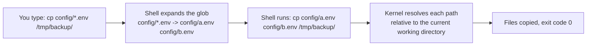
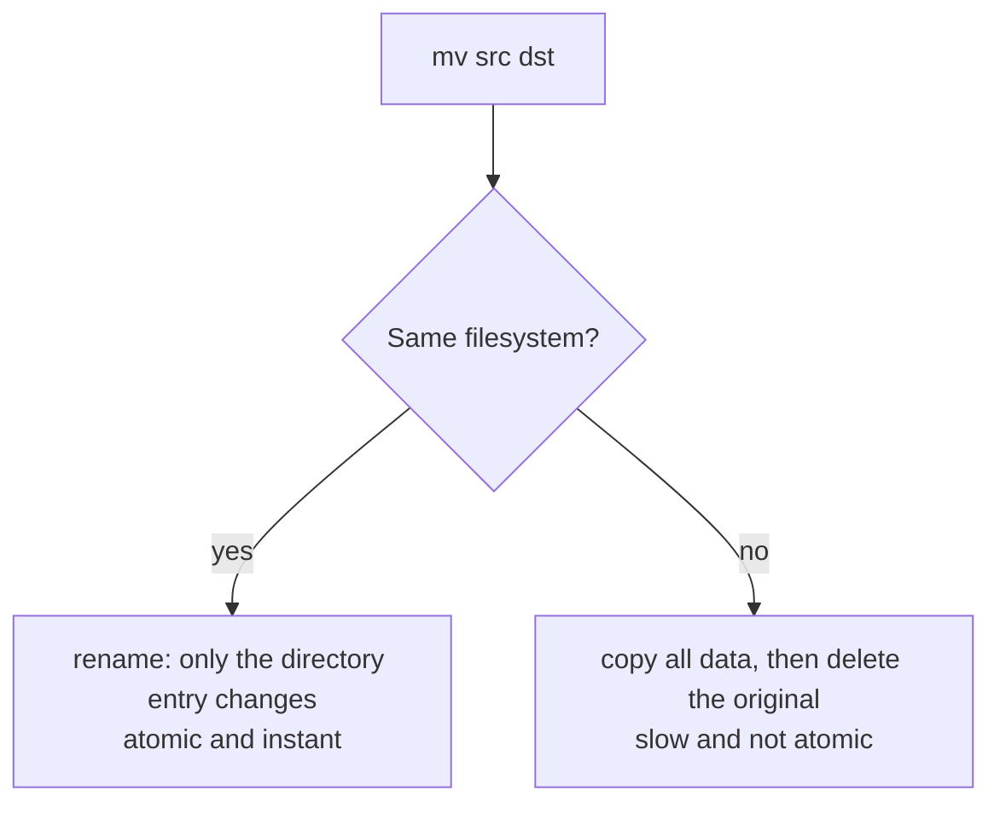

# L1.2 — Navigating and Managing Files

> **Level 1: Linux Fundamentals** · Topic 2 of 13 · ⏱ ~3 hours · Difficulty: Beginner

## 1. What it is

Almost every task on a Linux server starts with the same six verbs: **look** (`ls`), **move around** (`cd`, `pwd`),
**create** (`mkdir`, `touch`), **copy** (`cp`), **move or rename** (`mv`) and **delete** (`rm`). These commands are
tiny, but they are how you inspect a deployment, stage a release, take a backup before a risky change and clean up
afterwards.

Two ideas make them predictable. First, every file has a **path**: *absolute* paths start at `/`
(`/etc/nginx/nginx.conf`), *relative* paths start from your **current working directory** (`../logs/app.log`).
Second, the shell, not the command, expands wildcards: when you type `rm *.log` the shell turns `*.log` into a list
of file names *before* `rm` starts. Understanding that one fact explains most "why did it delete that?" surprises.

## 2. Why it matters in DevOps

- **Deployments are file operations.** Many release scripts are "copy the build into a new directory, then switch a
  symlink" (see section 5). Get a path wrong and you deploy the wrong thing, or nothing.
- **`rm` has no undo.** There is no trash can on a server. Typos such as `rm -rf /var/lib/postgresql /` or an
  unquoted variable (`rm -rf $DIR/*` when `$DIR` is empty) have destroyed production data.
- **Speed under pressure.** In an incident you cannot afford to hunt for a file with a GUI. Tab completion, `cd -`
  and `ls -lt` (newest first) save minutes.
- **Automation.** Scripts, Dockerfiles (`COPY`, `WORKDIR`) and CI jobs use exactly these semantics; a relative path
  that works in your shell may break in a cron job where the working directory is different.

## 3. Real-world system example

**Capistrano-style releases (and the tools that copied the idea).** Capistrano, a long-standing Ruby deployment tool,
popularised a directory layout that is still used by many deploy scripts, including simple Node.js ones:

```text
/var/www/shop-api/
├── releases/
│   ├── 20260901120000/     # each deploy is a fresh directory
│   └── 20260908093000/
├── shared/                 # logs, uploads, .env that survive deploys
└── current -> releases/20260908093000   # a symlink; the web server/process uses this path
```

A deploy is just `mkdir` (new release dir), `cp`/`rsync` (the build), `ln -sfn` (flip `current`) and, if something is
wrong, flipping the symlink back to the previous release. That is the entire rollback story, and it uses nothing but
the commands in this topic. Kubernetes uses the same idea internally: the kubelet mounts `ConfigMap` volumes as a
directory of files and updates them by swapping a symlink, so readers never see a half-written file.

## 4. Diagram

How a relative path is resolved, and what the shell does before a command runs:



Why `mv` within one filesystem is instant but across filesystems is not:



## 5. How it works

| Command | Purpose | Options worth knowing |
|---------|---------|-----------------------|
| `pwd` | Print the current directory | `-P` shows the real path with symlinks resolved |
| `cd DIR` | Change directory | `cd` (home), `cd -` (previous dir), `cd ..` (parent) |
| `ls` | List | `-l` long, `-a` include dotfiles, `-h` human sizes, `-t` newest first, `-S` biggest first, `-R` recursive, `-d` the directory itself |
| `mkdir` | Make directory | `-p` create parents and do not fail if it exists, `-v` verbose |
| `touch` | Create empty file or update timestamp | `-c` do not create |
| `cp` | Copy | `-r` recursive, `-a` archive (keeps permissions, ownership, timestamps, symlinks), `-i` ask before overwrite, `-n` never overwrite, `-v` verbose |
| `mv` | Move or rename | `-i`, `-n`, `-v`; works the same for files and directories |
| `rm` | Delete | `-r` recursive, `-f` no prompts, `-i` ask, `-v` verbose. `rmdir` removes only *empty* directories |
| `ln -s TARGET LINK` | Symbolic link | `-f` replace an existing link, `-n` treat an existing link-to-dir as a file |

Concepts to keep straight:

- **Hidden files** start with a dot (`.env`, `.ssh`). `ls` hides them; `ls -a` shows them. `*` does *not* match them.
- **Globs** (done by the shell): `*` any string, `?` one character, `[abc]` one of a set, `{a,b}` brace expansion
  (`cp app.conf{,.bak}` becomes `cp app.conf app.conf.bak`).
- **Quoting:** names with spaces need quotes (`"my file.txt"`). Always quote variables: `"$DIR"`.
- **Trailing slash:** `cp -r src dst` vs `cp -r src/ dst`: with GNU `cp` both create `dst/src` if `dst` exists; `rsync`
  (topic 5) treats the trailing slash very differently. Do not assume the habit transfers between tools.
- **Hard link vs symlink:** a symlink is a small file that stores a path; a hard link is a second name for the same
  inode. Deployment tooling uses symlinks.
- **Atomic switch:** `ln -sfn releases/NEW current` replaces the link in one step; `rm current && ln -s ...`
  leaves a moment where `current` does not exist.

## 6. Step-by-step guide

**Prerequisites:** any Linux shell. Safe sandbox: `docker run -it --rm ubuntu:24.04 bash`, a VM, WSL2 or a cheap VPS.
Everything below happens inside a scratch directory, so nothing important can be damaged.

1. **Where am I, and what is here?**
   ```bash
   pwd
   cd ~
   mkdir -p lab && cd lab
   pwd
   ls -la
   ```
   `pwd` prints something like `/home/deploy/lab`; the directory is empty apart from `.` (this directory) and `..` (parent).

2. **Build a project skeleton in one command.**
   ```bash
   mkdir -pv shop-api/{src,config,logs}
   touch shop-api/src/{app.js,db.js} shop-api/package.json
   ls -R shop-api
   ```
   Expected output (order may differ slightly):
   ```text
   shop-api:
   config  logs  package.json  src

   shop-api/config:

   shop-api/logs:

   shop-api/src:
   app.js  db.js
   ```

3. **Read a long listing.**
   ```bash
   ls -lah shop-api
   ```
   Output is similar to:
   ```text
   total 24K
   drwxr-xr-x 5 deploy deploy 4.0K Oct  8 20:26 .
   drwxr-xr-x 3 deploy deploy 4.0K Oct  8 20:26 ..
   drwxr-xr-x 2 deploy deploy 4.0K Oct  8 20:26 config
   drwxr-xr-x 2 deploy deploy 4.0K Oct  8 20:26 logs
   -rw-r--r-- 1 deploy deploy    0 Oct  8 20:26 package.json
   drwxr-xr-x 2 deploy deploy 4.0K Oct  8 20:26 src
   ```
   Columns: type and permissions, link count, owner, group, size, modified time, name. A leading `d` means directory, `l`
   symlink, `-` regular file. (Permissions are topic 6.)

4. **Copy safely: back up before you change.**
   ```bash
   cp -a shop-api shop-api.bak        # -a keeps permissions, timestamps, symlinks
   cp -v shop-api/package.json shop-api/package.json.orig
   cp shop-api/package.json{,.$(date +%F)}   # brace expansion plus command substitution
   ls shop-api
   ```
   Look for `package.json.orig` and `package.json.2026-10-08` (your date will differ).

5. **Move and rename (the same command).**
   ```bash
   mv shop-api/src/db.js shop-api/src/database.js       # rename
   mv shop-api/package.json.orig /tmp/                  # move to another directory
   mv -n shop-api/src/app.js shop-api/src/database.js   # -n: refuses to overwrite
   ```
   The last command prints nothing and does not clobber `database.js`. Without `-n` it would silently replace it.

6. **Navigate fast.**
   ```bash
   cd shop-api/src
   cd ../config      # relative: up one level, down into config
   cd -              # back to shop-api/src (the shell prints the path)
   cd                # home
   ```
   Press <kbd>Tab</kbd> to complete names; press it twice to list candidates.

7. **Delete with a seatbelt.**
   ```bash
   cd ~/lab
   rmdir shop-api                  # fails: Directory not empty (a safe default)
   rm -ri shop-api.bak             # asks about every file; answer y
   ls -d shop-api.bak/ 2>&1 | head -1
   ```
   `rmdir` only deletes empty directories, which is exactly why it is safe. After step 7 the second command prints
   `ls: cannot access 'shop-api.bak/': No such file or directory`.
   **Habit:** before any `rm -r`, run the same pattern with `ls` first. If `ls $PATTERN` lists what you expect, replace `ls` with `rm -r`.

8. **Do a symlink-based release flip (the Capistrano pattern).**
   ```bash
   mkdir -p app/releases/v1 app/releases/v2
   echo "version 1" > app/releases/v1/VERSION
   echo "version 2" > app/releases/v2/VERSION
   ln -sfn releases/v1 app/current
   cat app/current/VERSION          # version 1
   ln -sfn releases/v2 app/current  # the "deploy"
   cat app/current/VERSION          # version 2
   ln -sfn releases/v1 app/current  # the "rollback"
   ls -l app/current
   ```
   The final listing shows `app/current -> releases/v1`. Note the link target is relative to the directory the link lives in.

## 7. Real-world scenario

*(Illustrative.)* A teammate runs a cleanup script on the `shop-api` host: `rm -rf $RELEASE_DIR/*` to purge old
releases. The variable was never set in the cron environment, so the shell expanded the command to `rm -rf /*`.
Because the cron job ran as root, uploaded product images and the `.env` file under `/` were gone before the
filesystem errors stopped it. The team restored from the previous night's backup and lost about a day of uploads.

Investigation took ten minutes because the script logged its own commands. The fix was threefold: start scripts with
`set -euo pipefail` (so an unset variable is an error), use `"${RELEASE_DIR:?must be set}"` to abort on empty values,
and replace the global delete with `find "$RELEASE_DIR" -mindepth 1 -maxdepth 1 -mtime +30 -print` (dry run first, then
`-exec rm -rf {} +`). GNU `rm` also refuses `rm -rf /` by default (`--preserve-root`), but `/*` is not protected.
**Lesson:** destructive commands need guards, dry runs and least privilege; "it worked in my shell" is not enough.

## 8. Common mistakes and best practices

**Don't**

- Run `rm -rf` with unquoted or possibly-empty variables, or as root when a normal user would do.
- Use `cp -r` when you want an exact backup of permissions and ownership; use `cp -a` (or `rsync -a`).
- Assume `mv` across disks is atomic or instant; large moves between volumes can leave a half-moved tree if interrupted.
- Put spaces in file names on servers, or rely on `ls` output in scripts (use globs or `find`).
- Delete a log file that a running process holds open (see topic 1): truncate it instead with `: > file`.

**Do**

- Use `mkdir -p`, `cp -n`/`mv -n` and `-v` in scripts so reruns are safe and visible.
- Preview with `ls` or `echo` before destructive globs; add `-i` while learning.
- Use absolute paths in scripts, cron and systemd units (working directory there is not your shell's).
- Make deploys atomic with a symlink flip and keep the last few releases for quick rollback.
- Back up a config before editing it: `sudo cp -a /etc/nginx/nginx.conf{,.bak}`.

## 9. Tasks

- [ ] **T1 — Build and explore a tree** *(≈20 min, beginner)*
  - **Goal:** use `mkdir`, `touch`, `ls` and `cd` fluently.
  - **Steps:**
    1. Create `~/lab/shop-api/{src,config,logs,tests}` with one command.
    2. Create `app.js`, `db.js` and `routes.js` in `src`, and `.env.example` in `config`.
    3. Show hidden files with `ls -la shop-api/config`, then show the whole tree with `ls -R`.
  - **Done when:** `ls -la shop-api/config` lists `.env.example` and `ls -R shop-api` shows all four subdirectories.

- [ ] **T2 — Copy, rename, move** *(≈25 min, beginner)*
  - **Goal:** back up and reorganize without losing data.
  - **Steps:**
    1. `cp -a ~/lab/shop-api ~/lab/shop-api.bak`.
    2. Rename `routes.js` to `router.js` and move `db.js` into a new directory `src/lib/`.
    3. Run `diff -r shop-api shop-api.bak` and read the output.
  - **Done when:** `diff -r` reports exactly the rename and the move, and the backup is unchanged.

- [ ] **T3 — Atomic release and rollback** *(≈30 min, intermediate)*
  - **Goal:** implement the symlink deployment pattern.
  - **Steps:**
    1. Create `~/lab/app/releases/{r1,r2,r3}`, each with a `VERSION` file containing its name.
    2. Point `~/lab/app/current` at `r1`, flip to `r3`, then roll back to `r1` using only `ln -sfn`.
    3. After each flip run `readlink ~/lab/app/current` and `cat ~/lab/app/current/VERSION`.
  - **Done when:** the three `readlink` outputs read `releases/r1`, `releases/r3`, `releases/r1`.

- [ ] **T4 — Break it: the empty-variable trap** *(≈30 min, intermediate)*
  - **Goal:** see why unquoted variables are dangerous, safely.
  - **Steps:**
    1. In `~/lab/trap` create `a.txt b.txt` and write `unset DIR; echo rm -rf $DIR/*` — note the command is *echoed*, not run.
    2. Observe the printed `rm -rf /bin /boot ...` expansion (still only `echo`!), then fix it with `echo rm -rf "${DIR:?DIR is not set}"/*`.
    3. Run the fixed version and read the error.
  - **Done when:** the fixed command stops with `DIR is not set` and you can explain why the first form expands to the root directory. Never run the unguarded `rm` for real.

- [ ] **T5 — Automate a safe cleanup** *(≈45 min, intermediate)*
  - **Goal:** write a script that keeps only the newest 3 release directories.
  - **Steps:**
    1. Create ten directories `rel-01` to `rel-10` under `~/lab/releases` (use a `for` loop or brace expansion).
    2. Write `prune.sh` using `set -euo pipefail`, `ls -1dt` (newest first), `tail -n +4` and a dry-run mode that only prints what would be removed.
    3. Run it in dry-run mode, then for real.
  - **Done when:** exactly three release directories remain and the dry run printed the seven it would remove.

- [ ] **T6 — Prove it: navigate blind** *(≈30 min, advanced)*
  - **Goal:** demonstrate speed and safety without a guide.
  - **Steps:**
    1. In a fresh shell, create the full Capistrano layout (`releases`, `shared`, `current`) for `shop-api` with at most 4 commands.
    2. Deploy two fake releases and roll back.
    3. Explain aloud (or in writing) why `ln -sfn` is safer than `rm` followed by `ln -s`, and why `cp -a` beats `cp -r` for backups.
  - **Done when:** the layout exists, rollback works, and your explanation mentions atomicity and preserved metadata.

## 10. Self-check questions

1. What is the difference between an absolute and a relative path, and which should a cron job use?
2. Who expands `*.log`: `rm` or the shell? Why does that matter?
3. Why is renaming a file on the same filesystem instant, while moving it to another disk is slow?
4. What does `cd -` do and what does `cp -a` preserve that `cp -r` may not?
5. How can a symlink flip give you instant rollback?

<details>
<summary>Answers</summary>

1. Absolute paths start with `/`; relative ones start at the current working directory. Cron and systemd do not start in your shell's directory, so use absolute paths.
2. The shell, before `rm` runs. A glob or an empty variable can change which files the command receives, so quoting and previews matter.
3. A same-filesystem move only rewrites a directory entry (`rename`). Across filesystems the data must be copied and the original deleted.
4. `cd -` returns to the previous directory. `cp -a` preserves permissions, ownership (as root), timestamps and symlinks, and copies recursively.
5. Each release is kept in its own directory; "current" is a link. Re-pointing the link takes one atomic operation, so switching back to the old release is just as fast.
</details>

## 11. Further reading

- `man ls`, `man cp`, `man mv`, `man rm`, `man ln` — short and complete.
- GNU Coreutils manual (gnu.org/software/coreutils) — the reference for every command in this topic.
- *The Linux Command Line* by William Shotts (free online) — chapters on navigation and manipulating files.
- Capistrano documentation (capistranorb.com) — the origin of the `releases/` + `current` layout.
- See also: [Linux Filesystem Hierarchy](01-filesystem-hierarchy.md) and [Rollback](../level-05-cicd/07-rollback.md).

<!-- nav -->
---
← Previous: [Linux Filesystem Hierarchy](01-filesystem-hierarchy.md) · [Level 1 index](README.md) · Next: [Viewing and Searching Text](03-viewing-and-searching-text.md) →
