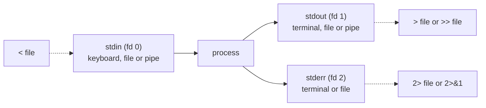

# L1.3 — Viewing and Searching Text

> **Level 1: Linux Fundamentals** · Topic 3 of 13 · ⏱ ~4 hours · Difficulty: Beginner

## 1. What it is

On Linux almost everything an operator cares about is **text**: configuration files, logs, command output,
process lists, even kernel statistics in `/proc`. A small toolbox reads that text (`cat`, `less`, `head`, `tail`), searches
it (`grep` for *contents*, `find` for *files*), and connects the tools together.

The connection mechanism is the real idea. Every program starts with three streams: **stdin** (input), **stdout**
(normal output) and **stderr** (errors). A **pipe** (`|`) connects one program's stdout to the next program's stdin;
**redirection** (`>`, `>>`, `<`, `2>`) connects streams to files. Small single-purpose tools plus pipes become a
query language for your servers, which is the "Unix philosophy".

## 2. Why it matters in DevOps

- **Incidents are text searches.** "Show me every 5xx from the last ten minutes, grouped by endpoint" is a one-line pipeline.
- **No fancy tooling on the box.** Production hosts, containers and rescue shells often have only coreutils, `grep` and
  `find`. Dashboards and log platforms are great, until they are down or the host is the thing that is broken.
- **Automation glue.** CI steps, deploy scripts and health checks are made of `grep -q`, `find ... -mtime`, exit codes
  and redirections.
- **Mistakes are quiet.** Wrong redirection (`>` instead of `>>`) overwrites a log; discarding stderr hides the real error.

## 3. Real-world system example

**Nginx and the access log.** Nginx writes one line per request to `/var/log/nginx/access.log` in a documented
format (the "combined" log format by default). Operators and SRE teams routinely answer production questions directly
from that file with `grep`, `cut`, `sort` and `uniq` before a metrics pipeline is even consulted. The same is true for
PostgreSQL (`/var/log/postgresql/`), `sshd` authentication failures (`/var/log/auth.log` on Debian/Ubuntu) and
Kubernetes node logs under `/var/log/pods/`.

Log shippers such as Fluent Bit and Promtail (for Grafana Loki) work the way you will in this topic: they tail files,
parse lines and forward them. Understanding `tail -F`, file rotation and line-oriented text makes those tools
make sense. Every command in this topic runs on the Nginx access-log format shown in the guide below.

## 4. Diagram

A pipeline: each program does one job; the kernel connects them with in-memory pipes.


The three standard streams and where redirection attaches:



## 5. How it works

**Viewing**

| Command | What it does |
|---------|--------------|
| `cat FILE` | Print a whole file (also joins files: `cat a b > c`) |
| `less FILE` | Pager: `/text` search, `n`/`N` next/previous, `G` end, `g` start, `F` follow, `q` quit |
| `head -n 20 FILE`, `tail -n 20 FILE` | First / last lines |
| `tail -f FILE` / `tail -F FILE` | Follow growth; `-F` also survives log rotation |
| `wc -l FILE` | Count lines |
| `cut -d' ' -f1,7 FILE` | Extract delimited columns |
| `sort`, `uniq -c`, `sort -rn` | Order lines, count duplicates (`uniq` needs sorted input), rank by number |

**Searching contents: `grep`** (also `egrep` is just `grep -E`)

| Option | Meaning |
|--------|---------|
| `-i` | Ignore case |
| `-n` | Show line numbers |
| `-v` | Invert (lines that do *not* match) |
| `-c` | Count matching lines |
| `-r`, `--include='*.conf'` | Recurse into directories; filter by file name |
| `-E` | Extended regex: `a\|b` becomes `a|b`, `+`, `?`, `{n,m}` |
| `-F` | Fixed string, no regex (also faster, safer for `(` or `.`) |
| `-w` | Match whole words |
| `-A N`, `-B N`, `-C N` | N lines of context after, before, around |
| `-o` | Print only the matching part |
| `-l`, `-L` | Only file names with / without matches |
| `-q` | Quiet; only the exit code (0 found, 1 not found), perfect for `if` |

**Searching files: `find`**

```text
find WHERE  TESTS  ACTION
find /var/log -type f -name '*.log' -mtime +7 -size +100M -print
```

Tests: `-name` (case-sensitive glob; `-iname` ignores case), `-type f|d|l`, `-mtime +7` (older than 7 days),
`-mmin -10` (changed in the last 10 min), `-size +100M`, `-user`, `-perm`. Actions: `-print` (default), `-delete`,
`-exec CMD {} \;` (once per file) or `-exec CMD {} +` (batched). For unusual names use `-print0 | xargs -0 CMD`.

**Redirection and pipes**

| Syntax | Effect |
|--------|--------|
| `cmd > file` | stdout to file, **truncating** it |
| `cmd >> file` | append |
| `cmd 2> err.txt` | stderr only to a file |
| `cmd > all.txt 2>&1` | both streams to one file (order matters: redirect stdout first, then point stderr at it) |
| `cmd &> all.txt` | bash shorthand for the line above |
| `cmd > /dev/null 2>&1` | discard everything (use sparingly) |
| `cmd < file` | read stdin from a file |
| `cmd1 \| cmd2` | pipe stdout of 1 into stdin of 2 |
| `cmd \| tee file` | write to screen **and** file; `tee -a` appends; the standard way to write a root-owned file: `echo x \| sudo tee /etc/f` |
| `<<'EOF' ... EOF` | here-document: feed a block of text as stdin (quoted `'EOF'` prevents `$` expansion) |

A pipeline's exit code is the last command's, unless you use `set -o pipefail` in scripts.

## 6. Step-by-step guide

**Prerequisites:** bash on any Linux. We create a realistic sample so you do not need a web server yet.

1. **Create sample logs** (Nginx combined format and an application log).
   ```bash
   mkdir -p ~/lab/logs && cd ~/lab/logs
   cat > access.log <<'EOF'
   203.0.113.10 - - [08/Oct/2026:10:15:01 +0000] "GET /api/products HTTP/1.1" 200 1532 "-" "curl/8.5.0"
   203.0.113.10 - - [08/Oct/2026:10:15:02 +0000] "GET /api/products/42 HTTP/1.1" 200 410 "-" "curl/8.5.0"
   198.51.100.7 - - [08/Oct/2026:10:15:09 +0000] "POST /api/orders HTTP/1.1" 201 87 "-" "Mozilla/5.0"
   198.51.100.7 - - [08/Oct/2026:10:15:11 +0000] "POST /api/orders HTTP/1.1" 500 52 "-" "Mozilla/5.0"
   192.0.2.55 - - [08/Oct/2026:10:15:15 +0000] "GET /api/orders/9 HTTP/1.1" 404 33 "-" "Mozilla/5.0"
   192.0.2.55 - - [08/Oct/2026:10:15:20 +0000] "GET /healthz HTTP/1.1" 200 2 "-" "kube-probe/1.30"
   198.51.100.7 - - [08/Oct/2026:10:16:01 +0000] "POST /api/orders HTTP/1.1" 502 157 "-" "Mozilla/5.0"
   EOF
   cat > app.log <<'EOF'
   2026-10-08T10:15:01Z INFO  server listening on :3000
   2026-10-08T10:15:09Z INFO  order created id=1001
   2026-10-08T10:15:11Z ERROR db: connection refused (127.0.0.1:5432)
   2026-10-08T10:15:12Z WARN  retrying in 2s
   2026-10-08T10:16:01Z ERROR db: timeout after 5000ms
   EOF
   wc -l *.log
   ```
   Expected: `7 access.log`, `5 app.log`, `12 total`.

2. **Look at files three ways.**
   ```bash
   cat app.log            # whole file
   head -n 2 app.log      # first 2 lines
   less access.log        # inside less: type /POST then Enter, n for next match, q to quit
   ```

3. **Search for text with `grep`.**
   ```bash
   grep ERROR app.log
   grep -n -i error app.log          # line numbers, case-insensitive
   grep -c ERROR app.log             # prints: 2
   grep -v INFO app.log              # everything except INFO lines
   grep -E 'ERROR|WARN' app.log      # either word
   grep -F '(127.0.0.1' app.log      # fixed string; no regex surprises from "("
   grep -B1 -A1 'connection refused' app.log   # one line of context each side
   ```
   `grep ERROR` prints the two ERROR lines at 10:15:11 and 10:16:01.

4. **Find server errors in the access log, then summarize them.**
   ```bash
   grep -E '" 5[0-9]{2} ' access.log
   awk '{print $9}' access.log | sort | uniq -c | sort -rn      # status code histogram
   cut -d' ' -f1 access.log | sort | uniq -c | sort -nr | head -3   # top client IPs
   ```
   Output of the histogram is:
   ```text
         3 200
         1 502
         1 500
         1 404
         1 201
   ```
   (`awk` is the subject of the next topic; here it only prints the 9th column.) `uniq` only collapses *adjacent*
   duplicates, which is why `sort` always comes first.

5. **Use redirection correctly.**
   ```bash
   ls /nonexistent > out.txt 2> err.txt      # error goes to err.txt, out.txt is empty
   cat err.txt
   (echo start; ls /nonexistent) > both.txt 2>&1
   cat both.txt
   grep ERROR app.log | tee errors.txt | wc -l   # saves AND counts: prints 2
   echo "extra" >> errors.txt                    # append, never overwrites
   ```

6. **Find files with `find`.**
   ```bash
   mkdir -p srv/logs && touch srv/logs/a.log srv/logs/b.log
   touch -d '40 days ago' srv/logs/a.log
   find srv -type f -name '*.log'                 # all logs
   find srv -type f -name '*.log' -mtime +30      # older than 30 days -> srv/logs/a.log
   find srv -type f -name '*.log' -mtime +30 -print -exec ls -l {} +
   ```
   **Always run the `-print` version first.** Only when the list is right replace it with `-delete`
   (`find srv -name '*.log' -mtime +30 -delete`).

7. **Combine `find` and `grep` to search a codebase or `/etc`.**
   ```bash
   grep -rn 'listen' /etc/nginx/ 2>/dev/null          # after Nginx is installed (capstone)
   grep -rIl --exclude-dir=node_modules 'TODO' ~/lab  # -I skips binary files
   find . -type f -name '*.log' -print0 | xargs -0 grep -l ERROR
   ```

8. **Watch a log live, like on-call.**
   ```bash
   tail -F app.log &              # follow in the background
   echo "2026-10-08T10:20:00Z ERROR payment: card declined" >> app.log
   kill %1                        # stop the background tail
   ```
   `tail -F` immediately prints the new line. Use `tail -F` rather than `-f` for logs that get rotated.

## 7. Real-world scenario

*(Illustrative.)* At 02:10 the pager fires: checkout error rate has crossed 5%. The on-call engineer SSHes into a
`shop-api` host and runs:

```bash
sudo grep -E '" 5[0-9]{2} ' /var/log/nginx/access.log | awk '{print $7}' | sort | uniq -c | sort -rn | head
```

Nearly every error is `POST /api/orders`. `grep -B2 'ERROR' /var/log/shop-api/app.log | tail -20` shows
`db: connection refused (127.0.0.1:5432)` at the same minute the errors began. `systemctl status postgresql` (a later
topic) shows PostgreSQL was restarted by an unattended upgrade. The database is back, the API's retry logic recovers,
and the engineer adds a follow-up: schedule upgrades in a maintenance window and alert on "connection refused".
**Lesson:** three commands narrowed a vague alert to a single endpoint and a single dependency in under two minutes.

## 8. Common mistakes and best practices

**Don't**

- Use `>` when you meant `>>`: `echo x > /var/log/app.log` destroys the log's previous content.
- Write `cmd 2>&1 > file` (stderr still goes to the terminal) when you mean `cmd > file 2>&1`.
- Use `cat file | grep x` in scripts when `grep x file` does the same without an extra process (fine interactively).
- Pipe a file onto itself (`sort f > f`) — the shell truncates `f` before `sort` reads it; use a temp file or `sort -o f f`.
- Run `find ... -delete` or `-exec rm` before looking at the plain `-print` output.
- Pass untrusted file names to `xargs` without `-print0` / `-0`.

**Do**

- Learn `less` (`/`, `n`, `G`, `F`): it handles multi-gigabyte files without loading them whole.
- Quote regexes with single quotes so the shell does not expand `*`, `$` or `|` first.
- Use `grep -q` plus the exit code in scripts: `if grep -q 'ready' status.txt; then ...`.
- Use `set -o pipefail` in scripts so a failing first command is not hidden by a successful last one.
- Keep a personal "incident one-liner" cheat sheet (top URLs, top IPs, errors per minute).

## 9. Tasks

- [ ] **T1 — Build the sample logs and answer five questions** *(≈30 min, beginner)*
  - **Goal:** use `grep`, `wc`, `head`, `tail` on realistic data.
  - **Steps:**
    1. Create `access.log` and `app.log` as in step 1 of the guide.
    2. Answer: how many requests? how many were `POST`? how many returned 5xx? what was the first and last timestamp? which IP made the most requests?
    3. Write each answer next to the command that produced it.
  - **Done when:** every answer is backed by a command and the counts are 7, 3, 2 (500 and 502), `10:15:01` / `10:16:01`, `198.51.100.7`.

- [ ] **T2 — Navigate a big file with `less`** *(≈20 min, beginner)*
  - **Goal:** read a large file without `cat`.
  - **Steps:**
    1. Generate 100,000 lines: `seq 1 100000 | sed 's/^/line /' > big.txt`.
    2. Open with `less big.txt`; jump to the end (`G`), to line 5000 (`5000g`), search for `line 99999` (`/line 99999`).
    3. Press `F` to follow, then <kbd>Ctrl</kbd>+<kbd>C</kbd> and `q`.
  - **Done when:** you can reach any line in under 10 seconds using only keyboard commands.

- [ ] **T3 — Redirection drill** *(≈30 min, intermediate)*
  - **Goal:** control stdout and stderr independently.
  - **Steps:**
    1. Run `ls /etc/hostname /nonexistent` four times, sending (a) nothing to the terminal, (b) only errors to `e.txt`, (c) only output to `o.txt`, (d) both to `all.txt`.
    2. Show `wc -l` of each file.
    3. Demonstrate the `2>&1 > file` ordering bug and explain why stderr still prints.
  - **Done when:** the four files have the expected contents and you can explain the ordering rule in one sentence.

- [ ] **T4 — Find and clean old files safely** *(≈40 min, intermediate)*
  - **Goal:** write a dry-run-first cleanup.
  - **Steps:**
    1. Create 20 files with random ages (`touch -d "$((RANDOM % 60)) days ago" f$i.log`).
    2. Print files older than 30 days with `find`, count them with `wc -l`, then delete only those with `-delete`.
    3. Verify the remaining files are all newer than 30 days with `find . -mtime +30 | wc -l` (must print 0).
  - **Done when:** the final count is 0 and the dry-run list matched what was deleted.

- [ ] **T5 — Break it: the self-overwrite and the missing sort** *(≈30 min, intermediate)*
  - **Goal:** hit two classic mistakes in a safe place.
  - **Steps:**
    1. Run `sort names.txt > names.txt` on a copy and observe that the file is empty. Fix it with `sort -o`.
    2. Run `cut -d' ' -f1 access.log | uniq -c` without `sort` and compare with the correct pipeline.
  - **Done when:** you can explain, for both cases, what the shell or `uniq` did and show the corrected command.

- [ ] **T6 — Prove it: build an incident one-liner kit** *(≈45 min, advanced)*
  - **Goal:** answer production questions from a log with no help.
  - **Steps:**
    1. Without looking at the guide, write one-liners for: top 5 URLs, top 5 client IPs, 5xx count, requests per minute (hint: `cut -c14-18` or `awk`), and all lines for one IP with 2 lines of context.
    2. Run them on a log you generate with at least 1,000 lines (a loop with `$RANDOM` is fine).
    3. Explain each pipeline stage to a colleague.
  - **Done when:** all five commands return correct, verified results and you can describe what each pipe stage does.

## 10. Self-check questions

1. What is the difference between `>` and `>>`, and between `|` and `>`?
2. Why must you `sort` before `uniq -c`?
3. What does `cmd > file 2>&1` do, and how is `cmd 2>&1 > file` different?
4. When would you use `grep -F`, `grep -q` and `tail -F`?
5. Why is `find ... -print0 | xargs -0` safer than `find ... | xargs`?

<details>
<summary>Answers</summary>

1. `>` truncates and writes a file, `>>` appends. A pipe connects a program's stdout to another program's stdin; `>` connects it to a file.
2. `uniq` only merges adjacent identical lines; sorting brings duplicates next to each other.
3. The first sends stdout to the file and then points stderr at the same place. In the second, stderr is duplicated to the terminal *before* stdout is redirected, so errors still show on screen.
4. `-F` for literal text with regex characters, `-q` for exit-code-only checks in scripts, `tail -F` for following a log that gets rotated.
5. It separates names with NUL bytes, so spaces and newlines in file names cannot split one name into several arguments.
</details>

## 11. Further reading

- `man grep`, `man find`, `man bash` (sections "Redirection" and "Pipelines").
- GNU Grep manual and GNU Findutils manual (gnu.org/software) — complete option references.
- *The Linux Command Line* by William Shotts (free online) — chapters on redirection, pipelines and searching.
- *Nginx* documentation on the `log_format` directive (nginx.org/en/docs) for the exact access-log fields.
- See also: [awk and sed](04-awk-and-sed.md), [systemctl and journalctl](11-systemctl-and-journalctl.md) and
  [Observability](../level-00-what-devops-is/10-observability.md).

<!-- nav -->
---
← Previous: [Navigating and Managing Files](02-navigating-and-managing-files.md) · [Level 1 index](README.md) · Next: [Text Processing with awk and sed](04-awk-and-sed.md) →
