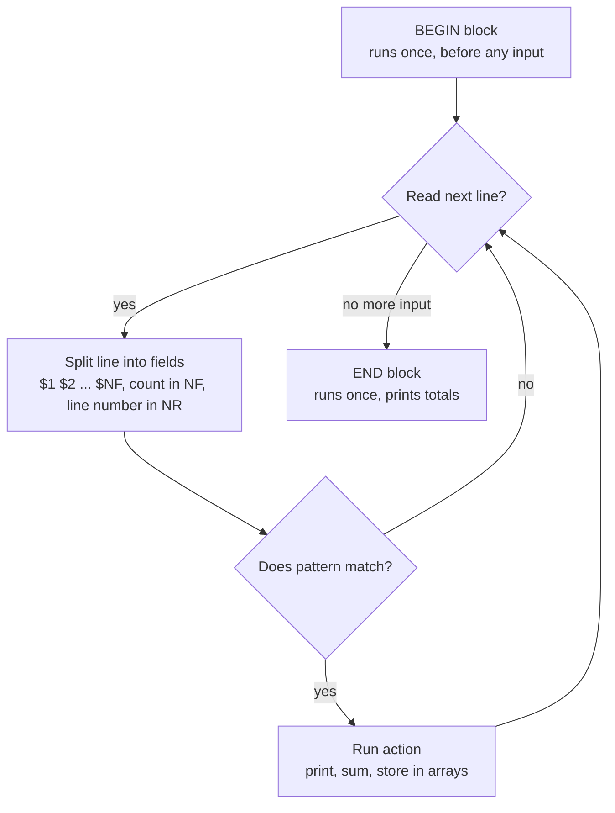
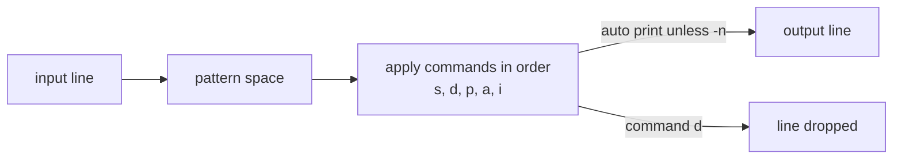

# L1.4 — Text Processing with awk and sed

> **Level 1: Linux Fundamentals** · Topic 4 of 13 · ⏱ ~4 hours · Difficulty: Intermediate

## 1. What it is

`grep` finds lines. **`awk`** and **`sed`** *change* and *calculate over* them.

**`sed`** (stream editor) reads text line by line and applies editing commands: substitute (`s/old/new/`), delete (`d`),
print selected lines (`-n '2,5p'`). It is what you reach for to patch a config value in a script or to rewrite a stream
on the fly. **`awk`** (named after its authors Aho, Weinberger and Kernighan) is a small programming language
built around one idea: split every line into **fields** (`$1`, `$2` ... `$NF`) and run `pattern { action }` rules on each
line. It can filter, sum, group, count and reformat — a tiny report generator in one line.

Both read stdin or files, write stdout, and slot into pipelines (topic 3). They are installed on every Linux
system, including the stripped-down images used in containers.

## 2. Why it matters in DevOps

- **Log analysis without tools:** latency per endpoint, bytes per client, errors per minute straight from raw logs.
- **Config patching in automation:** changing `DB_HOST=` in an env file during a deploy, commenting a line out in
  `sshd_config`, stripping comments from a file before diffing it.
- **Glue between commands:** `ps`, `df`, `kubectl` and `docker` print columns; `awk '{print $2}'` extracts the one you need.
- **Portability:** an `awk`/`sed` one-liner works on a minimal container image, a bastion host and an old server alike.

## 3. Real-world system example

**Nginx / Apache access logs and ad-hoc SRE analysis.** Both servers write whitespace-delimited access logs in
well-known formats, which is why decades of operations runbooks contain `awk` one-liners such as "sum column 10 (bytes
sent) by IP" or "count status codes in column 9". Even when teams run Grafana Loki or an ELK stack, the same
field logic exists inside their query languages (LogQL's `line_format`, `json`/`logfmt` parsers). Learning to
split a line into fields is the transferable skill.

`sed` is just as pervasive in packaging and provisioning: Debian/Ubuntu package maintainer scripts, Dockerfiles and
cloud-init user-data scripts commonly use `sed -i` to flip a setting in a shipped default config file such as
`sshd_config` or `postgresql.conf`. (Configuration management
tools in Level 0 exist largely to replace fragile `sed` edits with idempotent, declarative ones; see
[Configuration Management](../level-00-what-devops-is/04-configuration-management.md).)

## 4. Diagram

awk's execution model: one program, three kinds of blocks.



sed's model: a pattern space that each line passes through.



## 5. How it works

**awk building blocks**

| Item | Meaning |
|------|---------|
| `$0`, `$1`, `$NF` | Whole line, first field, last field |
| `NR`, `NF`, `FNR` | Line number (overall), field count, line number in the current file |
| `-F':'`, `-F'"'`, `-F'[][]'` | Field separator (regex). Default: runs of blanks |
| `OFS` | Output field separator, e.g. `BEGIN{OFS=","}` |
| `pattern { action }` | Run action only when pattern is true: `$9 >= 500`, `/ERROR/`, `NR>1`, `$7 ~ /^\/api/` |
| `BEGIN{}` / `END{}` | Before / after all input |
| Arrays | `count[$9]++` is a hash table; loop with `for (k in count)` |
| `printf` | Formatted output: `printf "%-15s %5d\n", $1, n` |
| Functions | `length()`, `substr(s,start,len)`, `split(s,arr,sep)`, `tolower()`, `sub()`, `gsub()` |

Note: Ubuntu and Debian ship **mawk** as the default `awk`; many other systems have **gawk**. Everything in this topic works in both.
Avoid GNU-only extras (`gensub`, `asort`, `PROCINFO`) in portable scripts, or install `gawk` explicitly.

**sed building blocks**

| Command | Effect |
|---------|--------|
| `s/old/new/` `s/old/new/g` | Substitute first / every occurrence on a line. Use another delimiter if the text has slashes: `s#/usr/local#/opt#g` |
| `-n` + `p` | Suppress auto-print, print only chosen lines: `sed -n '2,3p'`, `sed -n '/ERROR/p'` |
| `d` | Delete matching lines: `sed '/^#/d;/^$/d'` removes comments and blank lines |
| `Naddress` | Address by line `5`, range `2,4`, last line `$`, regex `/WARN/`, or step `1~2` |
| `i\`, `a\`, `c\` | Insert before, append after, change the line |
| `-E` | Extended regex (`+ ? | ( )` without backslashes); backreferences `\1` in the replacement |
| `-i[SUFFIX]` | Edit the file **in place**. `-i.bak` keeps a backup. (On macOS BSD `sed`, `-i` needs an argument: `-i ''`.) |
| `-e` | Multiple expressions: `sed -e 's/a/b/' -e 's/c/d/'` |

Rule of thumb: **`sed` for editing text, `awk` for columns and arithmetic, `grep` for finding lines.** When a pipeline of
`grep | cut | sed` gets long, one `awk` program is usually clearer.

## 6. Step-by-step guide

**Prerequisites:** the `access.log` and `app.log` from [topic 3](03-viewing-and-searching-text.md), step 1. Nothing here
changes system files; `sed -i` is run only on copies.

1. **Print columns.** In the Nginx combined format, `$1` is the client IP, `$7` the URL, `$9` the status and `$10` the bytes.
   ```bash
   awk '{print $1, $7, $9}' access.log | head -3
   ```
   Output:
   ```text
   203.0.113.10 /api/products 200
   203.0.113.10 /api/products/42 200
   198.51.100.7 /api/orders 201
   ```

2. **Filter with a pattern.**
   ```bash
   awk '$9 >= 500' access.log                         # whole lines with 5xx
   awk '$9 >= 500 {print $4, $7, $9}' access.log       # only selected fields
   awk '/POST/ && $9 == 500' access.log                # regex AND comparison
   ```
   The second command prints two lines such as `[08/Oct/2026:10:15:11 /api/orders 500`.

3. **Count and sum with arrays: the real power of awk.**
   ```bash
   awk '{c[$9]++} END {for (s in c) print s, c[s]}' access.log | sort
   ```
   ```text
   200 3
   201 1
   404 1
   500 1
   502 1
   ```
   Bytes per client, biggest first, and an average:
   ```bash
   awk '{b[$1]+=$10} END {for (i in b) print i, b[i]}' access.log | sort -k2 -nr
   awk '{sum+=$10; n++} END {printf "avg bytes: %.1f over %d requests\n", sum/n, n}' access.log
   ```
   Expected: `203.0.113.10 1942`, `198.51.100.7 296`, `192.0.2.55 35` and `avg bytes: 324.7 over 7 requests`.

4. **Change the field separator to parse inside quotes and brackets.**
   ```bash
   awk -F'"' '{print $2}' access.log | head -2        # the request line: GET /api/products HTTP/1.1
   awk -F'[][]' '{print $2}' access.log | head -2     # the timestamp inside [ ]
   ```

5. **Requests per minute (the classic).**
   ```bash
   awk '{split($4, t, ":"); m[t[2] ":" t[3]]++} END {for (k in m) print k, m[k]}' access.log | sort
   ```
   ```text
   10:15 6
   10:16 1
   ```

6. **Use `awk` as glue for other commands.**
   ```bash
   df -h | awk 'NR>1 && $5+0 > 80 {print $6, $5}'      # mounts over 80% full (empty on a healthy box)
   ps aux | awk '$3 > 50 {print $2, $11}'              # PID and command of processes using over 50% CPU
   ```

7. **Substitute with `sed`.**
   ```bash
   sed 's/ERROR/ERR/' app.log | head -3               # first match per line
   sed -n '2,3p' app.log                              # print lines 2-3 only
   sed '/INFO/d' app.log                              # delete INFO lines
   sed -E 's/[0-9]{4}-[0-9]{2}-[0-9]{2}T//' app.log | head -2   # strip the date: 10:15:01Z INFO ...
   sed 's#/usr/local#/opt#g' <<< "/usr/local/bin"      # alternate delimiter -> /opt/bin
   ```

8. **Edit a config file in place, safely.**
   ```bash
   printf 'DB_HOST=localhost\nDB_PORT=5432\n' > env.test
   sed -i.bak 's/^DB_HOST=.*/DB_HOST=10.0.1.5/' env.test
   cat env.test            # DB_HOST=10.0.1.5 and DB_PORT=5432
   diff env.test.bak env.test
   ```
   `-i.bak` leaves `env.test.bak`, so you can always diff and revert. Anchoring with `^` and `.*` replaces the whole
   value, not just the first word, and makes the edit idempotent: running it twice gives the same result.

9. **Capture groups: reformat and extract.**
   ```bash
   sed -E 's/(db): (.*)/\1 -> \2/' app.log | sed -n 3p        # ... ERROR db -> connection refused (...)
   sed 's/.*id=\([0-9]*\).*/\1/' app.log | sed -n 2p           # prints 1001
   ```
   `\( \)` in basic mode (or `( )` with `-E`) captures; `\1` reuses it.

## 7. Real-world scenario

*(Illustrative.)* After a deploy, p95 latency for `shop-api` doubles, but the dashboard only shows an aggregate.
The Nginx log has been extended with `$request_time` as the last field (a common `log_format` customisation). The on-call
engineer runs:

```bash
awk '{t[$7]+=$NF; n[$7]++} END {for (u in t) printf "%-30s %6.3f s avg  (%d req)\n", u, t[u]/n[u], n[u]}' \
  /var/log/nginx/access.log | sort -k2 -nr | head
```

One URL, `/api/search`, averages 1.8 seconds while everything else is under 50 ms. The team finds that the release added
a query with no index (a topic for Level 13). They roll back, add the index and redeploy. A follow-up replaces the
one-liner with a proper latency histogram metric.
**Lesson:** ten seconds of `awk` located the slow endpoint; the lasting fix was better instrumentation, not heroics.

## 8. Common mistakes and best practices

**Don't**

- Run `sed -i` on a production config with no backup or no review of the diff.
- Parse structured data (JSON, YAML, CSV with quoted commas) with `awk`/`sed`. Use `jq`, `yq` or a CSV tool.
- Forget that the default field separator collapses runs of spaces but `-F' '` (single space) does not behave the same everywhere. Prefer the default or an explicit regex.
- Use unanchored substitutions (`s/DB_HOST/.../`) that also match comments or similar keys.
- Put shell variables inside single-quoted awk programs and expect expansion. Pass them with `awk -v host="$HOST" '$1==host'`.

**Do**

- Build pipelines incrementally: run the first stage, check it, add the next.
- Test an `sed` edit without `-i` first, then with `-i.bak`, then diff.
- Anchor patterns (`^`, `$`) and make edits idempotent so scripts can be run twice.
- Use `awk -v` and `-F` instead of shell loops for column work; it is faster and clearer.
- Prefer a real log pipeline (Loki, Elasticsearch, CloudWatch Logs Insights) for recurring analysis and keep one-liners for triage.

## 9. Tasks

- [ ] **T1 — Columns and filters** *(≈25 min, beginner)*
  - **Goal:** print and filter fields with awk.
  - **Steps:**
    1. Use the sample `access.log`. Print only IP and URL for all `POST` requests.
    2. Print the line number and URL for every request whose status is not 200.
    3. Print the last field of every line of `app.log` using `$NF`.
  - **Done when:** the first command prints three lines and the second prints four.

- [ ] **T2 — Histogram and top-N** *(≈30 min, intermediate)*
  - **Goal:** aggregate with arrays.
  - **Steps:**
    1. Generate a 1,000-line log with a loop that picks random statuses from `200 200 200 404 500` and random IPs from three RFC 5737 addresses.
    2. Produce a status histogram and top clients with `awk` (arrays, not `sort | uniq -c`).
    3. Compute the error rate as a percentage with `printf "%.1f%%\n"`.
  - **Done when:** the histogram counts add up to 1000 and the percentage matches a manual `grep -c`.

- [ ] **T3 — Patch a config safely with sed** *(≈30 min, intermediate)*
  - **Goal:** edit text in place with a backup.
  - **Steps:**
    1. Create an `app.env` with `PORT=3000`, `DB_HOST=localhost`, `# DB_HOST=old` and `LOG_LEVEL=info`.
    2. Change `DB_HOST` to `10.0.1.5` without touching the commented line. Use `-i.bak`.
    3. Run the same sed twice and confirm the file does not change the second time (`diff`).
  - **Done when:** `diff app.env.bak app.env` shows only the `DB_HOST` change and the second run is a no-op.

- [ ] **T4 — Break it: greedy match and wrong quotes** *(≈30 min, intermediate)*
  - **Goal:** understand two frequent failures.
  - **Steps:**
    1. Run `echo '"a" and "b"' | sed 's/".*"/X/'`; observe that `.*` is greedy. Fix it with `s/"[^"]*"/X/g`.
    2. Set `HOST=198.51.100.7` and try `awk '$1==$HOST' access.log` (fails to match), then fix it with `awk -v host="$HOST" '$1==host'`.
  - **Done when:** both fixes work and you can explain greedy matching and why shell variables are not visible inside single quotes.

- [ ] **T5 — Automate a daily error report** *(≈45 min, advanced)*
  - **Goal:** turn one-liners into a script.
  - **Steps:**
    1. Write `report.sh <logfile>` that prints total requests, 5xx count and rate, top 3 URLs and top 3 IPs, using only `awk`, `sort`, `head`.
    2. Start with `set -euo pipefail`, validate that the argument is a readable file.
    3. Run it on your 1,000-line log and on an empty file; handle the empty-file division by zero.
  - **Done when:** the report is correct, the empty file prints "no requests" and the script exits 0 in both cases.

- [ ] **T6 — Prove it: the minute-by-minute error timeline** *(≈45 min, advanced)*
  - **Goal:** answer a new question with no guide.
  - **Steps:**
    1. Using only `awk`, `sed` and `sort`, print for each minute the number of requests and the number of 5xx responses, side by side, from a log spanning at least 10 minutes.
    2. Mark minutes with an error rate above 5% with a trailing `ALERT`.
    3. Explain the program line by line to a colleague.
  - **Done when:** output is correct for at least one hand-checked minute and the explanation covers BEGIN/END, arrays and field splitting.

## 10. Self-check questions

1. What do `$0`, `$1`, `$NF`, `NR` and `NF` mean in awk?
2. When do `BEGIN` and `END` blocks run, and what are they typically used for?
3. What is the difference between `sed 's/a/b/'` and `sed 's/a/b/g'`?
4. Why use `sed -i.bak` rather than `sed -i`?
5. How do you pass a shell variable into an awk program?

<details>
<summary>Answers</summary>

1. The whole line, the first field, the last field, the current line number and the number of fields on the current line.
2. `BEGIN` runs once before any input (set `OFS`, print headers); `END` runs once after all input (print totals, loop over arrays).
3. Without `g` only the first match on each line is replaced; with `g` every match is.
4. It keeps a backup copy you can diff and restore if the edit was wrong.
5. `awk -v name="$VAR" '... name ...'`, because single quotes stop the shell from expanding variables inside the program.
</details>

## 11. Further reading

- `man awk`, `man sed`; the GNU Sed manual and GNU Awk User's Guide (gnu.org/software) for complete references.
- *The AWK Programming Language* by Aho, Kernighan and Weinberger — the definitive short book by the language's authors.
- *sed & awk* by Dale Dougherty and Arnold Robbins (O'Reilly).
- See also: [Viewing and Searching Text](03-viewing-and-searching-text.md) and [Observability](../level-00-what-devops-is/10-observability.md).

<!-- nav -->
---
← Previous: [Viewing and Searching Text](03-viewing-and-searching-text.md) · [Level 1 index](README.md) · Next: [Network and Transfer Commands](05-network-transfer-commands.md) →
