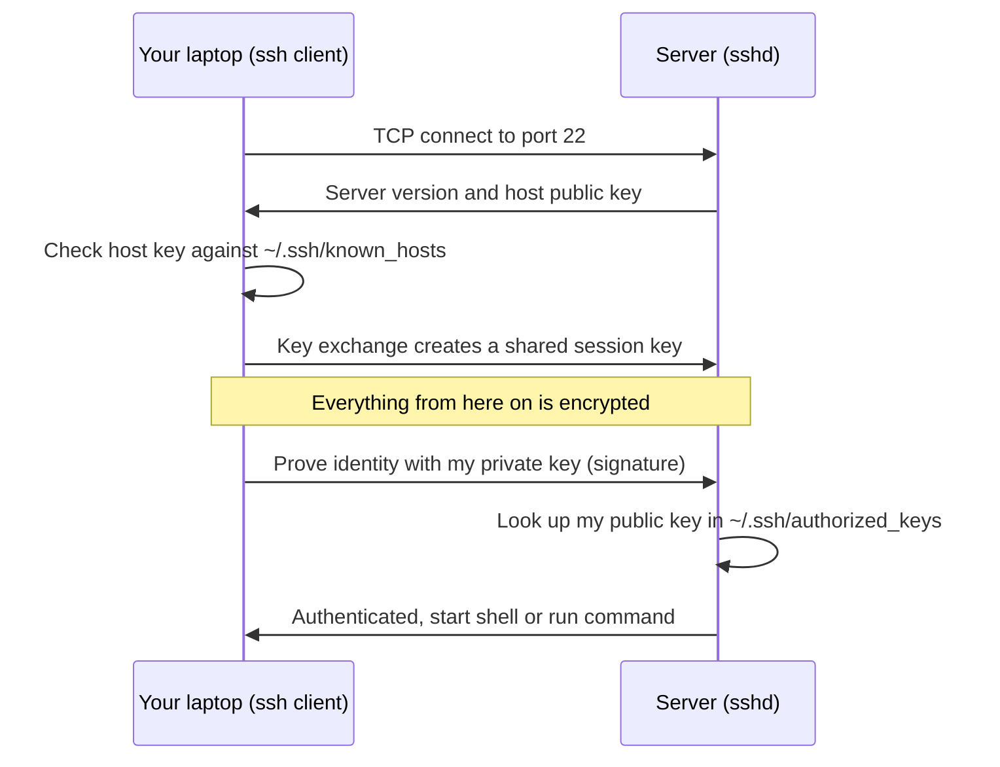
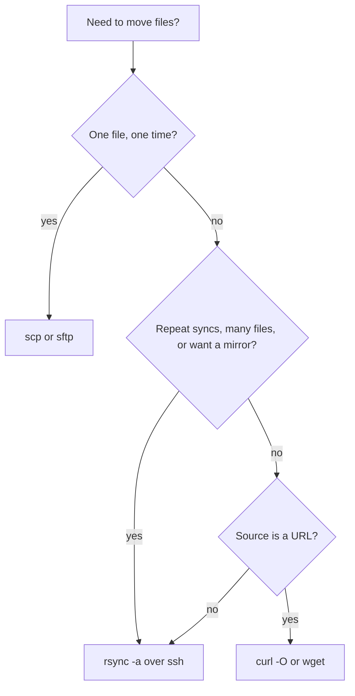

# L1.5 — Network and Transfer Commands

> **Level 1: Linux Fundamentals** · Topic 5 of 13 · ⏱ ~4 hours · Difficulty: Beginner

## 1. What it is

Five command-line tools do most of the "talking to other machines" in DevOps:

- **`curl`** (Client URL) sends a request to a URL and shows the response. It speaks HTTP/HTTPS and many other protocols, and is the universal way to test an API or a health endpoint.
- **`wget`** (Web get) downloads files and can retry and resume; it is simpler than `curl` for "fetch this file".
- **`ssh`** (Secure Shell) opens an encrypted remote terminal, or runs a single command on a remote host.
- **`scp`** (Secure Copy) copies files over SSH.
- **`rsync`** (remote sync) copies only the *differences* between two directory trees, locally or over SSH.

All of the remote ones ride on a protocol that is encrypted and authenticated by default. (Key-based login is in [topic 12](12-ssh-keys-and-authorized-keys.md); this topic is about using the commands.)

## 2. Why it matters in DevOps

- **`curl` is your debugger.** "Is the service up?", "what headers did the load balancer add?", "how long does the TLS handshake take?" are all one `curl` away. It is also inside Docker health checks, CI smoke tests and `curl | sh` installers.
- **SSH is the front door to servers.** Deploys, log checks, tunnels and Git-over-SSH all use it. A bad SSH habit (reused keys, ignoring host-key warnings) is a security incident waiting to happen.
- **`rsync` makes deploys and backups cheap.** Sending only changed bytes turns a 5 GB sync into seconds, and `--delete` makes the destination an exact mirror.
- **Failures are silent without flags.** A script that runs `curl` without `--fail` happily treats a 500 error page as success.

## 3. Real-world system example

**Git over SSH on GitHub.** When you run `git clone git@github.com:org/shop-api.git`, Git is simply running `ssh` under the hood, authenticated by the public key you registered with GitHub. The same mechanism lets CI systems use *deploy keys* to read a single repository.

**Debian and Linux distribution mirrors.** Public Linux mirrors are kept in sync with `rsync`, which is why `rsync://` is a standard mirror protocol: only changed package files move between the master and each mirror.

**Kubernetes and load balancers** rely on HTTP probes: kubelet (and cloud load balancers) call an endpoint such as `/healthz` and judge the result by the HTTP status code, the same check you do by hand with `curl -fsS -o /dev/null -w '%{http_code}'`.

## 4. Diagram

What really happens when you run `ssh deploy@192.0.2.10`:



Choosing a transfer tool:



## 5. How it works

**curl: the options you will use every day**

| Option | Meaning |
|--------|---------|
| `-s` / `-S` | Silent (no progress bar) / still show errors. Use `-sS` together in scripts |
| `-f` (`--fail`) | Exit non-zero (22) on HTTP 4xx/5xx instead of printing the error page |
| `-L` | Follow redirects |
| `-I` | Send `HEAD`, show only response headers |
| `-v` | Verbose: request and response headers, TLS details (`>` sent, `<` received) |
| `-X METHOD`, `-d DATA`, `-H 'Header: v'` | Method, body, header. `-d` implies `POST` |
| `-o FILE` / `-O` | Save output to a name / to the remote file name |
| `-w '%{http_code} %{time_total}\n'` | Print timing and status after the transfer; combine with `-o /dev/null` |
| `--max-time N`, `--connect-timeout N` | Never hang forever |
| `--retry N --retry-connrefused` | Retry on transient errors; `--retry-connrefused` also retries when nothing is listening yet |
| `--resolve host:443:IP` | Test a specific backend while keeping the right `Host`/SNI name |
| `-k` | Skip TLS verification. **Only for debugging**; never in scripts |

**wget**: `wget URL` (download), `-O FILE` (name), `-c` (resume), `-q` (quiet), `--spider` (check existence, no download), `-r` (recursive).

**ssh**

| Usage | Meaning |
|-------|---------|
| `ssh user@host` | Interactive shell |
| `ssh user@host 'uptime; df -h /'` | Run commands and return; quote the whole command |
| `ssh -i ~/.ssh/key -p 2222 user@host` | Choose a key and port |
| `ssh -t host 'sudo -l'` | Force a TTY (needed for interactive prompts such as `sudo`) |
| `ssh -v host` | Debug the connection (repeat `-vvv` for more) |
| `ssh -o StrictHostKeyChecking=accept-new host` | Trust a host key on first contact only, reject if it changes later |

**scp**: `scp file user@host:/path/`, `scp -r dir user@host:/path/`, `scp user@host:/var/log/app.log .`. Modern OpenSSH implements `scp` on top of the SFTP protocol; for anything bigger or repeated, prefer `rsync`.

**rsync**

| Option | Meaning |
|--------|---------|
| `-a` | Archive: recursive, keep permissions, times, symlinks, owner/group (when root) |
| `-v`, `-h`, `--progress` | Verbose, human sizes, progress |
| `-z` | Compress in transit (helps on slow links, hurts on already-compressed data) |
| `-n` (`--dry-run`) | Show what would change; **always run first** |
| `--delete` | Remove files at the destination that are gone from the source (a true mirror) |
| `--exclude 'node_modules' --exclude '.env'` | Skip paths |
| `-e 'ssh -p 2222 -i key'` | Choose the remote shell and its options |

**The trailing slash rule (rsync):** `rsync -a src/ dst/` copies the *contents* of `src` into `dst`; `rsync -a src dst/` creates `dst/src`. This differs from `cp`'s habits, so always dry-run.

## 6. Step-by-step guide

**Prerequisites:** a Linux/macOS shell with `curl`; for the remote steps, a VPS or a local VM with `sshd` (for instance a free-tier VPS, or `sudo apt-get install -y openssh-server` on a throwaway Ubuntu VM). Use `192.0.2.10` below as a placeholder for your server's address.

1. **Make an HTTP request and read the status.** A tiny local server gives a safe target:
   ```bash
   mkdir -p ~/lab/web && cd ~/lab/web
   echo '{"status":"ok"}' > healthz
   python3 -m http.server 8099 >/dev/null 2>&1 &
   curl -s localhost:8099/healthz
   curl -sS -o /dev/null -w '%{http_code} %{time_total}s %{size_download}B\n' localhost:8099/healthz
   ```
   First prints `{"status":"ok"}`; the second prints similar to `200 0.002084s 16B`.

2. **See the headers and the full conversation.**
   ```bash
   curl -I localhost:8099/healthz            # response headers only (HEAD)
   curl -sv localhost:8099/healthz 2>&1 | grep -E '^[<>]'
   ```
   Lines starting with `>` are what curl sent (`GET /healthz HTTP/1.1`, `Host:`, `User-Agent:`), lines with `<` are the response.

3. **Use `--fail` and exit codes the way scripts do.**
   ```bash
   curl -s -o /dev/null -w '%{http_code}\n' localhost:8099/nope    # prints 404 but exits 0
   curl -fsS localhost:8099/nope; echo "exit=$?"                   # curl: (22) ... returned error: 404, exit=22
   curl --max-time 2 -sS localhost:1; echo "exit=$?"               # connection refused, exit=7
   ```
   Exit code `22` means HTTP error with `-f`; `7` means could not connect; `28` is a timeout.

4. **Send data like an API client.**
   ```bash
   curl -sS -X POST localhost:8099/healthz -H 'Content-Type: application/json' -d '{"sku":"A1"}' -w '\n%{http_code}\n'
   ```
   Python's simple server answers `501` (it does not implement `POST`). Against `shop-api` later you expect `201`.
   Stop the server with `kill %1`.

5. **Download files with `wget` and `curl`.**
   ```bash
   curl -fsSLO https://example.com/index.html       # -L follow redirects, -O keep the name
   wget -q -O - https://example.com | head -3        # write to stdout
   wget --spider -S https://example.com 2>&1 | head -5   # check existence and headers only
   ```
   Outbound HTTPS requires internet access; `example.com` is reserved for documentation.

6. **Run a command on a server over SSH.**
   ```bash
   ssh deploy@192.0.2.10 'hostname; uptime; df -h /'
   ssh -t deploy@192.0.2.10 'sudo systemctl status ssh --no-pager | head -5'
   ```
   The first time you connect you see `The authenticity of host ... can't be established` and a fingerprint: that is the
   host-key check from the diagram. Compare the fingerprint with the one in your VPS provider's console before typing `yes`.

7. **Copy a file with `scp`.**
   ```bash
   echo "release 1.4.2" > VERSION
   scp VERSION deploy@192.0.2.10:/tmp/
   scp deploy@192.0.2.10:/etc/os-release ./remote-os-release
   ```

8. **Mirror a directory with `rsync`: dry-run first, then real.**
   ```bash
   mkdir -p build && echo "console.log('hi')" > build/app.js && echo secret > build/.env
   rsync -avn --delete --exclude '.env' build/ deploy@192.0.2.10:/tmp/shop-api-release/
   rsync -avh --progress --delete --exclude '.env' build/ deploy@192.0.2.10:/tmp/shop-api-release/
   rsync -avh --delete --exclude '.env' build/ deploy@192.0.2.10:/tmp/shop-api-release/   # again
   ```
   The first command lists `app.js` but transfers nothing (`-n`). The second sends it. The third reports no files
   transferred, because rsync found no differences: the property that makes it good for repeated deploys.
   (Local-only practice: replace the remote target with a local path such as `/tmp/shop-api-release/`.)

9. **Configure SSH once, type less forever.** Add to `~/.ssh/config` (details in [topic 13](13-ssh-agent-and-port-forwarding.md)):
   ```text
   Host shop
       HostName 192.0.2.10
       User deploy
       IdentityFile ~/.ssh/id_ed25519
   ```
   Now `ssh shop`, `scp VERSION shop:/tmp/` and `rsync -a build/ shop:/tmp/rel/` all work.

## 7. Real-world scenario

*(Illustrative.)* A post-deploy script for `shop-api` ends with `curl http://localhost:3000/healthz` and the pipeline
shows green, yet customers see errors. The API had crashed on a missing environment variable and the reverse proxy
was returning a `502` HTML page, and `curl` happily printed it and exited `0`. The engineer reproduces it with `curl -v`,
sees the `HTTP/1.1 502` line, and changes the check to:

```bash
curl --fail --silent --show-error --max-time 5 --retry 5 --retry-delay 2 --retry-connrefused http://localhost:3000/healthz
```

Now a bad release fails the pipeline, a slow start is retried instead of failing, and a hung process cannot block the
job forever. **Lesson:** a health check is only useful if its exit code reflects reality: `--fail`, timeouts, retries.

## 8. Common mistakes and best practices

**Don't**

- Use `curl -k` or `StrictHostKeyChecking=no` in scripts; you disable the very protection that detects impersonation.
- Pipe `curl ... | sudo bash` from a URL you have not read. Download, inspect, then run (and verify checksums when provided).
- Run `rsync --delete` without a dry-run, or with a source path missing its trailing slash.
- Put secrets on the command line (`curl -H "Authorization: Bearer <YOUR_TOKEN>"` shows up in `ps` and shell history); read from a file or env var with `-H @file`/`--config`.
- Copy `.env` files and private keys around with `scp` to "just make it work".

**Do**

- Use `-fsS`, `--max-time` and `--retry` in every scripted `curl`.
- Use `rsync -a` with `--exclude` lists for deploys and `-n` for review; keep a rollback copy (topic 2).
- Verify the SSH host-key fingerprint on first contact and let `known_hosts` catch changes.
- Put hosts in `~/.ssh/config` so commands stay short and consistent.
- Use `-w` to expose timing (`time_namelookup`, `time_connect`, `time_starttransfer`) when diagnosing slowness.

## 9. Tasks

- [ ] **T1 — Interrogate a URL** *(≈20 min, beginner)*
  - **Goal:** read status, headers and timing with `curl`.
  - **Steps:**
    1. Start `python3 -m http.server 8099` in a scratch directory containing a `healthz` file.
    2. Run `curl -I`, `curl -v` and `curl -w '%{http_code} %{time_total}\n' -o /dev/null -s` against it.
    3. Request a path that does not exist and note the status.
  - **Done when:** you can show the status code (200 and 404), one request header and one response header from the output.

- [ ] **T2 — Exit codes that tell the truth** *(≈25 min, intermediate)*
  - **Goal:** write a robust health check.
  - **Steps:**
    1. Write `check.sh` that runs `curl --fail --silent --show-error --max-time 3 --retry 3 --retry-connrefused URL` and prints `UP` or `DOWN`.
    2. Run it against the running server, a 404 path, and a closed port (`localhost:1`).
    3. Print `$?` after each and record the three exit codes.
  - **Done when:** the script prints `UP`/`DOWN` correctly and you recorded the codes 0, 22 and 7.

- [ ] **T3 — First SSH connection and host verification** *(≈30 min, intermediate)*
  - **Goal:** connect to a server and understand the host-key prompt.
  - **Steps:**
    1. Create a free-tier VPS or local Ubuntu VM with `sshd` running and note its IP.
    2. `ssh user@IP 'hostname; uptime'`. Compare the shown fingerprint to the one from the provider console, then accept.
    3. Inspect `~/.ssh/known_hosts` and run `ssh-keygen -F IP`.
  - **Done when:** the command runs, and you can show the stored host-key line for the server.

- [ ] **T4 — Deploy a directory with rsync** *(≈40 min, intermediate)*
  - **Goal:** use dry-run and `--delete` safely.
  - **Steps:**
    1. Create `build/` with five files, one of them `.env`.
    2. Sync to a server (or local `/tmp/rel/`) with `-avn`, then for real with `--exclude '.env'`.
    3. Delete a file from `build/`, re-run with and without `--delete`, and compare.
  - **Done when:** the destination matches `build/` minus `.env`, and you can explain what `--delete` removed and why the trailing slash matters.

- [ ] **T5 — Break it: wrong slash, wrong key** *(≈30 min, intermediate)*
  - **Goal:** reproduce two common mistakes safely.
  - **Steps:**
    1. Run `rsync -a build /tmp/rel-b/` (no trailing slash on source) and show the extra nesting (`/tmp/rel-b/build/...`).
    2. Try `ssh -i /tmp/wrongkey deploy@IP` (generate an unrelated key with `ssh-keygen -t ed25519 -f /tmp/wrongkey -N ''`) and read the `Permission denied (publickey)` message with `-v`.
  - **Done when:** you can state which directory structure each form produces and which line of `ssh -v` shows the key being offered and rejected.

- [ ] **T6 — Prove it: scripted release push** *(≈45 min, advanced)*
  - **Goal:** automate a safe copy-and-verify without the guide.
  - **Steps:**
    1. Write `push.sh` that rsyncs `build/` to a timestamped directory `releases/$(date +%Y%m%d%H%M%S)` on the server, then runs `ssh` to execute `ls` on it.
    2. Make the script abort on any error (`set -euo pipefail`) and run `rsync -n` first when called with `--dry-run`.
    3. Explain how you would flip a `current` symlink as the final step (topic 2).
  - **Done when:** running it twice produces two release directories and the dry run changes nothing on the server.

## 10. Self-check questions

1. Why does `curl http://host/` exit with 0 even when the server returns 500, and how do you change that?
2. What does `rsync -a src/ dst/` do differently from `rsync -a src dst/`?
3. What is the purpose of `known_hosts`, and what should you do if SSH warns that a host key has changed?
4. When would you choose `rsync` over `scp`?
5. What is wrong with `curl -k` in a deployment script?

<details>
<summary>Answers</summary>

1. By default curl succeeds if it can complete the transfer, whatever the HTTP status. Use `-f`/`--fail` (exit 22) or check `-w '%{http_code}'`.
2. The trailing slash on the source copies the contents of `src` into `dst`; without it you get `dst/src/...`.
3. It records each server's public host key so you notice impersonation or man-in-the-middle attacks. A changed key means the server was rebuilt or something is interposed: verify out of band before removing the old entry.
4. For repeated syncs, directories, mirrors, resumable transfers and when only changed data should be sent.
5. It disables certificate verification, so an attacker with a forged certificate can intercept traffic; fix the certificate or trust store instead.
</details>

## 11. Further reading

- curl documentation and the book *Everything curl* (everything.curl.dev) — the authoritative, free guide.
- `man ssh`, `man ssh_config`, `man scp`, `man rsync` and the OpenSSH project documentation (openssh.com).
- The rsync project documentation (rsync.samba.org) for the trailing-slash and filter rules.
- GNU Wget manual (gnu.org/software/wget).
- See also: [Network Debugging Tools](../level-02-networking/10-network-debugging-tools.md) and [HTTP Methods and Status Codes](../level-02-networking/07-http-methods-and-status-codes.md).

<!-- nav -->
---
← Previous: [Text Processing with awk and sed](04-awk-and-sed.md) · [Level 1 index](README.md) · Next: [File Permissions: chmod and chown](06-permissions-chmod-chown.md) →
