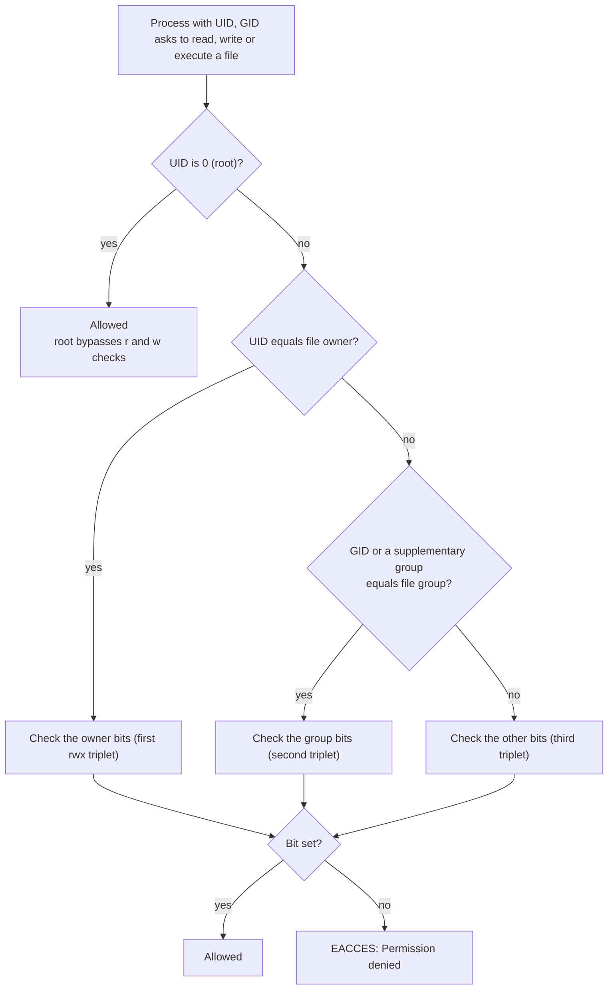
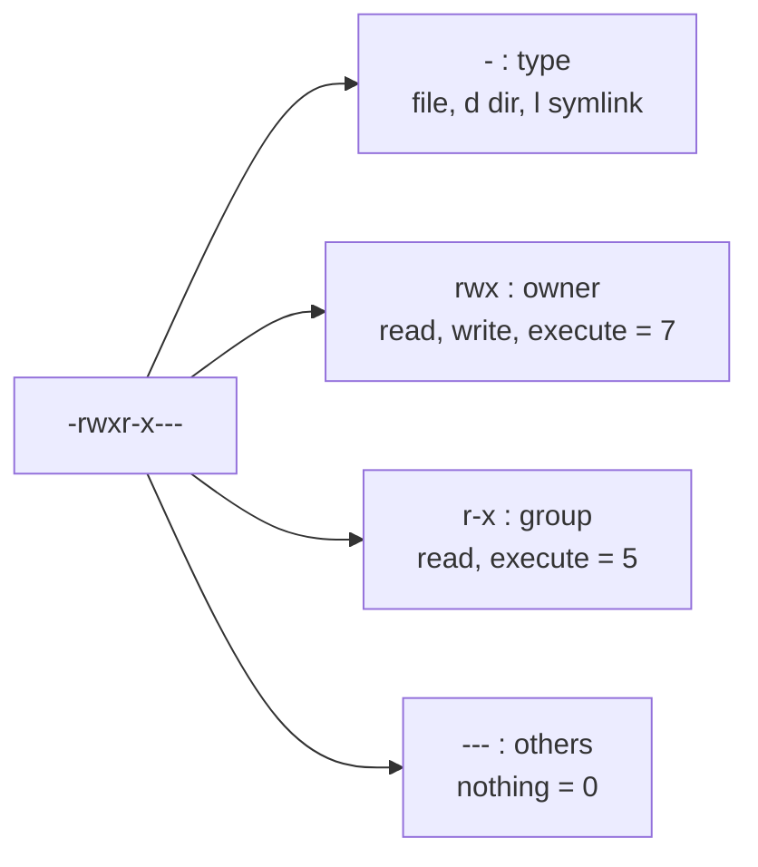

# L1.6 — File Permissions: chmod and chown

> **Level 1: Linux Fundamentals** · Topic 6 of 13 · ⏱ ~4 hours · Difficulty: Intermediate

## 1. What it is

Every file and directory on Linux has an **owner** (a user), a **group**, and three sets of **permission bits** that say
what the owner, the group and everybody else may do: **r**ead, **w**rite and e**x**ecute. That is the entire core model
(called POSIX permissions, after the standard that defines it), and it is the main barrier between a compromised web server
process and the rest of your system.

You inspect it with `ls -l` (`-rwxr-x---`), change the bits with **`chmod`** (change mode), change ownership with
**`chown`** (change owner) and **`chgrp`**, and control the default for new files with **`umask`**. Three special bits, **setuid, setgid and sticky**,
add behaviour for programs and shared directories.

## 2. Why it matters in DevOps

- **"Permission denied" is the most common deployment error.** Nginx cannot read the static files, the API cannot write
  its log, `systemd` cannot execute the script. You must be able to diagnose it in a minute.
- **`chmod 777` is the classic bad fix** that turns a small bug into a security hole. Knowing the right minimal permission is a professional skill.
- **Secrets protection.** SSH refuses to use a private key that other users can read; PostgreSQL refuses to start if its data directory is too open; `.env` files with passwords must be `600` or `640`.
- **Least privilege** (Level 11) starts here: services run as their own user and own only what they need.
- **Containers and CI:** file ownership mismatches between a host volume and the container user are a daily source of failures (Level 4).

## 3. Real-world system example

**OpenSSH and PostgreSQL enforce permissions on purpose.** If `~/.ssh/id_ed25519` is readable by others, the `ssh` client prints
`WARNING: UNPROTECTED PRIVATE KEY FILE!` and ignores the key; `sshd` with its default `StrictModes yes` refuses
`authorized_keys` if the home directory or `.ssh` is writable by other users. PostgreSQL refuses to start when its data
directory is accessible to group or others beyond what it allows (it expects mode `0700`, or `0750` when group access is configured).
These are not bugs; the software knows that a loose permission means someone else might read a key or database files.

**`sudo` and `passwd` use setuid.** On Ubuntu, `/usr/bin/sudo` and `/usr/bin/passwd` are owned by root with the setuid bit
(`-rwsr-xr-x`). That is how an ordinary user running `passwd` can write to the root-only `/etc/shadow`.
The system's `/tmp` uses the sticky bit (`drwxrwxrwt`) so everyone can create files there but only a file's owner can delete it.

## 4. Diagram

How the kernel decides whether a process may open a file:



Anatomy of a permission string:



## 5. How it works

**Meaning of the bits**

| Bit | On a file | On a directory |
|-----|-----------|----------------|
| `r` (4) | read contents | list names (`ls`) |
| `w` (2) | modify contents | create, delete, rename entries *inside* (needs `x` too) |
| `x` (1) | run as a program | enter it (`cd`) and access items by name |

A directory without `x` is unusable even if it has `r`. To reach `/var/www/shop/index.html`, the user needs `x` on **every
directory in the path**. This is the cause of many "403 Forbidden" mysteries in Nginx (check with `namei -l /path`).

**Octal (numeric) mode:** add the values per class, so `rwx`=7, `r-x`=5, `rw-`=6, `r--`=4, `---`=0.

| Mode | Meaning | Typical use |
|------|---------|-------------|
| `600` `-rw-------` | owner read/write only | private keys, `.env` with secrets |
| `640` `-rw-r-----` | owner rw, group read | config read by a service group |
| `644` `-rw-r--r--` | everyone reads | normal files, static content |
| `700` `drwx------` | owner only | `~/.ssh`, PostgreSQL data dir |
| `750` `drwxr-x---` | owner full, group enter | app directories |
| `755` `drwxr-xr-x` | everyone can enter and list | normal directories, executables |

**Symbolic mode:** `chmod u+x file`, `chmod g-w,o= file`, `chmod a+r file` (`u` user/owner, `g` group, `o` others, `a` all;
`+` add, `-` remove, `=` set exactly). Capital `X` adds execute only for directories (or files already executable):
`chmod -R u=rwX,g=rX,o= dir` is the safe recursive form.

**Ownership:** `chown user file`, `chown user:group file`, `chown -R user: dir` (group defaults to the user's login group), `chgrp group file`. Only root may give a file away; a normal user can only change the group of their own files to a group they belong to.

**umask** removes bits from the default (files start at `666`, directories at `777`). With `umask 022` new files are `644` and directories `755`; with `077` they are `600`/`700`; with `002` they are `664` (group-writable, useful for shared project directories).

**Special bits**

| Bit | Octal | Effect |
|-----|-------|--------|
| setuid (`s` in owner x) | 4000 | An executable runs with the *file owner's* UID (`passwd`, `sudo`). Ignored on scripts. |
| setgid (`s` in group x) | 2000 | Executable: runs with the file's group. **Directory:** new files inherit the directory's group (great for shared dirs). |
| sticky (`t` in others x) | 1000 | In a directory, only the file owner (or root) can delete or rename entries (`/tmp`). |

A capital `S` or `T` means the special bit is set but the execute bit underneath is not (usually a mistake).

Beyond this model: ACLs (`setfacl`/`getfacl`), file attributes (`chattr +i`), SELinux/AppArmor. You will meet them later; the basic model solves most DevOps cases.

## 6. Step-by-step guide

**Prerequisites:** any Linux shell and `sudo` (for `chown`). Use a scratch directory.

1. **Read permissions.**
   ```bash
   mkdir -p ~/lab/perm && cd ~/lab/perm
   touch app.sh
   ls -l app.sh
   stat -c '%A %a %U:%G %n' app.sh
   ```
   Output is similar to `-rw-r--r-- 644 deploy:deploy app.sh`: type and permissions, octal, owner:group.

2. **Change mode numerically and symbolically.**
   ```bash
   chmod 755 app.sh;           stat -c '%A %a' app.sh   # -rwxr-xr-x 755
   chmod g-x,o= app.sh;        stat -c '%A %a' app.sh   # -rwxr----- 740
   chmod 600 app.sh;           stat -c '%A %a' app.sh   # -rw------- 600
   chmod a+r app.sh;           stat -c '%A %a' app.sh   # -rw-r--r-- 644
   ```

3. **Make a script executable and run it.**
   ```bash
   printf '#!/bin/bash\necho "hello from $(whoami)"\n' > hello.sh
   ./hello.sh                  # bash: ./hello.sh: Permission denied
   chmod u+x hello.sh
   ./hello.sh                  # hello from deploy
   ```

4. **See what umask does.**
   ```bash
   umask                       # usually 0022
   (umask 077; touch private; mkdir pdir; stat -c '%A %a %n' private pdir)
   (umask 002; touch group-file; stat -c '%A %a %n' group-file)
   ```
   Expected: `-rw------- 600 private`, `drwx------ 700 pdir`, `-rw-rw-r-- 664 group-file`. The subshell `( )` keeps the umask change from leaking into your session.

5. **Change ownership.** `www-data` is the account Nginx uses on Ubuntu.
   ```bash
   sudo chown www-data:www-data app.sh
   ls -l app.sh                # owner and group are now www-data
   sudo chown "$USER": app.sh  # give it back
   ```

6. **Diagnose a directory-traversal failure.**
   ```bash
   mkdir -p site/private && echo hi > site/private/index.html
   chmod 755 site/private/index.html
   chmod 600 site/private                       # remove x from the directory
   sudo -u www-data cat site/private/index.html # Permission denied, even though the file is 755
   chmod 755 site/private
   namei -l "$PWD/site/private/index.html"      # shows owner/mode of every path component
   ```
   (`sudo -u www-data` runs the command as that user, topic 7. If your home directory is `700`, the earlier components
   also block `www-data`: `namei -l` reveals which one.)

7. **Shared directory with setgid and a sticky bit.**
   ```bash
   mkdir shared
   chmod 2775 shared;  stat -c '%A %a' shared   # drwxrwsr-x 2775  (setgid)
   chmod 1777 shared;  stat -c '%A %a' shared   # drwxrwxrwt 1777 (sticky, like /tmp)
   ls -ld /tmp
   ```
   With setgid on a directory owned by group `deployers`, files that anyone in the group creates are automatically owned by `deployers`.

8. **Find setuid programs (a classic security audit).**
   ```bash
   ls -l /usr/bin/passwd /usr/bin/sudo
   find /usr/bin /usr/sbin -perm -4000 -type f 2>/dev/null
   ```
   You see `-rwsr-xr-x root root` on `passwd`, `sudo`, `mount`, `su` and a few others. An unexpected entry on a server is a red flag.

9. **Apply the right permissions to a secret and a service directory.**
   ```bash
   sudo install -d -m 750 -o root -g www-data /etc/shop-api
   echo 'DB_PASSWORD=<YOUR_PASSWORD>' | sudo tee /etc/shop-api/shop-api.env >/dev/null
   sudo chown root:www-data /etc/shop-api/shop-api.env
   sudo chmod 640 /etc/shop-api/shop-api.env
   ls -ld /etc/shop-api; ls -l /etc/shop-api/shop-api.env
   ```
   Only root can edit the file; the service group can read it; everyone else gets nothing. Clean up with `sudo rm -r /etc/shop-api`.

## 7. Real-world scenario

*(Illustrative.)* After moving the static front-end of `shop-api` to a new server, Nginx returns `403 Forbidden` for every
file. The deploy copied files with `scp` as user `deploy`; the web root `/var/www/shop` is `drwx------ deploy deploy`, so `www-data`
cannot enter it. A colleague suggests `chmod -R 777 /var/www`. The engineer instead runs `sudo -u www-data ls /var/www/shop`
(Permission denied), then `namei -l /var/www/shop/index.html` which points at the `700` directory.

The fix is `chmod 755` on directories and `644` on files — done in one pass with
`find /var/www/shop -type d -exec chmod 755 {} +` and `find /var/www/shop -type f -exec chmod 644 {} +` — and the deploy script
now uses `rsync -a --chmod=D755,F644`. **Lesson:** read the path component by component; fix the *minimum*, and encode the fix in the deploy so it does not recur.

## 8. Common mistakes and best practices

**Don't**

- Run `chmod -R 777` to "make it work". It makes everything writable and executable by every account on the host.
- Run `chmod -R 644 dir` (it strips `x` from directories and breaks them) or `chown -R` on a path you have not double-checked (`chown -R user: /` is catastrophic).
- Set setuid on scripts or on shells; the kernel ignores setuid on scripts, and on binaries it is a privilege-escalation risk.
- Make private keys or `.env` files group/world-readable.
- Run a service as root merely to avoid a permission error.

**Do**

- Give each service its own user and own only its data directories (`/var/lib/app`, `/var/log/app`).
- Use `640`/`600` for secrets, `644`/`755` for public content, `700` for `~/.ssh` and database data.
- Use `X` in symbolic modes or `find -type d` / `-type f` to treat directories and files differently.
- Use groups plus a setgid directory for shared access, instead of widening "others".
- Use `namei -l` and `sudo -u <service-user>` to test access as the service, not as yourself.

## 9. Tasks

- [ ] **T1 — Decode and set modes** *(≈20 min, beginner)*
  - **Goal:** convert between symbolic and octal fluently.
  - **Steps:**
    1. Write down the octal for `-rwxr-x---`, `-rw-r-----`, `drwxr-xr-x`, `-rwsr-xr-x` without tools.
    2. Create files and set each mode, then verify with `stat -c '%A %a'`.
  - **Done when:** all four answers (750, 640, 755, 4755) match `stat`.

- [ ] **T2 — Control defaults with umask** *(≈25 min, beginner)*
  - **Goal:** predict the mode of new files.
  - **Steps:**
    1. In subshells, set umask `022`, `027`, `077` and `002`; create one file and one directory under each.
    2. Predict the modes first, then compare with `stat`.
  - **Done when:** your predictions match for all eight objects.

- [ ] **T3 — Locked-down service secret** *(≈30 min, intermediate)*
  - **Goal:** apply least privilege to a config file.
  - **Steps:**
    1. Create `/etc/shop-api/shop-api.env` as in step 9 with owner `root`, group `www-data`, mode `640`.
    2. Prove `www-data` can read it: `sudo -u www-data cat ...`. Prove an unrelated user cannot: `sudo -u nobody cat ...`.
    3. Remove the directory afterwards.
  - **Done when:** the first `cat` prints the file and the second prints `Permission denied`.

- [ ] **T4 — Break it: the missing x** *(≈30 min, intermediate)*
  - **Goal:** reproduce and diagnose a traversal failure.
  - **Steps:**
    1. Build `~/lab/web/a/b/index.html` and make each directory `755`, the file `644`.
    2. Remove `x` from `a` (`chmod 644 a`), then run `sudo -u www-data cat ~/lab/web/a/b/index.html` (if your home is `700`, use `/srv/lab/web/...` instead).
    3. Use `namei -l` to find the culprit; fix it with the minimum change.
  - **Done when:** you identify `a` as the blocking directory from `namei` output and the read succeeds after the fix.

- [ ] **T5 — Shared team directory with setgid** *(≈40 min, intermediate)*
  - **Goal:** make group collaboration work without 777.
  - **Steps:**
    1. Create group `deployers` (`sudo groupadd deployers`) and directory `/srv/releases` owned by `root:deployers`, mode `2775`.
    2. Create a file as yourself (add yourself to the group with `sudo usermod -aG deployers $USER` and start a new login or `newgrp deployers`).
    3. Confirm the new file's group is `deployers`, then repeat without the setgid bit and compare.
  - **Done when:** with setgid the file's group is `deployers`, without it the file's group is your primary group.

- [ ] **T6 — Prove it: permission audit** *(≈45 min, advanced)*
  - **Goal:** find risky permissions on a host without a guide.
  - **Steps:**
    1. Write a command list that finds world-writable files outside `/proc`, `/sys` and `/tmp` (`find / -xdev -type f -perm -0002 ...`), all setuid/setgid binaries, and files without an owner (`-nouser`).
    2. Run it on a VM and justify (or fix) each finding.
    3. Explain what each of the three bit classes means in plain words.
  - **Done when:** you have a short written report listing each category, its command and a decision (expected, or fixed).

## 10. Self-check questions

1. What does `640` mean for a file, and who can do what?
2. Why can you not `cd` into a directory that has `r` but not `x`?
3. What does `umask 027` produce for a new file and a new directory?
4. What is the difference between setuid and setgid on a directory, and what is the sticky bit for?
5. A service reports "Permission denied" reading `/etc/shop-api/app.env` (mode 640, `root:root`). What is the minimal fix?

<details>
<summary>Answers</summary>

1. Owner can read and write; group members can read; everyone else has no access.
2. `r` only lets you list names; `x` on a directory is needed to traverse it and access entries by name.
3. Files `640` (666 minus 027) and directories `750`.
4. Setuid on a file runs it as the owner (it has no effect on directories); setgid on a directory makes new entries inherit the directory's group. The sticky bit restricts deleting or renaming entries to the entry's owner (and root), as in `/tmp`.
5. Change the group to the service's group (`chown root:shop-api`) and keep `640`, rather than widening to others.
</details>

## 11. Further reading

- `man chmod`, `man chown`, `man umask`, `man 7 credentials`, `man namei`.
- GNU Coreutils manual (gnu.org/software/coreutils) — "File permissions" chapter.
- *The Linux Command Line* by William Shotts (free online) — "Permissions" chapter.
- *Linux Basics for Hackers* is not required; prefer the Ubuntu Server documentation on users and permissions (ubuntu.com/server/docs).
- See also: [Users, Groups, sudo and root](07-users-groups-sudo-root.md) and [Linux and SSH Hardening](../level-11-security-devsecops/01-linux-and-ssh-hardening.md).

<!-- nav -->
---
← Previous: [Network and Transfer Commands](05-network-transfer-commands.md) · [Level 1 index](README.md) · Next: [Users, Groups, sudo and root](07-users-groups-sudo-root.md) →
