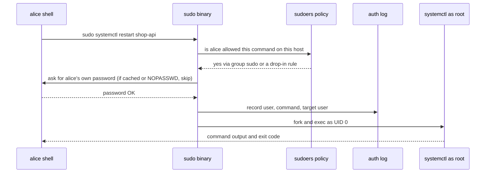
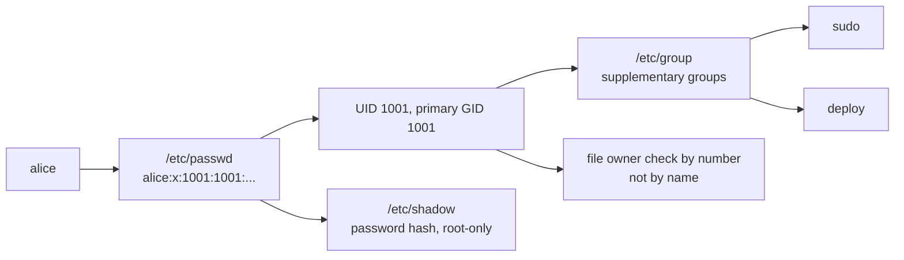

# L1.7 — Users, Groups, sudo and root

> **Level 1: Linux Fundamentals** · Topic 7 of 13 · ⏱ ~4 hours · Difficulty: Intermediate

## 1. What it is

Every process on Linux runs *as* a **user**, identified by a number called the **UID** (user ID). Every file is
owned by a UID and a **GID** (group ID). The kernel never looks at names — names such as `alice` or `postgres` are
just labels from `/etc/passwd` and `/etc/group`. A **group** is a named set of users; membership lets you grant the
same access to several people (or services) at once.

The user with UID `0` is **root**, the superuser: permission checks are skipped for it. Because that is far too much
power for everyday work, administrators log in as a normal user and borrow root's power one command at a time with
**`sudo`** ("superuser do"). What `sudo` allows is written in the **sudoers** policy. A third kind of account is the
**service account** (also called a *system user*): a non-human user such as `www-data`, `postgres` or `shop-api` that
exists only so a daemon can run with the least privilege it needs.

## 2. Why it matters in DevOps

- **Blast radius:** an API that runs as root turns any remote-code-execution bug into a full server takeover. Running it as an unprivileged user turns the same bug into a contained incident.
- **Access reviews and audits:** "who can become root on production?" must have a short, provable answer (`getent group sudo`, `/etc/sudoers.d/`).
- **Onboarding and offboarding:** adding a teammate and — more importantly — removing a leaver cleanly (account, groups, SSH keys, sudo rights) is a daily operations task, later automated by configuration management.
- **Permission errors:** most "Permission denied" tickets are really "wrong user or wrong group". See [File Permissions](06-permissions-chmod-chown.md) for the file side of the same coin.
- **Compliance:** frameworks such as SOC 2 and PCI DSS expect individual accounts (no shared logins) and logged privilege escalation. `sudo` logs every command by default.

## 3. Real-world system example

**Debian/Ubuntu packages and the databases and web servers on them.** When you `apt install postgresql`, the package
creates a system user and group named `postgres` and a data directory under `/var/lib/postgresql` owned by it.
When you install Nginx, the master process starts as root only long enough to bind port 80/443 (ports below 1024
are privileged) and then the worker processes run as the unprivileged `www-data` user (Debian and Ubuntu default; the
`user` directive in `nginx.conf` controls it). Redis, Prometheus' `node_exporter` and the Docker daemon follow the same
pattern: a dedicated account per service, no login shell, no password.

Cloud images apply the same idea to humans. The official Ubuntu AMIs on AWS ship with a default `ubuntu` user that has
passwordless `sudo` (via a drop-in file under `/etc/sudoers.d/`) and no usable password, so access is by SSH key only
and root login is not used directly. Amazon Linux uses `ec2-user` the same way. `cloud-init` creates these accounts
at first boot from the instance's user data.

## 4. Diagram

How a privileged command is authorized when `alice` runs `sudo systemctl restart shop-api`:



How identity is resolved from names to numbers:



## 5. How it works

### The account databases

| File | Contents | Who can read it |
|------|----------|-----------------|
| `/etc/passwd` | one line per user: `name:x:UID:GID:comment:home:shell` | everyone |
| `/etc/shadow` | password hashes and ageing info (`!` or `*` = no password login) | root only |
| `/etc/group` | `name:x:GID:member1,member2` | everyone |
| `/etc/sudoers`, `/etc/sudoers.d/*` | who may run what as whom | root only (mode `0440`) |

Ranges (distribution default, set in `/etc/login.defs`): UID 0 = root, **1-999 = system accounts**, **1000+ = human
users**. This is why a service account created with `--system` gets a low UID.

### Commands you will use daily

| Task | Command |
|------|---------|
| Create a human user with home dir and bash | `sudo useradd -m -s /bin/bash -c "Alice" alice` (Debian-friendly interactive wrapper: `adduser`) |
| Create a service account | `sudo useradd --system --no-create-home --shell /usr/sbin/nologin shop-api` |
| Set / expire a password | `sudo passwd alice` / `sudo passwd -e alice` (forces change at next login) |
| Add to a group (append!) | `sudo usermod -aG deploy alice` |
| Lock / unlock an account | `sudo usermod -L alice` / `sudo usermod -U alice` |
| Delete user and home | `sudo userdel -r alice` |
| Create / delete a group | `sudo groupadd deploy` / `sudo groupdel deploy` |
| Who am I, what groups | `id`, `whoami`, `groups alice` |
| Look up an account | `getent passwd alice`, `getent group sudo` |
| Run as root / as another user | `sudo cmd` / `sudo -u postgres psql` |
| Root shell (use sparingly) | `sudo -i` |
| Edit sudoers safely | `sudo visudo` or `sudo visudo -f /etc/sudoers.d/deploy` |
| Who logged in, recently | `who`, `last` |

**The `-a` in `usermod -aG` is critical.** `usermod -G deploy alice` *replaces* all supplementary groups — a classic
way to remove yourself from `sudo` and lock yourself out.

### Primary vs supplementary groups

Each user has one **primary group** (the GID in `/etc/passwd`, used for newly created files) and any number of
**supplementary groups** (from `/etc/group`). Group changes take effect only for **new** login sessions — an existing
SSH session keeps its old group list until you log out and back in (or run `newgrp`).

### Reading a sudoers rule

```text
deploy  ALL=(root)  NOPASSWD: /usr/bin/systemctl restart shop-api, /usr/bin/systemctl status shop-api
 ^       ^    ^        ^             ^
 who    host  run-as  no password   exact commands allowed
```

- `%sudo ALL=(ALL:ALL) ALL` — the leading `%` means a *group*; members of `sudo` may run anything as anyone. (On RHEL-family systems the equivalent group is `wheel`.)
- Prefer **small drop-in files** in `/etc/sudoers.d/` (one per role) instead of editing `/etc/sudoers`. The files must have mode `0440` and are ignored if their name contains a `.` or ends in `~`.
- A syntax error in sudoers can disable `sudo` for everyone. **Always** edit with `visudo`, which validates before saving, and keep a second root session open while changing it.
- Allowing `NOPASSWD` for a command that can spawn a shell (`vim`, `less`, `find`, `systemctl edit`) is equivalent to giving away root. Restrict to exact commands with exact arguments.

### root vs service accounts

| | root | human admin (`alice`) | service account (`shop-api`) |
|---|------|----------------------|------------------------------|
| UID | 0 | 1000+ | 1-999 (system) |
| Login shell | `/bin/bash`; direct SSH login should be disabled | `/bin/bash` | `/usr/sbin/nologin` or `/bin/false` |
| Password | locked or unused on cloud images | none (SSH key) or strong | none |
| Home | `/root` | `/home/alice` | none, or a data dir such as `/var/lib/shop-api` |
| Purpose | emergencies, package install | interactive work, uses `sudo` | runs exactly one daemon |

## 6. Step-by-step guide

**Prerequisites:** a disposable Ubuntu/Debian machine where you have `sudo` — a VM, a cloud VPS, or
`docker run -it --rm ubuntu:24.04 bash` (inside the container you are root and must first run
`apt-get update && apt-get install -y sudo`). Use a throwaway environment: you are creating accounts.

1. **Look at the existing identity.**
   ```bash
   id
   getent passwd root
   getent group sudo
   ```
   Expected: `id` prints `uid=… gid=… groups=…`; the root line ends in `:/root:/bin/bash`.

2. **Create a human admin user.**
   ```bash
   sudo useradd -m -s /bin/bash -c "Alice Admin" alice
   sudo passwd alice
   getent passwd alice
   ls -ld /home/alice
   ```
   Expected: a line like `alice:x:1001:1001:Alice Admin:/home/alice:/bin/bash` and a home directory owned by `alice`.

3. **Create a group and add alice to it.**
   ```bash
   sudo groupadd deploy
   sudo usermod -aG deploy alice
   id alice
   ```
   Expected: `groups=1001(alice),1002(deploy)` (your numbers will differ).

4. **Give the group a narrow sudo right.**
   ```bash
   echo '%deploy ALL=(root) NOPASSWD: /usr/bin/systemctl restart shop-api, /usr/bin/systemctl status shop-api' \
     | sudo tee /etc/sudoers.d/deploy
   sudo chmod 0440 /etc/sudoers.d/deploy
   sudo visudo -cf /etc/sudoers.d/deploy
   ```
   Expected: `/etc/sudoers.d/deploy: parsed OK`. If you see a syntax error, fix it **before** leaving the session.

5. **Test what alice can and cannot do.**
   ```bash
   sudo -l -U alice
   sudo -u alice sudo -n systemctl status shop-api   # allowed by policy (the unit may not exist yet)
   sudo -u alice sudo -n cat /etc/shadow             # must be refused
   ```
   `sudo -l -U alice` lists the permitted commands. The last command prints `sudo: a password is required` or
   `sorry, user alice is not allowed to execute…` — a refusal is the correct result.

6. **Create a service account for the API.**
   ```bash
   sudo useradd --system --no-create-home --home-dir /nonexistent \
     --shell /usr/sbin/nologin shop-api
   getent passwd shop-api
   id shop-api
   ```
   Expected: UID below 1000 and shell `/usr/sbin/nologin`. Try `sudo su - shop-api`: it prints
   `This account is currently not available.` — services do not need logins.

7. **Run a command as the service account and see the files it owns.**
   ```bash
   sudo mkdir -p /var/lib/shop-api
   sudo chown shop-api:shop-api /var/lib/shop-api
   sudo -u shop-api touch /var/lib/shop-api/ok
   sudo -u shop-api ls -l /var/lib/shop-api
   sudo -u shop-api touch /etc/should-fail    # Permission denied: least privilege at work
   ```

8. **Audit sudo use.**
   ```bash
   sudo journalctl _COMM=sudo --since "10 minutes ago" --no-pager | tail -5
   # or, on systems that still log to a file:
   sudo grep sudo /var/log/auth.log | tail -5
   ```
   You should see entries such as `alice : TTY=pts/0 ; PWD=/home/alice ; USER=root ; COMMAND=/usr/bin/…`.

9. **Offboard alice and clean up.**
   ```bash
   sudo usermod -L alice               # lock first (instant, reversible)
   sudo userdel -r alice               # then remove account and home
   sudo rm /etc/sudoers.d/deploy
   sudo groupdel deploy
   sudo userdel shop-api
   ```
   `getent passwd alice` should print nothing.

## 7. Real-world scenario

*(Illustrative.)* A small startup's Node.js API has run as `root` since the first deploy because "it needed port 80".
A dependency with a path-traversal bug lets an attacker read and write arbitrary files; because the process is root, the
attacker adds their own SSH key to `/root/.ssh/authorized_keys` and reads `/etc/shadow`. The incident review is blunt: the
bug was ordinary, the *privilege* was the disaster.

The fix, applied the same week: a `shop-api` service account with `nologin`, ownership of only `/opt/shop-api` and
`/var/lib/shop-api`; Nginx owns port 443 and proxies to the API on `127.0.0.1:3000`; a narrow
`/etc/sudoers.d/deploy` lets the CI deploy user restart exactly one service; root SSH login is disabled
(`PermitRootLogin no`). **Lesson:** least privilege does not stop bugs, but it decides whether a bug is a bad afternoon or a
breach. The same pattern is formalized in [Linux and SSH Hardening](../level-11-security-devsecops/01-linux-and-ssh-hardening.md).

## 8. Common mistakes and best practices

**Don't**

- Run application servers as root, or log in as root over SSH.
- Use `usermod -G` without `-a` (it replaces the group list and can drop `sudo`).
- Edit `/etc/sudoers` with a normal editor, or leave a broken file in `/etc/sudoers.d/`.
- Hand out `NOPASSWD: ALL` or allow editors/pagers/`find`/`tar` via sudo — each is a root shell in disguise.
- Share one login between people; you lose accountability and cannot revoke one person.
- Give a service account a real shell and password "just to debug".

**Do**

- One account per human, one account per service. Use groups for shared access.
- Prefer `sudo cmd` over `sudo -i`, so every privileged action is logged separately.
- Use drop-in files under `/etc/sudoers.d/`, mode `0440`, validated with `visudo -cf`.
- Lock rather than delete first when offboarding; then remove SSH keys and sudo rules.
- Check `getent group sudo` (or `wheel`) regularly; make it part of access reviews.
- Remember group changes need a new login session.

## 9. Tasks

- [ ] **T1 — Create and inspect a user** *(≈20 min, beginner)*
  - **Goal:** see how the account databases map names to numbers.
  - **Steps:**
    1. Create user `dev1` with a home directory and bash shell.
    2. Print its `/etc/passwd` line, its `id`, and `ls -ld /home/dev1`.
    3. Show that `/etc/shadow` is unreadable as a normal user: `cat /etc/shadow` as `dev1`.
  - **Done when:** you can read each of the seven `passwd` fields aloud and the `shadow` read fails with "Permission denied".

- [ ] **T2 — Shared directory via a group** *(≈30 min, beginner)*
  - **Goal:** grant two users shared access without making files world-writable.
  - **Steps:**
    1. Create users `dev1`, `dev2` and group `shop-team`; add both with `usermod -aG`.
    2. `sudo mkdir /srv/shop && sudo chown root:shop-team /srv/shop && sudo chmod 2770 /srv/shop` (the leading `2` is setgid, so new files inherit the group).
    3. As `dev1` create a file in `/srv/shop`; as `dev2` append to it. Then try as a third user.
  - **Done when:** `dev1` and `dev2` can both write, the third user gets "Permission denied", and `ls -l` shows group `shop-team` on the new file.

- [ ] **T3 — Narrow sudo rule** *(≈30 min, intermediate)*
  - **Goal:** allow exactly one privileged action.
  - **Steps:**
    1. Create `/etc/sudoers.d/dev1` allowing `dev1` to run only `/usr/bin/systemctl status ssh` (or `ssh.service`) as root without a password.
    2. Validate with `visudo -cf`, then check with `sudo -l -U dev1`.
    3. As `dev1` run the allowed command, then try `sudo systemctl restart ssh` and `sudo cat /etc/shadow`.
  - **Done when:** the allowed command works without a prompt and both others are refused.

- [ ] **T4 — Service account for a tiny daemon** *(≈40 min, intermediate)*
  - **Goal:** run a process as a non-login system user and prove what it can touch.
  - **Steps:**
    1. Create system user `shop-api` with `nologin`, and `/var/lib/shop-api` owned by it.
    2. Run `sudo -u shop-api sh -c 'sleep 300 &'`, then find it with `ps -o user,pid,cmd -C sleep`.
    3. As `shop-api`, try writing to `/var/lib/shop-api`, `/etc` and `/root`.
  - **Done when:** `ps` shows user `shop-api` (not root), the first write succeeds and the other two fail.

- [ ] **T5 — Break it and fix it: the lockout** *(≈30 min, advanced)*
  - **Goal:** experience the two classic lockouts safely, in a VM you can snapshot.
  - **Steps:**
    1. Keep a second root session open. As user `dev1` (a member of `sudo`) run `sudo usermod -G dev1 dev1` (no `-a`) and check `id dev1`.
    2. Restore the group with `sudo usermod -aG sudo dev1`.
    3. In a scratch file (not the live sudoers) write an invalid rule and show `visudo -cf` rejecting it.
  - **Done when:** you can explain why step 1 removed `sudo` rights, `id dev1` shows `sudo` again, and `visudo -cf` reports a syntax error on the bad file.

- [ ] **T6 — Prove it: onboarding and offboarding script** *(≈45 min, advanced)*
  - **Goal:** make access changes repeatable and auditable.
  - **Steps:**
    1. Without the guide, write `onboard.sh <user> "<public key>"` that creates the user, adds them to `deploy`, and installs the key with correct modes (`700`/`600`). It must be safe to re-run.
    2. Write `offboard.sh <user>` that locks the account, removes the SSH keys and group membership, and prints what it did.
    3. Run both on a scratch machine and explain each command.
  - **Done when:** running `onboard.sh` twice leaves one correct user, and after `offboard.sh` the user can no longer log in and `getent group deploy` no longer lists them.

## 10. Self-check questions

1. What is the difference between a user name and a UID, and which one does the kernel use?
2. Why is `usermod -G` without `-a` dangerous?
3. Why should a service account have `/usr/sbin/nologin` as its shell?
4. You added `bob` to the `docker` group, but `docker ps` still says permission denied in his open SSH session. Why?
5. Why use `/etc/sudoers.d/` plus `visudo -cf` instead of editing `/etc/sudoers` directly?
6. Why is `NOPASSWD: /usr/bin/vim /etc/shop-api.env` less safe than it looks?

<details>
<summary>Answers</summary>

1. Names are labels from `/etc/passwd`; the kernel and filesystem use the numeric UID/GID. Two names with the same UID are the same user.
2. It replaces the whole supplementary group list, so the user can lose `sudo` (and other) memberships. Use `-aG` to append.
3. It denies interactive logins, so a compromised credential or a stolen password cannot be used for a shell. The daemon still runs fine because systemd starts it directly.
4. Group membership is read at login. Start a new session (or `newgrp docker`). Also remember that docker-group membership is effectively root on that host.
5. A syntax error in the main file can disable `sudo` entirely. Drop-ins keep roles separate and easy to add/remove, and `visudo -cf` validates before the file goes live.
6. From inside the editor the user can run `:!sh` or `:r /etc/shadow` and get a root shell or read any file. Use `sudoedit` for file edits.
</details>

## 11. Further reading

- `man useradd`, `man usermod`, `man sudoers`, `man visudo`, `man passwd` — the authoritative references.
- Ubuntu Server documentation — "User Management" section.
- *The Linux Command Line* by William Shotts — chapter on users and permissions.
- *UNIX and Linux System Administration Handbook* (Nemeth et al.) — chapters on access control and the root account.
- See also: [File Permissions: chmod and chown](06-permissions-chmod-chown.md) and [Processes, PIDs and Signals](08-processes-and-signals.md).

<!-- nav -->
---
← Previous: [File Permissions: chmod and chown](06-permissions-chmod-chown.md) · [Level 1 index](README.md) · Next: [Processes, PIDs and Signals](08-processes-and-signals.md) →
