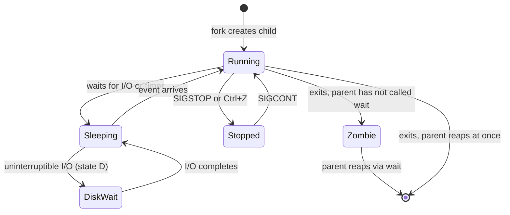
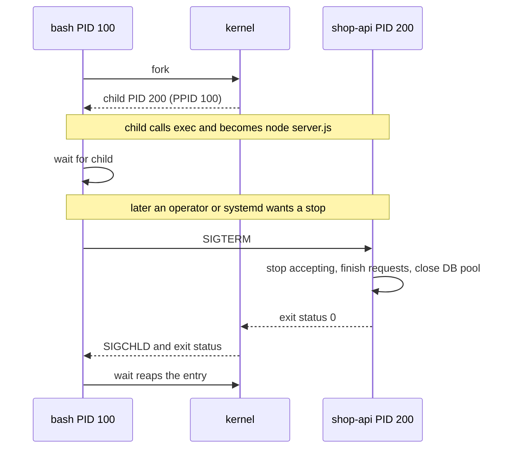

# L1.8 — Processes, PIDs and Signals

> **Level 1: Linux Fundamentals** · Topic 8 of 13 · ⏱ ~4 hours · Difficulty: Intermediate

## 1. What it is

A **process** is a running instance of a program: the program's code plus its memory, open files, environment
variables and the user it runs as. The kernel gives each process a unique number, the **PID** (process ID). Every
process except the very first has a **parent**, identified by its **PPID** (parent PID), so processes form a tree
rooted at PID 1 (`systemd` on modern distributions).

New processes are created in two steps. A process calls **`fork()`**, which makes a near-identical copy of itself (the
**child**). The child then usually calls **`exec()`**, which replaces its memory with a different program. This is
exactly what your shell does when you type `ls`: it forks, the child execs `/usr/bin/ls`, and the shell waits.
**Signals** are small numbered notifications the kernel or other processes send to a process — "please shut down",
"reload your config", "you are being killed" — and they are how `kill`, `Ctrl+C`, `systemctl stop` and Kubernetes
all stop software.

## 2. Why it matters in DevOps

- **Deployments and restarts:** whether the old version finishes its in-flight requests or drops them depends on whether it handles `SIGTERM`.
- **Stuck services:** "the process is running but not responding" needs you to read process state (`R`, `S`, `D`, `Z`) and know when `kill -9` is correct and when it loses data.
- **Zombies and leaks:** a service that forks workers and never reaps them eventually exhausts the PID table and the whole server cannot start new processes.
- **Containers:** the main process of a container is PID 1 *inside* it; if it ignores `SIGTERM` (a very common bug), `docker stop` and Kubernetes wait out the grace period and then `SIGKILL` it.
- **Capacity and cost:** a runaway process eating CPU or memory is the most common reason a server falls over; you find it by PID.

## 3. Real-world system example

**Nginx, PostgreSQL and Kubernetes all document their signal behavior.**

- **Nginx** has a *master* process and several *worker* processes. The master runs as root, reads the config and
  forks workers. The Nginx documentation specifies the signals: `SIGHUP` re-reads the configuration and gracefully
  replaces workers (no dropped connections — `nginx -s reload` sends this), `SIGQUIT` is a graceful shutdown that
  lets workers finish requests, and `SIGTERM`/`SIGINT` is a fast shutdown.
- **PostgreSQL** documents three shutdown modes in terms of signals sent to the postmaster: `SIGTERM` is "Smart"
  shutdown (wait for clients to disconnect), `SIGINT` is "Fast" (roll back transactions and disconnect), and
  `SIGQUIT` is "Immediate" (abort without cleanup, forcing crash recovery on the next start). `SIGHUP` reloads the config files.
- **Kubernetes** stops a pod by sending `SIGTERM` to the container's main process, waiting
  `terminationGracePeriodSeconds` (30 seconds by default), and then sending `SIGKILL`. Applications that exit cleanly on
  `SIGTERM` give zero-downtime rollouts; applications that do not get killed mid-request.
- **Docker** does the same: `docker stop` sends `SIGTERM`, then `SIGKILL` after a default 10-second timeout.

## 4. Diagram

The life of a process, as the kernel sees it:



How a shell starts a program, and how a graceful stop plays out:



## 5. How it works

### The identifiers

| Term | Meaning | How to see it |
|------|---------|---------------|
| PID | unique ID of the process | `ps`, `pgrep`, `echo $$` (the shell's own) |
| PPID | PID of the parent | `ps -o pid,ppid,cmd` |
| PGID / SID | process group / session, used for job control and terminals | `ps -o pid,pgid,sid,cmd` |
| UID | user the process runs as | `ps -o user,pid,cmd` |
| Exit status | 0 = success, 1-255 = failure; `128+N` means killed by signal N | `echo $?` |

The kernel exposes everything under `/proc/<PID>/`: `status`, `cmdline`, `environ`, `fd/` (open files), `cwd`, `exe`.

### Process states (the `STAT` column of `ps`)

| Code | State | Meaning |
|------|-------|---------|
| `R` | Running / runnable | on a CPU or waiting for one |
| `S` | Interruptible sleep | waiting for an event (normal for idle servers) |
| `D` | Uninterruptible sleep | waiting on disk/NFS I/O; cannot be killed until the I/O returns |
| `T` | Stopped | paused by `SIGSTOP` / `Ctrl+Z` |
| `Z` | Zombie | has exited, but the parent has not read its exit status |
| `s`, `l`, `+`, `<`, `N` | suffix flags | session leader, multi-threaded, foreground, high/low priority |

### Zombies and orphans

- A **zombie** is a dead process whose entry stays in the process table only so the parent can read its exit
  status with `wait()`. It uses no CPU or memory, but it holds a PID. **You cannot kill a zombie** — it is already dead.
  You fix the *parent* (make it call `wait`, restart it); once the parent dies, PID 1 adopts and reaps the zombies.
- An **orphan** is a *live* process whose parent died. It is re-parented to PID 1 (or a "subreaper") — this is how daemons detach.
- In containers, PID 1 is whatever you started. If it is a shell script or app that never reaps children, zombies pile up; use `docker run --init`, `tini`, or `dumb-init` as a minimal PID 1.

### Signals you must know

| Signal | # | Default action | Can be caught? | Typical use |
|--------|---|----------------|----------------|-------------|
| `SIGHUP` | 1 | terminate | yes | terminal closed; by convention daemons **reload config** |
| `SIGINT` | 2 | terminate | yes | `Ctrl+C` |
| `SIGQUIT` | 3 | core dump | yes | `Ctrl+\`; Nginx graceful shutdown |
| `SIGKILL` | 9 | terminate | **no** | last resort; the kernel removes the process, no cleanup |
| `SIGTERM` | 15 | terminate | yes | the polite "please exit" (default of `kill`) |
| `SIGUSR1`, `SIGUSR2` | 10, 12 | terminate | yes | app-defined (Nginx reopens logs on USR1) |
| `SIGSTOP` / `SIGCONT` | 19 / 18 | stop / continue | no / yes | pause and resume |
| `SIGCHLD` | 17 | ignore | yes | tells a parent a child changed state |

`SIGKILL` and `SIGSTOP` can never be caught or ignored. That is why `kill -9` always works (except on `D`-state
processes), and also why it is a last resort: no destructors run, no buffers flush, no locks or temp files are cleaned up.

**Order of escalation:** `SIGTERM` → wait a few seconds → `SIGKILL`.

### Commands

| Task | Command |
|------|---------|
| List all processes | `ps aux`, `ps -ef`, `ps -eo pid,ppid,stat,user,%cpu,%mem,cmd --sort=-%mem` |
| Process tree | `pstree -p`, `ps -ef --forest` |
| Find by name | `pgrep -a node`, `pidof nginx` |
| Send a signal by PID | `kill <PID>` (TERM), `kill -HUP <PID>`, `kill -9 <PID>` |
| Send by name | `pkill -TERM -f shop-api`, `killall nginx` |
| Run detached from the terminal | `nohup cmd > out.log 2>&1 &`, or better a systemd service |
| Job control in a shell | `cmd &`, `jobs`, `fg`, `bg`, `Ctrl+Z` |
| What is a process doing | `ls -l /proc/<PID>/fd`, `lsof -p <PID>`, `strace -p <PID>` |
| Change CPU priority | `nice -n 10 cmd`, `renice 10 -p <PID>` |

## 6. Step-by-step guide

**Prerequisites:** any Linux shell (VM, VPS, WSL2 or `docker run -it --rm ubuntu:24.04 bash`; inside a bare
container install `procps` and `psmisc` for `ps`, `pstree`, `pkill`). Nothing here is destructive.

1. **Meet your own process and its parent.**
   ```bash
   echo "my shell PID=$$ PPID=$PPID"
   ps -o pid,ppid,stat,cmd -p $$
   ```
   Expected: one row, `STAT` is `Ss` (sleeping session leader). The PPID is your terminal emulator or `sshd`.

2. **Watch fork + exec happen.**
   ```bash
   sleep 120 &
   echo "child PID=$!"
   ps -o pid,ppid,stat,comm --ppid $$
   ```
   Expected: a `sleep` row whose `PPID` is your shell's PID. Your shell *forked*, and the child *exec'd* `/usr/bin/sleep`.

3. **See the process tree.**
   ```bash
   pstree -p $$
   ```
   Expected (similar to): `bash(1234)───sleep(1290)`. On a server run `pstree -p | head -20` to see PID 1 (`systemd`) at the root.

4. **Inspect a process through `/proc`.**
   ```bash
   PID=$(pgrep -n sleep)
   grep -E 'Name|State|PPid|Uid' /proc/$PID/status
   ls -l /proc/$PID/exe /proc/$PID/cwd
   tr '\0' ' ' < /proc/$PID/cmdline; echo
   ```

5. **Pause and resume with signals.**
   ```bash
   kill -STOP $PID; ps -o pid,stat,comm -p $PID     # STAT shows T
   kill -CONT $PID; ps -o pid,stat,comm -p $PID     # STAT back to S
   ```

6. **Write a program that handles signals, and send them.** Save as `graceful.sh`:
   ```bash
   #!/bin/bash
   trap 'echo "got SIGHUP: reloading config"' HUP
   trap 'echo "got SIGTERM: finishing work, exiting"; exit 0' TERM
   echo "running as PID $$"
   while true; do sleep 1; done
   ```
   ```bash
   chmod +x graceful.sh
   ./graceful.sh &
   P=$!
   sleep 2; kill -HUP  $P      # prints: got SIGHUP: reloading config
   sleep 2; kill -TERM $P      # prints: got SIGTERM: finishing work, exiting
   wait $P; echo "exit status: $?"    # 0, because the handler exited cleanly
   ```
   Now compare with a hard kill: start it again, run `kill -9 $P; wait $P; echo $?`. The handler never runs and
   the exit status is `137` (128 + 9).

7. **Make a zombie on purpose (and see that it cannot be killed).**
   ```bash
   python3 - <<'EOF'
   import os, time, subprocess
   pid = os.fork()
   if pid == 0:
       os._exit(0)          # child exits immediately
   time.sleep(1)            # parent does NOT call wait()
   print(subprocess.run(["ps", "-o", "pid,ppid,stat,comm", "-p", str(pid)],
                        capture_output=True, text=True).stdout)
   os.waitpid(pid, 0)       # now the parent reaps it
   EOF
   ```
   Expected (similar to): a row whose `STAT` is `Z`. Once the script ends, the zombie is gone. To list zombies on any host:
   `ps -eo pid,ppid,stat,comm | awk '$3 ~ /^Z/'`.

8. **Find and stop a CPU hog like an operator.**
   ```bash
   yes > /dev/null &                       # burns one CPU core
   ps -eo pid,%cpu,cmd --sort=-%cpu | head -3
   pkill -TERM yes                         # polite first
   pgrep yes || echo "gone"
   ```

9. **Run something that survives logout.**
   ```bash
   nohup sleep 600 > /dev/null 2>&1 &
   ps -o pid,ppid,cmd -C sleep
   ```
   After you close the terminal, the process is re-parented to PID 1 (an orphan). For real services use systemd — next topic: [Daemons and systemd](09-daemons-and-systemd.md).

## 7. Real-world scenario

*(Illustrative.)* After a release, `shop-api` deployments cause a burst of 502 errors for about 30 seconds. The
service is started by a wrapper script `start.sh` that runs `node server.js`. Investigation: `systemctl stop` sends
`SIGTERM` to the *shell*, which dies immediately without forwarding it to Node; systemd waits, times out, and sends
`SIGKILL`, cutting live requests. Meanwhile `ps` shows leftover `Z` entries from a helper the script spawned.

The fix: start Node directly (`ExecStart=/usr/bin/node /opt/shop-api/server.js`, or `exec node server.js` in the script),
add a `SIGTERM` handler that stops accepting connections, drains in-flight requests and closes the database pool, and
reduce the stop timeout to match. The 502 burst disappears. **Lesson:** a deployment is a process-lifecycle problem —
the signal has to reach the process that can act on it.

## 8. Common mistakes and best practices

**Don't**

- Reach for `kill -9` first. It skips cleanup: half-written files, stale lock files, lost in-memory data, unflushed logs.
- Try to kill a zombie — it is already dead. Deal with its parent.
- Start long-running services with `nohup ... &` in production; they have no restart policy, no log management, no dependency ordering.
- Put a shell wrapper in front of your server without using `exec` (signals stop at the shell).
- Assume `SIGHUP` means "reload" for every program; check its documentation (for some it still means "exit").

**Do**

- Escalate: `SIGTERM`, wait, then `SIGKILL`.
- Make applications handle `SIGTERM`: stop accepting work, drain, close connections, exit 0.
- Use `pgrep -a` to check what a pattern matches *before* running `pkill` with it.
- Look at state (`STAT`) before acting: `D` means look at storage, `Z` means look at the parent, `T` means someone stopped it.
- Use `docker run --init` or a tiny init (`tini`) when a container spawns children.

## 9. Tasks

- [ ] **T1 — Draw the tree** *(≈20 min, beginner)*
  - **Goal:** understand parent/child relationships on a real machine.
  - **Steps:**
    1. Run `pstree -p | head -30` and `ps -ef --forest | head -30`.
    2. Open a second terminal, run `sleep 300 &`, and find that `sleep` in the tree.
    3. Write down its PID, PPID and which program the PPID belongs to.
  - **Done when:** you can name the full chain from PID 1 to your `sleep` (for example `systemd → sshd → sshd → bash → sleep`).

- [ ] **T2 — Read `/proc`** *(≈25 min, beginner)*
  - **Goal:** treat a process as a set of files.
  - **Steps:**
    1. Start `sleep 500 &` and capture its PID.
    2. Print its state, parent and UID from `/proc/<PID>/status`, its binary via `/proc/<PID>/exe`, and its open files via `ls -l /proc/<PID>/fd`.
    3. Compare with `ps -o pid,ppid,stat,user,cmd -p <PID>`.
  - **Done when:** both views agree and you can explain what each field means.

- [ ] **T3 — Graceful vs forced stop** *(≈30 min, intermediate)*
  - **Goal:** feel the difference between `SIGTERM` and `SIGKILL`.
  - **Steps:**
    1. Create `worker.sh` that, in a loop, appends the time to `/tmp/worker.out`, and on `SIGTERM` appends `clean shutdown` and exits 0.
    2. Run it, send `SIGTERM`, check the file and exit status. Run again and send `SIGKILL`.
  - **Done when:** the file ends with `clean shutdown` only in the first case and you can show exit statuses `0` and `137`.

- [ ] **T4 — Config reload with SIGHUP** *(≈30 min, intermediate)*
  - **Goal:** implement the reload convention yourself.
  - **Steps:**
    1. Write a script that reads `GREETING` from `/tmp/app.conf` at start and prints it every 2 seconds.
    2. Add a `HUP` trap that re-reads the file.
    3. Change the file and run `kill -HUP <PID>` without restarting.
  - **Done when:** the printed greeting changes without a new PID.

- [ ] **T5 — Break it: zombie hunt** *(≈30 min, advanced)*
  - **Goal:** identify and clear a zombie the way you would on a server.
  - **Steps:**
    1. Run the zombie script from step 7 modified so the parent sleeps 120 s before reaping.
    2. From another terminal find the zombie with `ps -eo pid,ppid,stat,comm | awk '$3 ~ /^Z/'`.
    3. Try `kill -9` on the zombie PID and observe nothing changes; then terminate the *parent* and watch the zombie disappear.
  - **Done when:** the zombie vanishes after its parent exits and you can explain who reaped it.

- [ ] **T6 — Prove it: container PID 1** *(≈40 min, advanced; needs Docker)*
  - **Goal:** show why PID 1 matters for shutdown time.
  - **Steps:**
    1. Run `docker run -d --name t1 ubuntu:24.04 sleep 1000` and time `docker stop t1` (the `sleep` as PID 1 ignores `SIGTERM`, so it waits about 10 seconds, then `SIGKILL`).
    2. Repeat with `docker run -d --init --name t2 ubuntu:24.04 sleep 1000` and time `docker stop t2`.
    3. Explain the difference in writing, including what `--init` adds.
  - **Done when:** you measure the two stop times and your explanation correctly attributes the delay to signal handling of PID 1. Clean up with `docker rm -f t1 t2`.

## 10. Self-check questions

1. What do `fork()` and `exec()` each do, and why are they separate calls?
2. Why can `kill -9` never be handled by the application, and what is the cost of using it?
3. A process shows state `Z`. Can you kill it? What do you do?
4. What is the difference between a zombie and an orphan?
5. `systemctl restart` causes dropped requests. Name two process-level causes.
6. What does an exit status of `143` tell you?

<details>
<summary>Answers</summary>

1. `fork()` copies the current process; `exec()` replaces the current program image with another. Separating them lets the child set up redirections, environment and user before exec — the basis of shells and pipes.
2. `SIGKILL` is handled by the kernel, not delivered to the program, so no cleanup runs. You risk corrupted or lost data, stale locks and dropped connections.
3. No; it is already dead and only awaits `wait()` by its parent. Fix or restart the parent (the init process then reaps it).
4. A zombie is dead and unreaped; an orphan is alive but its parent died, so PID 1 adopted it.
5. The process does not handle `SIGTERM` (or a wrapper script swallows it so signals never reach it), so it is killed mid-request; also a stop timeout shorter than the drain time.
6. 128 + 15: the process was terminated by `SIGTERM`.
</details>

## 11. Further reading

- `man 7 signal`, `man 2 fork`, `man 2 execve`, `man 2 wait`, `man ps`, `man proc` — authoritative references.
- Nginx documentation, "Controlling nginx" — signal behavior of master and workers.
- PostgreSQL documentation, "Server Shutdown" — Smart, Fast and Immediate modes.
- Kubernetes documentation, "Pod Lifecycle" (termination of Pods) and Docker documentation, `docker stop`.
- *The Linux Programming Interface* by Michael Kerrisk — chapters on processes and signals.
- See also: [Daemons and systemd](09-daemons-and-systemd.md), [System Monitoring Commands](10-system-monitoring.md), and [Containers and Their Lifecycle](../level-04-docker/03-containers.md).

<!-- nav -->
---
← Previous: [Users, Groups, sudo and root](07-users-groups-sudo-root.md) · [Level 1 index](README.md) · Next: [Daemons and systemd](09-daemons-and-systemd.md) →
