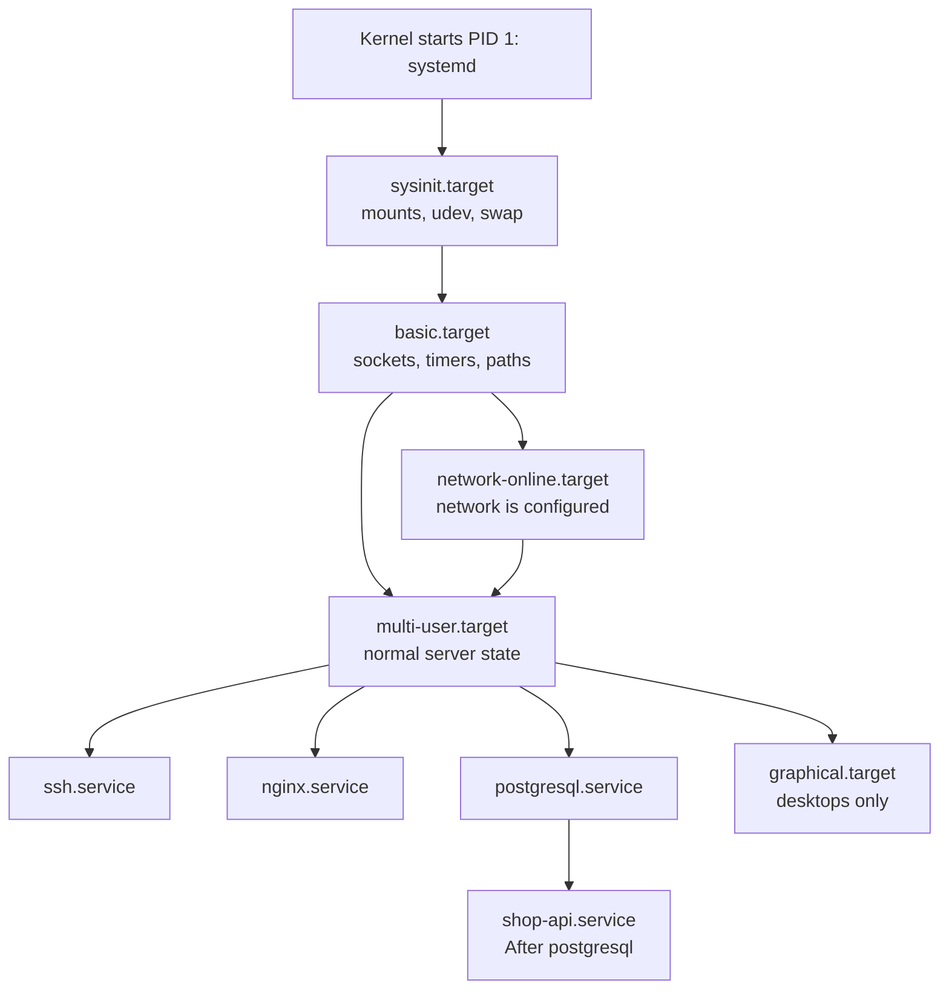
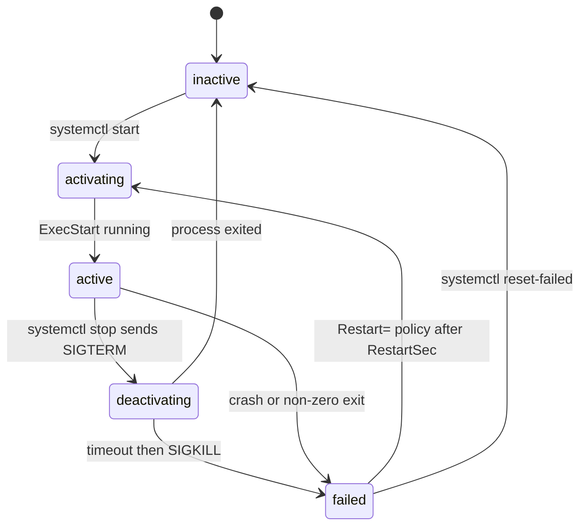

# L1.9 — Daemons and systemd

> **Level 1: Linux Fundamentals** · Topic 9 of 13 · ⏱ ~4 hours · Difficulty: Intermediate

## 1. What it is

A **daemon** is a program that runs in the background, not attached to anyone's terminal, usually started at boot
and expected to keep running: `sshd` (remote logins), `nginx` (web), `postgres` (database), `cron` (scheduler). By
convention many daemon names end in `d`. Historically a daemon had to "daemonize" itself — fork twice, detach from the
terminal, write a PID file. That is no longer needed: a modern **init system** starts and supervises it for you.

On almost every mainstream distribution (Ubuntu, Debian, RHEL, Fedora, Amazon Linux 2023) that init system is
**systemd**. It is PID 1, the first process the kernel starts, and the ancestor of every other process. systemd
describes everything it manages as a **unit**, defined in a small INI-style text file: a **service** unit runs a
daemon, a **timer** unit schedules work (a cron replacement), a **socket** unit listens on a port and starts a service
on demand, a **mount** unit mounts a filesystem, and a **target** unit is a named group of units that represents a
system state, such as "multi-user system with networking is up".

## 2. Why it matters in DevOps

- **Every deployment on a VM ends with a unit file.** "Run my app, restart it when it crashes, start it at boot, after the database" is exactly what a service unit expresses.
- **Boot and recovery:** after a reboot or an autoscaling event, only enabled units come back. A service that works when you started it by hand but is not `enabled` will be missing after the next reboot.
- **Ordering bugs:** an API that starts before the network or database is ready fails at boot, then works when restarted by hand — a classic `After=` problem.
- **Security:** units can sandbox a process (non-root user, read-only filesystem, no new privileges) with a few lines, with no extra tooling.
- **It is the basis for the next topic:** daily operations use `systemctl` and `journalctl`, see [Services and Logs](11-systemctl-and-journalctl.md).

## 3. Real-world system example

**Ubuntu Server and Amazon Linux in the cloud.** Machine images from Ubuntu and Amazon boot with systemd. The
packages for **Nginx** and **PostgreSQL** each install a unit (`nginx.service`, `postgresql.service`) in `/usr/lib/systemd/system/`
and enable it, so they start on boot with no extra work. **cloud-init** runs its stages as systemd units to configure a fresh
instance, and the **kubelet** on a Kubernetes node is itself a systemd service (`kubelet.service`) — if it crashes, systemd restarts it,
which is why `systemctl status kubelet` and `journalctl -u kubelet` are the first commands in node debugging.
The Docker Engine also runs as a systemd service (`docker.service`) with a companion `docker.socket` unit that can start it
on demand. Node exporter, the Prometheus host-metrics agent, is typically deployed as a small hand-written service unit
running as an unprivileged user — the same kind of unit you will write below.

## 4. Diagram

How the system comes up, in terms of targets:



What systemd does for a service from start to crash recovery:



## 5. How it works

### Where unit files live (later directories win)

| Path | Purpose |
|------|---------|
| `/usr/lib/systemd/system/` (also `/lib/systemd/system/`) | units shipped by packages — do not edit |
| `/etc/systemd/system/` | **your** units and overrides — this is where you write files |
| `/etc/systemd/system/<unit>.d/override.conf` | a drop-in that changes parts of a packaged unit (`systemctl edit <unit>`) |
| `/run/systemd/system/` | transient units, gone after reboot |

After creating or editing a unit file run **`sudo systemctl daemon-reload`** so systemd re-reads the files.

### Anatomy of a service unit

```ini
[Unit]           # what it is and how it is ordered
Description=shop-api (Node.js)
After=network-online.target postgresql.service    # start order only
Wants=network-online.target                       # soft dependency (pull it in)
Requires=postgresql.service                       # hard dependency (stop together)

[Service]        # how to run it
Type=simple
User=shop-api
ExecStart=/usr/bin/node /opt/shop-api/server.js
Restart=on-failure

[Install]        # what "enable" does
WantedBy=multi-user.target
```

| Directive | Meaning |
|-----------|---------|
| `After=` / `Before=` | **ordering only.** `After=postgresql.service` alone does not start PostgreSQL |
| `Wants=` / `Requires=` | pulls another unit in; `Requires` also stops this unit if the other fails |
| `Type=simple` | default: the process in `ExecStart` is the service (best for modern apps that stay in the foreground) |
| `Type=forking` | for legacy daemons that fork into the background and write a PID file |
| `Type=notify` | the app tells systemd when it is ready (`sd_notify`); used by software built with systemd support |
| `Type=oneshot` | run to completion (scripts, migrations); pair with `RemainAfterExit=yes` if needed |
| `User=`, `Group=` | run unprivileged — see [Users, Groups, sudo and root](07-users-groups-sudo-root.md) |
| `WorkingDirectory=` | the process's current directory |
| `Environment=`, `EnvironmentFile=` | variables, or a file of `KEY=value` lines (keep secrets out of the unit file itself) |
| `ExecStart=` / `ExecReload=` / `ExecStop=` | commands; `ExecStart` must use an **absolute path** |
| `Restart=` | `no`, `on-failure`, `always`; with `RestartSec=` delay |
| `TimeoutStopSec=` | how long after `SIGTERM` before `SIGKILL` — see [Processes and Signals](08-processes-and-signals.md) |
| `LimitNOFILE=` | open-file limit (high-traffic servers need more than 1024) |
| `NoNewPrivileges=`, `ProtectSystem=`, `ProtectHome=`, `PrivateTmp=`, `ReadWritePaths=` | sandboxing: make `/usr` and `/etc` read-only, hide `/home`, give a private `/tmp`, allow writes only to listed paths |
| `WantedBy=` | which target pulls this unit in when enabled (`multi-user.target` for servers) |

`enable` does not start anything — it creates a symlink from `multi-user.target.wants/` to the unit, so the service starts at
the next boot. `start` runs it now. Use `enable --now` for both.

### Targets are the modern runlevels

| Target | Roughly equals | Use |
|--------|----------------|-----|
| `poweroff.target`, `reboot.target` | runlevel 0 / 6 | shutdown, reboot |
| `rescue.target` | single-user (1) | repair mode with basic services |
| `multi-user.target` | runlevel 3 | normal server, no GUI (the usual default on servers) |
| `graphical.target` | runlevel 5 | desktop |
| `network-online.target` | — | network configured; wait on it when you need to connect immediately |

`systemctl get-default` shows the default; `systemctl list-dependencies multi-user.target` shows what it pulls in.

### Timers instead of cron

A timer unit `backup.timer` activates the service `backup.service` of the same name on a schedule (`OnCalendar=*-*-* 03:00:00`).
Advantages over cron: logs go to the journal, missed runs can be caught up (`Persistent=true`), and dependencies and sandboxing apply.

## 6. Step-by-step guide

**Prerequisites:** an Ubuntu 22.04/24.04 or Debian VM or VPS with `sudo` (systemd does not run in a default
Docker container, so use a real VM, multipass, Vagrant or WSL2 with systemd enabled). Node.js is not required: the
example daemon is a few lines of Python that ships with Ubuntu.

1. **Look at the real thing first.**
   ```bash
   ps -p 1 -o pid,comm              # PID 1 is systemd
   systemctl get-default            # multi-user.target on servers
   systemctl list-units --type=service --state=running | head
   systemctl cat ssh                # see a packaged unit (on RHEL-family: sshd)
   ```

2. **Create a tiny HTTP daemon** to supervise. It echoes a message and shuts down cleanly on `SIGTERM`.
   ```bash
   sudo mkdir -p /opt/hello
   sudo tee /opt/hello/server.py > /dev/null <<'EOF'
   import os, signal, sys
   from http.server import BaseHTTPRequestHandler, HTTPServer

   class H(BaseHTTPRequestHandler):
       def do_GET(self):
           body = f"hello from pid {os.getpid()}\n".encode()
           self.send_response(200)
           self.end_headers()
           self.wfile.write(body)

   srv = HTTPServer(("127.0.0.1", 8080), H)
   signal.signal(signal.SIGTERM, lambda *a: (print("SIGTERM, bye", flush=True), sys.exit(0)))
   print("listening on 127.0.0.1:8080", flush=True)
   srv.serve_forever()
   EOF
   ```

3. **Create an unprivileged account for it.**
   ```bash
   sudo useradd --system --no-create-home --shell /usr/sbin/nologin hello
   ```

4. **Write the unit file.**
   ```bash
   sudo tee /etc/systemd/system/hello.service > /dev/null <<'EOF'
   [Unit]
   Description=Hello demo daemon
   After=network.target

   [Service]
   Type=simple
   User=hello
   Group=hello
   ExecStart=/usr/bin/python3 /opt/hello/server.py
   Restart=on-failure
   RestartSec=2
   NoNewPrivileges=true
   ProtectSystem=strict
   ProtectHome=true
   PrivateTmp=true

   [Install]
   WantedBy=multi-user.target
   EOF
   ```

5. **Validate, load and start it.**
   ```bash
   sudo systemd-analyze verify /etc/systemd/system/hello.service   # prints nothing when fine
   sudo systemctl daemon-reload
   sudo systemctl enable --now hello
   systemctl status hello --no-pager
   curl -s http://127.0.0.1:8080/
   ```
   Expected: `Active: active (running)`, a `Loaded: ... enabled` line, and `hello from pid <number>`.

6. **Prove supervision: kill it and watch it return.**
   ```bash
   MAINPID=$(systemctl show -p MainPID --value hello)
   sudo kill -9 "$MAINPID"
   sleep 3
   systemctl show -p MainPID,NRestarts --value hello    # a new PID, restarts counted
   curl -s http://127.0.0.1:8080/
   ```
   The `curl` reply has a different PID than before. `Restart=on-failure` treated the `SIGKILL` as a failure.

7. **Stop it gracefully and read why it stopped.**
   ```bash
   sudo systemctl stop hello
   journalctl -u hello -n 8 --no-pager
   ```
   You should see `SIGTERM, bye` and `Deactivated successfully`. It exited with status 0 on the signal we handled.

8. **Override a setting without editing the file.**
   ```bash
   sudo systemctl edit hello      # in the editor add: [Service]  Environment=GREETING=hi   then save
   systemctl cat hello            # shows the unit plus /etc/systemd/system/hello.service.d/override.conf
   ```

9. **Look at targets and ordering.**
   ```bash
   systemctl list-dependencies multi-user.target | head -20
   systemd-analyze blame | head              # slowest units at boot
   systemd-analyze critical-chain hello.service
   ```

10. **Clean up.**
    ```bash
    sudo systemctl disable --now hello
    sudo rm /etc/systemd/system/hello.service
    sudo rm -r /opt/hello
    sudo userdel hello
    sudo systemctl daemon-reload
    ```

## 7. Real-world scenario

*(Illustrative.)* After a routine kernel patch and reboot, the `shop-api` VM comes back but returns 502 from Nginx. The
on-call engineer runs `systemctl status shop-api` and sees `failed` with `ECONNREFUSED 127.0.0.1:5432` in the journal:
the API started before PostgreSQL was accepting connections. The unit had no ordering (`After=postgresql.service`),
so the race was lost only on boot, when everything starts in parallel; on later manual restarts the database was already
up. `systemctl restart shop-api` fixes it right now.

Permanent fix: add `After=postgresql.service` and `Wants=postgresql.service` (and `Restart=on-failure` with `RestartSec=3` so a late
database no longer needs a human). They test by rebooting a staging VM. **Lesson:** "works when I start it, fails at boot"
means ordering or environment; systemd starts units in parallel unless you tell it otherwise.

## 8. Common mistakes and best practices

**Don't**

- Forget `daemon-reload` after changing a unit, then wonder why nothing changed (`systemctl status` warns: "unit file changed on disk").
- Edit files under `/usr/lib/systemd/system/` — use `systemctl edit` drop-ins so package upgrades do not overwrite your change.
- Use a relative path or shell syntax in `ExecStart` (no `~`, pipes, or `&&`; use `/bin/sh -c '...'` deliberately if you need a shell).
- Run an app as root, or `Type=forking` for programs that stay in the foreground.
- Put secrets in the `.service` file, which is world-readable; use an `EnvironmentFile=` with mode `0600`/`0640`, or a secrets manager.
- Assume `After=` starts the other service (that is `Wants=`/`Requires=`).

**Do**

- Run services as dedicated non-root users and add sandboxing (`NoNewPrivileges`, `ProtectSystem`, `PrivateTmp`).
- Set `Restart=on-failure` and a sane `RestartSec`; rate limits (`StartLimitBurst`) stop endless crash loops from hiding the real error.
- `enable` services that must survive a reboot and **test a real reboot** of non-production machines.
- Validate with `systemd-analyze verify` and review boot with `systemd-analyze blame`.
- Keep the app in the foreground and log to stdout/stderr — the journal captures it (next topic).

## 9. Tasks

- [ ] **T1 — Explore the init system** *(≈20 min, beginner)*
  - **Goal:** see systemd as the parent of the system.
  - **Steps:**
    1. Run `ps -p 1 -o pid,comm`, `systemctl get-default`, and `systemctl list-units --type=service --state=running`.
    2. Read a packaged unit with `systemctl cat ssh` (or `nginx`, `cron`) and label its `[Unit]`, `[Service]`, `[Install]` lines.
  - **Done when:** you can explain what `Type`, `ExecStart`, `Restart` and `WantedBy` do in that unit.

- [ ] **T2 — Ship your first service** *(≈40 min, beginner)*
  - **Goal:** turn a script into a supervised, boot-persistent daemon.
  - **Steps:**
    1. Follow steps 2-5 of the guide with the `hello` daemon.
    2. Reboot the VM (`sudo reboot`) and, after logging in, run `curl http://127.0.0.1:8080/`.
  - **Done when:** the daemon answers after a reboot without you starting it, and `systemctl is-enabled hello` prints `enabled`.

- [ ] **T3 — Harden the unit** *(≈30 min, intermediate)*
  - **Goal:** measure what the sandbox directives buy you.
  - **Steps:**
    1. Run `systemd-analyze security hello.service` and note the exposure score.
    2. Add `ProtectKernelTunables=true`, `ProtectControlGroups=true`, `RestrictAddressFamilies=AF_INET AF_INET6`, `CapabilityBoundingSet=` (empty), then `daemon-reload` and restart.
    3. Re-run the analysis and check the service still answers.
  - **Done when:** the score improves and `curl` still works.

- [ ] **T4 — Break it and fix it: ordering** *(≈30 min, intermediate)*
  - **Goal:** reproduce a boot-order failure.
  - **Steps:**
    1. Create `needsdb.service` whose `ExecStart` is `/bin/sh -c 'nc -z 127.0.0.1 5432 || exit 1'` with `Type=oneshot` and no ordering.
    2. Start it without PostgreSQL running and read the failure in `journalctl -u needsdb`.
    3. Fix it with `After=postgresql.service` and `Wants=postgresql.service` (install PostgreSQL first), and use `Restart=on-failure` if you switch it to a long-running type.
  - **Done when:** the unit succeeds after `systemctl start needsdb` and `systemd-analyze critical-chain needsdb.service` shows PostgreSQL earlier in the chain.

- [ ] **T5 — Replace a cron job with a timer** *(≈40 min, intermediate)*
  - **Goal:** schedule work the systemd way.
  - **Steps:**
    1. Create `stamp.service` (`Type=oneshot`, `ExecStart=/bin/sh -c 'date >> /tmp/stamp.log'`) and `stamp.timer` (`OnCalendar=*:0/1`, a run every minute, `Persistent=true`, `WantedBy=timers.target`).
    2. `daemon-reload`, `enable --now stamp.timer`, then `systemctl list-timers stamp.timer` and `systemd-analyze calendar '*:0/1'`.
  - **Done when:** `/tmp/stamp.log` gains a line each minute and `journalctl -u stamp` shows the runs. Disable the timer afterwards.

- [ ] **T6 — Prove it: unit for `shop-api` from scratch** *(≈45 min, advanced)*
  - **Goal:** write a production-grade unit without the guide.
  - **Steps:**
    1. Without copying, write `/etc/systemd/system/shop-api.service` for `node /opt/shop-api/server.js` that: runs as a `shop-api` system user, loads `/etc/shop-api/shop-api.env`, starts after PostgreSQL and the network, restarts on failure, has a 20-second stop timeout, and uses at least four sandbox options.
    2. Validate with `systemd-analyze verify`, then explain each line aloud or in writing.
  - **Done when:** `systemd-analyze verify` reports no errors about your syntax and you can justify every directive. (The finished version is built in the [Level 1 capstone](99-capstone-project.md).)

## 10. Self-check questions

1. What is the difference between `enable` and `start`?
2. Why does `After=postgresql.service` not guarantee PostgreSQL is running?
3. Where should you put your own unit files and overrides, and why not in `/usr/lib/systemd/system/`?
4. What does `Type=simple` assume about the program, and when would you need `Type=forking`?
5. What command must follow any edit of a unit file?
6. How does a timer unit differ from a cron entry?

<details>
<summary>Answers</summary>

1. `start` runs it now; `enable` creates the symlink so it starts at boot. `enable --now` does both.
2. `After=` only orders units that are both being started. `Wants=`/`Requires=` pull the other unit in.
3. `/etc/systemd/system/` (and `.d/override.conf` drop-ins); package upgrades overwrite files in `/usr/lib/systemd/system/`.
4. That the process stays in the foreground and is the service; `forking` is for legacy daemons that background themselves and write a PID file.
5. `sudo systemctl daemon-reload`.
6. A timer triggers a regular service unit, so you get the journal, dependencies, sandboxing, `Persistent=true` catch-up and `list-timers`, while cron has none of these by itself.
</details>

## 11. Further reading

- `man systemd.service`, `man systemd.unit`, `man systemd.exec`, `man systemd.timer`, `man systemd.target` — the authoritative reference.
- freedesktop.org systemd documentation (systemd.io) and the Arch Wiki "systemd" page.
- Ubuntu Server documentation; Red Hat "Managing services with systemd" guide.
- See also: [Services and Logs: systemctl and journalctl](11-systemctl-and-journalctl.md) and [Processes, PIDs and Signals](08-processes-and-signals.md).

<!-- nav -->
---
← Previous: [Processes, PIDs and Signals](08-processes-and-signals.md) · [Level 1 index](README.md) · Next: [System Monitoring Commands](10-system-monitoring.md) →
