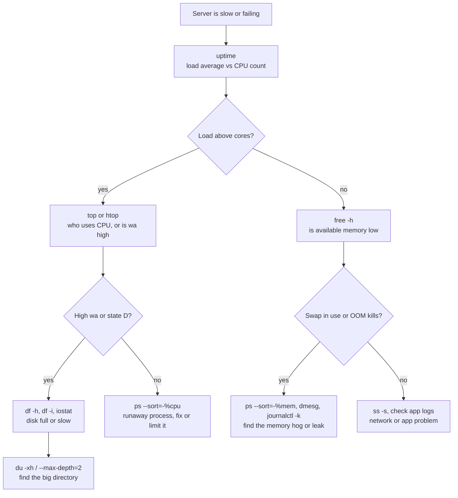
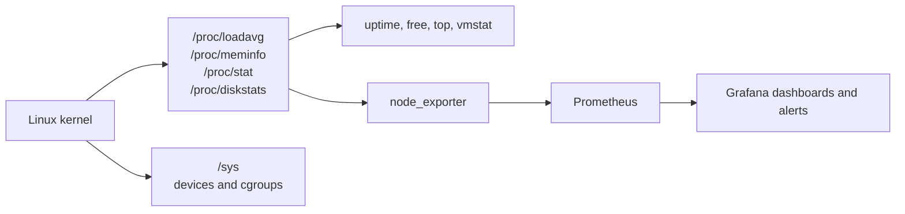

# L1.10 — System Monitoring Commands

> **Level 1: Linux Fundamentals** · Topic 10 of 13 · ⏱ ~4 hours · Difficulty: Intermediate

## 1. What it is

Before dashboards and alerts exist, every Linux machine can already tell you what it is doing — if you know which
command to ask. A small set of built-in tools covers the four resources every server has: **CPU**, **memory**,
**disk** (space and I/O) and **network**. `uptime` and the **load average** give a one-line summary of demand; `ps`,
`top` and `htop` show which processes use what; `free` shows memory; `df` and `du` show disk space; `vmstat` shows
CPU, memory and I/O together over time.

Almost all of these tools simply read the virtual files in `/proc` and `/sys` ([Filesystem Hierarchy](01-filesystem-hierarchy.md)) and format them. That
is also exactly what monitoring agents such as Prometheus' `node_exporter` do, which is why learning these commands
teaches you what the graphs on a dashboard actually mean.

## 2. Why it matters in DevOps

- **First five minutes of any incident:** "is the box out of CPU, memory or disk?" is answered with `uptime`, `free -h`, `df -h` and `top` — before you open a single dashboard.
- **Disk full is the most common self-inflicted outage.** Two commands (`df`, `du`) find it; knowing about *inode* exhaustion and deleted-but-open files finds the confusing cases.
- **Memory pressure kills services silently.** When RAM runs out the kernel's out-of-memory (OOM) killer terminates a process, often your database or API, with no error in the app's own log.
- **Right-sizing and cost:** whether a workload needs a bigger instance or just a leak fixed is a measurement question.
- **Monitoring literacy:** metrics like `node_load1`, `node_memory_MemAvailable_bytes` and `node_filesystem_avail_bytes` are the numbers below, exported. See [Observability](../level-00-what-devops-is/10-observability.md) and [What to Monitor](../level-10-observability/11-what-to-monitor.md).

## 3. Real-world system example

**Prometheus `node_exporter` and the USE method.** The standard way to monitor Linux hosts in a Prometheus setup is to
run `node_exporter` on every machine. It reads `/proc/loadavg`, `/proc/meminfo`, `/proc/stat`, `/proc/diskstats`,
`/proc/net/dev` and filesystem statistics, and exposes them as metrics (for example `node_load1`, `node_memory_MemAvailable_bytes`,
`node_cpu_seconds_total`, `node_filesystem_avail_bytes`). The commands in this topic read the same sources.

Brendan Gregg (a performance engineer well known for his work at Netflix) popularized the **USE method** for resources: check
**U**tilization, **S**aturation and **E**rrors for each of CPU, memory, disk and network. Load average is a saturation hint for
CPU, swapping (the `si`/`so` columns of `vmstat`) is memory saturation, and `df` plus inode usage measure disk utilization. Google's
SRE book makes the same point at the service level with the four golden signals; the host-level USE checks tell you *why* the
service-level numbers went bad.

## 4. Diagram

A fast triage flow for "the server is slow":



Where the numbers come from:



## 5. How it works

### Load average — the most misread number

`uptime` prints three **load averages**: the 1-, 5- and 15-minute exponentially smoothed average of the number of
tasks that are **running, waiting for a CPU, or (on Linux) in uninterruptible disk wait (state `D`)**.

```text
 00:45:30 up 23 min,  0 user,  load average: 0.45, 0.18, 0.06
```

- Compare it with the number of **CPU cores** (`nproc`). On a 4-core box a load of 4.0 means the CPUs are exactly fully
  used; 8.0 means about as many tasks waiting as running. Rule of thumb: **sustained load above the core count is saturation**.
- **Trend** matters: `1 min` much higher than `15 min` = a recent spike; the reverse = recovering.
- High load with idle CPU usually means tasks stuck in disk (or NFS) wait — look at `wa` in `top` and state `D` in `ps`.
- Load is **not** CPU percent. A load of 0.5 on 1 core is about half-busy, but a load of 50 on 64 cores can be fine.

### The commands

| Tool | What it answers | Handy forms |
|------|-----------------|-------------|
| `uptime` | how long up, load average | `uptime -p` (pretty), `cat /proc/loadavg` |
| `ps` | snapshot of processes | `ps aux --sort=-%mem \| head`, `ps -eo pid,ppid,stat,%cpu,%mem,rss,cmd --sort=-%cpu \| head` |
| `top` | live process view | `top -b -n1 \| head -15` (batch mode for scripts), press `1` per-CPU, `M` sort by memory, `P` by CPU, `c` full command, `k` kill |
| `htop` | friendlier `top` (tree, colors, search, mouse); install with `apt install htop` | `F5` tree, `F6` sort, `F9` kill, `F4` filter |
| `free` | memory and swap | `free -h`; read the **available** column |
| `df` | space per mounted filesystem | `df -hT`, `df -i` (inodes), `df -h /var` |
| `du` | space used by a directory tree | `du -sh /var/log`, `du -xh / --max-depth=2 \| sort -h \| tail` |
| `vmstat` | CPU, memory, swap, I/O over time | `vmstat 1 5` (every second, five times) |
| `iostat -x 1` | per-disk utilization, latency (package `sysstat`) | watch `%util`, `await` |
| `ss -s`, `ss -tulpn` | sockets and listening ports | covered with network tools |
| `lsof +L1` | deleted files still held open | explains "df is full but du is small" |
| `dmesg -T`, `journalctl -k` | kernel messages, including OOM kills | `dmesg -T \| grep -i 'killed process'` |

### Reading `free`

```text
               total        used        free      shared  buff/cache   available
Mem:            15Gi       555Mi        14Gi        13Mi       726Mi        15Gi
Swap:             0B          0B          0B
```

- Linux uses free memory as **page cache** to speed up disk reads, so `free` being small is normal. The number that matters is **available**: memory that can be handed to programs without swapping (free plus reclaimable cache).
- **Swap in use and growing** (see `si`/`so` in `vmstat`) means real memory pressure. When even swap runs out, the **OOM killer** picks a process and kills it with `SIGKILL`; the evidence is in `dmesg`/`journalctl -k`.

### Reading `top`

```text
%Cpu(s):  0.0 us,  0.0 sy,  0.0 ni, 97.6 id,  0.0 wa,  0.0 hi,  0.0 si,  2.4 st
```

| Field | Meaning |
|-------|---------|
| `us` / `sy` | time in user programs / in the kernel |
| `ni` | time in low-priority (niced) processes |
| `id` | idle |
| `wa` | waiting for I/O (disk/network filesystem) — high means a storage bottleneck |
| `st` | **steal**: the hypervisor gave your virtual CPU to someone else (noisy neighbors on VPS/cloud) |

Per-process columns: `RES` is real resident memory, `VIRT` is address space (often huge and harmless), `S` is state.

### `df` vs `du`

- `df` asks the **filesystem** how much is used (fast, authoritative for "is it full?").
- `du` walks **directories** and adds up files (slow on big trees, tells you *where*).
- They disagree when a file was deleted but a process still holds it open (`lsof +L1`), or when another filesystem is mounted over a directory. Use `du -x` to stay on one filesystem.
- A filesystem can also be "full" with free blocks if it ran out of **inodes** (millions of tiny files): `df -i` shows `IUse% 100%`.

## 6. Step-by-step guide

**Prerequisites:** any Linux machine. A container shell works, but values reflect the host's resources and, in a bare
container, you may need `apt-get update && apt-get install -y procps htop sysstat`. All commands are read-only
except the two small load generators in steps 5 and 8, which you stop yourself.

1. **Baseline: uptime, cores and load.**
   ```bash
   uptime
   nproc
   cat /proc/loadavg
   ```
   Expected (similar to): `up 23 min, 0 users, load average: 0.45, 0.18, 0.06`, then the core count, then the same
   three numbers followed by `1/105 3985` (running/total tasks and the last PID).

2. **Memory: read the right column.**
   ```bash
   free -h
   grep -E 'MemTotal|MemAvailable|SwapTotal|SwapFree' /proc/meminfo
   ```
   `available` is your headroom. Verify `free` is just formatting `/proc/meminfo`.

3. **Disk space and inodes.**
   ```bash
   df -hT -x tmpfs -x devtmpfs
   df -i /
   ```
   Note `Use%` for `/`, the filesystem type (`ext4`, `xfs`) and the inode `IUse%`.

4. **Find where the space went.**
   ```bash
   sudo du -xh / --max-depth=2 2>/dev/null | sort -h | tail -12
   sudo du -sh /var/log/* 2>/dev/null | sort -h | tail -5
   ```
   Expect `/usr`, `/var` and `/home` among the largest; on a log-heavy server `/var/log` rises quickly.

5. **Generate CPU load and watch every tool react.** Open a second terminal and run:
   ```bash
   # one busy loop per core (stop with: pkill -f 'while :; do :; done')
   for i in $(seq "$(nproc)"); do bash -c 'while :; do :; done' & done
   ```
   In the first terminal:
   ```bash
   uptime                                   # 1-minute load climbs toward nproc over about a minute
   top -b -n1 | head -15                    # bash processes at ~100% CPU each, id near 0
   ps -eo pid,%cpu,%mem,cmd --sort=-%cpu | head -5
   vmstat 1 5                               # r column near nproc, us high, id low
   ```
   Then stop the load: `pkill -f 'while :; do :; done'`. Watch `uptime` over a few minutes and see the 1-minute
   average fall faster than the 15-minute one.

6. **Use `top` and `htop` interactively.**
   ```bash
   top           # press 1 (per-CPU), M (sort by memory), P (sort by CPU), c (full command), q (quit)
   htop          # install first if missing: sudo apt-get install -y htop; try F5 (tree) and F4 (filter: node)
   ```

7. **Spot memory pressure signals.**
   ```bash
   vmstat 1 5              # si and so columns should be 0; sustained non-zero means swapping
   ps -eo pid,rss,cmd --sort=-rss | head -5      # RSS in KiB
   dmesg -T 2>/dev/null | grep -i 'out of memory\|killed process' || echo "no OOM events found"
   ```

8. **Reproduce "disk full but du says small" (safe, in /tmp).**
   ```bash
   df --output=used -m /tmp                        # note the used MB
   dd if=/dev/zero of=/tmp/big.bin bs=1M count=200 status=none
   tail -f /tmp/big.bin > /dev/null &            # a process now holds the file open
   rm /tmp/big.bin
   df --output=used -m /tmp                        # still about 200 MB higher, yet the file is gone from ls
   lsof +L1 | grep big.bin                         # shows the deleted-but-open file and its PID
   kill %1                                         # closing the file frees the space
   df --output=used -m /tmp                        # back to the starting number
   ```

9. **Capture a one-shot health snapshot** you can paste into an incident ticket:
   ```bash
   { date; uptime; free -h; df -hT -x tmpfs -x devtmpfs; \
     ps -eo pid,%cpu,%mem,cmd --sort=-%cpu | head -6; } | tee /tmp/health-$(hostname).txt
   ```

## 7. Real-world scenario

*(Illustrative.)* At 02:10 an alert fires: p95 latency of `shop-api` has tripled. The on-call engineer SSHes in.
`uptime` shows a load of 14 on a 4-core VM, yet `top` shows the CPUs 90% idle and `wa` at 60%. That pattern — high load,
idle CPU, high I/O wait — points at storage. `df -h` shows `/` at 100%, and `du -xh /var --max-depth=2 | sort -h | tail`
finds a 41 GB `/var/log/shop-api/debug.log`: debug logging was enabled during an earlier investigation and never turned
off, and PostgreSQL could no longer write its WAL (write-ahead log) quickly enough once the disk was full.

They truncate the file (`: > debug.log`), restart nothing, and latency recovers within a minute. Follow-ups: log rotation with a size cap,
an alert at 80% disk usage (`node_filesystem_avail_bytes`), and a separate volume for `/var/lib/postgresql`. **Lesson:** high load with idle CPU is a
disk story; the right order of commands solved it in two minutes.

## 8. Common mistakes and best practices

**Don't**

- Read `load average` as a percentage, or compare it without knowing the core count.
- Panic about low `free` memory — Linux fills spare RAM with cache. Look at `available` and swap activity.
- Judge memory by `VIRT`; look at `RES`/`RSS` (and `PSS` for shared memory).
- Run `du -h /` without `-x`: it crosses into `/proc`, other mounts and network shares, and takes ages.
- `rm` a huge file held open by a running process and expect space back.
- Leave `top`-style investigation as the only monitoring; these are for diagnosis, not alerting.

**Do**

- Check **CPU count first**, then load, then memory `available`, then `df -h` **and** `df -i`.
- Use the USE method (Utilization, Saturation, Errors) for each resource in order.
- Use batch mode (`top -b -n1`, `vmstat 1 5`) when capturing output for tickets or scripts.
- Look at the kernel log (`dmesg -T`, `journalctl -k`) for OOM kills and disk errors.
- Alert on trends (disk filling at X GB/hour) as well as thresholds, and put heavy-write data on its own volume.

## 9. Tasks

- [ ] **T1 — Read the baseline** *(≈20 min, beginner)*
  - **Goal:** produce a one-paragraph description of an idle machine.
  - **Steps:**
    1. Run `uptime`, `nproc`, `free -h`, `df -hT`, and `ps aux --sort=-%mem | head -5`.
    2. Write: cores, load (1/5/15), RAM total and available, root disk usage, top memory process.
  - **Done when:** every number in your paragraph matches the commands' output, and you state whether load is above or below the core count.

- [ ] **T2 — Make load visible** *(≈30 min, beginner)*
  - **Goal:** connect a load generator to what each tool shows.
  - **Steps:**
    1. Start one busy loop per core (step 5) and run `uptime`, `top -b -n1 | head -15`, `vmstat 1 5` once per minute for three minutes.
    2. Stop the load and watch the three averages decay.
  - **Done when:** you can show the 1-minute average rising towards `nproc` and falling again, and explain why the 15-minute number moves slowly.

- [ ] **T3 — Find the biggest consumer** *(≈30 min, intermediate)*
  - **Goal:** locate disk usage the way you would in an incident.
  - **Steps:**
    1. Create 300 MB under `/var/tmp/hog/` as 3 files with `fallocate` or `dd`.
    2. Using only `df` and `du -xh --max-depth`, narrow down from `/` to the `hog` directory.
    3. Delete the files and confirm with `df`.
  - **Done when:** you reached the directory with at most 3 `du` commands and space is returned.

- [ ] **T4 — Break it: deleted but open** *(≈30 min, intermediate)*
  - **Goal:** diagnose a "ghost" disk usage.
  - **Steps:**
    1. Reproduce step 8 with a 500 MB file.
    2. Prove `df` and `du` disagree; find the holder with `lsof +L1` (or `ls -l /proc/<PID>/fd | grep deleted`).
    3. Free the space once by killing the holder and once by truncating through `/proc/<PID>/fd/<N>` (`: > /proc/<PID>/fd/<N>`).
  - **Done when:** `df` returns to normal in both variants and you can explain why `rm` alone did not free the space.

- [ ] **T5 — Memory pressure drill** *(≈40 min, advanced; use a VM, not your laptop)*
  - **Goal:** watch swapping and the OOM killer leave evidence.
  - **Steps:**
    1. In a throwaway VM with 1-2 GB RAM, run a limited allocator inside a cgroup: `sudo systemd-run --scope -p MemoryMax=200M python3 -c "x=b'x'*(1024**3); print('allocated')"`.
    2. Watch `vmstat 1` in another terminal. Then check `dmesg -T | tail` or `journalctl -k -n 20`.
  - **Done when:** the process is killed and you can point to the kernel log line that names it and its memory limit.

- [ ] **T6 — Prove it: write a `health.sh` triage script** *(≈45 min, advanced)*
  - **Goal:** automate the first five minutes of an incident.
  - **Steps:**
    1. Without the guide, write `health.sh` that prints cores, load vs cores with a `WARN` if the 1-minute load exceeds the core count, memory available percent with a `WARN` below 10%, each filesystem above 80% usage, and the top 3 CPU and memory processes.
    2. Make it exit non-zero when any `WARN` is printed. Test it by simulating each condition (CPU loop, a tiny threshold you set by variable).
  - **Done when:** the script runs on a fresh machine, flags at least one simulated problem with a non-zero exit code, and you can explain every command it uses.

## 10. Self-check questions

1. A 4-core server shows load average `4.1, 3.9, 2.0`. Is that good or bad?
2. Why is `free` showing only 200 MB "free" on a healthy server with 16 GB RAM?
3. Load is 20 but CPU is 95% idle. What is probably happening and what do you check?
4. `df -h` shows 100% but `du -sh /*` totals far less. Give two causes.
5. Which column tells you that a VPS is being throttled by its host?
6. What leaves evidence of an OOM kill, and where do you find it?

<details>
<summary>Answers</summary>

1. The CPUs are fully used and rising over 15 minutes: at capacity and worth watching, not yet a crisis. A sustained load above the core count would be saturation.
2. Linux caches disk data in free RAM. Check `available` instead; it includes reclaimable cache.
3. Many tasks are waiting on I/O (state `D`), so storage or an NFS mount is the bottleneck. Check `wa` in `top`, `iostat -x`, `df -h`, and `ps` for `D` states.
4. A deleted file still held open by a process (`lsof +L1`), another filesystem mounted over a directory, or reserved blocks/hidden mounts; also inode exhaustion shows as "No space left" with free blocks (check `df -i`).
5. `st` (steal) in `top` or `vmstat`.
6. The kernel log: `dmesg -T`, `journalctl -k`, search for "Out of memory: Killed process".
</details>

## 11. Further reading

- `man proc` (for `/proc/loadavg`, `/proc/meminfo`), `man top`, `man ps`, `man free`, `man df`, `man du`, `man vmstat`.
- Brendan Gregg, "The USE Method" and *Systems Performance* (2nd ed.).
- Brendan Gregg, "Linux Load Averages: Solving the Mystery" (his blog) — why Linux load includes `D` state.
- Prometheus documentation: `node_exporter` README, for the metrics that mirror these commands.
- See also: [Services and Logs: systemctl and journalctl](11-systemctl-and-journalctl.md) and [Processes, PIDs and Signals](08-processes-and-signals.md).

<!-- nav -->
---
← Previous: [Daemons and systemd](09-daemons-and-systemd.md) · [Level 1 index](README.md) · Next: [Services and Logs: systemctl and journalctl](11-systemctl-and-journalctl.md) →
