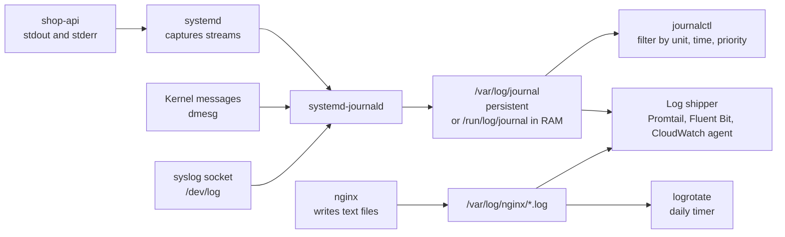
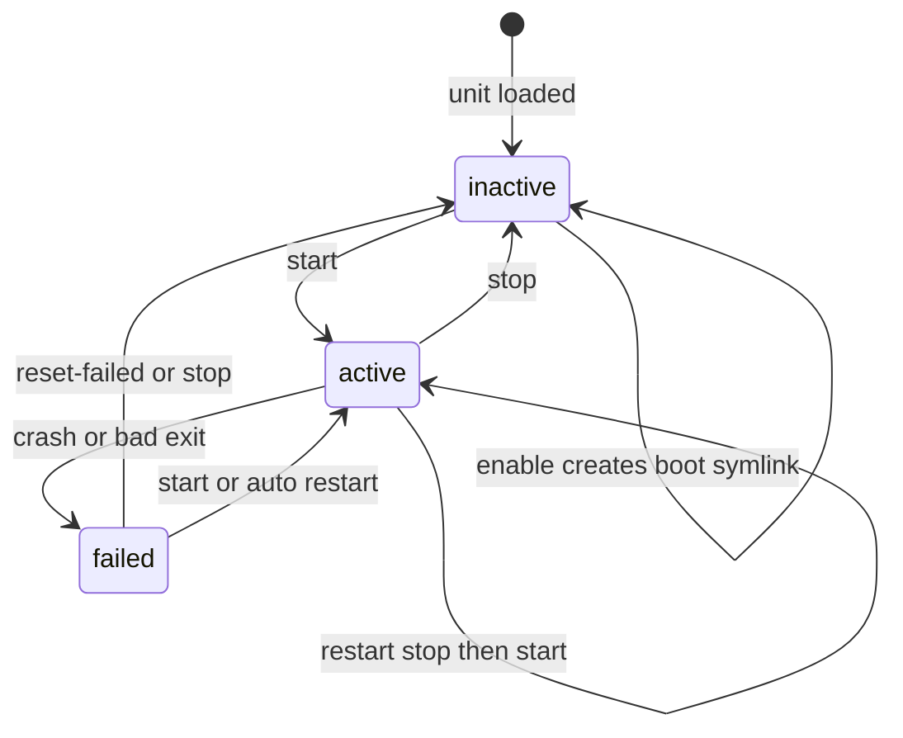

# L1.11 — Services and Logs: systemctl and journalctl

> **Level 1: Linux Fundamentals** · Topic 11 of 13 · ⏱ ~4 hours · Difficulty: Intermediate

## 1. What it is

**`systemctl`** is the command-line control panel for systemd ([Daemons and systemd](09-daemons-and-systemd.md)): it starts,
stops, restarts, enables and inspects services. **`journalctl`** is the matching log reader. systemd captures
everything a service writes to standard output and standard error, plus its own lifecycle messages ("Started…",
"Main process exited, code=exited, status=1"), into a structured binary log called the **journal**, maintained by the
`systemd-journald` daemon. Each entry carries metadata — unit name, PID, user, priority, boot ID — so you can filter by
unit, time range or severity instead of grepping text files.

Not all logs go through the journal. Many programs (Nginx, PostgreSQL, Apache) also write plain text files under `/var/log/`.
Those files grow forever unless **log rotation** — the `logrotate` tool, run daily by a timer or cron — renames, compresses and
deletes old ones. A competent operator knows both worlds: journal for service lifecycle and stdout logs, files plus logrotate
for traditional daemons.

## 2. Why it matters in DevOps

- **`systemctl status` + `journalctl -u` are the first two commands in nearly every Linux incident.** They answer "is it running, why did it stop, and what did it say last?"
- **Safe changes:** knowing the difference between `reload` (re-read config, no downtime) and `restart` (brief outage) is the difference between a quiet deploy and a blip in the error graph.
- **Disk safety:** unrotated logs are one of the top causes of full disks ([Filesystem Hierarchy](01-filesystem-hierarchy.md)). Rotation and journal size limits are a standard hardening checklist item.
- **Forensics and audits:** persistent, timestamped, per-unit logs let you reconstruct an outage hours later, and `journalctl _COMM=sudo` shows who ran what.
- **Foundation for observability:** log shippers (Promtail, Fluent Bit, the CloudWatch agent) read the journal or these files and forward them. See [Structured Logging](../level-10-observability/05-structured-logging.md).

## 3. Real-world system example

**Kubernetes nodes and the twelve-factor "logs to stdout" pattern.** On a kubeadm-built Kubernetes node, the
`kubelet` and the container runtime (`containerd`) are systemd services, so a failing node is debugged with
`systemctl status kubelet` and `journalctl -u kubelet`. Container logs are different: the runtime writes them as files under
`/var/log/pods/` and `/var/log/containers/`, and a node-level log agent tails those files — the same two-world split
described above.

The widely used **twelve-factor app** guidance says applications should write logs to stdout and let the execution environment collect them. systemd is that environment
for a plain VM: a Node.js process that just `console.log`s needs no log-file code at all, and `journalctl -u shop-api -f` shows it live.
Debian and Ubuntu packages for **Nginx** and **PostgreSQL** ship `logrotate` rules in `/etc/logrotate.d/`
(`nginx`, `postgresql-common`) that rotate their text logs, which is why a stock server does not fill its disk with web logs
within weeks.

## 4. Diagram

Where a service's output goes:



The service state machine you drive with `systemctl`:



## 5. How it works

### `systemctl` essentials

| Goal | Command | Notes |
|------|---------|-------|
| Run now / stop now | `sudo systemctl start X` / `stop X` | does not change boot behavior |
| Stop then start | `sudo systemctl restart X` | brief downtime; use for binary/unit changes |
| Re-read config without stopping | `sudo systemctl reload X` | only if the service supports it (`ExecReload`); Nginx, PostgreSQL, sshd do |
| Reload or fall back to restart | `sudo systemctl reload-or-restart X` | safe default in deploy scripts |
| Start at boot | `sudo systemctl enable X` / `disable X` | symlink only; add `--now` to also start/stop |
| Prevent any start (even by dependency) | `sudo systemctl mask X` / `unmask X` | links the unit to `/dev/null` |
| State | `systemctl status X`, `is-active X`, `is-enabled X`, `is-failed X` | the last three print one word and set the exit code (handy in scripts) |
| All services | `systemctl list-units --type=service`, `--state=failed` | `systemctl --failed` lists broken ones |
| See files | `systemctl cat X`, `systemctl show X -p ExecStart,MainPID,NRestarts` | `show` gives machine-readable properties |
| After editing a unit file | `sudo systemctl daemon-reload` | then restart the service |
| Clear a failed state | `sudo systemctl reset-failed X` | resets the restart-rate limiter too |
| Reboot / power off | `sudo systemctl reboot`, `poweroff` | |

Reading `systemctl status`:

```text
● shop-api.service - shop-api (Node.js)
     Loaded: loaded (/etc/systemd/system/shop-api.service; enabled; preset: enabled)
     Active: active (running) since Fri 2026-10-09 09:12:44 UTC; 3h 2min ago
   Main PID: 2210 (node)
      Tasks: 11 (limit: 4557)
     Memory: 68.4M
        CPU: 14.221s
     CGroup: /system.slice/shop-api.service
             └─2210 /usr/bin/node /opt/shop-api/server.js

Oct 09 09:12:44 web1 systemd[1]: Started shop-api.service - shop-api (Node.js).
Oct 09 09:12:45 web1 node[2210]: shop-api listening on 127.0.0.1:3000
```

`Loaded` tells you whether it starts at boot (`enabled`/`disabled`); `Active` tells you the state now; the last lines are the tail of
the journal. A service with `Active: failed (Result: exit-code)` or `activating (auto-restart)` is a crash loop.

### `journalctl` essentials

| Goal | Command |
|------|---------|
| Logs for one service | `journalctl -u shop-api` (add `-u nginx` more than once to interleave) |
| Follow live | `journalctl -u shop-api -f` |
| Last N lines | `journalctl -u shop-api -n 100 --no-pager` |
| Time window | `journalctl -u shop-api --since "1 hour ago"`, `--since "2026-10-09 09:00" --until "09:30"` (short: `-S`, `-U`) |
| Current boot / previous boot | `journalctl -b`, `journalctl -b -1` (needs persistent journal) |
| Priority filter | `journalctl -p err` (error and worse), `-p warning..err`; levels: `emerg alert crit err warning notice info debug` |
| Kernel messages | `journalctl -k` (like `dmesg`) |
| By process / user / executable | `journalctl _PID=2210`, `_UID=1001`, `_COMM=sudo`, `_SYSTEMD_UNIT=ssh.service` |
| Text search in the message | `journalctl -u shop-api -g 'ECONNREFUSED'` (regex `-g`/`--grep`) |
| Newest first | `journalctl -r` |
| Machine-readable output | `journalctl -u shop-api -o json-pretty`, `-o cat` (message only) |
| Disk used | `journalctl --disk-usage` |
| Shrink | `sudo journalctl --vacuum-size=500M`, `--vacuum-time=2weeks` |

**Persistence:** on many Ubuntu/Debian installs the journal is stored on disk (`/var/log/journal` exists); where it does not, the journal lives
in RAM under `/run/log/journal` and **disappears on reboot** — exactly when you want it. Make it persistent and bounded with a drop-in
file `/etc/systemd/journald.conf.d/50-size.conf`:

```ini
[Journal]
Storage=persistent
SystemMaxUse=1G
MaxRetentionSec=1month
```

then `sudo systemctl restart systemd-journald`. (`Storage=auto` — the default — is persistent only if the directory `/var/log/journal` exists.)
Entries may also be rate-limited per service if one spams; the message "Suppressed N messages" tells you.

### Log rotation with `logrotate`

`logrotate` runs from `logrotate.timer` (daily) and reads `/etc/logrotate.conf` plus one file per application in `/etc/logrotate.d/`.
A rule for the `shop-api` text logs:

```text
/var/log/shop-api/*.log {
    daily
    rotate 14
    compress
    delaycompress
    missingok
    notifempty
    create 0640 shop-api adm
    postrotate
        systemctl kill -s HUP shop-api.service >/dev/null 2>&1 || true
    endscript
}
```

| Directive | Meaning |
|-----------|---------|
| `daily` / `weekly` / `size 100M` | when to rotate (by time or by size) |
| `rotate 14` | keep 14 old files, delete older |
| `compress`, `delaycompress` | gzip old logs; wait one cycle so a process still writing to the last file is safe |
| `missingok`, `notifempty` | no error if absent; skip empty files |
| `create MODE OWNER GROUP` | create a fresh empty log with these permissions |
| `copytruncate` | copy then truncate the original in place — for apps that cannot reopen files; may lose a few lines |
| `postrotate … endscript` | tell the program to reopen its log file (signal or reload) |

The rotation mechanism is `rename app.log → app.log.1`, create a new `app.log`, then signal the program to reopen it ([Processes and Signals](08-processes-and-signals.md)).
Test without changing anything: `sudo logrotate -d /etc/logrotate.d/shop-api` (debug, dry run) and force one with `sudo logrotate -f …`.

## 6. Step-by-step guide

**Prerequisites:** an Ubuntu/Debian VM or VPS with systemd and `sudo` (not a plain Docker container). The guide uses `ssh`, which is
installed on most servers (the unit is `ssh.service` on Debian/Ubuntu, `sshd.service` on RHEL-family). Optionally install Nginx
(`sudo apt-get install -y nginx`) for the later steps.

1. **Inspect a running service.**
   ```bash
   systemctl status ssh --no-pager
   systemctl is-active ssh; systemctl is-enabled ssh
   systemctl show ssh -p MainPID,ActiveState,NRestarts
   ```
   Expected: `active`, `enabled` and a `MainPID`.

2. **Read its logs.**
   ```bash
   journalctl -u ssh -n 20 --no-pager
   journalctl -u ssh --since "1 hour ago" --no-pager | tail
   ```
   You will see logins (`Accepted publickey for …`) and any failed attempts (`Failed password` or `Invalid user`).

3. **Filter by severity and by boot.**
   ```bash
   journalctl -p err -b --no-pager | tail -20
   journalctl -k -n 10 --no-pager              # kernel ring buffer
   journalctl --list-boots | tail -3
   journalctl --disk-usage
   ```

4. **Follow logs live while you cause events.** In terminal A: `journalctl -f -u ssh`. In terminal B, open a new SSH session or run
   `ssh -o BatchMode=yes -o PreferredAuthentications=none invalid@localhost` and watch the entries appear in terminal A.

5. **Practice reload vs restart with Nginx.**
   ```bash
   sudo systemctl enable --now nginx
   systemctl show nginx -p MainPID
   sudo nginx -t && sudo systemctl reload nginx     # validate, then graceful reload
   systemctl show nginx -p MainPID                   # same master PID: no restart happened
   sudo systemctl restart nginx
   systemctl show nginx -p MainPID                   # new PID
   ```

6. **Make a service fail on purpose and diagnose it from the journal.**
   ```bash
   sudo tee /etc/systemd/system/badapp.service > /dev/null <<'EOF'
   [Unit]
   Description=Deliberately broken demo

   [Service]
   ExecStart=/bin/sh -c 'echo "starting"; echo "fatal: cannot connect to db" >&2; exit 1'
   Restart=on-failure
   RestartSec=2
   StartLimitIntervalSec=30
   StartLimitBurst=3
   EOF
   sudo systemctl daemon-reload
   sudo systemctl start badapp
   sleep 8
   systemctl status badapp --no-pager | head -12
   journalctl -u badapp --no-pager | tail -12
   ```
   Expected: after three quick failures systemd gives up with `start-limit-hit` / `Result: start-limit-hit`, and the
   journal shows the repeated `fatal: cannot connect to db` lines. This is how a crash loop looks.
   Clean up: `sudo systemctl reset-failed badapp; sudo rm /etc/systemd/system/badapp.service; sudo systemctl daemon-reload`.

7. **Limit the journal.**
   ```bash
   journalctl --disk-usage
   sudo journalctl --vacuum-time=7d            # drop entries older than 7 days
   sudo mkdir -p /etc/systemd/journald.conf.d
   printf '[Journal]\nSystemMaxUse=500M\n' | sudo tee /etc/systemd/journald.conf.d/50-size.conf
   sudo systemctl restart systemd-journald
   ```

8. **Write and test a logrotate rule.**
   ```bash
   sudo mkdir -p /var/log/demoapp
   sudo sh -c 'seq 1 5000 > /var/log/demoapp/app.log'
   sudo tee /etc/logrotate.d/demoapp > /dev/null <<'EOF'
   /var/log/demoapp/*.log {
       size 10k
       rotate 3
       compress
       delaycompress
       missingok
       notifempty
       copytruncate
   }
   EOF
   sudo logrotate -d /etc/logrotate.d/demoapp   # dry run: reads "log needs rotating"
   sudo logrotate -f /etc/logrotate.d/demoapp   # force a rotation
   ls -l /var/log/demoapp
   ```
   Expected: `app.log` (empty again) and `app.log.1`. Run the force command again and `app.log.2.gz` appears (that is `delaycompress`
   working). If `logrotate` is missing: `sudo apt-get install -y logrotate`. Clean up with `sudo rm -r /var/log/demoapp /etc/logrotate.d/demoapp`.

9. **Check that rotation actually runs.**
   ```bash
   systemctl list-timers logrotate.timer --no-pager
   cat /var/lib/logrotate/status | head -5
   ```

## 7. Real-world scenario

*(Illustrative.)* A Friday-evening deploy of `shop-api` "succeeded" but checkout errors rise. `systemctl status shop-api` shows
`active (running)` — but `Active:` says `since … 20s ago` and `NRestarts` is climbing: the service starts, dies and is restarted every few
seconds. `journalctl -u shop-api -n 50 --no-pager` shows `Error: Missing environment variable DATABASE_URL`: the new release read
a variable that was added to the staging env file but never to `/etc/shop-api/shop-api.env` in production.

They add the variable, run `sudo systemctl restart shop-api`, and watch `journalctl -u shop-api -f` until `listening on 127.0.0.1:3000`
appears. The post-incident change: the deploy script now ends with `systemctl is-active --quiet shop-api && curl -fsS http://127.0.0.1:3000/health`
and fails loudly otherwise. **Lesson:** `active (running)` is a snapshot — check the restart count and the logs, then verify with a real request.

## 8. Common mistakes and best practices

**Don't**

- Use `restart` when `reload` is supported — you drop connections for no reason.
- Forget `daemon-reload` after editing a unit, or `enable` after creating one, then lose the service at the next reboot.
- Run `journalctl` without a unit or time filter on a busy host and scroll through gigabytes; and don't forget `--no-pager` in scripts.
- Rely on a RAM-only journal for production forensics, or let the journal and `/var/log` grow without limits.
- Use `copytruncate` everywhere out of laziness; prefer a proper reopen (`postrotate` + signal) when the app supports it.
- `rm` a live log file to "rotate" it — the process keeps writing to the deleted inode.

**Do**

- Check `status`, then `journalctl -u … -n 100`, then the process (`ps`), in that order.
- `nginx -t` / `sshd -t` (validate config) **before** `reload` or `restart`.
- Make the journal persistent with a size limit, and rotate text logs with `logrotate` (and test with `-d`).
- Log to stdout/stderr from your own services and let journald capture them.
- Use `systemctl is-active`/`is-enabled` and exit codes in scripts and CI health checks.

## 9. Tasks

- [ ] **T1 — Tour a service** *(≈20 min, beginner)*
  - **Goal:** read `systemctl status` fluently.
  - **Steps:**
    1. Run `systemctl status ssh` (or `cron`) and label each line of output: Loaded, Active, Main PID, CGroup, recent logs.
    2. Run `systemctl show ssh -p MainPID,ActiveEnterTimestamp`.
  - **Done when:** you can say whether the service is enabled, how long it has been up and its PID without re-reading the page.

- [ ] **T2 — Filter the journal** *(≈30 min, beginner)*
  - **Goal:** answer questions with filters, not scrolling.
  - **Steps:**
    1. List all errors since the last boot (`-p err -b`).
    2. Show only `ssh` entries from the last hour.
    3. Find every `sudo` command run today with `journalctl _COMM=sudo --since today`.
    4. Output one entry as JSON with `-o json-pretty -n 1` and name five fields.
  - **Done when:** you have the three results and have identified `_SYSTEMD_UNIT`, `_PID`, `PRIORITY`, `MESSAGE` and `__REALTIME_TIMESTAMP` in the JSON.

- [ ] **T3 — Reload, don't restart** *(≈30 min, intermediate)*
  - **Goal:** prove a reload keeps the same process.
  - **Steps:**
    1. Install Nginx. Record its master PID.
    2. Change the `server_name` or add a response header, run `nginx -t`, then `systemctl reload nginx`.
    3. Confirm the new setting is live (`curl -sI localhost`) and the master PID is unchanged. Then `restart` and show the PID changed.
  - **Done when:** you have PID evidence for both cases.

- [ ] **T4 — Break it and fix it: crash loop** *(≈40 min, intermediate)*
  - **Goal:** diagnose and cure a failing unit from its logs alone.
  - **Steps:**
    1. Create a service whose `ExecStart` points at `/usr/bin/nodee` (typo) and one whose env file is missing (`EnvironmentFile=/etc/nope.env`).
    2. For each, use only `systemctl status` and `journalctl -u` to find the error message, and fix it.
  - **Done when:** both units reach `active (running)` and you wrote down the exact journal line that revealed each cause.

- [ ] **T5 — Rotate logs correctly** *(≈45 min, intermediate)*
  - **Goal:** build a `logrotate` rule for a real file-writing app and prove it works.
  - **Steps:**
    1. Write a small script or service that appends a line per second to `/var/log/demoapp/app.log`.
    2. Create a `size`-based rule with `rotate 3`, `compress`, `delaycompress`, and either `postrotate` or `copytruncate`.
    3. Run `logrotate -d`, then `-f` several times.
  - **Done when:** `ls` shows `app.log`, `app.log.1`, `app.log.2.gz`, `app.log.3.gz`, the oldest is deleted at the fourth rotation, and the app kept writing throughout.

- [ ] **T6 — Prove it: a post-deploy checker** *(≈45 min, advanced)*
  - **Goal:** automate the first five minutes of diagnosing a service.
  - **Steps:**
    1. Without the guide, write `svc-check.sh <unit>` that prints `is-active`, `is-enabled`, `NRestarts`, uptime, the last 20 journal lines, and the count of `err`-or-worse entries in the last 10 minutes.
    2. Exit non-zero if the unit is not active or has restarted more than 3 times in the last 10 minutes. Test it against a healthy and a deliberately broken unit.
  - **Done when:** the script gives exit 0 on a healthy service, a non-zero code on the broken one, and you can explain each command.

## 10. Self-check questions

1. What is the difference between `restart`, `reload` and `reload-or-restart`?
2. What does `enable` do, and why does a running, non-enabled service vanish after reboot?
3. How do you see the last 100 lines of a service's log and keep following new ones?
4. After a reboot you cannot find yesterday's logs with `journalctl -b -1`. Why, and what fixes it?
5. How does `logrotate` avoid breaking a process that still has the log file open?
6. What does `Active: activating (auto-restart)` with a growing `NRestarts` tell you?

<details>
<summary>Answers</summary>

1. `restart` stops and starts (downtime); `reload` asks the running process to re-read its config (no downtime, if supported); `reload-or-restart` reloads if possible, else restarts.
2. It creates a symlink in the target's `.wants/` directory so the unit starts at boot. Without it, nothing starts the service after a reboot.
3. `journalctl -u NAME -n 100 -f`.
4. The journal was stored only in RAM (`/run/log/journal`). Create `/var/log/journal` or set `Storage=persistent` in `journald.conf`, then restart `systemd-journald`.
5. It renames the file and then signals the program to reopen it (`postrotate`), or uses `copytruncate`, which copies and then truncates the same inode in place.
6. A crash loop: the process keeps exiting, and systemd keeps restarting it. Read the journal for the exit reason; the rate limit may soon put it in `failed`.
</details>

## 11. Further reading

- `man systemctl`, `man journalctl`, `man journald.conf`, `man logrotate`, `man systemd.exec` — the authoritative references.
- freedesktop.org systemd documentation (systemd.io); Ubuntu Server and Red Hat documentation on managing services and journald.
- Adam Wiggins, "The Twelve-Factor App" (12factor.net), factor XI: Logs.
- See also: [Daemons and systemd](09-daemons-and-systemd.md), [System Monitoring Commands](10-system-monitoring.md), and [Structured Logging](../level-10-observability/05-structured-logging.md).

<!-- nav -->
---
← Previous: [System Monitoring Commands](10-system-monitoring.md) · [Level 1 index](README.md) · Next: [SSH Keys, known_hosts and authorized_keys](12-ssh-keys-and-authorized-keys.md) →
