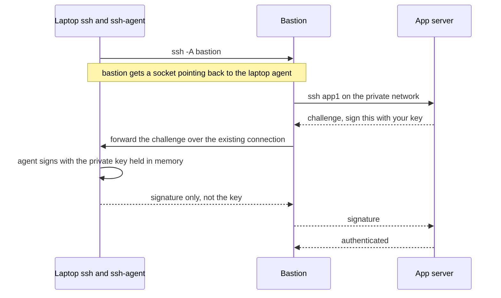
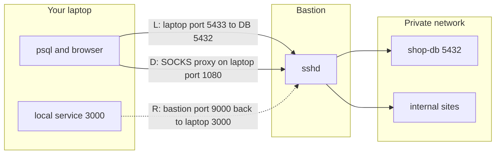

# L1.13 — ssh-agent and Port Forwarding

> **Level 1: Linux Fundamentals** · Topic 13 of 13 · ⏱ ~5 hours · Difficulty: Intermediate

## 1. What it is

**`ssh-agent`** is a small background program that holds your decrypted private keys in memory. You unlock a key
once with `ssh-add`, and every later `ssh`, `scp` or `git` command asks the agent to sign the login challenge, so you type your
passphrase once per session instead of once per connection — and the private key is never handed to the client programs.
**Agent forwarding** (`ssh -A`) extends that: it lets a remote machine ask *your local* agent to sign challenges, so you can
hop from a bastion to an internal server without ever copying a private key onto the bastion.

**Port forwarding** (also called **SSH tunneling**) uses an SSH connection as an encrypted pipe for other traffic. You can make a remote
service appear on a port on your laptop (**local forward**, `-L`), expose a laptop service on the remote machine
(**remote forward**, `-R`), or turn the SSH connection into a general **SOCKS proxy** (**dynamic forward**, `-D`). **`ProxyJump`** (`-J`)
reaches a machine that is only visible through a **bastion host** (also called a jump host), and **`~/.ssh/config`** lets you save all of
these options under short names such as `ssh prod-db`.

## 2. Why it matters in DevOps

- **Private networks are the norm.** Databases, internal dashboards and Kubernetes nodes live in private subnets; the only public door is a bastion. `ProxyJump` and `-L` are how engineers reach them without opening those ports to the internet.
- **Safe debugging:** connect a local `psql` or browser to a production database or Grafana through a tunnel instead of exposing it publicly or copying data around.
- **Key hygiene:** with an agent and forwarding, private keys stay on one machine. Without them, people copy keys onto servers — the thing audits flag first.
- **Convenience that scales:** a good `~/.ssh/config` makes the correct secure path the easy path, so nobody is tempted to take shortcuts.
- **Risk awareness:** agent forwarding to an untrusted host lets anyone with root on it *use* your keys while you are connected; `-R` can expose internal services to the world. Both are classic security-review findings.

## 3. Real-world system example

**Bastion hosts in AWS VPCs.** The standard AWS pattern places application servers and databases in private subnets with no public
IP, and a hardened bastion (or, increasingly, AWS Systems Manager Session Manager, which provides tunnel-like port forwarding without
opening port 22) in a public subnet. An engineer reaches an RDS PostgreSQL instance from a laptop with a command like
`ssh -L 5433:shop-db.internal.example.com:5432 bastion` and then runs `psql -h 127.0.0.1 -p 5433`. The Kubernetes ecosystem works similarly:
`kubectl port-forward` is the same idea (a local port connected to a pod) built into the API machinery.

**GitHub** is a ubiquitous agent consumer: `git push` over `git@github.com` signs with the key from your agent, and many CI systems
load a deploy key into an ephemeral `ssh-agent` for the duration of a job. GitHub's documentation on SSH agent forwarding
also notes the risks and that forwarding should only be enabled for hosts you trust.

## 4. Diagram

Agent forwarding through a bastion — the private key never leaves the laptop:



Three kinds of tunnel and the direction each one opens:



## 5. How it works

### ssh-agent commands

| Task | Command |
|------|---------|
| Start an agent for this shell (manual) | `eval "$(ssh-agent -s)"` — sets `SSH_AUTH_SOCK` and `SSH_AGENT_PID` |
| Add the default key(s) / a specific key | `ssh-add` / `ssh-add ~/.ssh/id_ed25519` |
| Add with a lifetime | `ssh-add -t 4h ~/.ssh/id_ed25519` |
| List loaded keys (fingerprints / full public) | `ssh-add -l` / `ssh-add -L` |
| Remove one / all | `ssh-add -d ~/.ssh/id_ed25519` / `ssh-add -D` |
| Stop the agent | `ssh-agent -k` |
| Is an agent available | `echo "$SSH_AUTH_SOCK"` and `ssh-add -l` (exit 2 = cannot reach agent, 1 = no keys) |

Most desktop environments and macOS start an agent for you (macOS: `AddKeysToAgent yes` and `UseKeychain yes` in config). On Linux servers and CI you start it
yourself. In `~/.ssh/config`, `AddKeysToAgent yes` adds a key to the agent the first time you use it.

### Agent forwarding: convenience with a risk

`ssh -A host` (or `ForwardAgent yes` for a specific `Host`) creates a socket on the remote host, `/tmp/ssh-XXXX/agent.NNNN`, that proxies requests to your
agent. Anyone who is **root on that host** (or runs as your user there) can use that socket to authenticate as you to other servers while your connection is open.
They cannot steal the key itself, but they can impersonate you. Therefore:

- Use `-A`/`ForwardAgent` only for hosts you fully trust, never `Host *`.
- **Prefer `ProxyJump`**, which does not expose your agent to the bastion at all: your laptop connects *through* the bastion directly to the target and authenticates itself.
- Confirm each use with `ssh-add -c` (the agent asks you before each signature), or use hardware keys that require a touch.

### The three port-forward types

| Flag | Name | Meaning | Typical use |
|------|------|---------|-------------|
| `-L [bind:]lport:host:rport` | Local | connections to `lport` on **your machine** go through SSH and come out connecting to `host:rport` as seen from the **SSH server** | reach a private database or admin UI |
| `-R [bind:]rport:host:lport` | Remote | connections to `rport` on the **SSH server** come back to `host:lport` as seen from **your machine** | show a local dev server to a remote machine, or reach your laptop from a server |
| `-D [bind:]port` | Dynamic | `ssh` opens a **SOCKS5 proxy** on `port`; each connection is forwarded to wherever the app requests | browse many internal sites through one tunnel |

Useful companion flags:

- `-N` — do not run a remote command (tunnel only). `-f` — go to the background after authentication. Together: `ssh -fN -L …`.
- `-J user@jump` — ProxyJump. Chain: `-J jump1,jump2`.
- By default forwarded ports bind to `127.0.0.1` only. Binding to `0.0.0.0` (`-L 0.0.0.0:8080:…`) shares the tunnel with your whole network; for `-R` the server's `GatewayPorts` setting decides (default: loopback only).
- On the server, `AllowTcpForwarding no` in `sshd_config` disables tunneling; use it on hosts that must never be a pivot.
- `-o ExitOnForwardFailure=yes` makes ssh fail instead of silently continuing without the forward; `-o ServerAliveInterval=30` keeps idle tunnels alive.

### `~/.ssh/config`

Read top to bottom; for each option the **first** value found wins, so put specific `Host` blocks first and `Host *` defaults last.

```text
# ~/.ssh/config   (chmod 600)
Host bastion
    HostName 203.0.113.10
    User ubuntu
    IdentityFile ~/.ssh/id_ed25519
    IdentitiesOnly yes

Host app1
    HostName 10.0.1.15
    User ubuntu
    ProxyJump bastion

Host db-tunnel
    HostName 10.0.2.20
    User ubuntu
    ProxyJump bastion
    LocalForward 5433 shop-db.internal.example.com:5432
    ExitOnForwardFailure yes

Host *
    ServerAliveInterval 30
    ServerAliveCountMax 3
    AddKeysToAgent yes
    HashKnownHosts yes
```

| Directive | Effect |
|-----------|--------|
| `Host` | pattern or alias this block applies to (`Host web-*` works) |
| `HostName`, `Port`, `User` | real address and defaults |
| `IdentityFile`, `IdentitiesOnly yes` | which key to offer; the second stops the client offering every key in the agent (avoids "Too many authentication failures") |
| `ProxyJump` | the bastion(s) to go through |
| `LocalForward`, `RemoteForward`, `DynamicForward` | the forwards from the previous table, applied on every connect |
| `ForwardAgent` | agent forwarding per host — set it only on trusted names |
| `ServerAliveInterval` | keepalives that stop NAT/firewalls dropping idle sessions |
| `ControlMaster auto`, `ControlPath ~/.ssh/cm/%C`, `ControlPersist 10m` | reuse one connection for many sessions: much faster `scp`/`rsync`/Ansible. Keep the path short (socket paths are limited to about 100 characters); create the directory first |

Debug what SSH will do with `ssh -G app1` (prints the final merged config) and `ssh -v app1` (shows the key offered and the jump hops).

## 6. Step-by-step guide

**Prerequisites:** the key from the previous topic ([SSH Keys](12-ssh-keys-and-authorized-keys.md)) and one or two servers you can reach
with SSH — ideally a "bastion" with a public IP and a second machine reachable only from it (two local VMs on a host-only network,
two cheap VPSs in the same region, or two cloud instances in one VPC). To learn with one machine, use `localhost` as the "private" target.
Addresses below are placeholders from documentation ranges: replace `203.0.113.10` (bastion) and `10.0.1.15` (private app server).

1. **Start an agent and load your key.**
   ```bash
   eval "$(ssh-agent -s)"            # prints: Agent pid 12345
   ssh-add -t 4h ~/.ssh/id_ed25519   # asks for the passphrase once
   ssh-add -l                        # lists the fingerprint of the key
   ```
   Expected: `Identity added: … (Lifetime set to 14400 seconds)`, then a line `256 SHA256:… alice@laptop (ED25519)`.
   Log in to the bastion twice: no passphrase prompt the second time (or at all).

2. **Show what agent forwarding does (and does not) do.**
   ```bash
   ssh bastion 'echo "SOCK=${SSH_AUTH_SOCK:-none}"'        # prints SOCK=none
   ssh -A bastion 'echo "SOCK=$SSH_AUTH_SOCK"; ssh-add -l'  # a /tmp/ssh-…/agent.NNN path and your key listed
   ```
   With `-A` the bastion can list and use your key; without it it sees no agent. Nothing was copied.

3. **Reach a private server with ProxyJump (preferred over `-A`).**
   ```bash
   ssh -J ubuntu@203.0.113.10 ubuntu@10.0.1.15 hostname
   ```
   Expected: the private host's hostname. Your agent signs for both hops; no key lives on the bastion.
   Note that `-i keyfile` applies only to the final host, not to the jump; with an agent or the config file below
   this is not a problem.

4. **Write the config.** Create `~/.ssh/config` with the `bastion` and `app1` blocks from section 5, then:
   ```bash
   chmod 600 ~/.ssh/config
   ssh app1 hostname              # same result as step 3 with a short name
   ssh -G app1 | grep -iE '^(hostname|user|proxyjump) '
   ```
   Expected from `-G`: `hostname 10.0.1.15`, `user ubuntu`, `proxyjump bastion`.

5. **Local forward: reach a private service from your laptop.** Start a stand-in web service on the private server (`python3 -m http.server 8000 --bind 127.0.0.1`
   in a second terminal on that machine), then:
   ```bash
   ssh -fN -L 8081:127.0.0.1:8000 app1
   curl -s -o /dev/null -w "%{http_code}\n" http://127.0.0.1:8081/
   ```
   Expected: `200`. Port 8081 on your laptop now leads to port 8000 on `app1`. For a real database use
   `-L 5433:shop-db.internal.example.com:5432` and connect with `psql -h 127.0.0.1 -p 5433 -U shop shopdb`.
   If you see `cannot listen to port: 8081` something else is using it — choose another local port.

6. **Remote forward: let the server see something on your laptop.**
   ```bash
   python3 -m http.server 3000 --bind 127.0.0.1 &        # a stand-in "local dev app"
   ssh -fN -R 9100:127.0.0.1:3000 app1
   ssh app1 'curl -s -o /dev/null -w "%{http_code}\n" http://127.0.0.1:9100/'
   ```
   Expected: `200`. Port 9100 on `app1` now leads back to your laptop's port 3000. Note it listens on the server's loopback only (default `GatewayPorts no`).

7. **Dynamic forward: a SOCKS proxy.**
   ```bash
   ssh -fN -D 1080 bastion
   curl --socks5-hostname 127.0.0.1:1080 -s -o /dev/null -w "%{http_code}\n" http://10.0.1.15:8000/
   ```
   Expected: `200` (the request travelled through the bastion and its DNS and routing were used). Point a browser's SOCKS5 proxy setting at `127.0.0.1:1080` to browse internal sites.

8. **See and stop your tunnels.**
   ```bash
   ss -tlnp | grep -E ':(8081|1080)\b'        # listening sockets owned by ssh
   pgrep -af 'ssh -fN'                        # the background tunnel processes
   kill <PID>                                 # close a tunnel
   ```

9. **Speed up repeated connections.**
   ```bash
   mkdir -p ~/.ssh/cm
   cat >> ~/.ssh/config <<'EOF'

   Host bastion app1
       ControlMaster auto
       ControlPath ~/.ssh/cm/%C
       ControlPersist 10m
   EOF
   time ssh app1 true; time ssh app1 true    # the second is much faster
   ssh -O check app1; ssh -O exit app1       # inspect then close the shared connection
   ```
   (Appending at the end is fine here because `Host *` does not set these options. Where two blocks set the same option, the first value wins.)

10. **Clean up.** Stop tunnels with `kill`, clear the agent with `ssh-add -D` (or `ssh-agent -k` for an agent you started), and delete any test files.

## 7. Real-world scenario

*(Illustrative.)* An engineer needs to run a one-off report against the production PostgreSQL in `us-east-1`. The database has no public address; the team's
policy forbids opening 5432 to the internet. Instead she runs `ssh -fN db-tunnel` (the config block above), connects `psql` to `127.0.0.1:5433`, and
closes the tunnel afterwards. The bastion's `sshd` logs show her key and the destination.

The week before, a teammate used `ssh -A` to a shared build server "for convenience". A compromised build job there found his agent socket and
logged in to two other hosts as him until he disconnected. The postmortem outcome: `ForwardAgent` removed from the shared `Host *` block,
`ProxyJump` required for private hosts, `AllowAgentForwarding no` on build servers, and the bastion restricted to `AllowTcpForwarding` only for the
subnets that need it. **Lesson:** tunnels make private networks usable; forwarding your agent into someone else's machine hands them your identity.

## 8. Common mistakes and best practices

**Don't**

- Enable `ForwardAgent yes` under `Host *`, or forward your agent to shared or untrusted servers.
- Copy private keys to a bastion "so I can hop onward".
- Bind tunnels to `0.0.0.0` unless you intend to share them; a forgotten `-R` can expose an internal service to the internet via the server.
- Leave stale `ssh -fN` tunnels running for days; forgotten tunnels are invisible access paths.
- Put `Host *` defaults above specific blocks (the first value wins).
- Let the agent hold keys forever on shared machines.

**Do**

- Use `ProxyJump` rather than agent forwarding; use `IdentitiesOnly yes` with explicit `IdentityFile`.
- Set key lifetimes (`ssh-add -t`), confirm-on-use (`-c`) or hardware keys for production access.
- Keep `~/.ssh/config` in version control (without private keys) so the team shares host aliases.
- Add `ExitOnForwardFailure yes` and `ServerAliveInterval` for tunnels used in scripts.
- Restrict forwarding on servers that should not be pivots (`AllowTcpForwarding no`, `AllowAgentForwarding no`) and use `PermitOpen` to limit allowed destinations.
- Consider managed alternatives (Session Manager, SSH certificates, `kubectl port-forward`) where policy allows.

## 9. Tasks

- [ ] **T1 — Passphrase once** *(≈20 min, beginner)*
  - **Goal:** use the agent so you stop retyping passphrases.
  - **Steps:**
    1. Start an agent in a new shell (`eval "$(ssh-agent -s)"`), `ssh-add` your key with `-t 1h`.
    2. Run `ssh-add -l`, SSH to a lab server twice, then `ssh-add -D` and try again.
  - **Done when:** the first two logins ask for nothing and the third prompts for the passphrase again, and you can show the key's remaining lifetime was set.

- [ ] **T2 — Forwarded agent versus none** *(≈30 min, intermediate)*
  - **Goal:** see exactly what a forwarded agent exposes.
  - **Steps:**
    1. `ssh host 'echo $SSH_AUTH_SOCK; ssh-add -l'`, then repeat with `ssh -A`.
    2. On the remote shell (with `-A`) run `ls -l $SSH_AUTH_SOCK` and, as root on that host (`sudo -i`), set `SSH_AUTH_SOCK` to the same path and run `ssh-add -l`.
  - **Done when:** you demonstrate that without `-A` there is no agent, with `-A` the key is usable, and root on the remote can use the socket — and you can say why this matters.

- [ ] **T3 — Tunnel to a private service** *(≈40 min, intermediate)*
  - **Goal:** reach a service that listens only on a private interface.
  - **Steps:**
    1. On a target machine start `python3 -m http.server 8000 --bind 127.0.0.1`.
    2. From your laptop confirm a direct request fails, then open `ssh -fN -L 8081:127.0.0.1:8000 target` and request `http://127.0.0.1:8081/`.
    3. Verify the listener with `ss -tlnp` and close the tunnel.
  - **Done when:** the direct request fails and the tunneled one returns `200`.

- [ ] **T4 — Build a bastion workflow in `~/.ssh/config`** *(≈45 min, intermediate)*
  - **Goal:** make `ssh app1` and `scp file app1:` work through the bastion with no flags.
  - **Steps:**
    1. Write `bastion` and `app1` blocks using `ProxyJump`, `IdentityFile` and `IdentitiesOnly`.
    2. Add a `db-tunnel` block with `LocalForward`, then use it for `psql` (or `nc -zv 127.0.0.1 5433`).
    3. Check the result with `ssh -G app1` and add `ControlMaster`/`ControlPersist`; time repeated connections.
  - **Done when:** `ssh app1`, `scp`, and the tunnel all work with short names and the second connection is measurably faster.

- [ ] **T5 — Break it: the exposed tunnel** *(≈40 min, advanced)*
  - **Goal:** understand how `0.0.0.0` binds and `-R` can leak access.
  - **Steps:**
    1. Open `ssh -fN -L 0.0.0.0:8082:127.0.0.1:8000 target` and, from a second machine on your network, request `http://<your-laptop-ip>:8082/`. Close it and repeat with the default bind to show it fails from outside.
    2. On the server set `AllowTcpForwarding no` in a drop-in config, `sudo sshd -t && sudo systemctl reload ssh`, and show a `-L` attempt is refused.
  - **Done when:** you reproduced exposure and its prevention, and can explain both with `ss -tlnp` output.

- [ ] **T6 — Prove it: reach the database safely** *(≈50 min, advanced)*
  - **Goal:** end-to-end private database access without public ports, from memory.
  - **Steps:**
    1. Without the guide, design and run: laptop to bastion to a private host running PostgreSQL (or any TCP service), using `ProxyJump` and a `LocalForward`, no agent forwarding, no key copied to the bastion.
    2. Prove no secrets live on the bastion (`ls -la ~/.ssh` there, `ssh-add -l` empty on it), and write down the three commands to tear everything down.
  - **Done when:** a client on your laptop talks to the private service through `127.0.0.1`, the bastion holds none of your keys, and you can explain every flag you used.

## 10. Self-check questions

1. What does `ssh-agent` hold, and what does a client program receive from it?
2. Why is `ProxyJump` safer than `ssh -A` through a bastion?
3. In `-L 5433:db.internal:5432 bastion`, which machine resolves `db.internal`, and where does the listener open?
4. When would you use `-R`, and what is its main risk?
5. What does `-D 1080` give you that `-L` does not?
6. In `~/.ssh/config`, why must specific `Host` blocks come before `Host *`?

<details>
<summary>Answers</summary>

1. Decrypted private keys in memory; clients only get signatures (answers to challenges), never the key.
2. With `ProxyJump` the bastion only relays encrypted traffic; your laptop authenticates directly to the target, so no agent socket exists on the bastion for others to abuse.
3. The bastion (the SSH server) resolves `db.internal` and connects to port 5432; the listener opens on `127.0.0.1:5433` on your laptop.
4. To expose something on your machine to the remote side (a dev server, a callback endpoint, or reaching your laptop from a server). Risk: it can expose your internal service to anyone who can reach the remote port (especially with `GatewayPorts`).
5. A generic SOCKS5 proxy that can reach any host and port through the tunnel, instead of one fixed destination.
6. For each option, the first matching value wins, so earlier specific blocks must set values before the general `Host *` defaults.
</details>

## 11. Further reading

- `man ssh`, `man ssh_config`, `man ssh-agent`, `man ssh-add`, `man sshd_config` (especially `AllowTcpForwarding`, `PermitOpen`, `GatewayPorts`).
- OpenSSH project documentation (openssh.com) and the OpenSSH Cookbook on Wikibooks.
- GitHub Docs, "Using SSH agent forwarding"; AWS documentation on Systems Manager Session Manager port forwarding.
- *SSH Mastery* by Michael W. Lucas.
- See also: [SSH Keys, known_hosts and authorized_keys](12-ssh-keys-and-authorized-keys.md), [Network and Transfer Commands](05-network-transfer-commands.md), and [Linux and SSH Hardening](../level-11-security-devsecops/01-linux-and-ssh-hardening.md).

<!-- nav -->
---
← Previous: [SSH Keys, known_hosts and authorized_keys](12-ssh-keys-and-authorized-keys.md) · [Level 1 index](README.md) · Next: [Level capstone project](99-capstone-project.md) →
