# Level 1 — Linux Fundamentals

> **Goal:** Become comfortable operating Linux servers without depending on tutorials.

| | |
|---|---|
| **Recommended time** | 2-4 weeks |
| **Topics** | 13 |
| **Practice / capstone** | Deploy Ubuntu + Nginx + Node.js API + PostgreSQL on a VPS manually, without Docker. |

## Topics

| # | Topic | What you will learn |
|---|-------|---------------------|
| 1 | [Linux Filesystem Hierarchy](01-filesystem-hierarchy.md) | /etc /var /home /opt /usr /tmp /proc /sys and what lives where |
| 2 | [Navigating and Managing Files](02-navigating-and-managing-files.md) | ls cd pwd cp mv rm mkdir touch |
| 3 | [Viewing and Searching Text](03-viewing-and-searching-text.md) | cat less grep find, pipes and redirection |
| 4 | [Text Processing with awk and sed](04-awk-and-sed.md) | awk, sed, log parsing one-liners |
| 5 | [Network and Transfer Commands](05-network-transfer-commands.md) | curl wget ssh scp rsync |
| 6 | [File Permissions: chmod and chown](06-permissions-chmod-chown.md) | rwx, octal, ownership, umask, setuid basics |
| 7 | [Users, Groups, sudo and root](07-users-groups-sudo-root.md) | useradd, groups, sudoers, root vs service accounts |
| 8 | [Processes, PIDs and Signals](08-processes-and-signals.md) | PID, parent/child, fork/exec, SIGTERM/SIGKILL/SIGHUP, zombies |
| 9 | [Daemons and systemd](09-daemons-and-systemd.md) | what a daemon is, systemd units, targets, writing a unit file |
| 10 | [System Monitoring Commands](10-system-monitoring.md) | ps top htop df du free uptime, load average |
| 11 | [Services and Logs: systemctl and journalctl](11-systemctl-and-journalctl.md) | start/stop/enable/status, journalctl filters, log rotation |
| 12 | [SSH Keys, known_hosts and authorized_keys](12-ssh-keys-and-authorized-keys.md) | keypairs, ssh-keygen, host verification, authorized_keys |
| 13 | [ssh-agent and Port Forwarding](13-ssh-agent-and-port-forwarding.md) | ssh-agent, agent forwarding, local/remote/dynamic tunnels, ProxyJump, ~/.ssh/config |
| ★ | [Level capstone project](99-capstone-project.md) | Deploy Ubuntu + Nginx + Node.js API + PostgreSQL on a VPS manually, without Docker. |

## How to work through this level

1. Read each topic in order: *what it is → why it matters → real-world example → diagram → guide*.
2. Do **every task** in the topic's *Tasks* section and tick the box (`- [x]`) in your own fork or notes.
3. Answer the *Self-check questions* without looking, then reveal the answers.
4. Finish with the **capstone project**, which combines all topics of the level.
5. Move on only when you can do the capstone's *Prove it* task without the guide.

## Topic flow

```mermaid
flowchart LR
    T1["1. Linux Filesystem Hierarchy"]
    T2["2. Navigating and Managing Files"]
    T3["3. Viewing and Searching Text"]
    T4["4. Text Processing with awk and sed"]
    T5["5. Network and Transfer Commands"]
    T6["6. File Permissions: chmod and chown"]
    T7["7. Users, Groups, sudo and root"]
    T8["8. Processes, PIDs and Signals"]
    T9["9. Daemons and systemd"]
    T10["10. System Monitoring Commands"]
    T11["11. Services and Logs: systemctl and journalctl"]
    T12["12. SSH Keys, known_hosts and authorized_keys"]
    T13["13. ssh-agent and Port Forwarding"]
    CAP(["Capstone"])
    T1 --> T2 --> T3 --> T4 --> T5 --> T6 --> T7 --> T8 --> T9 --> T10 --> T11 --> T12 --> T13 --> CAP
```

---
← [Level 0 — What DevOps Actually Is](../level-00-what-devops-is/README.md) · [Roadmap home](../README.md) · [Level 2 — Networking](../level-02-networking/README.md) →
