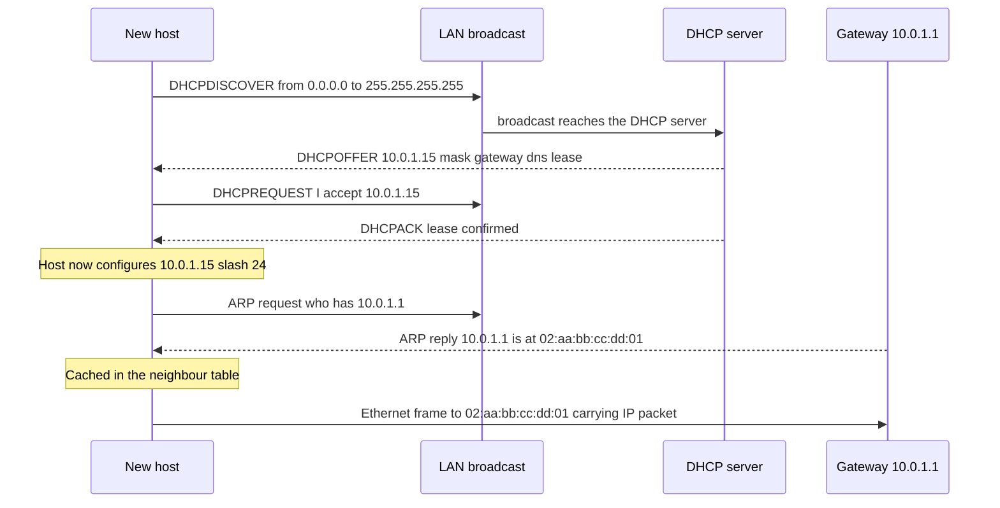
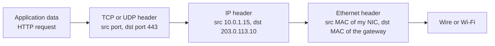

# L2.1 — IP, MAC, ARP and DHCP

> **Level 2: Networking** · Topic 1 of 11 · ⏱ ~4 hours · Difficulty: Beginner

## 1. What it is

Every machine on a network has **two kinds of address**, and they solve different problems:

- A **MAC address** (Media Access Control, 48 bits, e.g. `02:42:ac:11:00:02`) names a *network interface* on the **local link** (the same
  Ethernet segment, Wi-Fi network or virtual switch). It is only meaningful for one hop.
- An **IP address** (Internet Protocol, e.g. `10.0.1.15`) names a *host's position in the network* and is used to route packets across many hops, all the way around the world.

Two small protocols glue these together. **ARP** (Address Resolution Protocol) answers "I want to send to `10.0.1.1` — which MAC address do I put on the Ethernet frame?" **DHCP** (Dynamic Host Configuration Protocol) answers "I just booted and have no address — what IP, netmask, gateway and DNS server should I use?"

## 2. Why it matters in DevOps

- **"Can't reach the server" starts here.** Before blaming the firewall or the app, you check: does the host have an IP? Is it in the right subnet? Does it know its gateway's MAC?
- **Cloud networking is built on these ideas.** Every EC2 instance gets its address by DHCP from the VPC; every ENI (Elastic Network Interface) has a MAC; DHCP option sets decide which DNS server your servers use.
- **Duplicate IPs and stale ARP entries** cause maddening intermittent failures, especially around failover (keepalived/VRRP, MetalLB) and VM/container migrations.
- **Container and Kubernetes networking** builds virtual interfaces, bridges and veth pairs that each have MACs and IPs; you debug them with the same tools (`ip addr`, `ip neigh`).

## 3. Real-world system example

**AWS VPC.** When you launch an EC2 instance, the instance's operating system asks for its configuration with DHCP, and the VPC answers with the private IPv4 address assigned to its ENI, the subnet mask, the default gateway (the subnet's VPC router) and DNS settings from the VPC's **DHCP option set**. AWS documents that the Amazon-provided DNS resolver lives at the VPC network range's base address plus two (and at `169.254.169.253`), and that the first four and the last address of every subnet are reserved. AWS also documents that VPCs do not support broadcast or multicast in the usual sense: the platform itself answers ARP so your instances still resolve their gateway.

**MetalLB in layer-2 mode** (a bare-metal Kubernetes load-balancer add-on) makes a Service IP reachable by having one node answer ARP requests (IPv6: NDP) for that IP. If that node dies, another node takes over and sends a *gratuitous ARP* so that switches and neighbours update their tables. **keepalived** with VRRP does the same for a floating virtual IP in front of two Nginx or HAProxy servers.

## 4. Diagram

How a new host gets an address (DHCP "DORA") and then resolves its gateway's MAC with ARP:



The addressing layers on one packet leaving your laptop for a server on the internet:



Note that the destination **IP** stays the server's all the way, but the destination **MAC** is the *next hop's* (the gateway) and is rewritten at every router.

## 5. How it works

**Addressing layers (TCP/IP model)**

| Layer | Address | Scope | Example | Changes per hop? |
|-------|---------|-------|---------|------------------|
| Link (L2) | MAC | one local network | `02:42:ac:11:00:02` | Yes |
| Internet (L3) | IP | end to end | `10.0.1.15` | No (except NAT) |
| Transport (L4) | Port | one process on a host | `443` | No |

**MAC addresses.** 6 bytes, written as hex pairs. The first 3 bytes (the OUI) identify the vendor; bit 1 of the first byte set means "locally administered" (virtual NICs, Docker, cloud). `ff:ff:ff:ff:ff:ff` is the **broadcast** address that every host on the segment accepts.

**ARP.** Before sending an IP packet to a neighbour, the host looks in its **neighbour table** (`ip neigh`). If absent it broadcasts "who has 10.0.1.1? tell 10.0.1.15"; the owner replies unicast. Entries are cached for tens of seconds and move through states such as `REACHABLE`, `STALE`, `DELAY`, `FAILED`. For destinations *outside* your subnet you do not ARP for the destination - you ARP for the **default gateway** and hand it the packet. A **gratuitous ARP** is an unsolicited announcement ("10.0.1.100 is now at this MAC") used after a failover. IPv6 replaces ARP with **NDP** (Neighbor Discovery Protocol), covered in [L2.3](03-ipv4-ipv6-cidr-subnets.md).

**DHCP.** A UDP protocol: client port 68, server port 67. The four-message exchange is **D**iscover, **O**ffer, **R**equest, **A**cknowledge. The server hands out a *lease*, a time-limited right to use the address. At 50% of the lease the client tries to renew (unicast), and at about 87.5% it rebroadcasts to any server. Besides the IP, DHCP options carry the subnet mask, router (default gateway), DNS servers, search domain and NTP servers. A DHCP **relay** forwards broadcasts across routers so one server can serve many subnets.

**Useful commands**

| Command | Purpose |
|---------|---------|
| `ip -br addr` | Brief list of interfaces, state and IPs |
| `ip link show eth0` | MAC address, MTU, up/down |
| `ip neigh` | ARP/NDP neighbour table |
| `ip route` | Which gateway is used (preview of [L2.4](04-routing-nat-ports-firewalls.md)) |
| `arping -I eth0 10.0.1.1` | ARP-level ping (also detects duplicate IPs with `-D`) |
| `tcpdump -n -i eth0 arp or port 67 or port 68` | Watch ARP and DHCP on the wire |
| `resolvectl status` or `cat /etc/resolv.conf` | DNS servers obtained via DHCP |

## 6. Step-by-step guide

**Prerequisites:** Docker on a laptop or VM (free). Nothing leaves your machine. The `iproute2`, `iputils-arping` and `tcpdump` packages are installed inside a throwaway container.

1. **Create an isolated network with two containers.**
   ```bash
   docker network create --subnet 10.77.0.0/24 labnet
   docker run -d --name hostA --network labnet --cap-add NET_ADMIN --cap-add NET_RAW ubuntu:24.04 sleep infinity
   docker run -d --name hostB --network labnet --cap-add NET_ADMIN --cap-add NET_RAW ubuntu:24.04 sleep infinity
   for h in hostA hostB; do
     docker exec $h bash -c "apt-get update -qq && apt-get install -y -qq iproute2 iputils-arping iputils-ping tcpdump >/dev/null"
   done
   ```
   Expected: no errors. (Docker's bridge network is a virtual switch, which is exactly an Ethernet segment.)

2. **Look at the two addresses of each host.**
   ```bash
   docker exec hostA ip -br addr
   docker exec hostA ip link show eth0
   ```
   Similar to `eth0@if23  UP  10.77.0.2/24` and `link/ether 02:42:0a:4d:00:02`. The IP is the L3 address; the MAC (`link/ether`) is the L2 address. Docker derives container MACs from the IP, which is why they look related.

3. **Show that the neighbour table starts empty, then fills.**
   ```bash
   docker exec hostA ip neigh
   docker exec hostA ping -c 1 10.77.0.3
   docker exec hostA ip neigh
   ```
   After the ping you see something like `10.77.0.3 dev eth0 lladdr 02:42:0a:4d:00:03 REACHABLE`. That entry was created by an ARP exchange.

4. **Watch the ARP exchange on the wire.** Open two terminals.
   ```bash
   # terminal 1
   docker exec hostA tcpdump -n -e -i eth0 arp
   # terminal 2: clear the cache first so ARP has to happen again
   docker exec hostA ip neigh flush all
   docker exec hostA ping -c 1 10.77.0.3
   ```
   Expect two lines: `ARP, Request who-has 10.77.0.3 tell 10.77.0.2` (sent to `ff:ff:ff:ff:ff:ff`) and `ARP, Reply 10.77.0.3 is-at 02:42:...`.

5. **Use arping to test layer 2 directly.**
   ```bash
   docker exec hostA arping -c 2 -I eth0 10.77.0.3
   ```
   `arping` replies prove the L2 path works even if a firewall blocks ICMP, a classic way to separate "L2 broken" from "ICMP filtered".

6. **Create a duplicate-IP problem.**
   ```bash
   docker exec hostB ip addr add 10.77.0.2/24 dev eth0     # hostB now also claims hostA's address
   docker exec hostB arping -c 2 -D -I eth0 10.77.0.2 ; echo "exit=$?"
   ```
   Duplicate address detection (`-D`) should report a reply and exit non-zero when someone else answers (behaviour varies slightly between `arping` implementations). Remove the extra address: `docker exec hostB ip addr del 10.77.0.2/24 dev eth0`.

7. **See the DHCP exchange (read-only on a real machine).** On a Linux VM or laptop using DHCP, release and watch:
   ```bash
   sudo tcpdump -n -i any -vv 'udp port 67 or udp port 68' &
   sudo dhclient -r && sudo dhclient -v      # older systems; with NetworkManager use: nmcli device reapply <iface>
   ```
   Expect `DHCP-Message Option 53, length 1: Discover`, then `Offer`, `Request`, `ACK` with options for Subnet-Mask, Router, Domain-Name-Server and Lease-Time. Do this only on a machine you can afford to briefly lose connectivity on, for example a local VM.

8. **Clean up.**
   ```bash
   docker rm -f hostA hostB && docker network rm labnet
   ```

## 7. Real-world scenario

*(Illustrative.)* **Symptom:** after a planned failover of the two HAProxy servers in front of `shop-api`, about half of all clients still time out for several minutes while the other half work. **Investigation:** `ip addr` on the new primary shows it holds the floating IP `192.0.2.50`; `tcpdump -n arp` on the upstream router's neighbouring host shows requests for `192.0.2.50` being answered, but the router keeps sending frames to the *old* MAC. The router's ARP entry had not expired and the failover script had not sent a gratuitous ARP. **Fix:** configure keepalived to send gratuitous ARPs on takeover (`garp_master_delay`/`garp_master_repeat`) and verify with `arping -U -I eth0 192.0.2.50`. **Lesson:** an IP address is only reachable at L2 while the neighbours' ARP caches agree who owns it.

## 8. Common mistakes and best practices

**Don't**

- Assign static IPs inside a DHCP pool without a reservation - you will eventually get a duplicate address.
- Assume "ping fails" means "L3 is down": ICMP may simply be filtered. Check ARP (`ip neigh`) and use `arping` or TCP-based tests.
- Hard-code MAC addresses in automation for cloud VMs; they change when ENIs are replaced.
- Run two DHCP servers on one segment by accident (a home router plugged into the lab network is the usual culprit).

**Do**

- Use `ip -br addr`, `ip route` and `ip neigh` as the first three commands on any "network is down" ticket.
- Use DHCP reservations or cloud-assigned addresses; keep static addressing for infrastructure with a documented range.
- Send gratuitous ARP on any virtual-IP failover and keep ARP-related sysctls (`arp_ignore`, `arp_announce`) in mind with load-balancer DSR setups.
- Remember the MAC changes at every router hop; the IP does not.

## 9. Tasks

- [ ] **T1 — Map your own addresses** *(≈20 min, beginner)*
  - **Goal:** identify your L2 and L3 addresses and your gateway.
  - **Steps:**
    1. Run `ip -br addr`, `ip link show` and `ip route` on your machine or VM.
    2. Write down your IP, prefix length, MAC address, default gateway IP.
    3. Run `ip neigh` and find the gateway's MAC.
  - **Done when:** you have those five values and can say which are L2 and which are L3.

- [ ] **T2 — Capture an ARP exchange** *(≈30 min, beginner)*
  - **Goal:** see an ARP request and reply as raw packets.
  - **Steps:**
    1. Build the two-container lab from section 6 (steps 1-2).
    2. Run `tcpdump -n -e -i eth0 arp` in hostA, flush the neighbour table, and ping hostB.
  - **Done when:** you can point to the broadcast destination `ff:ff:ff:ff:ff:ff` in the request and the unicast reply carrying hostB's MAC.

- [ ] **T3 — Add a third host and predict the table** *(≈30 min, intermediate)*
  - **Goal:** predict neighbour-table contents before looking.
  - **Steps:**
    1. Start `hostC` on `labnet`. Before running anything, write down what `ip neigh` on hostA should show after hostA pings only hostC.
    2. Run the ping and compare.
  - **Done when:** your prediction matched: hostA lists hostC (and the Docker gateway if contacted) but not hostB.

- [ ] **T4 — Break it: duplicate IP** *(≈30 min, intermediate)*
  - **Goal:** produce and detect an IP conflict.
  - **Steps:**
    1. Follow section 6 step 6 so two containers claim `10.77.0.2`.
    2. From hostA run `ping -c 3 10.77.0.2` and `ip neigh` repeatedly; observe the MAC.
    3. Detect it with `arping -D`, then remove the duplicate.
  - **Done when:** you can show two different MACs answering for one IP, then show a clean `arping -D` result after the fix.

- [ ] **T5 — Read a DHCP lease** *(≈30 min, intermediate)*
  - **Goal:** find what your DHCP server told you.
  - **Steps:**
    1. Locate your lease info: `resolvectl status`, `nmcli device show <iface>` or `/var/lib/dhcp/*.leases` depending on distro.
    2. Capture a renewal with `tcpdump` as in step 7 if you have a disposable VM.
  - **Done when:** you can list the lease time, router, DNS servers and the four DORA message types you saw.

- [ ] **T6 — Prove it: from MAC to gateway** *(≈30 min, advanced)*
  - **Goal:** explain addressing without notes.
  - **Steps:**
    1. Without the guide, draw (paper is fine) the Ethernet, IP and TCP headers of a packet from your laptop to `203.0.113.10`, filling in which MAC and IP appear on your link and on the link beyond the first router.
    2. Verify the first-hop MAC on your machine using `ip route get 203.0.113.10` and `ip neigh`.
  - **Done when:** your drawing shows the destination IP unchanged, the destination MAC equal to your gateway's MAC, and you can explain why.

## 10. Self-check questions

1. Why do we need both MAC and IP addresses?
2. When your host sends a packet to a server in another country, whose MAC address is in the Ethernet destination field?
3. Name the four DHCP messages and which ones are broadcast.
4. What does a gratuitous ARP do and when do you use it?
5. `ping` to a host on the same subnet fails but `arping` works. What does that tell you?

<details>
<summary>Answers</summary>

1. MACs identify an interface on one link and are flat and unroutable; IPs are hierarchical and routable across networks. Each layer solves a different scope.
2. The MAC of your default gateway (the next hop). Each router rewrites the MAC for its next hop.
3. Discover, Offer, Request, Acknowledge. Discover and (typically) Request are broadcast by the client before it has a confirmed address; the server's Offer/Ack may be unicast or broadcast depending on client flags.
4. It announces that an IP now maps to a (new) MAC, refreshing neighbours' caches; used after a virtual-IP failover or a NIC/VM change.
5. L2 works and the host is alive; ICMP is being filtered by a host firewall or security group, or the ICMP stack is rate-limited.
</details>

## 11. Further reading

- `man ip-neighbour`, `man arping`, `man dhclient` on a Linux system.
- RFC 826 (ARP) and RFC 2131 (DHCP) - short and readable.
- AWS documentation: "DHCP option sets" and "Subnet CIDR blocks" in the Amazon VPC User Guide.
- MetalLB documentation: "Layer 2 mode" concept page.
- *TCP/IP Illustrated, Volume 1* by W. Richard Stevens (and Kevin Fall).
- Next topic: [L2.2 — TCP, UDP and ICMP](02-tcp-udp-icmp.md). Related: [L1.5 — Network and Transfer Commands](../level-01-linux-fundamentals/05-network-transfer-commands.md).

<!-- nav -->
---
← Previous level: [Level 1 — Linux Fundamentals](../level-01-linux-fundamentals/README.md) · [Level 2 index](README.md) · Next: [TCP, UDP and ICMP](02-tcp-udp-icmp.md) →
