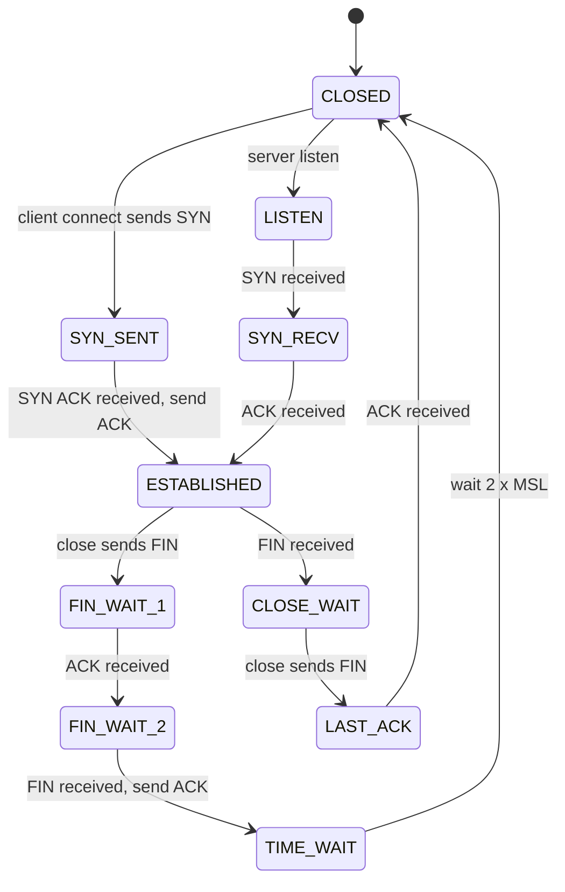
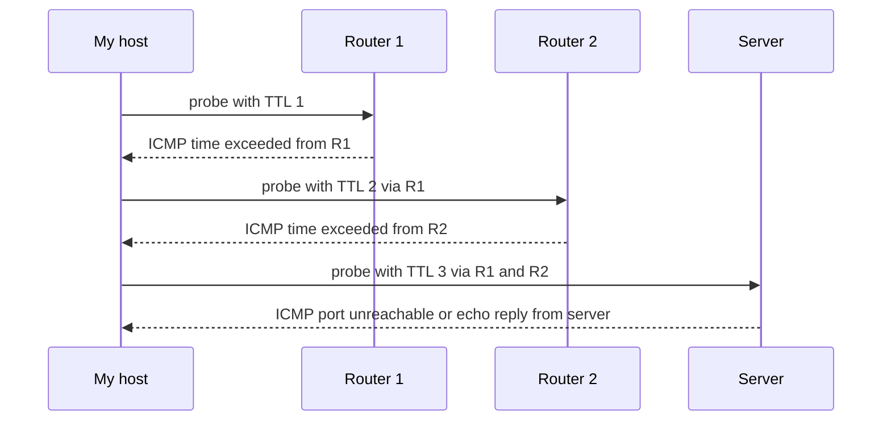

# L2.2 — TCP, UDP and ICMP

> **Level 2: Networking** · Topic 2 of 11 · ⏱ ~4 hours · Difficulty: Beginner

## 1. What it is

IP gets a packet from one host to another, but it makes **no promises**: packets can be lost, duplicated, reordered or delayed. The **transport layer** sits on top and decides what promises, if any, to add. It also adds **ports** so many programs on one host can share one IP address.

- **TCP** (Transmission Control Protocol) gives a **reliable, ordered byte stream** between two endpoints. It does this with a connection set-up (the 3-way handshake), sequence numbers, acknowledgements, retransmission, flow control and congestion control. Web servers, databases, SSH and most APIs use TCP.
- **UDP** (User Datagram Protocol) just sends individual **datagrams** with a source and destination port. No connection, no retransmission, no ordering. It is tiny and fast. DNS, DHCP, NTP, WireGuard, game and video traffic, and QUIC/HTTP-3 use UDP.
- **ICMP** (Internet Control Message Protocol) is not a transport for applications; it is IP's **diagnostic and error channel**: "destination unreachable", "time exceeded", "echo request/reply" (what `ping` uses). It has no ports.

## 2. Why it matters in DevOps

- Most "it hangs" vs "connection refused" vs "connection reset" bugs are only understood if you know what TCP is doing. These three symptoms point to three different root causes (firewall drop, closed port, process or proxy closing).
- **Timeouts, retries and connection pools** in every client library are TCP behaviour in disguise.
- Health checks, load balancers and security groups are defined per protocol and port: TCP vs UDP vs ICMP rules are different things.
- **Blocking all ICMP breaks things**: Path MTU Discovery relies on ICMP "fragmentation needed" messages. Black-holed large packets are one of the nastiest production bugs.
- Capacity: thousands of `TIME_WAIT` sockets or an exhausted ephemeral port range are classic outage causes.

## 3. Real-world system example

**DNS** is the textbook UDP+TCP system. Resolvers send queries as single UDP datagrams to port 53, which is cheaper than opening a TCP connection for a one-packet question. When a response is too large, or the server sets the truncated (`TC`) flag, the client retries over TCP; zone transfers (AXFR) and DNS over TLS use TCP. **HTTP/3** is the opposite choice: Google-originated QUIC (now standardised by the IETF) runs over UDP and re-implements reliability, ordering and encryption in user space, so it can avoid TCP's head-of-line blocking and ship new features without waiting for operating-system kernels; Cloudflare and Google publicly serve HTTP/3 to browsers. **WireGuard** VPNs are UDP-only for the same reason. **AWS** documents that ICMP "fragmentation needed" messages must be allowed for path MTU discovery to work, and its Security Groups let you open ICMP types separately from TCP/UDP ports (that is why `ping` to an instance works only when you add an ICMP rule).

## 4. Diagram

The TCP connection life cycle (the part that shows up in `ss` output):



How `ping` and `traceroute` use ICMP and the IP TTL field to find each hop:



## 5. How it works

**TCP vs UDP at a glance**

| | TCP | UDP |
|---|-----|-----|
| Connection | Yes: 3-way handshake before data | None |
| Delivery | Reliable, retransmits lost segments | Best effort |
| Ordering | In-order byte stream | None (datagram boundaries preserved) |
| Flow/congestion control | Yes | No (application must do it) |
| Header size | 20+ bytes | 8 bytes |
| Typical use | HTTP/1.1, HTTP/2, SSH, PostgreSQL, Redis | DNS, DHCP, NTP, QUIC, WireGuard, syslog |

**TCP reliability, in short.** Each byte has a sequence number. The receiver acknowledges the next byte it expects. If the sender hears no ACK before a timer expires (or sees duplicate ACKs), it retransmits. The receiver advertises a **window** (how much buffer it has) for **flow control**, and the sender maintains a **congestion window** that grows while things work and shrinks on loss, which is how TCP avoids collapsing shared links.

**The handshake.** `SYN` (client picks initial sequence number) -> `SYN,ACK` (server picks its own and acknowledges) -> `ACK`. One round trip (1 RTT) is spent before any data flows. [L2.6](06-tcp-and-tls-handshakes.md) goes deeper.

**Closing.** Each side sends `FIN`; the side that closes first sits in `TIME_WAIT` for about 60 seconds on Linux so late duplicate packets cannot corrupt a new connection that reuses the same 4-tuple. A `RST` (reset) tears a connection down immediately - sent when a packet arrives for a port nobody listens on, or when an application aborts.

**Three failure symptoms you must tell apart**

| Symptom | What happened on the wire | Usual cause |
|---------|---------------------------|-------------|
| `Connection refused` | Server host replied with `RST` quickly | Host reachable but nothing listening on that port |
| `Connection timed out` | SYNs sent, **no reply at all** | Firewall or security group silently dropping, wrong IP, routing problem |
| `Connection reset by peer` | Connection established, then `RST` arrived | Process crashed, proxy idle-timeout, app closed with unread data |

**ICMP types you should know**: type 8/0 echo request/reply (ping), type 3 destination unreachable (code 3 = port unreachable, code 4 = fragmentation needed and DF set), type 11 time exceeded (what traceroute uses). For IPv6 it is ICMPv6, and it is *mandatory* for NDP and path MTU discovery.

**Ephemeral ports.** A client's source port is chosen from a range (see `/proc/sys/net/ipv4/ip_local_port_range`, usually 32768-60999). Each outgoing connection consumes one 4-tuple (src IP, src port, dst IP, dst port).

**Commands**

| Command | Purpose |
|---------|---------|
| `ss -tan` / `ss -ltnp` | TCP sockets (all, numeric) / listening sockets with process |
| `ss -tan state time-wait \| wc -l` | Count sockets by state |
| `ss -s` | Summary of socket counts |
| `nc -zv host 443` | TCP connect test |
| `nc -u host 53` | UDP send (no confirmation) |
| `ping -c 4 host` | ICMP echo |
| `traceroute -n host` / `tracepath host` / `mtr -rwn host` | Per-hop path using TTL expiry |

## 6. Step-by-step guide

**Prerequisites:** a Linux shell with `ss` (iproute2), `nc` (netcat) and `python3`. `ping`, `traceroute` and `mtr` may need `sudo apt-get install -y iputils-ping traceroute mtr-tiny`. Everything below uses localhost, so it is safe.

1. **Start a TCP listener and inspect it.**
   ```bash
   python3 -m http.server 8080 --bind 127.0.0.1 &
   ss -ltn 'sport = :8080'
   ```
   Expect `LISTEN 0 5 127.0.0.1:8080 0.0.0.0:*` (queue size may differ). `LISTEN` is the server-side socket state from the diagram.

2. **Connect and observe `ESTABLISHED` and `TIME_WAIT`.**
   ```bash
   curl -s -o /dev/null http://127.0.0.1:8080/
   ss -tan 'sport = :8080 or dport = :8080'
   ```
   The finished request leaves a `TIME-WAIT` entry on one side. Run `ss -tan state time-wait | wc -l` to count them.

3. **Produce "connection refused".**
   ```bash
   nc -zv 127.0.0.1 9
   ```
   Expect `nc: connect to 127.0.0.1 port 9 (tcp) failed: Connection refused`. The kernel answered `RST` immediately.

4. **Produce "timed out" (a silent drop) with a local firewall rule** (needs root; on a VM or container with `NET_ADMIN`).
   ```bash
   sudo iptables -A INPUT -p tcp --dport 8080 -j DROP
   time nc -zv -w 3 127.0.0.1 8080 ; echo exit=$?
   sudo iptables -D INPUT -p tcp --dport 8080 -j DROP
   ```
   (On a shared machine, run this inside a throwaway container instead, so the rule cannot affect anyone else.) You should wait the full 3 seconds and get a timeout - not an instant refusal. Compare the two: refusal = something answered; timeout = silence. The final `-D` removes the rule.

5. **See UDP's lack of a connection.**
   ```bash
   nc -u -l 127.0.0.1 9999 &              # UDP listener (OpenBSD netcat)
   echo hello | nc -u -w1 127.0.0.1 9999   # prints "hello" on the listener side
   ss -lun 'sport = :9999'
   echo hello | nc -u -w1 127.0.0.1 9998 ; echo "exit=$?"   # no listener, no error shown
   ```
   The listener prints `hello`. Sending to a port with no listener usually shows nothing at all: UDP gives the sender no confirmation (the host may return an ICMP port-unreachable, which `nc` sometimes reports).

6. **Use ICMP.**
   ```bash
   ping -c 3 127.0.0.1
   traceroute -n 1.1.1.1        # or: tracepath 1.1.1.1  /  mtr -rwn -c 5 1.1.1.1
   ```
   `ping` prints `64 bytes from ...: icmp_seq=1 ttl=64 time=0.0xx ms`. `traceroute` prints one line per hop; `* * *` means that hop did not send back "time exceeded" (filtered, not necessarily broken). Output in your network will differ.

7. **Capture a handshake and an ICMP packet.**
   ```bash
   sudo tcpdump -n -i lo 'tcp port 8080 or icmp' -c 12 &
   curl -s -o /dev/null http://127.0.0.1:8080/ ; ping -c 1 127.0.0.1
   ```
   In the TCP lines look for flags `[S]`, `[S.]`, `[.]` (the handshake), then `[P.]` data and `[F.]` closing. ICMP lines show `echo request` / `echo reply`.

8. **Clean up.**
   ```bash
   kill %1 2>/dev/null; pkill -f "http.server 8080"; pkill -f "nc -u -l" ; true
   ```

## 7. Real-world scenario

*(Illustrative.)* **Symptom:** after a VPC change, `shop-api` can fetch small responses from a partner API but uploads and large responses hang forever; health checks (tiny packets) pass. **Investigation:** `curl -v` shows the TLS handshake completing, then stalling when the request body is sent. `ping -M do -s 1472 partner-host` fails while `-s 1200` works, so the effective path MTU is smaller than 1500 (a tunnel was added). Packet capture shows large segments leaving and no ACKs; no "fragmentation needed" ICMP ever arrives because a security group and the partner's firewall drop all ICMP. **Fix:** allow ICMP type 3 code 4 on both ends (and optionally clamp MSS on the tunnel with `iptables ... --clamp-mss-to-pmtu`). **Lesson:** "ICMP is optional" is a myth; TCP depends on it for path MTU discovery.

## 8. Common mistakes and best practices

**Don't**

- Block all ICMP "for security". Allow at least echo (if policy permits), destination unreachable and time exceeded.
- Treat `ping` as the definition of "up": servers can be up with ICMP filtered, and ping can succeed while the app port is closed.
- Open UDP services to the internet without rate limiting (DNS, NTP, memcached have been used for amplification DDoS).
- Use `kill -9` on busy servers and then wonder about `CLOSE_WAIT` leaks: `CLOSE_WAIT` piling up means the *application* is not closing sockets.

**Do**

- Match the test to the layer: `ping` (ICMP) -> `nc -zv` (TCP port open) -> `curl -v` (application).
- Set connect timeouts and read timeouts separately in every client; never use "infinite".
- Prefer TCP for anything needing delivery guarantees; choose UDP only when the app tolerates loss or builds its own reliability.
- Monitor socket states (`ss -s`, node_exporter's `node_netstat_*` and `node_sockstat_*` metrics) and ephemeral-port exhaustion.

## 9. Tasks

- [ ] **T1 — Read a socket table** *(≈20 min, beginner)*
  - **Goal:** map `ss` output to TCP states.
  - **Steps:**
    1. Start the listener from section 6 step 1.
    2. Run `ss -ltnp` and `ss -tan`.
    3. Identify one `LISTEN`, and (after a `curl`) one `TIME-WAIT` socket.
  - **Done when:** you can name each column (state, Recv-Q, Send-Q, local, peer) and point at the PID owning the listener.

- [ ] **T2 — Refused vs timed out** *(≈30 min, beginner)*
  - **Goal:** distinguish the two most common connection failures.
  - **Steps:**
    1. Run `nc -zv 127.0.0.1 9` (closed port) and time it.
    2. Add the `iptables` DROP rule from step 4 and time `nc -zv -w 3`.
    3. Remove the rule.
  - **Done when:** you have two timed results (instant refusal vs full timeout) and can say which packet the client did or did not receive.

- [ ] **T3 — Handshake in a capture** *(≈30 min, intermediate)*
  - **Goal:** find SYN, SYN-ACK, ACK and FIN in real packets.
  - **Steps:**
    1. Run `sudo tcpdump -n -i lo -S 'tcp port 8080'` (the `-S` shows absolute sequence numbers).
    2. Run `curl -s http://127.0.0.1:8080/ > /dev/null`.
    3. Annotate each packet: flags, seq, ack.
  - **Done when:** your annotation shows the server's ACK number equals the client's initial sequence number plus one.

- [ ] **T4 — UDP vs TCP behaviour** *(≈30 min, intermediate)*
  - **Goal:** demonstrate that UDP has no connection.
  - **Steps:**
    1. Send a UDP datagram to a port with no listener and capture with `tcpdump -n -i lo udp or icmp`.
    2. Start the listener, send again, and compare.
  - **Done when:** you can show whether an ICMP port-unreachable came back in the first case and what the listener printed in the second.

- [ ] **T5 — Trace a path and explain a `* * *`** *(≈30 min, intermediate)*
  - **Goal:** use ICMP-based tools correctly.
  - **Steps:**
    1. Run `traceroute -n` (or `mtr -rwn`) to a public IP such as `1.1.1.1`.
    2. Re-run with TCP probes: `sudo traceroute -T -p 443 -n 1.1.1.1`.
    3. Compare the hop lists.
  - **Done when:** you can explain why some hops show `* * *` in one run and answer in another.

- [ ] **T6 — Prove it: diagnose three symptoms** *(≈40 min, advanced)*
  - **Goal:** classify failures from symptoms alone.
  - **Steps:**
    1. Without the guide, reproduce "refused", "timed out" and "reset by peer" (hint: a server that accepts and immediately closes, or `curl` against a port where you `kill` the server mid-response).
    2. For each, capture the packets and write one sentence naming the packet that decided the outcome.
  - **Done when:** you have three captures and three correct one-line explanations.

## 10. Self-check questions

1. What exactly does TCP guarantee that UDP does not? What does it cost?
2. A client gets `Connection refused` in 1 ms, another gets `timed out` after 30 s. What is different on the wire?
3. Why is `TIME_WAIT` necessary, and when is a large number of them a problem?
4. How does `traceroute` discover each hop?
5. Why can blocking all ICMP cause large transfers to hang?

<details>
<summary>Answers</summary>

1. Reliable, in-order, de-duplicated byte-stream delivery with flow and congestion control. Cost: handshake latency (1 RTT), per-connection state, head-of-line blocking after loss, and header overhead.
2. Refused: the target host replied with RST (nothing listening). Timeout: no reply at all (drop by a firewall or security group, wrong route, host down).
3. It prevents delayed segments from a closed connection being accepted by a new one with the same 4-tuple. A large number is a problem if the ephemeral port range for a single destination is exhausted (many short connections from one client to one server); fix with keep-alive/connection pooling.
4. It sends probes with increasing IP TTL (1, 2, 3...). Each router that decrements TTL to zero returns ICMP time exceeded, revealing its address.
5. Path MTU Discovery needs ICMP "fragmentation needed" messages; if they are dropped, the sender keeps using too-large packets that never arrive while small packets work.
</details>

## 11. Further reading

- `man ss`, `man tcp` (7), `man udp` (7), `man ping`, `man traceroute`.
- RFC 9293 (TCP, the consolidated spec), RFC 768 (UDP), RFC 792 (ICMP), RFC 1191 (Path MTU Discovery).
- *High Performance Browser Networking* by Ilya Grigorik (free online) - the TCP, UDP and QUIC chapters.
- AWS VPC User Guide: security group rules for ICMP and "Path MTU Discovery".
- Next topic: [L2.3 — IPv4, IPv6, CIDR and Subnets](03-ipv4-ipv6-cidr-subnets.md). Deeper later: [L12.5 — HTTP/2, HTTP/3 and QUIC](../level-12-advanced-networking/05-http2-http3-quic.md).

<!-- nav -->
---
← Previous: [IP, MAC, ARP and DHCP](01-ip-mac-arp-dhcp.md) · [Level 2 index](README.md) · Next: [IPv4, IPv6, CIDR and Subnets](03-ipv4-ipv6-cidr-subnets.md) →
