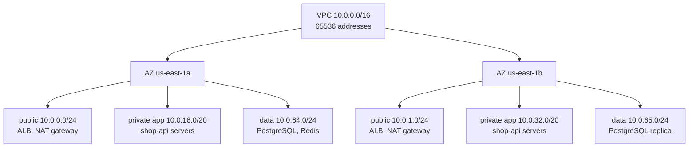
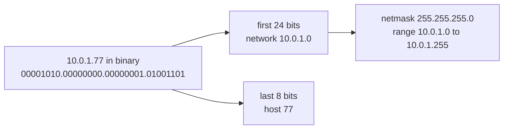

# L2.3 — IPv4, IPv6, CIDR and Subnets

> **Level 2: Networking** · Topic 3 of 11 · ⏱ ~5 hours · Difficulty: Intermediate

## 1. What it is

An **IPv4 address** is 32 bits, written as four decimal bytes (`10.0.1.15`). It has two parts: a **network prefix** (which network?) and a **host part** (which machine on it?). **CIDR** (Classless Inter-Domain Routing) notation says where the split is: `10.0.1.0/24` means "the first 24 bits are the network, the remaining 8 bits are hosts", giving 2^8 = 256 addresses. **Subnetting** is dividing a big block into smaller blocks (for example splitting a VPC into public, private and database subnets).

An **IPv6 address** is 128 bits, written as eight groups of hex (`2001:db8:1234:5600::1`). It exists because IPv4's roughly 4.3 billion addresses ran out. IPv6 uses the same prefix idea (`/64`), but with a vastly larger space and some differences: no ARP (NDP instead), no broadcast, and addresses are plentiful enough that NAT is unnecessary.

## 2. Why it matters in DevOps

- **You will design CIDR plans.** Every VPC, Kubernetes cluster (node, Pod and Service ranges) and VPN needs a range chosen up front. Wrong choices are painful to undo.
- **Overlapping ranges block connectivity.** VPC peering, Transit Gateway, VPNs and multi-cluster setups need non-overlapping CIDRs. Two teams who both picked `10.0.0.0/16` cannot be peered without painful renumbering.
- **Running out of IPs is a real outage.** Subnets sized too small stop autoscaling ("InsufficientFreeAddressesInSubnet"); Pod IP exhaustion stops deployments.
- **Security rules are CIDR rules.** Security groups, NACLs, `iptables` and Kubernetes NetworkPolicies all say things like `10.0.16.0/20`. A misread prefix opens (or closes) far more than intended.

## 3. Real-world system example

**Amazon VPC.** You give a VPC an IPv4 CIDR block between `/16` and `/28` and carve it into subnets, each living in exactly one Availability Zone. AWS documents that in every subnet it reserves five addresses (the network address, the VPC router, the DNS server, one for future use, and the broadcast address), so a `/24` has 251 usable addresses, not 254. You can add an IPv6 CIDR to a VPC (AWS allocates a `/56`) and give each subnet a `/64`. **Kubernetes** adds more ranges: for example kubeadm's documented default Service CIDR is `10.96.0.0/12`, and CNI plugins such as Flannel commonly default to a Pod network like `10.244.0.0/16`; Amazon EKS with the VPC CNI instead gives Pods real VPC addresses taken from your subnets, which is why large EKS clusters need generously sized subnets. **Docker** uses `172.17.0.0/16` for its default bridge network, which sometimes overlaps with corporate VPN ranges - a common "it works on Wi-Fi but not on VPN" bug.

## 4. Diagram

A typical three-tier VPC plan split across Availability Zones (all ranges are examples):



How the prefix length splits an address (here `10.0.1.77/24`):



## 5. How it works

**CIDR math in four rules**

1. Addresses in a block: `2^(32 - prefix)`. `/24` = 256, `/20` = 4096, `/16` = 65,536, `/28` = 16, `/32` = exactly one host.
2. Each step of `/n` -> `/n+1` **halves** the block; `/n-1` doubles it.
3. A block must start on a multiple of its size: `10.0.16.0/20` is valid (16 is a multiple of 16 in the third octet); `10.0.8.0/20` is not (it would be `10.0.0.0/20`).
4. Netmask: `/24` = `255.255.255.0`, `/20` = `255.255.240.0`, `/16` = `255.255.0.0`. The third-octet step for a `/20` is 16, for a `/22` it is 4, for a `/23` it is 2.

| Prefix | Netmask | Addresses | Usable on a classic LAN (-2) | Usable in AWS (-5) |
|--------|---------|-----------|------------------------------|--------------------|
| /16 | 255.255.0.0 | 65,536 | 65,534 | 65,531 |
| /20 | 255.255.240.0 | 4,096 | 4,094 | 4,091 |
| /24 | 255.255.255.0 | 256 | 254 | 251 |
| /26 | 255.255.255.192 | 64 | 62 | 59 |
| /28 | 255.255.255.240 | 16 | 14 | 11 |
| /30 | 255.255.255.252 | 4 | 2 | - |
| /32 | 255.255.255.255 | 1 | single host | - |

**Private ranges (RFC 1918)**: `10.0.0.0/8`, `172.16.0.0/12` (172.16.0.0-172.31.255.255) and `192.168.0.0/16`. Also useful: `127.0.0.0/8` (loopback), `169.254.0.0/16` (link-local, includes the cloud metadata address `169.254.169.254`), `100.64.0.0/10` (carrier-grade NAT space, sometimes used for EKS secondary ranges). Documentation-only ranges (RFC 5737): `192.0.2.0/24`, `198.51.100.0/24`, `203.0.113.0/24`; this repo uses them in examples.

**Subnet membership test.** Two hosts are on the same subnet when `(IP AND mask)` is identical. If yes, the host ARPs for the destination directly; if no, it sends to the default gateway ([L2.4](04-routing-nat-ports-firewalls.md)).

**Planning a VPC**

- Pick a block large enough for growth: `/16` for a VPC is the common default. Avoid ranges you might peer with (office, VPN, other accounts). Record them in a central IPAM sheet or AWS VPC IPAM.
- Give each tier its own subnets per AZ so security groups, route tables and NACLs can differ per tier.
- Size app subnets generously (Pods, ENIs, autoscaling), data subnets small.
- Leave unallocated space for new tiers or regions.

**IPv6 basics**

| Concept | IPv6 |
|---------|------|
| Length / notation | 128 bits, hex groups, leading zeros dropped, one `::` can replace a run of zero groups (`2001:db8::1`) |
| Standard subnet | `/64` (the lower 64 bits identify the interface) |
| Typical site allocation | `/48` for a site, `/56` for a VPC or home |
| Loopback | `::1` |
| Link-local | `fe80::/10`, auto-configured on every interface |
| Unique local (private-like) | `fc00::/7`, in practice `fd00::/8` |
| Global unicast | `2000::/3` |
| Documentation range | `2001:db8::/32` |
| Address assignment | SLAAC (router advertisements) and/or DHCPv6 |
| Neighbour discovery | NDP using ICMPv6 (replaces ARP), uses multicast not broadcast |
| NAT | Not normally needed; use firewalls to restrict access |

Dual stack means hosts run IPv4 and IPv6 simultaneously. Clients prefer IPv6 when available, falling back quickly ("Happy Eyeballs", RFC 8305). DNS publishes `A` records for IPv4 and `AAAA` records for IPv6 ([L2.5](05-dns-resolution.md)).

## 6. Step-by-step guide

**Prerequisites:** `python3` (standard library only, free, works anywhere). Optional: `ipcalc` or `sipcalc` (`sudo apt-get install -y ipcalc`).

1. **Inspect a CIDR block with Python's `ipaddress` module.**
   ```bash
   python3 - <<'EOF'
   import ipaddress as ip
   n = ip.ip_network("10.0.1.0/24")
   print(n.netmask, n.broadcast_address, n.num_addresses)
   print(ip.ip_address("10.0.1.77") in n, ip.ip_address("10.0.2.1") in n)
   EOF
   ```
   Expected output:
   ```text
   255.255.255.0 10.0.1.255 256
   True False
   ```

2. **Normalise a messy address.** A host address with a prefix is not a network; `strict=False` snaps it to the network.
   ```bash
   python3 -c "import ipaddress as i; n=i.ip_network('192.168.10.77/26', strict=False); print(n, n.broadcast_address)"
   ```
   Expect `192.168.10.64/26 192.168.10.127`. A `/26` has 64 addresses, in steps of 64 in the last octet (0, 64, 128, 192); 77 falls in the block starting at 64.

3. **Carve a VPC into subnets.**
   ```bash
   python3 - <<'EOF'
   import ipaddress as ip
   vpc = ip.ip_network("10.0.0.0/16")
   print("first four /20s:")
   for s in list(vpc.subnets(new_prefix=20))[:4]:
       print(" ", s, s[0], "-", s[-1], s.num_addresses)
   print("first three /24s (AWS usable = size - 5):")
   for s in list(vpc.subnets(new_prefix=24))[:3]:
       print(" ", s, s.num_addresses - 5)
   EOF
   ```
   Expect `10.0.0.0/20 ... 10.0.15.255 4096`, `10.0.16.0/20`, `10.0.32.0/20`, `10.0.48.0/20`, then three `/24`s each with 251 usable.

4. **Check two ranges for overlap before peering.**
   ```bash
   python3 -c "import ipaddress as i; a=i.ip_network('10.0.0.0/16'); b=i.ip_network('10.0.16.0/20'); c=i.ip_network('172.31.0.0/16'); print(a.overlaps(b), a.overlaps(c))"
   ```
   Expect `True False`.

5. **Do the same math by hand, then verify.** Question: what are the network, broadcast and usable range of `172.16.37.200/21`? A `/21` has 2048 addresses (steps of 8 in the third octet): 37 falls in the block starting at 32. So network `172.16.32.0`, broadcast `172.16.39.255`.
   ```bash
   python3 -c "import ipaddress as i; n=i.ip_network('172.16.37.200/21', strict=False); print(n, n[0], n[-1])"
   ```
   Expect `172.16.32.0/21 172.16.32.0 172.16.39.255`.

6. **IPv6 notation and subnetting.**
   ```bash
   python3 - <<'EOF'
   import ipaddress as ip
   a = ip.ip_address("2001:db8::1")
   print(a.exploded)          # 2001:0db8:0000:0000:0000:0000:0000:0001
   print(a.compressed)        # 2001:db8::1
   vpc6 = ip.ip_network("2001:db8:1234:5600::/56")
   print(list(vpc6.subnets(new_prefix=64))[:3])
   print(ip.ip_network("2001:db8:abcd:12::/64").num_addresses)   # 18446744073709551616
   EOF
   ```
   A `/56` contains 256 `/64` subnets; each `/64` has 2^64 addresses.

7. **Look at your own machine.**
   ```bash
   ip -br addr
   ip -6 addr show scope link      # your fe80:: link-local addresses
   ip route
   ```
   Identify the prefix length on your main interface and confirm the block size from the table above. Check for Docker overlap: `docker network inspect bridge --format '{{(index .IPAM.Config 0).Subnet}}'` (usually `172.17.0.0/16`).

8. **(Optional) Run the same plan through Terraform later.** In [Level 7](../level-07-terraform-iac/01-providers-and-resources.md) you can feed these CIDRs to `cidrsubnet()`; the function is the same math as step 3.

## 7. Real-world scenario

*(Illustrative.)* **Symptom:** the `shop-api` auto scaling group fails to scale out during a flash sale: new instances never launch and the activity history shows insufficient free IP addresses in the subnet. **Investigation:** the app subnets were created as `/26` (59 usable addresses in AWS) because "the app only has six servers". During the sale the group wanted 40 instances plus ENIs for the load balancer and Lambda functions in the same subnet. **Fix (short term):** add new `/24` subnets in each AZ, attach them to the group, and adjust route tables and the ALB subnets. **Fix (long term):** move to `/20` app subnets from a documented IPAM plan, and add a CloudWatch alarm on available IPs per subnet. **Lesson:** CIDR sizing is a capacity decision, and shrinking or renumbering later is far costlier than choosing generously.

## 8. Common mistakes and best practices

**Don't**

- Use the default `172.17.0.0/16`, `192.168.0.0/24` or `10.0.0.0/16` everywhere "because it is the default" - you will collide on VPN or peering.
- Forget the cloud's reserved addresses when sizing tiny subnets.
- Write `/32` where you meant `/24` in firewall rules (or the reverse, opening a whole block).
- Disable IPv6 blindly on hosts; some clients and tools expect `::1`, and half of the internet is reachable over it.

**Do**

- Keep a central, version-controlled CIDR plan (a table in the repo, or AWS VPC IPAM) with owners and environments.
- Allocate big, aligned blocks per environment (for example prod `10.0.0.0/16`, staging `10.1.0.0/16`, dev `10.2.0.0/16`) and leave gaps.
- Test overlaps programmatically (`ipaddress.overlaps`) in CI before applying network changes.
- Use `/64` for IPv6 subnets, and secure IPv6 with firewall rules exactly like IPv4 (no NAT does not mean no firewall).

## 9. Tasks

- [ ] **T1 — CIDR by hand** *(≈30 min, beginner)*
  - **Goal:** compute network, broadcast and size without tools.
  - **Steps:**
    1. For each of `192.168.5.130/25`, `10.20.30.40/20`, `172.20.200.9/22`, write the network, broadcast and number of addresses.
    2. Verify with the Python snippet in step 2.
  - **Done when:** all three hand answers match the tool.

- [ ] **T2 — Design a VPC plan** *(≈40 min, intermediate)*
  - **Goal:** produce an allocation table for `shop-api` across 3 AZs.
  - **Steps:**
    1. Start with `10.0.0.0/16`. Allocate public `/24`s, private app `/20`s and data `/24`s per AZ, as in section 4 but for three AZs.
    2. Generate the table with Python's `subnets()` and print network, first/last address and AWS-usable count.
    3. Leave at least half of the VPC unallocated.
  - **Done when:** the generated table has no overlaps (check with `overlaps`) and you can state the unallocated remainder.

- [ ] **T3 — Overlap detector** *(≈40 min, intermediate)*
  - **Goal:** automate peering safety checks.
  - **Steps:**
    1. Write `cidr_check.py` that reads a list of CIDRs (one per line, with a name) and prints every overlapping pair.
    2. Run it on `10.0.0.0/16`, `10.0.16.0/20`, `10.1.0.0/16`, `172.17.0.0/16`, `172.17.5.0/24`.
    3. Make it exit with status 1 if any overlap exists, so it can run in CI.
  - **Done when:** it prints exactly the two overlapping pairs and `echo $?` shows `1`.

- [ ] **T4 — Break it: the Docker/VPN collision** *(≈30 min, intermediate)*
  - **Goal:** see an address-space collision and fix it.
  - **Steps:**
    1. Create a Docker network that overlaps a route you already have: `docker network create --subnet 192.168.0.0/16 clash` (pick a range that overlaps your LAN, or the container route will shadow it).
    2. Compare `ip route` before and after, and test reaching a LAN host.
    3. Remove the network and recreate it with a non-overlapping range such as `10.200.0.0/24`.
  - **Done when:** you can show `ip route` entries for both cases and explain which route wins (longest prefix match; see [L2.4](04-routing-nat-ports-firewalls.md)).

- [ ] **T5 — IPv6 tour** *(≈30 min, intermediate)*
  - **Goal:** recognise IPv6 address types.
  - **Steps:**
    1. List your IPv6 addresses with `ip -6 addr`. Classify each: link-local, unique-local, or global.
    2. Compress `2001:0db8:0000:0000:0000:ff00:0042:8329` by hand, then confirm with Python.
    3. Run `curl -6 -s https://ifconfig.co` (or `ping -6 ::1`) to see whether you have IPv6 connectivity.
  - **Done when:** each address is classified correctly and the compressed form is `2001:db8::ff00:42:8329`.

- [ ] **T6 — Prove it: size a Kubernetes cluster's ranges** *(≈45 min, advanced)*
  - **Goal:** explain CIDR trade-offs to a teammate.
  - **Steps:**
    1. Without the guide, choose a node subnet, Pod CIDR and Service CIDR for a 100-node cluster running up to 30 Pods per node, ensuring no overlap with `10.0.0.0/16` (the VPC) or `172.17.0.0/16` (Docker).
    2. Justify each size in two sentences, and verify the non-overlap with Python.
  - **Done when:** your plan has three non-overlapping blocks, the Pod block has at least 100 x 30 addresses, and the justification mentions headroom.

## 10. Self-check questions

1. How many usable addresses does a `/24` give in AWS, and why not 254?
2. What is the network address of `10.0.77.5/20`?
3. Are `10.0.0.0/16` and `10.0.128.0/17` overlapping?
4. Why must peered VPCs have non-overlapping CIDRs?
5. Why is `/64` the standard IPv6 subnet size and why does IPv6 not need NAT?

<details>
<summary>Answers</summary>

1. 251: AWS reserves the first four addresses (network, VPC router, DNS, future use) and the last (broadcast) in every subnet.
2. `/20` has steps of 16 in the third octet; 77 falls in 64-79, so the network is `10.0.64.0/20`.
3. Yes: `10.0.128.0/17` is the upper half of `10.0.0.0/16`.
4. Routes are chosen by destination prefix; if both sides contain the same addresses the router cannot tell which network a destination belongs to, so AWS rejects peering with overlapping ranges.
5. SLAAC and NDP assume 64 bits for the interface identifier. The address space is so large that every host can have a globally unique address, so address-sharing NAT is not needed (firewalls still are).
</details>

## 11. Further reading

- AWS documentation: *Amazon VPC User Guide* - "VPC CIDR blocks" and "Subnet CIDR blocks".
- RFC 4632 (CIDR), RFC 1918 (private addresses), RFC 4291 (IPv6 addressing architecture), RFC 5737 (documentation addresses).
- Python docs: the `ipaddress` module.
- Kubernetes documentation: "Cluster Networking" and the kubeadm configuration reference for `podSubnet` and `serviceSubnet`.
- Next topic: [L2.4 — Routing, NAT, Ports and Firewalls](04-routing-nat-ports-firewalls.md). Cloud follow-up: [L6.4 — VPC and Subnets](../level-06-cloud-aws/04-vpc-and-subnets.md).

<!-- nav -->
---
← Previous: [TCP, UDP and ICMP](02-tcp-udp-icmp.md) · [Level 2 index](README.md) · Next: [Routing, NAT, Ports and Firewalls](04-routing-nat-ports-firewalls.md) →
