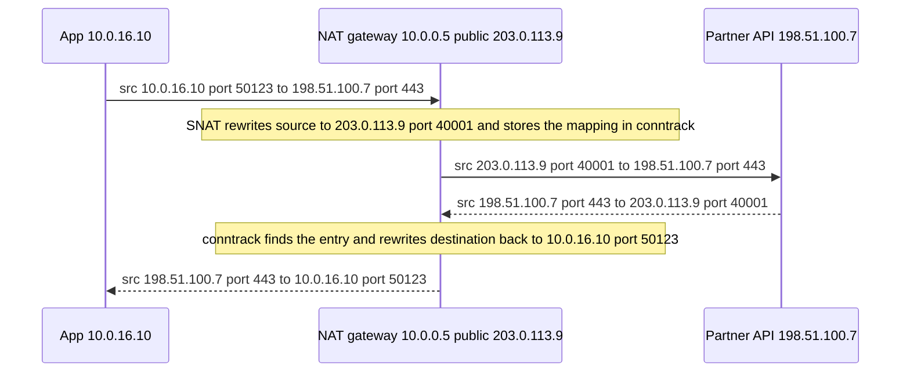
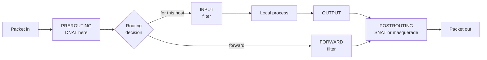

# L2.4 — Routing, NAT, Ports and Firewalls

> **Level 2: Networking** · Topic 4 of 11 · ⏱ ~6 hours · Difficulty: Intermediate

## 1. What it is

Four ideas decide whether a packet gets where it is going:

- **Routing** - every host and router has a **routing table**: a list of "to reach network X, send to next hop Y out of interface Z". The **default gateway** is the catch-all route (`0.0.0.0/0`) that says "anything I don't know about, hand to this router".
- **NAT** (Network Address Translation) - a router rewrites addresses (and often ports) in packets as they pass. **SNAT** (source NAT, also called masquerade) rewrites the *source*, so many private hosts share one public IP. **DNAT** (destination NAT, "port forwarding") rewrites the *destination*, so traffic aimed at a public IP and port lands on a private server.
- **Ports** - 16-bit numbers (0-65535) that identify a service or a connection endpoint on a host.
- **Firewalls** - rules that allow or drop packets. A **stateful** firewall tracks connections (via **conntrack**), so you only write rules for the *initiating* direction and replies are allowed automatically. On Linux, the kernel's **netfilter** framework does this, driven by **iptables** (classic) or **nftables** (modern replacement).

## 2. Why it matters in DevOps

- **VPC routing is routing tables.** A subnet is "public" because its route table sends `0.0.0.0/0` to an Internet Gateway, and "private" because it sends it to a NAT gateway or nowhere. Misrouted traffic is a daily cloud problem.
- **NAT hides your servers' real source IP.** Private instances reach the internet through a NAT gateway, so partners see one fixed IP (useful for allowlists) and you pay per-GB for it ([L20.7](../level-20-cost-optimization/07-network-egress-costs.md)).
- **Docker and Kubernetes are NAT machines.** `docker run -p 8080:80` creates a DNAT rule; kube-proxy turns Service IPs into Pod IPs with DNAT. If you cannot read NAT rules you cannot debug either.
- **Firewall mistakes are both security holes and outages.** An open database port is a breach; a dropped health-check port is a 3 a.m. page.

## 3. Real-world system example

**AWS VPC.** A route table entry `0.0.0.0/0 -> igw-...` makes a subnet public; `0.0.0.0/0 -> nat-...` lets private instances initiate outbound connections while remaining unreachable from the internet. The NAT gateway performs source NAT, replacing private source IPs with its Elastic IP, and conntrack-style state sends replies back. **Security Groups are stateful** (return traffic is automatically allowed) while **Network ACLs are stateless** (you must allow both directions, including ephemeral ports); this is AWS's own documented distinction ([L6.6](../level-06-cloud-aws/06-security-groups-and-nacls.md)). **Docker** uses iptables (or nftables) NAT: published ports become DNAT rules in the `DOCKER` chain and outbound container traffic is masqueraded. **Kubernetes** `kube-proxy` implements Services with iptables or IPVS rules that DNAT a Service's virtual IP to one of the Pod IPs, which is why a Service IP never answers `ping` on most clusters: it exists only in rules, not on any interface.

## 4. Diagram

A packet from a private server to the internet, and the reply, with SNAT on the NAT gateway:



Where the Linux kernel applies routing, NAT and filtering (netfilter hooks):



## 5. How it works

**Routing table and longest-prefix match.** For each packet the kernel picks the matching route with the **longest prefix** (most specific), then the lowest metric.

```text
default via 10.0.1.1 dev eth0 proto dhcp metric 100
10.0.1.0/24 dev eth0 proto kernel scope link src 10.0.1.15
172.17.0.0/16 dev docker0 proto kernel scope link src 172.17.0.1
```

A packet to `10.0.1.20` matches the `/24` (directly connected: ARP for it). A packet to `8.8.8.8` matches only `default`, so the host ARPs for `10.0.1.1` and sends the frame there. A packet to `172.17.0.5` matches the `/16` and goes out `docker0`. Routers do the same, one hop at a time; each decrements the TTL.

**Port ranges.** IANA: **well-known** 0-1023 (need root to bind on Linux by default; 22 SSH, 53 DNS, 80 HTTP, 443 HTTPS), **registered** 1024-49151 (5432 PostgreSQL, 6379 Redis, 8080, 9090 Prometheus), **dynamic/ephemeral** 49152-65535. Linux's own ephemeral range is `32768-60999` (`/proc/sys/net/ipv4/ip_local_port_range`). A connection is identified by the **4-tuple** (src IP, src port, dst IP, dst port), so thousands of clients can use port 443 on the server at once.

**NAT types**

| Type | Rewrites | Used for | Linux rule |
|------|----------|----------|-----------|
| SNAT / masquerade | source address (and port) on the way out | Private hosts to the internet; Docker outbound | `-t nat -A POSTROUTING ... -j MASQUERADE` |
| DNAT | destination address (and port) on the way in | Port forwarding, Docker `-p`, kube-proxy, load balancing | `-t nat -A PREROUTING ... -j DNAT --to-destination` |
| 1:1 NAT | both addresses, static | EC2 public/Elastic IP to private IP at the Internet Gateway | managed by the provider |

NAT is stateful: the first packet creates a conntrack entry (`conntrack -L` or `/proc/net/nf_conntrack`) and later packets and replies are translated automatically. NAT breaks protocols that embed addresses in payloads and means inbound connections to private hosts are impossible unless DNAT or a tunnel exists.

**Stateful vs stateless filtering**

| | Stateful (conntrack) | Stateless |
|---|----------------------|-----------|
| Replies | Automatically allowed if they belong to an allowed connection | Must be allowed by an explicit rule |
| Examples | iptables/nftables with `ct state`, AWS Security Groups, cloud firewalls | AWS NACLs, simple router ACLs |
| Rule effort | Write rules for inbound service ports only | Write both directions incl. ephemeral ports |

**iptables vs nftables.** iptables is the long-standing CLI with tables (`filter`, `nat`, `mangle`) and chains (`INPUT`, `FORWARD`, `OUTPUT`, `PREROUTING`, `POSTROUTING`). nftables is its successor, with one syntax for IPv4/IPv6 (`inet` family), sets (`{ 22, 80, 443 }`) and atomic ruleset loading. On modern distributions the `iptables` command is often `iptables-nft`, a compatibility front-end onto nftables (check `iptables --version`; it prints `(nf_tables)`).

**Rule of thumb for a host firewall**: default **drop** inbound, allow `established,related`, allow loopback, allow only the service ports you run, allow needed ICMP, log the rest.

## 6. Step-by-step guide

**Prerequisites:** Docker (free). Everything runs in throwaway containers with `NET_ADMIN`, so your host's rules are untouched. Output is "similar to" what you will see; addresses will differ.

1. **Read a routing table and ask the kernel which route it would use.**
   ```bash
   docker run --rm -it --cap-add NET_ADMIN ubuntu:24.04 bash -c \
     'apt-get update -qq && apt-get install -y -qq iproute2 >/dev/null && ip route && ip route get 8.8.8.8 && ip route get 127.0.0.1'
   ```
   Expect a `default via 172.17.0.1 dev eth0` line, a connected `172.17.0.0/16` line, and `ip route get` lines such as `8.8.8.8 via 172.17.0.1 dev eth0 src 172.17.0.2`.

2. **Build a mini-network: client -> router -> server.** The "inside" network is `--internal` (no way out on its own); the router bridges inside and outside.
   ```bash
   docker network create --internal --subnet 10.50.1.0/24 inside
   docker network create --subnet 10.50.2.0/24 outside

   # server on the outside network, logs the source IP of every request
   docker run -d --name server --network outside --ip 10.50.2.20 python:3.12-slim \
     python -m http.server 8080

   # router: forwards packets between both networks
   docker run -d --name router --network inside --ip 10.50.1.10 --cap-add NET_ADMIN \
     --sysctl net.ipv4.ip_forward=1 ubuntu:24.04 sleep infinity
   docker network connect --ip 10.50.2.10 outside router
   docker exec router bash -c "apt-get update -qq && apt-get install -y -qq iproute2 iptables nftables conntrack >/dev/null"

   # client on the inside network with a default route via the router
   docker run -d --name client --network inside --ip 10.50.1.20 --cap-add NET_ADMIN ubuntu:24.04 sleep infinity
   docker exec client bash -c "apt-get update -qq && apt-get install -y -qq iproute2 curl >/dev/null && ip route replace default via 10.50.1.10"
   docker exec client ip route
   ```
   Expect `default via 10.50.1.10 dev eth0` and `10.50.1.0/24 dev eth0`.

3. **Test without NAT - the reply cannot find its way back.**
   ```bash
   docker exec client curl -sS -m 3 http://10.50.2.20:8080/ | head -3
   ```
   Expect a timeout (`Connection timed out after 3000 milliseconds`). The request is forwarded, but the server only knows the `10.50.1.0/24` network via its default route to Docker's bridge, so the reply never returns. This is a real "missing return route" failure pattern.

4. **Add SNAT (masquerade) on the router, retry, and read the server's log.**
   ```bash
   docker exec router iptables -t nat -A POSTROUTING -s 10.50.1.0/24 -o eth1 -j MASQUERADE
   docker exec client curl -sS -m 3 http://10.50.2.20:8080/ | head -3
   docker logs server 2>&1 | tail -2
   ```
   The request now succeeds, and the server log shows the client as `10.50.2.10` (the router's outside address), not `10.50.1.20`. (The router's outside interface is normally `eth1`; confirm with `docker exec router ip -br addr`.)

5. **Look at the NAT translation table.**
   ```bash
   docker exec router conntrack -L 2>/dev/null | head
   docker exec router iptables -t nat -L POSTROUTING -n -v
   ```
   Similar to `tcp 6 ... src=10.50.1.20 dst=10.50.2.20 sport=40100 dport=8080 ... src=10.50.2.20 dst=10.50.2.10 sport=8080 dport=40100`: the two halves show the original and the translated tuple. The `-v` counters on the rule have increased. If `conntrack` shows nothing, the container may lack the kernel module permission; the iptables counters are enough.

6. **Add DNAT: publish a service on the router.**
   ```bash
   docker exec router iptables -t nat -A PREROUTING -p tcp --dport 9000 -j DNAT --to-destination 10.50.2.20:8080
   docker exec client curl -sS -m 3 http://10.50.1.10:9000/ | head -3
   ```
   The client talks to the router's port 9000 and is transparently handed the server's port 8080 - this is what `docker run -p` and a Kubernetes Service do.

7. **Write a stateful firewall with nftables and test it.** Load the ruleset in the router (it validates syntax first), then probe it.
   ```bash
   docker exec -i router bash -c 'cat > /tmp/fw.nft' <<'EOF'
   table inet filter {
     chain input {
       type filter hook input priority filter; policy drop;
       ct state established,related accept
       ct state invalid drop
       iifname "lo" accept
       tcp dport { 22, 80, 443 } accept
       icmp type echo-request limit rate 5/second accept
       ip6 nexthdr icmpv6 accept
       counter log prefix "nft-drop " drop
     }
   }
   EOF
   docker exec router nft -c -f /tmp/fw.nft && echo "syntax ok"
   docker exec router nft -f /tmp/fw.nft
   docker exec router nft list ruleset
   docker exec client bash -c 'timeout 3 bash -c "echo > /dev/tcp/10.50.1.10/9000" && echo open || echo blocked-or-closed'
   ```
   The `-c` flag only checks syntax (safe). After loading, connections to the router's own ports other than 22/80/443 hit the final `counter ... drop` rule; `nft list ruleset` shows its packet counter increasing. Forwarded traffic is unaffected because this chain hooks `input`, not `forward`.

8. **The same SNAT and filter rules in classic iptables form** (for reading older systems; validate without applying):
   ```bash
   cat > /tmp/rules.v4 <<'EOF'
   *filter
   :INPUT DROP [0:0]
   :FORWARD DROP [0:0]
   :OUTPUT ACCEPT [0:0]
   -A INPUT -i lo -j ACCEPT
   -A INPUT -m conntrack --ctstate ESTABLISHED,RELATED -j ACCEPT
   -A INPUT -p tcp -m multiport --dports 22,80,443 -j ACCEPT
   -A INPUT -p icmp --icmp-type echo-request -m limit --limit 5/second -j ACCEPT
   COMMIT
   *nat
   :PREROUTING ACCEPT [0:0]
   :POSTROUTING ACCEPT [0:0]
   -A PREROUTING -p tcp --dport 80 -j DNAT --to-destination 10.0.16.10:8080
   -A POSTROUTING -s 10.0.16.0/20 -o eth0 -j MASQUERADE
   COMMIT
   EOF
   sudo iptables-restore --test < /tmp/rules.v4 && echo "rules parse ok"
   ```

9. **Clean up.**
   ```bash
   docker rm -f client router server && docker network rm inside outside
   ```

## 7. Real-world scenario

*(Illustrative.)* **Symptom:** a new `shop-api` batch worker in a private subnet can reach PostgreSQL but every call to the payment provider's API times out. Other workers in a different subnet work fine. **Investigation:** `curl -v` hangs at `Trying 198.51.100.7:443`, so the SYN gets no answer (timeout rather than refusal). `ip route get 198.51.100.7` on the instance shows the default route via the subnet's router; in the AWS console the subnet's route table lacks `0.0.0.0/0 -> nat-...` because it was created with the default (local-only) table. **Fix:** associate the correct private route table that points to the NAT gateway; the call works immediately and the payment provider sees the NAT's Elastic IP, already on their allowlist. **Lesson:** "timeout to the internet from a private subnet" is a routing/NAT question before it is an application one; read the route table first.

## 8. Common mistakes and best practices

**Don't**

- Apply a default-drop firewall remotely without first allowing SSH and established connections - you lock yourself out. Use a timed rollback (`at`/`sleep && flush`) or the provider console.
- Mix iptables rules and a separate nftables ruleset without knowing which one is active; or copy rules from a blog without checking the chain, table and order (rules are evaluated top-down, first match wins).
- Forget `net.ipv4.ip_forward=1` when building a Linux router/NAT box, or forget to persist rules across reboots.
- Treat NAT as a security boundary. It is address translation; the stateful filter is what blocks traffic.

**Do**

- Learn with `ip route get <dst>` - it tells you exactly which route, interface and source IP will be used.
- Default-deny inbound, allow `ct state established,related`, and open only the ports you run.
- Use `nft -c -f` or `iptables-restore --test` to validate before applying; keep rulesets in version control and apply them with config management ([L0.4](../level-00-what-devops-is/04-configuration-management.md)).
- Expect asymmetric-routing and return-path problems whenever you add a second NIC, VPN or NAT.

## 9. Tasks

- [ ] **T1 — Predict the route** *(≈20 min, beginner)*
  - **Goal:** apply longest-prefix match.
  - **Steps:**
    1. Run `ip route` on a Linux box or container.
    2. For `127.0.0.1`, an address in your subnet, `8.8.8.8` and an address in `172.17.0.0/16`, write down which route you expect.
    3. Verify each with `ip route get`.
  - **Done when:** every prediction matches the kernel's `via`/`dev` answer.

- [ ] **T2 — Build the client-router-server lab** *(≈45 min, intermediate)*
  - **Goal:** make the lab from section 6 work end to end.
  - **Steps:**
    1. Follow steps 2-4.
    2. Capture on the server side with `tcpdump -n -i eth0 port 8080` inside the server container (install `tcpdump`), before and after adding MASQUERADE.
  - **Done when:** you can show the source IP seen by the server before (client's private IP, no reply) and after (router's IP, reply works).

- [ ] **T3 — DNAT a port** *(≈30 min, intermediate)*
  - **Goal:** implement port forwarding by hand.
  - **Steps:**
    1. Add a second server on `10.50.2.21` serving different content.
    2. Create DNAT so router port `9001` maps to it while `9000` maps to the first.
    3. Read the counters with `iptables -t nat -L PREROUTING -n -v`.
  - **Done when:** `curl` to `:9000` and `:9001` return different content and each rule's counter incremented.

- [ ] **T4 — Break it: forget the return path** *(≈30 min, intermediate)*
  - **Goal:** recognise missing NAT or routes from symptoms.
  - **Steps:**
    1. With the lab running, delete the MASQUERADE rule (`iptables -t nat -D POSTROUTING ...`).
    2. Run `curl -m 3` from the client and `tcpdump` on both router interfaces.
    3. Restore the rule.
  - **Done when:** you can state in one sentence where packets stop (reply is lost because the server has no route back to `10.50.1.0/24`) and prove it with captures.

- [ ] **T5 — Write and test a host firewall** *(≈45 min, advanced)*
  - **Goal:** produce a safe, stateful default-deny policy.
  - **Steps:**
    1. Start an Ubuntu container with `--cap-add NET_ADMIN`, running a listener on 80 and another on 8081.
    2. Write an nftables ruleset that allows only 80 plus established traffic and ICMP echo with a rate limit; validate with `nft -c`, then apply.
    3. Test from a second container: 80 works, 8081 does not (timeout, not refusal), and `nft list ruleset` shows counters.
  - **Done when:** port 80 answers, 8081 times out, and you can explain why a `reject` rule would have produced "refused" instead.

- [ ] **T6 — Prove it: explain a private subnet's trip to the internet** *(≈45 min, advanced)*
  - **Goal:** explain routing and NAT end to end.
  - **Steps:**
    1. Without the guide, draw the path of an HTTPS request from a private EC2 instance to a public API: route table lookups at each hop, ARP for the next hop, SNAT at the NAT gateway, the conntrack entry, and the return path.
    2. Mark the source and destination IP and port on every arrow.
  - **Done when:** your diagram has the private IP at the instance, the NAT's public IP on the internet side, and the return translation, and a teammate agrees it is correct.

## 10. Self-check questions

1. A host has routes for `10.0.0.0/8` and `10.0.5.0/24`. Which one does a packet for `10.0.5.9` use, and why?
2. What is the difference between SNAT and DNAT, and where in netfilter does each happen?
3. Why do Security Groups need no "outbound reply" rule but NACLs do?
4. What does `ct state established,related accept` do and why is it usually the first rule?
5. Why can't a server in a private subnet be reached from the internet even if its security group is open to `0.0.0.0/0`?

<details>
<summary>Answers</summary>

1. The `/24`: longest prefix wins (most specific route).
2. SNAT rewrites the source and happens in POSTROUTING (after routing); DNAT rewrites the destination and happens in PREROUTING (before the routing decision, so routing sees the new destination).
3. Security Groups are stateful and track connections so replies are automatically allowed; NACLs are stateless, so return traffic (including ephemeral ports) needs explicit rules.
4. It accepts packets belonging to connections already allowed (and related ones like ICMP errors), so you only need to write rules for new inbound connections. Putting it first is also faster.
5. It has no route to the internet gateway and no public IP mapped (no 1:1 NAT); the internet has no route to its private address. An open security group only matters once traffic can reach it.
</details>

## 11. Further reading

- `man ip-route`, `man iptables`, `man nft`, `man conntrack`.
- nftables wiki (wiki.nftables.org) - "Quick reference" and "Moving from iptables to nftables".
- Netfilter project documentation: packet flow diagram.
- AWS VPC User Guide: "Route tables", "NAT gateways", "Security groups" and "Network ACLs".
- Kubernetes documentation: "Virtual IPs and Service Proxies".
- Next topic: [L2.5 — DNS Resolution and Domain Architecture](05-dns-resolution.md). Later: [L6.5 — Route Tables, IGW and NAT Gateway](../level-06-cloud-aws/05-route-tables-igw-nat.md).

<!-- nav -->
---
← Previous: [IPv4, IPv6, CIDR and Subnets](03-ipv4-ipv6-cidr-subnets.md) · [Level 2 index](README.md) · Next: [DNS Resolution and Domain Architecture](05-dns-resolution.md) →
