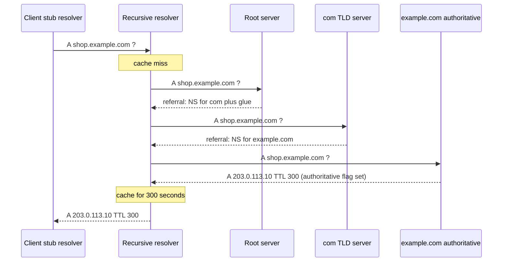
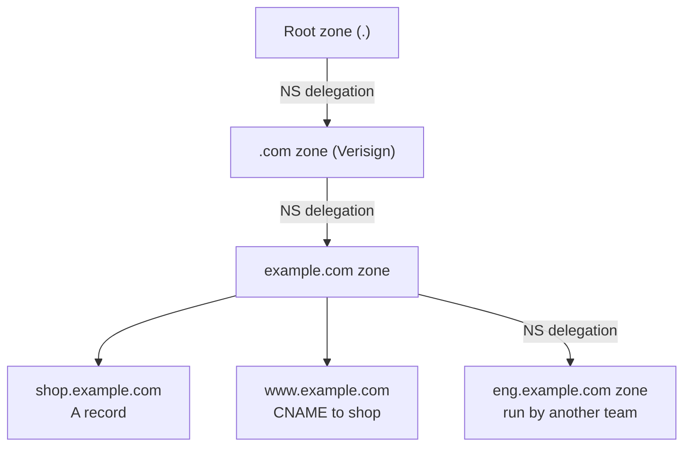

# L2.5 — DNS Resolution and Domain Architecture

> **Level 2: Networking** · Topic 5 of 11 · ⏱ ~5 hours · Difficulty: Intermediate

## 1. What it is

The **Domain Name System (DNS)** is the internet's distributed phone book. Humans and configuration files use names such as `shop.example.com`; IP packets need numbers such as `203.0.113.10`. DNS is the globally shared, hierarchical database that turns the first into the second (and many other kinds of answer: mail servers, text verification tokens, aliases, certificate-issuance rules).

Two very different kinds of server cooperate, and confusing them is the root of most DNS misunderstandings:

- An **authoritative server** holds the *real* records for a **zone** (a slice of the namespace, e.g. `example.com`) and answers only for that zone. It is the source of truth. Route 53, Cloudflare DNS, Google Cloud DNS and BIND serving your own zone are authoritative servers.
- A **recursive resolver** (also called a recursor or caching resolver) does the legwork *on behalf of clients*. It starts at the top of the hierarchy, follows referrals down to the authoritative server, and **caches** the answer for the record's **Time To Live (TTL)**. Your ISP, `1.1.1.1`, `8.8.8.8`, and the VPC resolver at `169.254.169.253` / `.2` in AWS are recursive resolvers.

Your laptop or application runs only a tiny **stub resolver** (glibc, `systemd-resolved`, a browser) that sends one question to a recursive resolver and waits.

## 2. Why it matters in DevOps

- **"It's always DNS."** A huge share of outages are DNS: an expired domain, a wrong record, a deleted delegation, a TTL that was too long to roll back a bad change.
- **Migrations and failover** (blue/green, region failover, moving to a new load balancer) are DNS changes, and their speed is governed by TTL and by caches you do not control.
- **Service discovery** inside Kubernetes and Docker is DNS (`shop-api.default.svc.cluster.local`). Misconfigured `ndots`, search domains or CoreDNS overload cause slow or failing calls that look like application bugs.
- **Security:** dangling CNAMEs enable subdomain takeover; DNS records prove domain ownership for TLS certificates (ACME DNS-01); SPF/DKIM/DMARC records are DNS.
- **Cost and latency:** every new hostname costs a lookup; uncached lookups add tens of milliseconds to the first request of every user.

## 3. Real-world system example

**Amazon Route 53** is the managed authoritative DNS service of AWS, and it shows the architecture in practice. When you create a hosted zone for `example.com`, Route 53 gives you four **name servers** (`NS` records) from different top-level domains; you must copy those into your **registrar** so the parent zone (`.com`) *delegates* to them. Route 53 also supports **alias records**, a Route 53 extension that behaves like a `CNAME` but can sit at the zone apex and always resolves to the current IPs of an ALB, CloudFront distribution or S3 website endpoint. Weighted, latency-based and health-checked failover routing are all just "the authoritative server gives different answers depending on policy", which is why low TTLs matter for them.

**The root and TLD layers** are run by many operators: the root zone is served by 13 named root server identities (`a.root-servers.net` to `m.root-servers.net`), each operated through anycast at hundreds of sites, and `.com` is operated by Verisign. **Cloudflare** runs a public recursive resolver (`1.1.1.1`) and also a large authoritative DNS network, and **Google Public DNS** (`8.8.8.8`) is another widely used recursor. **Kubernetes** ships **CoreDNS** as the cluster DNS server so a Pod can resolve a Service name; see [Level 8: Service Discovery](../level-08-kubernetes/17-service-discovery.md).

## 4. Diagram

A full cold-cache lookup of `shop.example.com`. The stub asks once; the recursive resolver does the walking:



How the namespace is delegated (each arrow is an `NS` record in the parent zone pointing at the child's servers):



## 5. How it works

**Hierarchy and zones.** A name is read right to left: `shop` . `example` . `com` . (the final dot is the root). A **zone** is an administrative boundary, not a name length: `example.com` may contain `www`, `api`, `mail` in one zone and delegate `eng.example.com` to a different set of servers. **Delegation** is just `NS` records in the parent zone (plus **glue** `A`/`AAAA` records when the name server's name lives inside the zone it serves). The **registrar** is the company where you register the domain; it tells the registry (e.g. Verisign for `.com`) which name servers to publish in the parent zone. Changing the NS at the registrar is what "moves your DNS".

**Record types you must know**

| Type | Meaning | Example |
|------|---------|---------|
| `A` | Name to IPv4 address | `shop.example.com. 300 IN A 203.0.113.10` |
| `AAAA` | Name to IPv6 address | `shop.example.com. 300 IN AAAA 2001:db8::10` |
| `CNAME` | Alias: this name is another name | `www IN CNAME shop.example.com.` |
| `NS` | Which servers are authoritative for the zone | `example.com. IN NS ns-123.awsdns-45.com.` |
| `SOA` | Zone metadata: primary server, serial, refresh, **negative-cache TTL** | one per zone |
| `MX` | Mail servers with priority | `example.com. IN MX 10 mail.example.com.` |
| `TXT` | Free text: SPF, domain verification, ACME challenges | `_acme-challenge IN TXT "..."` |
| `SRV` | Host and port for a service | `_sip._tcp IN SRV 10 5 5060 sip.example.com.` |
| `CAA` | Which certificate authorities may issue certs | `example.com. IN CAA 0 issue "letsencrypt.org"` |
| `PTR` | Reverse lookup, IP to name | `10.113.0.203.in-addr.arpa. IN PTR shop.example.com.` |

Rules worth knowing: a **CNAME cannot coexist with other records at the same name**, and therefore cannot sit at the zone apex (`example.com` itself needs `SOA` and `NS`). Providers work around this with ALIAS/ANAME/"CNAME flattening" features. The reserved `example.com` domain used throughout this roadmap is real and owned by IANA, so illustrative records in this topic use `203.0.113.x` documentation addresses instead of its real IPs.

**TTL and caching.** Every answer carries a TTL in seconds. The resolver may cache it that long, and each cache decrements it, so `dig` against a recursor shows a *counting-down* TTL, while against the authoritative server it always shows the full value. **Negative caching**: "this name does not exist" (`NXDOMAIN`) is also cached, for the lesser of the SOA's TTL and its minimum field. Practical consequence: before a planned migration, lower the TTL (for example from 3600 to 60) **at least one old-TTL period in advance**, make the change, then raise it again. Lowering it at the last minute does nothing for caches that already hold the old value.

**Response codes** you will meet: `NOERROR` (success, possibly with zero answers = "name exists, no such type"), `NXDOMAIN` (name does not exist), `SERVFAIL` (the resolver could not get an answer: broken delegation, DNSSEC failure, unreachable authoritative servers), `REFUSED` (server will not answer you).

**Transport.** Queries normally use UDP port 53; large answers or zone transfers fall back to TCP (see [L2.2](02-tcp-udp-icmp.md)). Encrypted variants (DNS over HTTPS and over TLS) hide queries from the local network.

**On a Linux host** the stub resolver reads `/etc/resolv.conf` (often pointing at a local `systemd-resolved` stub, `127.0.0.53`), `/etc/hosts` (consulted first, per `/etc/nsswitch.conf`) and search domains. Containers and Kubernetes Pods inherit their own `resolv.conf`.

| Tool | What it does |
|------|--------------|
| `dig example.com A` | Ask your default resolver; full detail |
| `dig +short example.com` | Just the answer |
| `dig @1.1.1.1 example.com` | Ask a specific resolver |
| `dig +trace example.com` | Walk root -> TLD -> authoritative yourself, like a resolver |
| `dig NS example.com` / `dig SOA example.com` | Delegation and zone info |
| `dig -x 203.0.113.10` | Reverse lookup |
| `nslookup example.com` / `host example.com` | Simpler alternatives |
| `getent hosts example.com` | What the *OS* resolves (honours `/etc/hosts`), unlike `dig` |

## 6. Step-by-step guide

**Prerequisites:** a Linux shell with `dig` (`sudo apt-get install -y dnsutils` on Debian/Ubuntu, `bind-utils` on RHEL) and outbound UDP/TCP 53. Querying the reserved `example.com` is harmless. Output below is representative; your addresses and TTLs will differ.

1. **Ask your resolver a question and read the sections.**
   ```bash
   dig example.com A
   ```
   Look at: `status: NOERROR`, the flags (`qr rd ra`; no `aa` because the answer came from a cache), the `ANSWER SECTION` line `example.com. 3600 IN A <address>`, and `SERVER:` at the bottom (the recursive resolver that answered you).

2. **Run it again and watch the TTL count down.**
   ```bash
   dig +noall +answer example.com A; sleep 5; dig +noall +answer example.com A
   ```
   The second TTL is about 5 lower: the resolver is serving from cache. This is the TTL mechanism in action.

3. **Ask the authoritative server directly.**
   ```bash
   dig +short NS example.com
   AUTH=$(dig +short NS example.com | head -1)
   dig @"$AUTH" example.com A +noall +answer +comments
   ```
   Now `flags:` contains `aa` (authoritative answer) and the TTL does **not** count down. If the first command prints nothing, your network blocks outbound DNS to arbitrary servers; use `@1.1.1.1` instead.

4. **Walk the delegation yourself.**
   ```bash
   dig +trace example.com A
   ```
   You see the root servers return `NS` records for `com.`, a `.com` server return `NS` records for `example.com.`, and finally an authoritative server return the `A` record. This is exactly the diagram in section 4, performed by `dig` instead of a resolver.

5. **Look at the other record types.**
   ```bash
   dig +short MX gmail.com
   dig +short TXT example.com
   dig +noall +answer SOA example.com
   dig +short CAA example.com
   ```
   Note the SOA fields: primary NS, admin mailbox, serial, refresh, retry, expire and the last number (the negative-caching TTL).

6. **Compare what the OS sees with what DNS sees.**
   ```bash
   echo "198.51.100.77 testhost.local" | sudo tee -a /etc/hosts
   getent hosts testhost.local          # finds it (uses /etc/hosts)
   dig +short testhost.local            # empty: dig only speaks DNS
   sudo sed -i '/testhost.local/d' /etc/hosts
   ```
   Applications use the OS resolver path; `dig` bypasses it. Remember this whenever "dig works but my app can't resolve".

7. **Provoke the error codes.**
   ```bash
   dig nosuchname-$RANDOM.example.com A | grep -E 'status|AUTHORITY'
   ```
   Expect `status: NXDOMAIN` and an `AUTHORITY` section containing the zone's SOA - the resolver caches the *negative* answer for the SOA minimum.

8. **(Optional) Run a tiny authoritative server and query it.** With Docker:
   ```bash
   mkdir -p /tmp/dnslab && cat > /tmp/dnslab/Corefile <<'EOF'
   example.test:1053 {
       file /root/example.test.db
       log
   }
   EOF
   cat > /tmp/dnslab/example.test.db <<'EOF'
   $ORIGIN example.test.
   @   3600 IN SOA ns.example.test. admin.example.test. 1 7200 3600 1209600 60
   @   3600 IN NS  ns.example.test.
   ns  3600 IN A   127.0.0.1
   shop 30  IN A   203.0.113.10
   www  30  IN CNAME shop.example.test.
   EOF
   docker run -d --name dnslab --network host -v /tmp/dnslab:/root coredns/coredns -conf /root/Corefile
   dig @127.0.0.1 -p 1053 www.example.test A +noall +answer
   docker rm -f dnslab
   ```
   Expect the `CNAME` to `shop.example.test.` followed by the `A 203.0.113.10` with TTL 30. You have just built an authoritative server for a zone.

## 7. Real-world scenario

*(Illustrative.)* The team migrates `shop.example.com` from an old load balancer (`203.0.113.10`) to a new ALB. The runbook says "update the A record, then verify". They update it at 14:00. By 14:05 the monitoring dashboards show **40 percent of traffic still hitting the old address**, and the old stack is already being scaled down. Investigation: `dig shop.example.com +noall +answer` against their own resolver shows the new IP, but `dig @8.8.8.8` shows `TTL 2900`, a number counting down from the original **3600**. Nobody lowered the TTL beforehand, so resolvers around the world will keep serving the old IP for up to an hour; some corporate resolvers and Java applications with their own caches hold it even longer.

They keep the old load balancer running (instead of tearing it down) until traffic drains, restart the long-lived JVM clients that cache DNS forever, and write the lesson into the runbook: **lower the TTL to 60 a full old-TTL ahead of the change, keep the old target alive for at least the old TTL after, raise TTL afterwards.** They also add a synthetic check that resolves through three public recursors.

## 8. Common mistakes and best practices

**Don't**

- Assume a DNS change is instant or reversible faster than the old TTL.
- Put a `CNAME` at the zone apex, or alongside an `MX`/`TXT` on the same name.
- Forget to update the registrar's NS records after creating a new hosted zone (the zone exists but nobody is delegated to it).
- Leave dangling `CNAME`s that point at deleted cloud resources (subdomain takeover risk).
- Debug application name resolution only with `dig`; the app may use `/etc/hosts`, search domains or its own cache.
- Let a single provider be a single point of failure for the whole zone if your availability target needs more.

**Do**

- Keep TTLs low (60-300 s) for records you may need to change fast (load balancers, failover), and higher (hours) for stable ones such as MX.
- Keep DNS in code (Terraform, `octodns`, Route 53 as IaC; see [Level 7](../level-07-terraform-iac/01-providers-and-resources.md)) and review changes like any other deploy.
- Monitor expiry of domains **and** certificates, and enable registrar lock plus auto-renew.
- Use `dig +trace` and `dig @authoritative` to separate "authoritative is wrong" from "a cache is stale".
- Add `CAA` records and use health-checked routing for failover records.

## 9. Tasks

- [ ] **T1 — Read a dig answer line by line** *(≈25 min, beginner)*
  - **Goal:** interpret every part of `dig` output.
  - **Steps:**
    1. Run `dig example.com A` and copy the output.
    2. Annotate: status, flags, question, answer (name, TTL, class, type, data), authority, `SERVER`, query time.
    3. Run `dig +short example.com` and explain why it hides all that.
  - **Done when:** your annotation explains each field, and you can say which server answered and whether the answer was cached.

- [ ] **T2 — Walk the hierarchy by hand** *(≈30 min, beginner)*
  - **Goal:** reproduce a recursive resolution manually.
  - **Steps:**
    1. Run `dig +trace shop.example.com A` (it will end in `NXDOMAIN`, which is fine) or `dig +trace example.com A`.
    2. List, in order, which server type answered each step and which record carried the referral.
    3. Pick one root server and run `dig @a.root-servers.net example.com A +norecurse` yourself; then follow the `NS` it returns.
  - **Done when:** you have the ordered chain root -> TLD -> authoritative with the NS names, and you can explain what *glue* is from the additional section.

- [ ] **T3 — Measure TTL and caching behaviour** *(≈30 min, intermediate)*
  - **Goal:** prove caches count down and authoritative servers do not.
  - **Steps:**
    1. Query a name against `1.1.1.1` three times, 10 seconds apart, using `+noall +answer`.
    2. Query the same name against its authoritative server three times.
    3. Query for a non-existent name twice and compare `Query time` and TTL in the SOA of the authority section.
  - **Done when:** you can show decreasing TTLs for the recursor, constant TTL for the authoritative server, and explain negative caching using the SOA.

- [ ] **T4 — Build and break a zone** *(≈45 min, intermediate)*
  - **Goal:** run your own authoritative server and cause realistic failures.
  - **Steps:**
    1. Follow step 8 (CoreDNS in Docker) to serve `example.test` on port 1053.
    2. Add an `MX` and a `TXT` record, bump the SOA serial, restart, and query both.
    3. Break it: add a `CNAME` for `shop` while the `A` record still exists, or misspell the filename in the Corefile. Observe the failure (`SERVFAIL`, empty answer or container log error).
    4. Fix it and confirm the answer again.
  - **Done when:** you can show a working answer, a deliberate failure with its exact symptom, and the corrected zone.

- [ ] **T5 — Simulate a safe migration cut-over** *(≈45 min, advanced)*
  - **Goal:** experience why the TTL must be lowered first.
  - **Steps:**
    1. In your CoreDNS zone set `shop` TTL to 300, query it through a local caching resolver (for example `dnsmasq` or `unbound` pointing at your server) and note the cached TTL.
    2. Change the record to a new IP; query the cache again and observe it still returns the old IP.
    3. Repeat with TTL 10 and measure how long the stale answer survives.
  - **Done when:** you have two measurements (staleness window with TTL 300 versus 10) and one sentence stating the migration rule.

- [ ] **T6 — Prove it: explain a lookup from memory** *(≈30 min, advanced)*
  - **Goal:** teach DNS resolution to a colleague.
  - **Steps:**
    1. Without notes, draw the sequence from stub to root to TLD to authoritative and back, labelling which answers are referrals and which are final.
    2. Write the three-command triage you use when "the site resolves to the wrong IP for some users" and what each command rules out.
  - **Done when:** your diagram and triage list match section 4 and section 5, and a teammate can follow them.

## 10. Self-check questions

1. What is the difference between a recursive resolver and an authoritative server, and which one does your laptop talk to?
2. Why can't you put a `CNAME` at `example.com`, and what do cloud providers offer instead?
3. You change an `A` record with TTL 3600 and want clients to switch within a minute. What should have been done earlier?
4. `dig` returns the right IP but the application connects to the old one. List three reasons.
5. What does `SERVFAIL` mean compared with `NXDOMAIN`?
6. How does a name server for `example.com` become known to the rest of the internet?

<details>
<summary>Answers</summary>

1. Authoritative servers hold a zone's real records and answer only for it; recursive resolvers walk the hierarchy for clients and cache. Your laptop's stub resolver talks to a recursive resolver.
2. A CNAME must be the only record at its name, but the apex needs `SOA` and `NS`. Providers add ALIAS/ANAME/flattening (Route 53 alias records, Cloudflare CNAME flattening).
3. Lower the TTL to about 60 at least one old-TTL (an hour) before the change, so caches already hold the short TTL.
4. `/etc/hosts` entry, an application or JVM DNS cache, a different resolver/search domain in the app's environment (container `resolv.conf`), or a connection pool that keeps using already-open connections.
5. `NXDOMAIN` is a definitive "name does not exist". `SERVFAIL` means the resolver failed to obtain a valid answer (broken delegation, lame servers, DNSSEC validation failure, timeouts).
6. The registrar publishes `NS` records (and glue where needed) for the domain in the parent TLD zone through the registry; that delegation is how resolvers find it.
</details>

## 11. Further reading

- RFC 1034 and RFC 1035 — the original DNS concepts and specification.
- Amazon Route 53 Developer Guide — hosted zones, alias records and routing policies.
- BIND 9 Administrator Reference Manual and the `dig` man page.
- *DNS and BIND* by Cricket Liu and Paul Albitz (O'Reilly).
- Cloudflare Learning Center — "What is DNS?" series.
- Next: [L2.6 TCP Connections and TLS Handshakes](06-tcp-and-tls-handshakes.md).

<!-- nav -->
---
← Previous: [Routing, NAT, Ports and Firewalls](04-routing-nat-ports-firewalls.md) · [Level 2 index](README.md) · Next: [TCP Connections and TLS Handshakes](06-tcp-and-tls-handshakes.md) →
