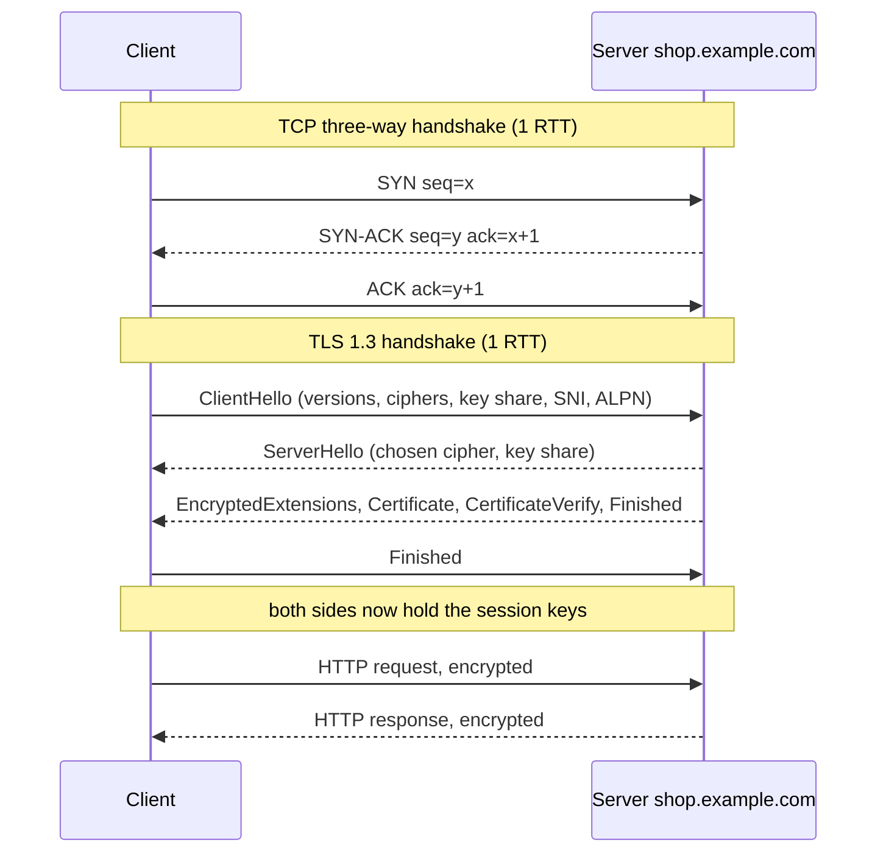
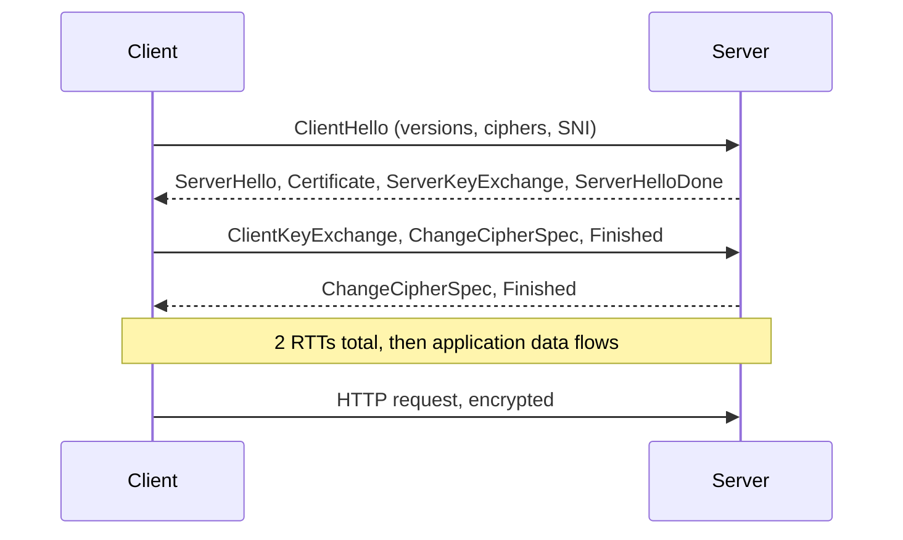
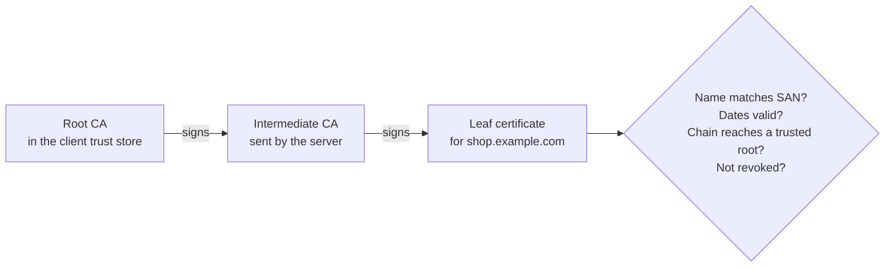

# L2.6 — TCP Connections and TLS Handshakes

> **Level 2: Networking** · Topic 6 of 11 · ⏱ ~5 hours · Difficulty: Intermediate

## 1. What it is

Before a browser can send a single HTTP request to `https://shop.example.com`, two set-up conversations must finish.

1. The **TCP three-way handshake** creates a reliable connection between the client and the server's IP and port. The two sides exchange `SYN`, `SYN-ACK` and `ACK` packets and agree on starting sequence numbers (see [L2.2](02-tcp-udp-icmp.md) for TCP itself).
2. The **Transport Layer Security (TLS) handshake** runs *inside* that connection. The two sides agree on a protocol version and cipher, the server proves its identity with a **certificate**, and both derive fresh **session keys** that encrypt everything after. TLS is what turns `http://` into `https://`.

A **certificate** is a signed statement "this public key belongs to `shop.example.com`", issued by a **Certificate Authority (CA)** that the client's operating system or browser trusts. **Server Name Indication (SNI)** is a field in the first TLS message in which the client says *which hostname* it wants, so a single IP address can serve certificates for many sites.

## 2. Why it matters in DevOps

- **Latency:** each round trip (RTT) before the first byte of HTTP is paid by every new connection. Connection reuse, keep-alive, TLS 1.3 and session resumption exist to avoid these RTTs.
- **Outages:** an **expired certificate** is one of the most common self-inflicted outages. Wrong hostname, missing intermediate certificate, or a client with an old trust store produce errors that look like "the API is down".
- **Debuggability:** you must be able to tell "TCP failed" (firewall, port closed) from "TLS failed" (certificate, protocol, SNI) from "HTTP failed" (app). Each has a different owner and fix.
- **Security and compliance:** which TLS versions and ciphers you allow, and where TLS ends (load balancer vs app), are audit questions. See later [Level 12: TLS](../level-12-advanced-networking/04-tls.md) and [TLS termination](../level-12-advanced-networking/11-tls-termination.md).
- **Automation:** certificate issuance and renewal (ACME, cert-manager, AWS Certificate Manager) is a core DevOps responsibility.

## 3. Real-world system example

**Let's Encrypt** is a free, automated public CA run by the nonprofit Internet Security Research Group. Its ACME protocol lets a server prove it controls a domain (by serving a token over HTTP or by putting a `TXT` record in DNS) and receive a certificate with a short lifetime (90 days at the time of writing), which is why renewal must be automated: Certbot, Caddy, Traefik and Kubernetes' cert-manager all do this. **AWS Certificate Manager (ACM)** issues and auto-renews public certificates for use on Application Load Balancers and CloudFront; the private key never leaves AWS. **Cloudflare** and other CDNs publish that they support TLS 1.3 and resumption, and **Chrome and Firefox** have supported TLS 1.3 for years, so most modern browsers complete the handshake in one round trip. **Certificate Transparency (CT)** logs are public append-only logs of issued certificates that browsers require; you can search them (for example via crt.sh) to see every certificate issued for your domain, a useful security check. **HTTP/3** replaces TCP with QUIC and folds the transport and TLS 1.3 handshakes together; see [Level 12](../level-12-advanced-networking/05-http2-http3-quic.md).

## 4. Diagram

TCP handshake followed by a TLS 1.3 handshake (the modern default), then the first HTTP request:



TLS 1.2 spends one more round trip, because key exchange happens in separate messages:



How the client decides to trust the certificate:



## 5. How it works

### TCP connection set-up

- The client picks an ephemeral source port and sends `SYN` with an initial sequence number. The server, if a process is `LISTEN`ing, replies `SYN-ACK`; the client replies `ACK`. The connection is `ESTABLISHED` on both sides after **1 RTT**; the client may send data with its final ACK.
- If nothing listens on the port the server sends `RST` (**connection refused**). If a firewall silently drops the SYN the client retries with exponential back-off (about 1, 2, 4, 8 seconds on Linux) and finally gives up with **timed out**.
- The server keeps two queues: half-open connections (`SYN_RECV`) and the **accept queue** of completed connections waiting for the application to call `accept()`. A flood of SYNs can fill the first (mitigated by **SYN cookies**); a slow application fills the second, and then clients see timeouts or resets even though "the port is open". Look at `ss -ltn`: `Recv-Q` is the current accept queue length and `Send-Q` its maximum.
- Latency rule of thumb: time to first byte of a brand-new HTTPS request = DNS + 1 RTT (TCP) + 1 RTT (TLS 1.3) or 2 RTT (TLS 1.2) + 1 RTT (HTTP request/response) + server time.

### What TLS provides

| Property | How |
|----------|-----|
| **Confidentiality** | Symmetric encryption (AES-GCM or ChaCha20-Poly1305) with keys derived for this session only |
| **Integrity** | Authenticated encryption; tampering is detected |
| **Authentication** | The server proves it holds the private key for the certificate; the client verifies the certificate chain and hostname |
| **Forward secrecy** | Ephemeral Diffie-Hellman (ECDHE) key exchange, so recording traffic today and stealing the server key later does not decrypt it (mandatory in TLS 1.3) |

### TLS 1.2 vs TLS 1.3

| | TLS 1.2 | TLS 1.3 |
|---|---------|---------|
| Handshake round trips | 2 | **1** (0 with resumption and 0-RTT, which has replay risks, so use it only for idempotent requests) |
| Key exchange | RSA or (EC)DHE, configurable | (EC)DHE only, so forward secrecy always |
| Cipher suites | Many, including weak legacy ones | Five AEAD suites only |
| Certificate visibility | Sent in clear | Encrypted after ServerHello |
| Status | Still widely deployed | Preferred; TLS 1.0 and 1.1 are deprecated (RFC 8996) |

Resumption lets a returning client skip the full handshake using a ticket or PSK from a previous session.

### Certificates, chains and names

A certificate holds the subject's public key, the **Subject Alternative Names (SAN)** list of hostnames it is valid for (the old Common Name field is ignored by modern clients), the validity dates, the issuer, and the issuer's signature. The server should send the **leaf plus intermediate(s)**; the client already has the root. A **missing intermediate** is the classic "works in my browser, fails in curl/Java" bug, because browsers sometimes fetch intermediates themselves and API clients do not. Wildcard certificates (`*.example.com`) cover one label only (`a.example.com`, not `a.b.example.com`). **Revocation** is checked through OCSP (often *stapled* by the server so the client need not call the CA) or CRLs, with uneven client support, which is why short lifetimes are the real mitigation.

### SNI and ALPN

The very first TLS message, `ClientHello`, carries two extensions that matter for infrastructure:

- **SNI** names the host (`shop.example.com`). A load balancer or Nginx uses it to choose *which certificate* to present and which virtual host to route to, *before* any HTTP is visible. Without SNI (very old clients), the server gives a default certificate and hostname checks fail.
- **ALPN (Application-Layer Protocol Negotiation)** lists protocols the client speaks (`h2`, `http/1.1`) so the server can choose HTTP/2 inside the same handshake, without an extra round trip.

(SNI is sent in clear in classic TLS; Encrypted Client Hello is the newer way to hide it.)

### Tools

| Command | Use |
|---------|-----|
| `openssl s_client -connect host:443 -servername host` | Perform a handshake, print the chain and negotiated version |
| `openssl x509 -noout -dates -subject -issuer -ext subjectAltName` | Decode a certificate |
| `curl -v https://host` | See TCP connect, TLS handshake summary, ALPN, HTTP |
| `curl --resolve host:443:IP https://host` | Test a specific server with the correct SNI and Host |
| `ss -tan` / `ss -ltn` | See socket states and accept queues |
| `tcpdump -nn -i any 'tcp port 443'` | See SYN, SYN-ACK, ACK and TLS records |

## 6. Step-by-step guide

**Prerequisites:** Linux shell with `openssl`, `curl` and, optionally, `tcpdump` (needs root or `sudo`). Steps 1-4 are completely local and safe. Outputs are representative; yours will differ in versions, cipher names and addresses.

1. **Make a self-signed certificate for the hostname `shop.example.com`.**
   ```bash
   mkdir -p ~/tlslab && cd ~/tlslab
   openssl req -x509 -newkey rsa:2048 -nodes -keyout key.pem -out cert.pem -days 7 \
     -subj "/CN=shop.example.com" -addext "subjectAltName=DNS:shop.example.com"
   openssl x509 -in cert.pem -noout -subject -issuer -dates -ext subjectAltName
   ```
   Subject and issuer are identical (it signed itself); SAN lists `DNS:shop.example.com`; the dates give a 7-day window.

2. **Start a TLS server and watch the handshake.**
   ```bash
   openssl s_server -accept 8443 -cert cert.pem -key key.pem -www &
   echo | openssl s_client -connect 127.0.0.1:8443 -servername shop.example.com -brief
   ```
   Expect `Protocol version: TLSv1.3`, a TLS_AES_*_GCM cipher, `Peer certificate: CN = shop.example.com` and `Verification error: self-signed certificate`. The error is correct: no trusted CA signed it.

3. **Force TLS 1.2 and compare, then try an old version.**
   ```bash
   echo | openssl s_client -connect 127.0.0.1:8443 -servername shop.example.com -tls1_2 -brief 2>&1 | head -4
   echo | openssl s_client -connect 127.0.0.1:8443 -tls1_1 2>&1 | grep -i error
   ```
   TLS 1.2 shows an `ECDHE-RSA-...` cipher. TLS 1.1 fails ("no protocols available" or a handshake failure) because modern OpenSSL builds disable it.

4. **Trust the certificate and see success; then break the name check.**
   ```bash
   echo | openssl s_client -connect 127.0.0.1:8443 -servername shop.example.com -CAfile cert.pem -verify_hostname shop.example.com -brief 2>&1 | grep -i verif
   echo | openssl s_client -connect 127.0.0.1:8443 -servername shop.example.com -CAfile cert.pem -verify_hostname other.example.com -brief 2>&1 | grep -i verif
   ```
   The first reports `Verification: OK`; the second reports a hostname mismatch. This is what browsers do when the SAN does not contain the requested name.

5. **Watch the whole thing on the wire** (needs root).
   ```bash
   sudo tcpdump -nn -i lo -c 12 'tcp port 8443' & TCPDUMP=$!
   sleep 1; echo | openssl s_client -connect 127.0.0.1:8443 -servername shop.example.com >/dev/null 2>&1
   wait $TCPDUMP
   ```
   You will see `[S]` (SYN), `[S.]` (SYN-ACK), `[.]` (ACK), then packets with `[P.]` carrying the ClientHello and the server's reply, and finally `[F.]` flags closing the connection. Capture `-w tls.pcap` and open it in Wireshark to see the handshake messages decoded.

6. **Inspect a real site's handshake.** (needs internet)
   ```bash
   curl -sv -o /dev/null https://example.com 2>&1 | grep -E "Connected to|SSL connection|ALPN|subject:|issuer:|expire date|HTTP/"
   echo | openssl s_client -connect example.com:443 -servername example.com 2>/dev/null | openssl x509 -noout -subject -issuer -dates -ext subjectAltName
   ```
   Note: the TLS version, the negotiated ALPN (`h2`), the issuer (a public CA), the validity dates and the SANs. In `curl -v`, lines beginning `*` are the connection, `>` is what you sent, `<` is what you received.

7. **Measure each phase with curl timings.**
   ```bash
   curl -s -o /dev/null https://example.com -w 'dns=%{time_namelookup}s tcp=%{time_connect}s tls=%{time_appconnect}s ttfb=%{time_starttransfer}s total=%{time_total}s\n'
   ```
   The values are cumulative: `tcp - dns` is the TCP handshake, `tls - tcp` is the TLS handshake. Run it twice and notice DNS drop to near zero when cached.

8. **Check certificate expiry the way monitoring does.**
   ```bash
   openssl x509 -in cert.pem -noout -checkend $((30*24*3600)); echo "exit=$?"
   ```
   Exit 1 ("Certificate will expire") means it expires within 30 days (this 7-day cert will). Alert on this in production at 21/14/7 days. Finally clean up: `kill %1; rm -rf ~/tlslab`.

## 7. Real-world scenario

*(Illustrative.)* At 02:07 an on-call engineer is paged: partner integrations calling `https://api.example.com` fail with `SSL certificate problem: certificate has expired`, while the website loads fine in a browser for staff. Investigation: `echo | openssl s_client -connect api.example.com:443 -servername api.example.com | openssl x509 -noout -dates` shows `notAfter` was two hours ago. The website uses an ACM certificate on an ALB (auto-renewed), but the API sits behind an Nginx on EC2 using a Let's Encrypt certificate from Certbot, and the renewal cron job had been failing for weeks because a firewall change blocked the HTTP-01 challenge on port 80. Staff browsers happened to reach the site through the CDN, hiding the problem.

Fix: temporarily reopen port 80, run `certbot renew`, `systemctl reload nginx`, and verify with `openssl s_client`. Follow-ups: alert when any certificate has fewer than 14 days left (probe from outside, as a black-box check), alert on renewal job failures, and migrate the endpoint to a managed certificate. **Lesson:** certificates are a dependency with a hard expiry date; renewal must be automated *and* monitored.

## 8. Common mistakes and best practices

**Don't**

- Disable certificate verification (`curl -k`, `verify=False`) to "make it work" and leave it in code.
- Forget the intermediate certificate in the server's chain file (`fullchain.pem`, not `cert.pem`).
- Issue certificates by hand with a calendar reminder as the only control.
- Allow TLS 1.0/1.1 or export-grade ciphers because "a legacy client needs it", without isolating that client.
- Use 0-RTT for non-idempotent requests (replays).
- Test an IP directly (`https://203.0.113.10`) and conclude the certificate is broken; without the right hostname/SNI you get the wrong certificate.

**Do**

- Automate issuance and renewal (ACME, cert-manager, ACM) and monitor `notAfter` externally.
- Always test with the real hostname: `curl --resolve shop.example.com:443:203.0.113.10 https://shop.example.com/`.
- Prefer TLS 1.3 with TLS 1.2 as a fallback; enable HTTP/2 via ALPN, session resumption and OCSP stapling.
- Know where TLS terminates (load balancer, proxy or app) and whether the hop after it is encrypted.
- Keep private keys out of source control and images ([Level 11: secrets](../level-11-security-devsecops/04-secrets-management-and-encryption.md)).
- Reuse connections (keep-alive, pools) so the handshakes are paid once, not per request.

## 9. Tasks

- [ ] **T1 — Capture a handshake and label every packet** *(≈40 min, beginner)*
  - **Goal:** see TCP and TLS on the wire.
  - **Steps:**
    1. Run the local `openssl s_server` from section 6 and capture with `sudo tcpdump -nn -i lo -w tls.pcap 'tcp port 8443'`.
    2. Connect once with `openssl s_client`, stop the capture, and read it with `tcpdump -nn -r tls.pcap` (or Wireshark).
    3. Label each packet: SYN, SYN-ACK, ACK, ClientHello, ServerHello and certificate packets, Finished, FIN.
  - **Done when:** you have a labelled list of packets and can point at the exact packet where TCP is established and where encryption begins.

- [ ] **T2 — Read a real certificate chain** *(≈30 min, beginner)*
  - **Goal:** identify leaf, intermediate and root.
  - **Steps:**
    1. Run `openssl s_client -connect example.com:443 -servername example.com -showcerts </dev/null`.
    2. Record, for each certificate in the chain, subject, issuer and expiry.
    3. Check which entry is the leaf by its SAN, and find the root in `/etc/ssl/certs` by name.
  - **Done when:** you can draw the chain (leaf -> intermediate -> root) with names and dates.

- [ ] **T3 — Measure where the time goes** *(≈30 min, intermediate)*
  - **Goal:** attribute latency to DNS, TCP, TLS and the server.
  - **Steps:**
    1. Use the curl `-w` format from step 7 against three different sites, three runs each.
    2. Compute TCP = `time_connect - time_namelookup`, TLS = `time_appconnect - time_connect`, server wait = `time_starttransfer - time_appconnect`.
    3. Compare against the RTT shown by `ping` and explain why TCP is about 1 RTT and TLS 1.3 about 1 RTT.
  - **Done when:** you have a table of the three phases per site and a sentence explaining each result.

- [ ] **T4 — Break TLS five ways and name each error** *(≈60 min, intermediate)*
  - **Goal:** recognise TLS failures by symptom.
  - **Steps:**
    1. Using your local server, produce: (a) untrusted CA, (b) hostname mismatch, (c) expired certificate (create one with `-days 1` and `faketime` or `openssl x509 ... -not_after`, or use `curl` against `https://expired.badssl.com/` if outbound access allows), (d) wrong protocol (`-tls1_1`), (e) plain HTTP to a TLS port with `curl http://127.0.0.1:8443/`.
    2. Record the exact `curl` and `openssl` error text for each.
    3. Write one line saying who would fix each: client, server operator, or CA.
  - **Done when:** you have five different error messages mapped to five causes.

- [ ] **T5 — Automate an expiry check** *(≈45 min, advanced)*
  - **Goal:** build the monitoring that prevents the section 7 outage.
  - **Steps:**
    1. Write a shell script `certcheck.sh host [port]` that connects with SNI, extracts `notAfter` with `openssl x509 -noout -enddate`, computes days left and exits non-zero if fewer than 14.
    2. Run it against `example.com`, against your local server, and against a host that has no TLS (it should fail clearly).
    3. Schedule it with cron or a systemd timer, or run it as a CI job that posts a failure.
  - **Done when:** the script prints days remaining, returns exit 0/1/2 for ok/soon/error, and runs on a schedule.

- [ ] **T6 — Prove it: explain the first 300 ms** *(≈30 min, advanced)*
  - **Goal:** tell the handshake story without notes.
  - **Steps:**
    1. Draw from memory the sequence from SYN to the first HTTP byte for TLS 1.3 and for TLS 1.2, counting RTTs.
    2. Explain what SNI and ALPN are and which message carries them.
    3. Explain how a client validates a certificate (chain, names, dates, revocation).
  - **Done when:** your drawing matches section 4 and you can answer "why is the first request slower than the second" and "why does the API fail with a missing intermediate while the browser works".

## 10. Self-check questions

1. How many round trips pass before the first HTTP request can be sent over TCP + TLS 1.3? Over TLS 1.2?
2. What is SNI, and what breaks if a server behind one IP hosts many sites but the client sends no SNI?
3. Name four checks a client makes on a server certificate.
4. What is the difference between `connection refused`, `connection timed out` and `certificate has expired`, in terms of the layer that failed?
5. Why does `curl https://203.0.113.10` fail certificate verification even though the certificate is valid for `shop.example.com`?
6. Why is the intermediate certificate important, and why do browsers sometimes hide a missing one?

<details>
<summary>Answers</summary>

1. TCP 1 RTT plus TLS 1.3 1 RTT, so 2 RTTs before the request (the request itself then takes one more for its response). With TLS 1.2 it is 3 RTTs before the request.
2. SNI is the hostname the client wants, sent in the ClientHello so the server can choose the certificate and virtual host. Without it the server serves a default certificate and hostname verification fails.
3. Chain leads to a trusted root; hostname matches a SAN; current time is within the validity dates; the certificate is not revoked (OCSP/CRL); also the key usage and signature algorithm are acceptable.
4. Refused: TCP reached the host but no listener (RST). Timed out: the SYN got no answer (firewall/routing). Expired certificate: TCP connected and TLS ran, then the client rejected the certificate in the TLS layer.
5. The name being checked is the IP, which is not in the SAN, and no SNI name is sent. Use the hostname, or `--resolve`.
6. Clients only trust roots they hold; the server must provide the intermediates that link its leaf to a root. Browsers may cache or fetch intermediates (AIA), so a broken chain can pass there but fail in curl, Java or Python.
</details>

## 11. Further reading

- RFC 8446 (TLS 1.3) and RFC 5246 (TLS 1.2); RFC 9293 for TCP.
- The `openssl-s_client`, `openssl-x509` and `curl` man pages.
- Let's Encrypt documentation ("How It Works") and the ACME protocol (RFC 8555).
- Mozilla's SSL Configuration Generator and TLS guidelines (documentation root: wiki.mozilla.org Security/Server Side TLS).
- *Bulletproof TLS and PKI* by Ivan Ristic.
- Cloudflare Learning Center — "What happens in a TLS handshake?".
- Next: [L2.7 HTTP Methods and Status Codes](07-http-methods-and-status-codes.md).

<!-- nav -->
---
← Previous: [DNS Resolution and Domain Architecture](05-dns-resolution.md) · [Level 2 index](README.md) · Next: [HTTP Methods and Status Codes](07-http-methods-and-status-codes.md) →
