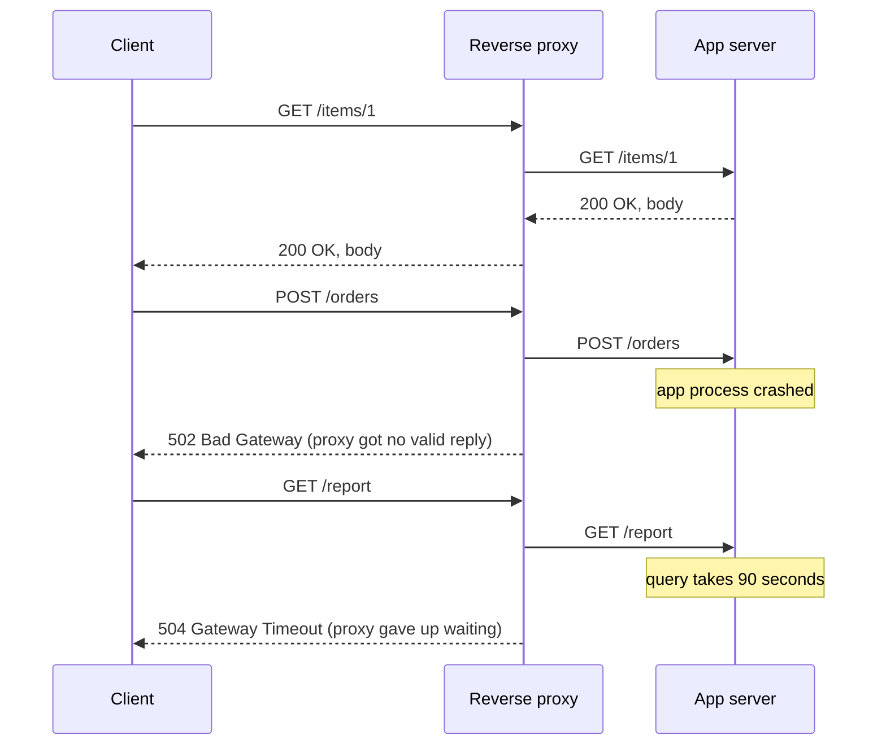
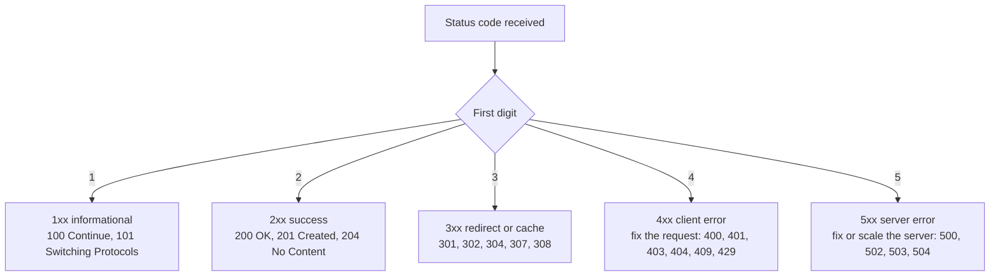

# L2.7 — HTTP Methods and Status Codes

> **Level 2: Networking** · Topic 7 of 11 · ⏱ ~4 hours · Difficulty: Beginner

## 1. What it is

**HTTP (HyperText Transfer Protocol)** is the request/response language that browsers, mobile apps, API clients, load balancers and health checks speak on top of TCP (and TLS). A client sends a **request** made of a **method** (what to do), a **target** (which resource), **headers** (metadata) and optionally a **body**. The server answers with a **status code** (what happened), headers and optionally a body.

```text
GET /items/1 HTTP/1.1            <- request line: method, target, version
Host: shop.example.com           <- headers
Accept: application/json

HTTP/1.1 200 OK                  <- status line: version, code, reason
Content-Type: application/json   <- headers
Content-Length: 41

{"id": 1, "name": "keyboard"}    <- body
```

HTTP is **stateless**: every request stands alone, and anything that looks like a "session" (a login, a cart) is carried by a header such as `Cookie` or `Authorization`. The method and status code are the vocabulary of every REST API and every monitoring dashboard: error-rate graphs are just counts of 5xx codes.

## 2. Why it matters in DevOps

- **Reading incidents:** "the 5xx rate rose" is meaningless until you know that `502`, `503`, `504` and `500` point at different components (proxy, capacity, timeout, application).
- **Safe retries:** load balancers, service meshes and clients retry failed requests. Retrying a `GET` is free; retrying a `POST /payments` can charge a customer twice. **Idempotency** is what makes automatic retry safe.
- **Health checks and deploys:** Kubernetes probes, ALB target groups and blue/green cut-overs decide "healthy" from status codes (usually `200`).
- **Caching, redirects and security** (HSTS, CORS, cookies) are all headers. A wrong `Cache-Control` can serve stale data to a million users, or leak private pages through a CDN.
- **Rate limits and back-pressure** (`429`, `Retry-After`, `503`) are part of the contract between services; see [Level 12: rate limiting](../level-12-advanced-networking/13-rate-limiting.md).

## 3. Real-world system example

**Stripe** documents an `Idempotency-Key` request header for `POST` requests: the client generates a unique key per logical operation, and if a network error forces a retry with the same key, Stripe returns the stored result instead of creating a second charge. That is exactly how an inherently non-idempotent method (`POST`) is made safe to retry. **GitHub's REST API** uses status codes precisely: `201 Created` with a `Location`, `204 No Content` for deletes, `304 Not Modified` for conditional requests with `ETag`, `403`/`429` plus `Retry-After` and `X-RateLimit-*` headers when you exceed rate limits. **AWS Application Load Balancers** publish distinct codes in their metrics and logs: `HTTPCode_ELB_5XX_Count` (the load balancer itself generated the error, such as `502` bad gateway, `503` no healthy targets, `504` timeout) versus `HTTPCode_Target_5XX_Count` (your application returned it). That one distinction tells the on-call engineer whether to look at the app or the fleet. **Kubernetes** itself exposes its API as HTTP: `kubectl` is a REST client doing `GET`, `POST`, `PATCH` and `DELETE` on resources, and the API server's `/healthz` and `/readyz` endpoints return `200` or `5xx`.

## 4. Diagram

The meaning of a `5xx` depends on who generated it. Here the proxy answers on behalf of a broken app:



Which status family to think of first:



## 5. How it works

### Methods, safety and idempotency

- **Safe** methods do not change server state (reads). **Idempotent** methods have the same effect whether you send them once or ten times (the *result state* is the same, even if a later `DELETE` returns `404`).

| Method | Typical use | Safe | Idempotent | Has body |
|--------|-------------|:----:|:----------:|:--------:|
| `GET` | Read a resource or list | yes | yes | no |
| `HEAD` | Same as GET, headers only (cheap health or size check) | yes | yes | no |
| `OPTIONS` | Ask what is allowed; browser CORS preflight | yes | yes | no |
| `POST` | Create a resource, or run an action/process data | no | **no** | yes |
| `PUT` | Replace a resource completely at a known URL | no | yes | yes |
| `PATCH` | Partially modify a resource | no | **not guaranteed** | yes |
| `DELETE` | Remove a resource | no | yes | rarely |

Practical consequences: two identical `POST /items` create two items; two identical `PUT /items/10` leave one item in the same state; `PATCH` of `{"qty": 6}` is idempotent but `{"qty_increment": 1}` is not.

### Status codes you must know

| Code | Name | Meaning and typical cause |
|------|------|--------------------------|
| `200` | OK | Success with body |
| `201` | Created | Resource created; `Location` header points at it |
| `202` | Accepted | Queued for async processing |
| `204` | No Content | Success, no body (DELETE, PUT) |
| `301` / `308` | Moved Permanently | Update bookmarks; cacheable. `308` keeps the method |
| `302` / `307` | Found / Temporary Redirect | Temporary; `307` keeps the method |
| `304` | Not Modified | Conditional GET matched the `ETag`; use your cache |
| `400` | Bad Request | Malformed or invalid input |
| `401` | Unauthorized | Not authenticated (missing or bad credentials) |
| `403` | Forbidden | Authenticated but not allowed (also WAFs and security tools) |
| `404` | Not Found | No such resource, or route not mapped by the proxy |
| `405` | Method Not Allowed | Resource exists but not for this method; `Allow` header lists valid ones |
| `409` | Conflict | State conflict, e.g. duplicate or version mismatch |
| `413` | Content Too Large | Body larger than the proxy or app limit (Nginx `client_max_body_size`) |
| `429` | Too Many Requests | Rate limited; honour `Retry-After` |
| `500` | Internal Server Error | Unhandled exception in the application |
| `502` | Bad Gateway | The proxy got an invalid response or the connection was refused or reset by the upstream |
| `503` | Service Unavailable | Overloaded, no healthy backends, or in maintenance; often has `Retry-After` |
| `504` | Gateway Timeout | The upstream did not respond within the proxy timeout |

**Rule of thumb for load balancers:** `502` = the upstream is broken or not listening, `503` = no one available to serve, `504` = the upstream is alive but too slow.

### Headers that matter

| Header | Direction | Why you care |
|--------|-----------|--------------|
| `Host` | request | Selects the virtual host/site on a shared IP. Mandatory in HTTP/1.1 (`:authority` in HTTP/2) |
| `User-Agent`, `Accept` | request | Client identity and wanted formats |
| `Content-Type`, `Content-Length` | both | Format and size of the body (`application/json`) |
| `Authorization` | request | `Bearer <TOKEN>` or Basic credentials; never log it |
| `Cookie` / `Set-Cookie` | request / response | Session state; flags `Secure`, `HttpOnly`, `SameSite` |
| `Cache-Control`, `ETag`, `If-None-Match` | both | Caching and conditional requests |
| `Location` | response | Target of a redirect or newly created resource |
| `X-Forwarded-For`, `X-Forwarded-Proto`, `Forwarded` | request (added by proxies) | Original client IP and scheme, because the app sees the proxy's IP |
| `X-Request-Id` | both | A correlation ID for tracing through every hop ([Level 10](../level-10-observability/07-correlation-ids.md)) |
| `Retry-After` | response | How long to wait after `429`/`503` |
| `Strict-Transport-Security` | response | HSTS: tells browsers to use HTTPS only |
| `Connection`, `Keep-Alive` | both | Persistent connections so TCP/TLS are reused |

### HTTP versions at a glance

HTTP/1.1 sends text messages one at a time per connection (browsers open several connections). HTTP/2 multiplexes many requests as binary streams on one TLS connection (negotiated via ALPN, see [L2.6](06-tcp-and-tls-handshakes.md)). HTTP/3 does the same over QUIC/UDP. The *semantics* (methods, status, headers) are identical across versions, so everything in this topic applies to all of them. Details: [Level 12](../level-12-advanced-networking/05-http2-http3-quic.md).

## 6. Step-by-step guide

**Prerequisites:** `python3` and `curl`. Everything runs on localhost (port 18080 is used to avoid clashing with other local servers). Outputs are representative.

1. **Create a tiny items API that returns realistic codes.** Save as `api.py`:
   ```python
   import json
   from http.server import BaseHTTPRequestHandler, ThreadingHTTPServer

   ITEMS = {1: {"id": 1, "name": "keyboard", "qty": 5}}
   NEXT_ID = 2

   class H(BaseHTTPRequestHandler):
       def _send(self, code, body=None, headers=None):
           data = b"" if body is None else json.dumps(body).encode()
           self.send_response(code)
           self.send_header("Content-Type", "application/json")
           self.send_header("Content-Length", str(len(data)))
           for k, v in (headers or {}).items():
               self.send_header(k, v)
           self.end_headers()
           if self.command != "HEAD":
               self.wfile.write(data)

       def _body(self):
           n = int(self.headers.get("Content-Length", 0))
           return json.loads(self.rfile.read(n) or b"{}")

       def _id(self):
           try:
               return int(self.path.rstrip("/").split("/")[-1])
           except ValueError:
               return None

       def do_GET(self):
           if self.path == "/old":
               return self._send(301, None, {"Location": "/items"})
           if self.path == "/boom":
               return self._send(500, {"error": "unhandled exception"})
           if self.path == "/slow-down":
               return self._send(429, {"error": "rate limited"}, {"Retry-After": "2"})
           if self.path == "/items":
               return self._send(200, list(ITEMS.values()))
           i = self._id()
           if i in ITEMS:
               return self._send(200, ITEMS[i])
           self._send(404, {"error": "not found"})

       do_HEAD = do_GET

       def do_POST(self):
           global NEXT_ID
           d = self._body()
           if "name" not in d:
               return self._send(400, {"error": "name required"})
           item = {"id": NEXT_ID, "name": d["name"], "qty": d.get("qty", 0)}
           ITEMS[NEXT_ID] = item
           NEXT_ID += 1
           self._send(201, item, {"Location": f"/items/{item['id']}"})

       def do_PUT(self):
           i = self._id()
           d = self._body()
           created = i not in ITEMS
           ITEMS[i] = {"id": i, "name": d.get("name", ""), "qty": d.get("qty", 0)}
           self._send(201 if created else 200, ITEMS[i])

       def do_PATCH(self):
           i = self._id()
           if i not in ITEMS:
               return self._send(404, {"error": "not found"})
           ITEMS[i].update(self._body())
           self._send(200, ITEMS[i])

       def do_DELETE(self):
           i = self._id()
           if i in ITEMS:
               del ITEMS[i]
               return self._send(204)
           self._send(404, {"error": "not found"})

   ThreadingHTTPServer(("127.0.0.1", 18080), H).serve_forever()
   ```
   Start it: `python3 api.py &`

2. **GET: read, and look at the raw exchange.**
   ```bash
   curl -i http://127.0.0.1:18080/items
   curl -v http://127.0.0.1:18080/items/1 2>&1 | grep -E '^[<>]'
   ```
   `-i` prints the status line and headers; `-v` shows `>` request lines and `<` response lines. Expect `200 OK`, `Content-Type: application/json` and a JSON body.

3. **POST twice: not idempotent.**
   ```bash
   curl -i -X POST -H 'Content-Type: application/json' -d '{"name":"mouse","qty":2}' http://127.0.0.1:18080/items
   curl -s -X POST -d '{"name":"mouse","qty":2}' http://127.0.0.1:18080/items -o /dev/null -w '%{http_code}\n'
   curl -s http://127.0.0.1:18080/items
   ```
   Expect `201 Created` with `Location: /items/2` both times, and two separate "mouse" items in the list (ids 2 and 3).

4. **PUT twice: idempotent.**
   ```bash
   for i in 1 2; do curl -s -o /dev/null -w '%{http_code}\n' -X PUT -d '{"name":"cable","qty":9}' http://127.0.0.1:18080/items/10; done
   curl -s http://127.0.0.1:18080/items/10
   ```
   First `201` (created), second `200` (replaced). The final state is identical either way: one item with id 10.

5. **PATCH and DELETE.**
   ```bash
   curl -s -X PATCH -d '{"qty":6}' http://127.0.0.1:18080/items/1
   for i in 1 2; do curl -s -o /dev/null -w '%{http_code}\n' -X DELETE http://127.0.0.1:18080/items/10; done
   ```
   PATCH returns the item with `"qty": 6`. DELETE returns `204` then `404`: the *state* is the same after both (item gone), which is why DELETE is idempotent even though the status differs.

6. **Provoke 4xx, 3xx, 5xx on purpose.**
   ```bash
   curl -s -i -X POST -d '{}' http://127.0.0.1:18080/items | head -1      # 400
   curl -s -i http://127.0.0.1:18080/nope | head -1                        # 404
   curl -s -i http://127.0.0.1:18080/boom | head -1                        # 500
   curl -s -i http://127.0.0.1:18080/slow-down | grep -iE 'HTTP/|retry'    # 429 + Retry-After
   curl -s -i http://127.0.0.1:18080/old | grep -iE 'HTTP/|location'       # 301 + Location
   curl -sL -o /dev/null -w '%{http_code} %{url_effective} redirects=%{num_redirects}\n' http://127.0.0.1:18080/old
   ```
   The last command follows the redirect: it ends at `200`, effective URL `/items`, `redirects=1`.

7. **HEAD and status-only checks (what health checks do).**
   ```bash
   curl -sI http://127.0.0.1:18080/items
   curl -s -o /dev/null -w '%{http_code}\n' http://127.0.0.1:18080/items
   ```
   HEAD returns the headers (including `Content-Length`) but no body.

8. **Make a proxy produce 502 and 504** (needs Nginx; with Docker):
   ```bash
   cat > /tmp/nginx-502.conf <<'EOF'
   events {}
   http { server { listen 8088;
     location /dead/ { proxy_pass http://127.0.0.1:9; }
     location /slow/ { proxy_pass http://127.0.0.1:18080/; proxy_read_timeout 1s; }
   } }
   EOF
   docker run -d --rm --name ngx --network host -v /tmp/nginx-502.conf:/etc/nginx/nginx.conf:ro nginx:stable
   curl -s -o /dev/null -w '%{http_code}\n' http://127.0.0.1:8088/dead/x   # 502: nothing listens on port 9
   docker stop ngx
   ```
   `502` appears because the upstream refused the connection. (To see `504`, point `/slow/` at a server that sleeps longer than the 1 s timeout.) Stop the Python server with `kill %1` when finished.

## 7. Real-world scenario

*(Illustrative.)* After a Friday release, the checkout dashboard shows 3 percent errors. The on-call engineer splits the graph by status code: it is **not** `500` (application exceptions) but `502`, and the ALB metric shows `HTTPCode_ELB_5XX` rising while `HTTPCode_Target_5XX` is flat. So the application is not throwing; the proxy cannot get answers from some targets. Investigation of one target's logs reveals the Node.js process exits on a startup race and is restarted by systemd every 40 seconds, and during each restart window the ALB gets "connection refused". The health check path `/` returned `200` from a static page that did not touch the app, so the broken instance was never taken out of rotation.

Fix: roll back the release, change the health check to `/healthz`, which verifies the database connection, and add `Retry-After` handling to clients. The team also noticed one client library retrying `POST /orders` on `502`; they added an `Idempotency-Key` header so those retries could not create duplicate orders. **Lesson:** status codes tell you *who* failed, and retry safety depends on method idempotency.

## 8. Common mistakes and best practices

**Don't**

- Return `200 OK` with `{"error": ...}` in the body; every monitor and proxy then sees success.
- Use `GET` for actions that change state (crawlers, prefetchers and caches will trigger them).
- Blindly retry `POST` or non-idempotent `PATCH` calls.
- Confuse `401` (who are you?) with `403` (you may not).
- Redirect health-check URLs (`301` to HTTPS) unless the checker follows redirects; a `301` is "unhealthy" to many load balancers.
- Log `Authorization` headers or cookies.

**Do**

- Use the narrowest accurate code: `201` + `Location` for creation, `204` for empty success, `409` for conflicts, `422`/`400` for validation, `429` for limits.
- Make writes retry-safe with idempotency keys, and combine retries with exponential back-off and jitter.
- Split dashboards and alerts by status family and by *who generated* it (LB vs app).
- Make health endpoints cheap, unauthenticated and meaningful (`/healthz` liveness, `/readyz` readiness).
- Propagate or generate `X-Request-Id` at the edge and log it everywhere. See also [idempotency in distributed systems](../level-13-databases-distributed-systems/14-idempotency.md).

## 9. Tasks

- [ ] **T1 — Walk the methods** *(≈30 min, beginner)*
  - **Goal:** use all five main methods and read the codes.
  - **Steps:**
    1. Run the API from section 6.
    2. Use `curl` to create, read, replace, patch and delete an item, noting each status code.
    3. Show the raw request and response for one of them with `curl -v`.
  - **Done when:** you have a table of method, URL, status code and one-line meaning for all five methods.

- [ ] **T2 — Demonstrate idempotency with numbers** *(≈30 min, intermediate)*
  - **Goal:** prove which methods are safe to repeat.
  - **Steps:**
    1. Send the same `POST` 5 times and count items; send the same `PUT` 5 times and count items.
    2. Add `"qty_increment"` handling to `PATCH` in `api.py` and show that repeating it changes state each time.
    3. Write one sentence per method: safe? idempotent? why?
  - **Done when:** your output shows 5 new items from POST, 1 from PUT, and a growing quantity for the increment PATCH.

- [ ] **T3 — Add an Idempotency-Key to POST** *(≈45 min, intermediate)*
  - **Goal:** make a non-idempotent operation retry-safe.
  - **Steps:**
    1. Modify `do_POST` to read an `Idempotency-Key` header, store `key -> response` in a dict, and return the stored response (same item id, code `201`) if the key repeats.
    2. Call it three times with the same key and three times without.
    3. Confirm item counts.
  - **Done when:** three calls with one key create exactly one item and three calls without a key create three.

- [ ] **T4 — Produce and diagnose 502, 503, 504** *(≈60 min, intermediate)*
  - **Goal:** map proxy error codes to causes.
  - **Steps:**
    1. Run Nginx in front of your API (Docker, as in step 8) and produce a `502` by pointing at a closed port.
    2. Produce a `504` by adding a `/sleep` endpoint (`time.sleep(3)`) and setting `proxy_read_timeout 1s`.
    3. Produce a `503` by returning it from your app for `/maintenance` and reading `Retry-After`.
    4. Look at the Nginx error log (`docker logs ngx`) and match each log line with a code.
  - **Done when:** you can reproduce all three on demand and state the cause shown in the log for each.

- [ ] **T5 — Write a status-code monitor** *(≈45 min, advanced)*
  - **Goal:** turn codes into a health signal.
  - **Steps:**
    1. Write a shell or Python script that requests a URL 20 times and prints the count per status code and the p50/max latency (`curl -w '%{http_code} %{time_total}\n'`).
    2. Run it against `/items`, `/boom` and `/slow-down`.
    3. Make it exit non-zero if more than 5 percent of responses are 5xx.
  - **Done when:** the script reports a per-code summary and the exit code flips for `/boom`.

- [ ] **T6 — Prove it: classify an incident** *(≈30 min, advanced)*
  - **Goal:** explain which component failed from codes alone.
  - **Steps:**
    1. Without notes, write what you would conclude and check first for each of: sudden `502`s, sudden `504`s, `503`s with `Retry-After`, a rise in `401`s after a deploy, and a rise in `429`s.
    2. Say for each whether a client may safely auto-retry `GET`, `PUT` and `POST`.
  - **Done when:** your answers match sections 5 and 7, and a teammate agrees they could act on them.

## 10. Self-check questions

1. What is the difference between a safe method and an idempotent method? Give one example of each combination.
2. Why is `POST` dangerous to retry, and how does an `Idempotency-Key` help?
3. A load balancer reports 502s, 503s and 504s. What does each tell you?
4. When should an API return `401` rather than `403`?
5. What does `304 Not Modified` save, and which headers make it possible?
6. Why does an application behind a proxy often see the wrong client IP, and which header helps?

<details>
<summary>Answers</summary>

1. Safe means no state change (GET, HEAD, OPTIONS). Idempotent means repeating has the same effect as once (PUT, DELETE, and all safe methods). Safe and idempotent: GET. Idempotent but not safe: PUT or DELETE. Neither: POST.
2. A repeated `POST` normally performs the action again (double charge). With an idempotency key the server remembers the first result and returns it for repeats.
3. `502`: the upstream gave an invalid response or refused or reset the connection (app down, wrong port). `503`: no healthy or available upstream, or overloaded. `504`: upstream did not reply before the timeout (slow).
4. `401` when credentials are missing or invalid (client should authenticate); `403` when authenticated but not permitted.
5. It saves transferring the body again: the client sends `If-None-Match` with the stored `ETag` (or `If-Modified-Since`), and the server answers `304` with no body.
6. The TCP connection comes from the proxy, so the source IP is the proxy's. `X-Forwarded-For` (or `Forwarded`) carries the original client IP, and should only be trusted when added by your own proxy.
</details>

## 11. Further reading

- RFC 9110 (HTTP Semantics) and RFC 9112 (HTTP/1.1) — the authoritative definitions of methods, status codes and headers.
- MDN Web Docs — "HTTP" guide, status code and header references.
- Stripe API documentation — "Idempotent requests".
- AWS Elastic Load Balancing documentation — "Troubleshoot your Application Load Balancers" (HTTP error codes).
- *HTTP: The Definitive Guide* by Gourley and Totty; *High Performance Browser Networking* by Ilya Grigorik (free online).
- Next: [L2.8 Reverse Proxies and Load Balancers](08-reverse-proxies-and-load-balancers.md).

<!-- nav -->
---
← Previous: [TCP Connections and TLS Handshakes](06-tcp-and-tls-handshakes.md) · [Level 2 index](README.md) · Next: [Reverse Proxies and Load Balancers](08-reverse-proxies-and-load-balancers.md) →
