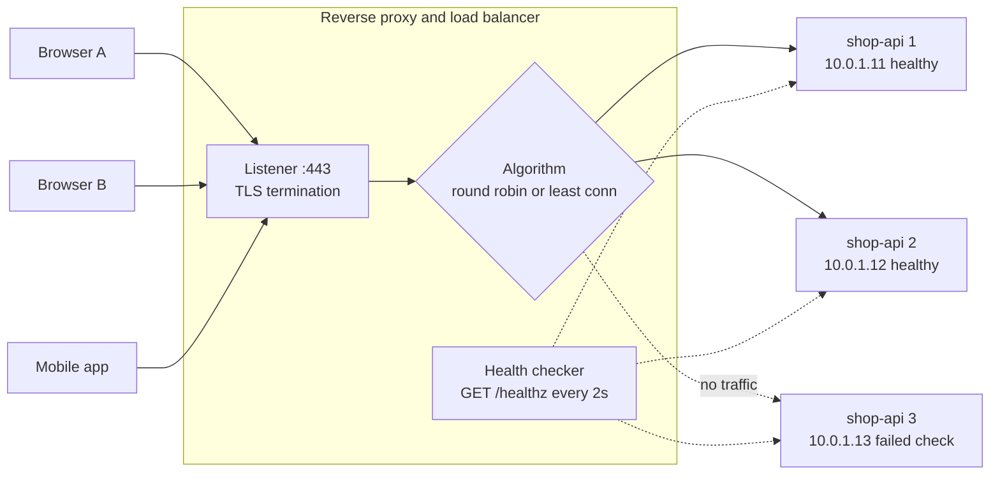
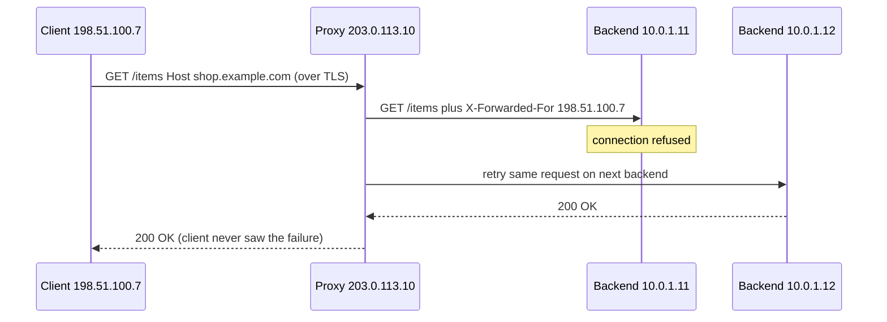

# L2.8 — Reverse Proxies and Load Balancers

> **Level 2: Networking** · Topic 8 of 11 · ⏱ ~5 hours · Difficulty: Intermediate

## 1. What it is

A **forward proxy** sits in front of *clients* and makes requests for them (a corporate web filter). A **reverse proxy** sits in front of *servers*: clients connect to the proxy, believing it is the website, and the proxy forwards each request to one of the real **backend** (also called **upstream** or **origin**) servers and relays the answer. Typical jobs: terminate TLS, route by hostname or URL path, compress, cache, rate-limit, add headers, hide the internal topology, and absorb slow clients.

A **load balancer (LB)** is a reverse proxy (or packet forwarder) whose main job is to **spread traffic across several identical backends** and to **stop sending traffic to broken ones**. Two ideas make it work: a **balancing algorithm** (who gets the next request) and **health checks** (who is allowed to get requests at all). In practice the two roles overlap, and software such as **Nginx**, **HAProxy** and **Envoy** does both.

## 2. Why it matters in DevOps

- **Availability:** a single server is a single point of failure. A load balancer plus health checks lets you lose a server (or deploy to one at a time) with no downtime. See [High Availability and Scalability](../level-00-what-devops-is/08-high-availability-and-scalability.md).
- **Scalability:** adding capacity means adding backends behind the same address; no client changes.
- **Deployments:** rolling, blue/green and canary releases are implemented by changing which backends receive traffic ([Level 5: zero-downtime deployments](../level-05-cicd/08-zero-downtime-deployments.md)).
- **Debugging:** most requests in modern systems cross at least one proxy. Knowing what it adds (`X-Forwarded-For`), what it changes (timeouts, buffering, body-size limits) and what it hides (the real client IP) explains many "works locally, fails in production" bugs.
- **Security:** the proxy is the choke point for TLS, WAF rules, rate limits and IP allow-lists, and keeps application servers off the public internet.

## 3. Real-world system example

**Nginx** powers a very large share of the web as a reverse proxy and web server; it is the default ingress for countless self-hosted stacks and the engine behind the Kubernetes `ingress-nginx` controller. **HAProxy** is known for high-performance TCP/HTTP load balancing with rich health checks and runtime statistics, and is used by many large sites; GitHub has publicly written about using HAProxy as part of its traffic layer. **Envoy** was created at Lyft and is now a CNCF graduated project; it is the data plane for service meshes such as Istio and for gateways such as Contour and Envoy Gateway, built around dynamic configuration (xDS) and rich observability. **AWS Elastic Load Balancing** (ALB, NLB, Gateway Load Balancer) is the managed equivalent: it registers targets, runs health checks, and distributes traffic across Availability Zones, with metrics such as `HealthyHostCount` and `TargetResponseTime` in CloudWatch ([Level 6: ALB](../level-06-cloud-aws/14-alb.md)). **Google** has published the design of its Maglev software network load balancer, which spreads traffic with consistent hashing so a given flow keeps hitting the same backend.

## 4. Diagram

A reverse proxy in front of three identical `shop-api` backends, with the health checker removing a failed one:



One request, including the headers the proxy adds, and a retry on a failed backend:



## 5. How it works

### Reverse proxy responsibilities

| Job | Detail |
|-----|--------|
| **Routing** | By `Host` header (virtual hosts), URL path (`/api/` to one pool, `/static/` to another), headers or cookies |
| **TLS termination** | Proxy holds the certificate, speaks plain HTTP (or re-encrypts) to backends. See [L2.6](06-tcp-and-tls-handshakes.md) |
| **Connection handling** | Keeps client connections open and reuses a pool of upstream connections, shielding backends from slow clients |
| **Header rewriting** | Adds `X-Forwarded-For`, `X-Forwarded-Proto`, `X-Request-Id`; sets `Host` |
| **Protection** | Request size limits, timeouts, rate limiting, WAF, IP rules |
| **Caching and compression** | Serves repeated responses without hitting the app; gzip/brotli |

Because the backend now sees the *proxy's* IP as the client, the proxy passes the original IP in `X-Forwarded-For` (see [L2.7](07-http-methods-and-status-codes.md)). Backends must trust that header only from known proxy addresses, or clients can spoof their IP.

### Balancing algorithms

| Algorithm | How it picks | Best for | Watch out |
|-----------|--------------|----------|-----------|
| **Round robin** | Next backend in turn | Equal backends and similar requests | Ignores load; one slow request type can pile up |
| **Weighted round robin** | Turn-taking proportional to weight | Mixed instance sizes, canary (1 percent) | Weights are static |
| **Least connections** | Backend with fewest active connections | Long or uneven requests, WebSockets | Needs connection tracking |
| **Least response time / peak EWMA** | Fastest recent responses | Heterogeneous latency | More complex; Envoy, HAProxy and some cloud LBs offer variants |
| **IP hash / consistent hash** | Hash of client IP, header or URL | Sticky behaviour, cache locality | Uneven spread; adding a backend remaps some keys |
| **Random with two choices** | Pick two at random, choose the less loaded | Large fleets with many proxies | Less intuitive; used in Envoy and Nginx (`random two`) |

**Session stickiness** (affinity) pins a user to one backend using a cookie or hash. It hides statelessness bugs and makes drains and failover harder; prefer stateless backends with session data in Redis ([Level 13: Redis](../level-13-databases-distributed-systems/07-redis.md)).

### Health checks

- **Passive** checks watch real traffic: after N consecutive errors or timeouts the backend is marked down for a period. Nginx open source does this (`max_fails`, `fail_timeout`). It costs real user requests to discover failure (mitigated with retries).
- **Active** checks probe on a timer, for example `GET /healthz` every 2 s; the backend goes down after `fall` failures and back up after `rise` successes. HAProxy, Envoy and every cloud LB do this (Nginx Plus, the commercial edition, also does).
- Check levels: TCP connect (port open), HTTP status (`200`), content or deep check (database reachable). Shallow checks keep a broken app in rotation; overly deep checks (calling five dependencies) can take the whole fleet out when one dependency blips. A good `/healthz` verifies the process and its *critical* dependencies cheaply. Kubernetes separates this into liveness and readiness probes ([Level 8](../level-08-kubernetes/15-liveness-and-readiness-probes.md)).
- **Connection draining** (deregistration delay): when a backend is removed for a deploy, existing requests are allowed to finish before it is stopped.

### The three tools

| | Nginx | HAProxy | Envoy |
|---|-------|---------|-------|
| Origin | Web server, then proxy | Purpose-built LB | Cloud-native proxy (Lyft, CNCF) |
| Config | Static text, `nginx -s reload` | Static text, hitless reload, runtime API | YAML, plus dynamic xDS APIs |
| Strengths | Web serving, caching, ubiquity | Health checks, stats, TCP and HTTP LB | Observability, retries, mesh and gateway use |
| Health checks | Passive (active in Plus) | Active and passive | Active and outlier detection |

### Useful commands

| Command | Use |
|---------|-----|
| `nginx -t` / `nginx -s reload` | Validate / apply config without dropping connections |
| `haproxy -c -f haproxy.cfg` | Validate config |
| `curl -I -H 'Host: shop.example.com' http://203.0.113.10/` | Test virtual host routing against a specific proxy |
| `curl -sH 'X-Request-Id: test-1' ...` then grep logs | Follow one request through hops |
| `ss -tan state established '( sport = :80 )'` | See live client connections to the proxy |

## 6. Step-by-step guide

**Prerequisites:** Linux with `python3`, `curl`, and `nginx` and `haproxy` (`sudo apt-get install -y nginx haproxy`; if the packages start system services, stop them with `sudo systemctl disable --now nginx haproxy` so they do not collide with the ports used here). We run everything on localhost. Outputs are representative of runs verified in a sandbox with Nginx 1.24 and HAProxy 2.8.

1. **Start three tiny backends that identify themselves.** Save as `backend.py`:
   ```python
   import sys
   from http.server import BaseHTTPRequestHandler, HTTPServer

   PORT = int(sys.argv[1])

   class H(BaseHTTPRequestHandler):
       def do_GET(self):
           body = b"ok\n" if self.path == "/healthz" else f"hello from backend {PORT}\n".encode()
           self.send_response(200)
           self.send_header("Content-Length", str(len(body)))
           self.end_headers()
           self.wfile.write(body)
       def log_message(self, *a):
           pass

   HTTPServer(("127.0.0.1", PORT), H).serve_forever()
   ```
   ```bash
   for p in 9001 9002 9003; do python3 backend.py $p & done
   curl -s http://127.0.0.1:9001/        # hello from backend 9001
   ```

2. **Nginx as a reverse proxy and load balancer.** Create `nginx.conf` (absolute paths for `pid` and logs; replace `/tmp/lab` with a directory you own, and `mkdir -p /tmp/lab`):
   ```nginx
   worker_processes 1;
   pid /tmp/lab/nginx.pid;
   error_log /tmp/lab/error.log;
   events {}
   http {
     access_log /tmp/lab/access.log;
     upstream shop_api {
       server 127.0.0.1:9001 weight=3;      # gets 3 of every 4 requests
       server 127.0.0.1:9002;
       server 127.0.0.1:9003 backup;        # used only when the others are down
     }
     server {
       listen 8090;
       location / {
         proxy_pass http://shop_api;
         proxy_set_header Host              $host;
         proxy_set_header X-Real-IP         $remote_addr;
         proxy_set_header X-Forwarded-For   $proxy_add_x_forwarded_for;
         proxy_connect_timeout 2s;
         proxy_next_upstream error timeout http_502 http_503;   # retry on the next backend
       }
     }
   }
   ```
   ```bash
   nginx -t -c /tmp/lab/nginx.conf         # "syntax is ok" and "test is successful"
   nginx -c /tmp/lab/nginx.conf
   for i in $(seq 8); do curl -s http://127.0.0.1:8090/; done | sort | uniq -c
   ```
   Expect about `6 hello from backend 9001` and `2 hello from backend 9002` (weights 3:1), and none from the backup.

3. **Watch passive failover.** Kill backend 9001 and keep sending requests:
   ```bash
   kill $(ss -ltnp | grep ':9001' | grep -o 'pid=[0-9]*' | cut -d= -f2)
   for i in $(seq 6); do curl -s -w '%{http_code}\n' http://127.0.0.1:8090/; done | sort | uniq -c
   grep 'Connection refused' /tmp/lab/error.log | head -2
   ```
   All six requests still return `200` from backend 9002 - the proxy retried the failed attempt on the next server (`proxy_next_upstream`), and the error log shows the refused connections it absorbed. Kill 9002 as well and the `backup` server (9003) takes over. Stop Nginx: `nginx -c /tmp/lab/nginx.conf -s stop`, and restart backends 9001 and 9002 before the next step.

4. **HAProxy with active health checks.** Create `haproxy.cfg`:
   ```text
   global
       log stdout format raw local0
       stats socket /tmp/hap.sock mode 600 level admin

   defaults
       mode http
       log global
       option httplog
       timeout connect 2s
       timeout client  30s
       timeout server  30s

   frontend fe_http
       bind 127.0.0.1:8091
       default_backend be_shop_api

   backend be_shop_api
       balance roundrobin
       option httpchk
       http-check send meth GET uri /healthz
       http-check expect status 200
       default-server inter 1s fall 2 rise 2
       server app1 127.0.0.1:9001 check
       server app2 127.0.0.1:9002 check
       server app3 127.0.0.1:9003 check

   listen stats
       bind 127.0.0.1:8404
       stats enable
       stats uri /stats
   ```
   ```bash
   haproxy -c -f haproxy.cfg                # Configuration file is valid
   haproxy -D -f haproxy.cfg -p /tmp/hap.pid
   sleep 4; for i in $(seq 9); do curl -s http://127.0.0.1:8091/; done | sort | uniq -c
   ```
   Expect three responses from each backend (round robin). Open `http://127.0.0.1:8404/stats` in a browser for the live dashboard, or `curl -s 'http://127.0.0.1:8404/stats;csv' | cut -d, -f1,2,18` to see `UP`/`DOWN` per server.

5. **Kill a backend and watch the health check remove it.**
   ```bash
   kill $(ss -ltnp | grep ':9002' | grep -o 'pid=[0-9]*' | cut -d= -f2)
   sleep 4
   curl -s 'http://127.0.0.1:8404/stats;csv' | cut -d, -f1,2,18 | grep app
   for i in $(seq 6); do curl -s http://127.0.0.1:8091/; done | sort | uniq -c
   ```
   `app2` shows `DOWN` after two failed checks (about 2 s) and traffic splits only between 9001 and 9003 - with **no failed user requests**, because the active check noticed before users did. Compare with step 3, where Nginx discovered failure with real traffic.

6. **Try other algorithms.** In the HAProxy backend change `balance roundrobin` to `balance leastconn` (or `balance source` for IP hashing), reload with `haproxy -D -f haproxy.cfg -p /tmp/hap.pid -sf $(cat /tmp/hap.pid)` and repeat the loop. Add `weight 3` to one `server` line and see the ratio change.

7. **(Optional) Envoy, same idea in YAML.** Envoy's static config for one listener and one health-checked cluster looks like this (not run in this sandbox; take a current image tag from the Envoy docs, and run with `docker run --rm --network host -v $PWD/envoy.yaml:/etc/envoy/envoy.yaml envoyproxy/envoy:<tag>`):
   ```yaml
   static_resources:
     listeners:
     - name: listener_0
       address: { socket_address: { address: 127.0.0.1, port_value: 8092 } }
       filter_chains:
       - filters:
         - name: envoy.filters.network.http_connection_manager
           typed_config:
             "@type": type.googleapis.com/envoy.extensions.filters.network.http_connection_manager.v3.HttpConnectionManager
             stat_prefix: ingress_http
             route_config:
               name: local_route
               virtual_hosts:
               - name: shop
                 domains: ["*"]
                 routes:
                 - match: { prefix: "/" }
                   route: { cluster: shop_api }
             http_filters:
             - name: envoy.filters.http.router
               typed_config:
                 "@type": type.googleapis.com/envoy.extensions.filters.http.router.v3.Router
     clusters:
     - name: shop_api
       type: STATIC
       lb_policy: LEAST_REQUEST
       health_checks:
       - timeout: 1s
         interval: 2s
         unhealthy_threshold: 2
         healthy_threshold: 2
         http_health_check: { path: /healthz }
       load_assignment:
         cluster_name: shop_api
         endpoints:
         - lb_endpoints:
           - endpoint: { address: { socket_address: { address: 127.0.0.1, port_value: 9001 } } }
           - endpoint: { address: { socket_address: { address: 127.0.0.1, port_value: 9002 } } }
   ```

8. **Clean up.** `nginx -c /tmp/lab/nginx.conf -s stop 2>/dev/null; kill $(cat /tmp/hap.pid); rm -rf /tmp/lab /tmp/hap.*`, and stop remaining `backend.py` processes (`jobs`, then `kill %1 %2 %3`, or find them with `ss -ltnp`).

## 7. Real-world scenario

*(Illustrative.)* During a sale, `shop.example.com` starts returning intermittent `504` errors. The dashboards show the application servers at 30 percent CPU, so nobody suspects capacity. The engineer looks at the proxy's per-backend stats and sees one of four backends with 400 active connections while the others hold 40: the proxy uses **round robin**, and a slow `/export` endpoint pins long requests to whichever backend drew them. That backend's worker pool is exhausted, so new requests queue and then hit `proxy_read_timeout`.

Short-term fix: switch the pool to `least_conn` and move `/export` to a dedicated pool with a higher timeout. Longer-term: add an active health check that fails when the worker queue is full, set connection draining on deploys, and make the export asynchronous (`202 Accepted` and a job). **Lesson:** an algorithm that is fine for uniform requests collapses for uneven ones, and "app CPU is low" does not mean "the app is healthy".

## 8. Common mistakes and best practices

**Don't**

- Point the health check at a static page that does not exercise the app (broken instances stay in rotation) or at an endpoint that calls every dependency (a database blip removes the entire fleet).
- Forget `proxy_set_header Host` and forwarded headers, then wonder why the app builds `http://` or internal URLs.
- Trust `X-Forwarded-For` from the open internet.
- Leave default timeouts and body-size limits unreviewed (`413`, `504` surprises).
- Rely on sticky sessions to paper over state kept in process memory.
- Run a single load balancer instance as the new single point of failure.

**Do**

- Use at least two LB instances (or a managed LB across Availability Zones) so the balancer itself is not a single point of failure.
- Prefer **least connections** (or two-choice) when request durations vary, round robin when they are uniform.
- Tune `fall`/`rise` and interval so detection is fast (a few seconds) without flapping.
- Enable connection draining and graceful shutdown (stop accepting, finish in-flight requests) in every deploy.
- Export LB metrics (request rate, 4xx/5xx by origin, healthy hosts, latency) and alert on healthy-host count.
- Keep proxy configuration in version control and validate it in CI (`nginx -t`, `haproxy -c`).

## 9. Tasks

- [ ] **T1 — Build a load-balanced pool with Nginx** *(≈45 min, beginner)*
  - **Goal:** distribute requests across three backends.
  - **Steps:**
    1. Run the three backends and the Nginx config from section 6.
    2. Send 30 requests and count responses per backend.
    3. Change weights to `1`, `1`, `2`, reload with `nginx -s reload`, and repeat.
  - **Done when:** the counts match the weights in both runs (for example 1:1:2).

- [ ] **T2 — Compare passive and active failure detection** *(≈45 min, intermediate)*
  - **Goal:** measure how many user requests fail while a backend is dead.
  - **Steps:**
    1. Remove `proxy_next_upstream` from the Nginx config, kill a backend, and send 20 requests, counting non-200 responses.
    2. Repeat through HAProxy with active checks (`inter 1s fall 2`).
    3. Record failures and time until the dead server is skipped for each.
  - **Done when:** you have a two-row table (failed requests, detection time) and a sentence on why they differ.

- [ ] **T3 — Route by path and host** *(≈45 min, intermediate)*
  - **Goal:** use the proxy as a router.
  - **Steps:**
    1. Create two backend pools: `api` (ports 9001-9002) and `static` (9003).
    2. In Nginx route `/api/` to `api` and everything else to `static`.
    3. Add a second `server` block with `server_name admin.example.com` returning a fixed `200`, and test with `curl -H 'Host: admin.example.com' http://127.0.0.1:8090/`.
  - **Done when:** three different requests reach three different destinations, shown by `curl` output and the access log.

- [ ] **T4 — Break it: uneven requests vs algorithm** *(≈60 min, advanced)*
  - **Goal:** reproduce the section 7 problem and fix it.
  - **Steps:**
    1. Modify `backend.py` so path `/slow` sleeps 3 seconds (use `ThreadingHTTPServer`).
    2. Send 10 concurrent `/slow` requests plus a stream of fast requests (`xargs -P 10` or `curl --parallel`) through HAProxy with `balance roundrobin`; record per-backend connection counts on the stats page.
    3. Switch to `leastconn` and repeat.
  - **Done when:** you can show different connection distributions for the two algorithms and explain the difference.

- [ ] **T5 — Preserve the client IP end to end** *(≈45 min, intermediate)*
  - **Goal:** make the backend see the real client address.
  - **Steps:**
    1. Change the backend to print the `X-Forwarded-For` and `X-Real-IP` headers it receives (return them in the body).
    2. Send requests through Nginx, once directly and once with an incoming spoofed `X-Forwarded-For: 1.2.3.4`.
    3. Observe how `$proxy_add_x_forwarded_for` appends rather than replaces, and note why a backend must only trust the last proxy hop.
  - **Done when:** you can show the header value in both cases and write the rule for safely deriving the client IP.

- [ ] **T6 — Prove it: design the front door** *(≈40 min, advanced)*
  - **Goal:** explain a production-grade LB design for `shop-api`.
  - **Steps:**
    1. Draw from memory: two proxy instances, three `shop-api` backends across two zones, health checks, TLS termination point, connection draining.
    2. List which algorithm you pick and why, and what the health endpoint verifies.
    3. Explain what a client sees when one backend dies, when one proxy dies, and during a deploy.
  - **Done when:** your design matches sections 4 and 5 and has no single point of failure.

## 10. Self-check questions

1. What is the difference between a forward proxy and a reverse proxy?
2. Round robin vs least connections: when does each fail or shine?
3. What is the difference between a passive and an active health check, and what does each cost?
4. Why does the backend see the load balancer's IP, and how do you recover the client's IP safely?
5. A deploy removes a backend from the pool and users see dropped requests. What was missing?
6. Why can a health check that tests the database make an outage worse?

<details>
<summary>Answers</summary>

1. A forward proxy acts for clients toward the internet; a reverse proxy acts for servers, receiving client requests and forwarding them to backends.
2. Round robin is simple and good for uniform requests; it ignores load, so uneven or long requests pile up. Least connections adapts to in-flight work and handles uneven durations, at the cost of tracking state.
3. Passive observes real traffic and marks a server down after errors (costs failed user requests, no extra load). Active probes on a timer and detects failure before users (costs probe traffic and needs a meaningful endpoint).
4. Because the TCP connection terminates at the proxy. The proxy adds `X-Forwarded-For` (or PROXY protocol at L4); the backend trusts it only when the immediate peer is a known proxy.
5. Connection draining: the proxy should stop sending new requests but let in-flight ones finish, and the app should shut down gracefully.
6. If the database blips, every backend fails its check at once and the LB marks all of them down; the whole service goes dark instead of degrading. Health checks should reflect whether this instance can serve, with care about shared dependencies.
</details>

## 11. Further reading

- Nginx documentation: `ngx_http_proxy_module` and `ngx_http_upstream_module`.
- HAProxy documentation: Configuration Manual (health checks, balance algorithms) and the Starter Guide.
- Envoy documentation: "Load balancing" and "Health checking" sections.
- AWS Elastic Load Balancing User Guide — target groups, health checks, deregistration delay.
- Google's Maglev paper, "Maglev: A Fast and Reliable Software Network Load Balancer" (NSDI 2016).
- *Site Reliability Engineering* (Google) — chapters on load balancing in the datacenter.
- Next: [L2.9 L4 versus L7 Load Balancing](09-l4-vs-l7-load-balancing.md).

<!-- nav -->
---
← Previous: [HTTP Methods and Status Codes](07-http-methods-and-status-codes.md) · [Level 2 index](README.md) · Next: [L4 versus L7 Load Balancing](09-l4-vs-l7-load-balancing.md) →
