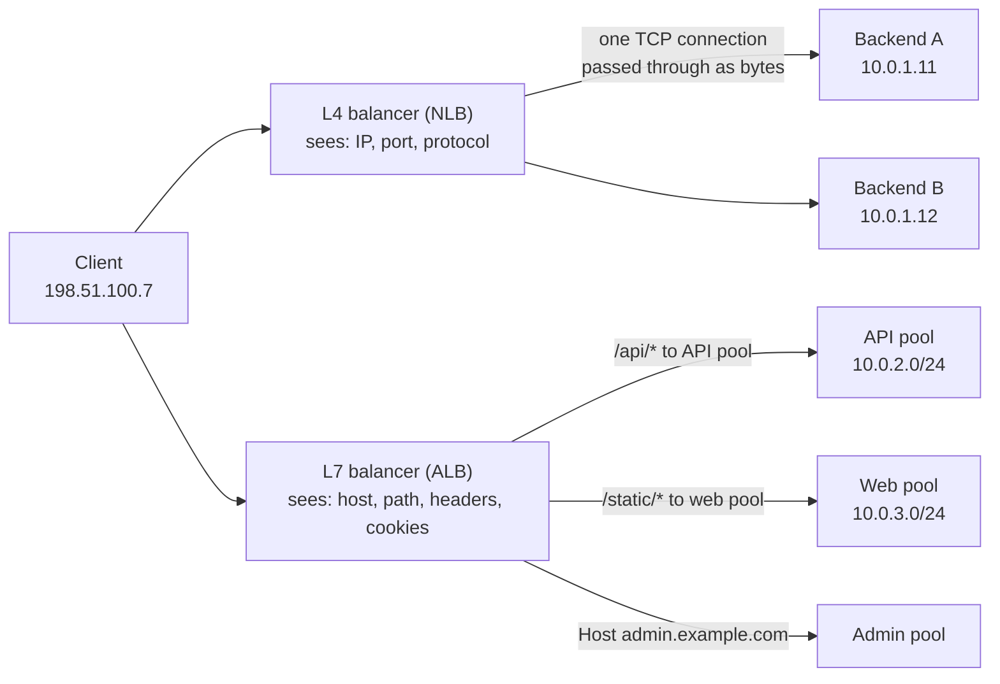
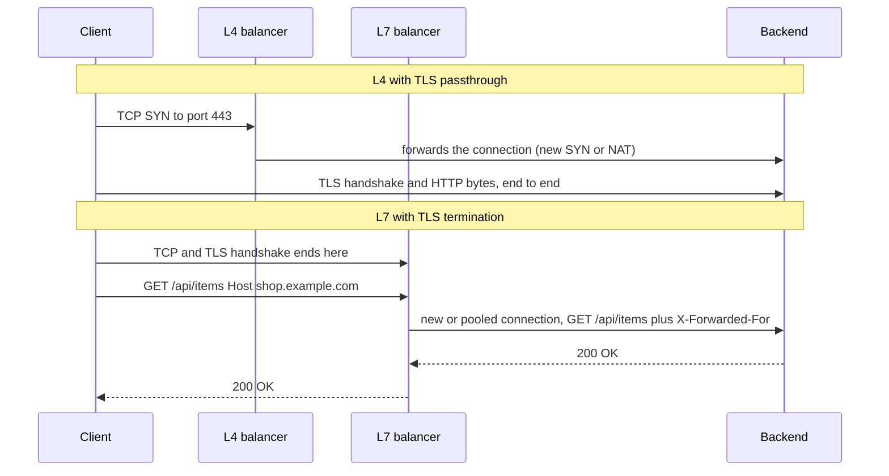

# L2.9 — L4 versus L7 Load Balancing

> **Level 2: Networking** · Topic 9 of 11 · ⏱ ~4 hours · Difficulty: Intermediate

## 1. What it is

Load balancers are named by the OSI layer at which they make decisions.

- A **Layer 4 (L4) load balancer** works at the **transport layer** (TCP and UDP). It sees only IP addresses and ports (the connection 5-tuple). It picks a backend when a connection starts and then shuffles bytes between client and backend without understanding them: it does not know whether the payload is HTTP, a database protocol or gibberish.
- A **Layer 7 (L7) load balancer** works at the **application layer**. It terminates the client's connection, reads the full request (for HTTP: method, host, path, headers, cookies), decides per request, and opens or reuses its own connection to a backend. It is a reverse proxy in the sense of [L2.8](08-reverse-proxies-and-load-balancers.md).

The names come from the OSI model (Layer 4 = transport, Layer 7 = application); [Level 12](../level-12-advanced-networking/01-osi-and-tcpip-models.md) covers the model in depth. AWS productizes the two as the **Network Load Balancer (NLB, L4)** and the **Application Load Balancer (ALB, L7)**.

## 2. Why it matters in DevOps

- **Choosing wrong costs real money and features.** Need path-based routing for microservices or WAF rules? An L4 balancer cannot do it. Need static IP addresses for partner allow-lists, UDP, or millions of connections per second? An L7 balancer may be the wrong tool.
- **Where TLS ends** (at the balancer, passed through, or both) follows from the choice and drives certificate management, observability and compliance.
- **Client IP visibility** differs: L4 can preserve the source IP, L7 sees the balancer's IP and passes the client's in a header.
- **Debugging error codes:** `502`/`504` come from L7 balancers; an L4 balancer can only reset, time out or refuse a connection. Different symptoms, different runbooks ([L2.7](07-http-methods-and-status-codes.md), [L2.10](10-network-debugging-tools.md)).
- **Kubernetes** exposes the same split: a `Service` of type `LoadBalancer` is usually L4, an `Ingress` or Gateway is L7 ([Level 8: Ingress](../level-08-kubernetes/05-ingress.md)).

## 3. Real-world system example

**AWS Elastic Load Balancing** is the clearest public example. An **ALB** inspects HTTP(S) and gRPC requests, supports host-based and path-based routing rules, redirects, fixed responses, header and query-string conditions, WebSocket, authentication through OIDC/Cognito, and integration with AWS WAF; it forwards the client's address in `X-Forwarded-For`. An **NLB** operates at the connection level for TCP, UDP and TLS, gives each Availability Zone a static IP address (and optionally an Elastic IP), is designed for very high throughput with low latency, and can preserve the client source IP to the target. A common production pattern combines them: NLB in front for static IPs, then ALB for routing. **Google's Maglev** and **Meta's Katran** are publicly described L4 balancers that spread connections with consistent hashing at the edge of their data centres, while **Envoy**, **Nginx** and **HAProxy** serve as the L7 layer behind them. **Cloudflare** documents both modes in its products: a layer-7 proxy for HTTP traffic and "Spectrum" for proxying arbitrary TCP and UDP (layer 4). **Kubernetes `kube-proxy`** implements Services as L4 load balancing in the kernel (iptables or IPVS), while an Ingress controller such as `ingress-nginx` does L7 routing on top.

## 4. Diagram

What each type can see and do with the same incoming connection:



Sequence difference: an L4 balancer never decrypts, an L7 balancer terminates TLS and makes a *second* connection:



## 5. How it works

### How an L4 balancer forwards

It chooses a backend for the connection by hashing the 5-tuple (source IP and port, destination IP and port, protocol) or by round robin, and keeps a flow table so all packets of one connection reach the same backend. Implementations either **rewrite addresses** (NAT; the backend replies via the balancer) or use **direct server return/encapsulation** (the backend answers the client directly). Because no HTTP parsing happens, it is extremely fast and handles any protocol, including databases, MQTT, SMTP and game traffic over UDP. Its health checks are typically TCP-connect (is the port open?), optionally HTTP.

### How an L7 balancer forwards

It accepts the connection, completes TLS, parses the HTTP request, evaluates routing rules, picks a backend from the matching pool, and sends the request over a (usually reused) backend connection. Each request can go somewhere different, even on the same client connection. This is what enables:

- routing by host, path, header, cookie, method or query string;
- TLS termination with one certificate store (and SNI-based certificate selection);
- request/response rewriting, redirects, compression, caching, WAF and rate limiting;
- per-request retries, timeouts, circuit breaking, canary splits by weight;
- rich metrics (status code, latency per route) and access logs.

The price: more CPU and memory per connection, more latency (small), a parser that is a security surface, and an HTTP-specific failure vocabulary (`502`, `504`).

### Comparison

| | L4 (for example NLB) | L7 (for example ALB) |
|---|---------------------|----------------------|
| Decides on | IP, port, protocol | Host, path, headers, cookies, method |
| Protocols | Any TCP or UDP | HTTP/1.1, HTTP/2, gRPC, WebSocket |
| Connection model | Passes the client connection through (or NATs it) | Terminates client side, new backend connection |
| TLS | Pass through to backend, or terminate on the balancer | Terminates (optionally re-encrypts to backend) |
| Client IP | Preserved (or via PROXY protocol) | In `X-Forwarded-For` |
| Latency and throughput | Lowest latency, very high throughput | More overhead per request |
| Static IP | Yes (per zone, Elastic IP) | No (use DNS name; or put NLB or Global Accelerator in front) |
| Health check | TCP connect, HTTP | HTTP status/body |
| Typical errors | Timeouts, resets, refused | `502`, `503`, `504`, `4xx` generated by the LB |
| Best for | Databases, TCP/UDP services, TLS passthrough, static IPs, extreme scale | Web apps, APIs, microservices routing, auth, WAF |

### Passing the client IP through an L4 hop

When an L4 balancer terminates and re-opens connections, the backend sees the balancer's IP. The **PROXY protocol** (HAProxy, supported by Nginx, NLB and others) prepends a small header to the connection that carries the original source address; the receiver must be configured to expect it, or it will treat the header as garbage and drop the connection.

### SNI routing at layer 4

A TLS `ClientHello` (see [L2.6](06-tcp-and-tls-handshakes.md)) carries the SNI hostname in clear text, so an L4 balancer can route `shop.example.com` and `api.example.com` to different backends **without decrypting anything** by peeking at the first packet. It cannot see the HTTP path, because that is encrypted. This is a useful middle ground that sits between pure L4 and full L7.

### Choosing

1. Is the protocol HTTP(S) or gRPC and do you need routing, WAF, auth or redirects? **L7**.
2. Is it TCP or UDP that is not HTTP (database, MQTT, DNS, game), or must clients allow-list fixed IPs, or is raw connection rate the constraint? **L4**.
3. Need both? Chain them (NLB then ALB/Nginx), or use L4 for the edge and L7 inside the cluster.

## 6. Step-by-step guide

**Prerequisites:** Linux with `haproxy`, `openssl`, `curl`, `python3` (`sudo apt-get install -y haproxy`; if it starts a system service, run `sudo systemctl disable --now haproxy`). Everything runs on localhost; outputs verified in a sandbox with HAProxy 2.8. We use one HAProxy for both an L4 TLS-passthrough listener and an L7 HTTP listener.

1. **Create two TLS backends with different certificates, and two HTTP backends.**
   ```bash
   mkdir -p ~/l4l7 && cd ~/l4l7
   for n in shop api; do
     openssl req -x509 -newkey rsa:2048 -nodes -keyout $n.key -out $n.crt -days 7 \
       -subj "/CN=$n.example.com" -addext "subjectAltName=DNS:$n.example.com" 2>/dev/null
   done
   openssl s_server -accept 9443 -cert shop.crt -key shop.key -www >/dev/null 2>&1 &
   openssl s_server -accept 9444 -cert api.crt  -key api.key  -www >/dev/null 2>&1 &
   cat > backend.py <<'EOF'
   import sys
   from http.server import BaseHTTPRequestHandler, HTTPServer
   PORT = int(sys.argv[1])
   class H(BaseHTTPRequestHandler):
       def do_GET(self):
           body = f"backend {PORT} path {self.path}\n".encode()
           self.send_response(200); self.send_header("Content-Length", str(len(body))); self.end_headers()
           self.wfile.write(body)
       def log_message(self, *a): pass
   HTTPServer(("127.0.0.1", PORT), H).serve_forever()
   EOF
   for p in 9001 9002; do python3 backend.py $p & done
   ```

2. **Write one HAProxy config with an L4 and an L7 frontend.** Save as `l4l7.cfg`:
   ```text
   global
       log stdout format raw local0

   defaults
       log global
       timeout connect 2s
       timeout client  30s
       timeout server  30s

   # Layer 4: TLS passthrough, route by SNI, never decrypts
   frontend fe_tls
       mode tcp
       bind 127.0.0.1:8443
       option tcplog
       tcp-request inspect-delay 3s
       tcp-request content accept if { req_ssl_hello_type 1 }
       use_backend be_shop if { req_ssl_sni -i shop.example.com }
       use_backend be_api  if { req_ssl_sni -i api.example.com }

   backend be_shop
       mode tcp
       server s1 127.0.0.1:9443

   backend be_api
       mode tcp
       server a1 127.0.0.1:9444

   # Layer 7: reads HTTP, routes by path
   frontend fe_http
       mode http
       bind 127.0.0.1:8091
       option httplog
       acl is_api path_beg /api
       use_backend be_pool_api if is_api
       default_backend be_pool_web

   backend be_pool_api
       mode http
       server app1 127.0.0.1:9001

   backend be_pool_web
       mode http
       server app2 127.0.0.1:9002
   ```
   ```bash
   haproxy -c -f l4l7.cfg          # Configuration file is valid
   haproxy -D -f l4l7.cfg -p hap.pid
   ```

3. **Prove the L4 listener routes by SNI and never decrypts.**
   ```bash
   for h in shop.example.com api.example.com; do
     echo "== $h"
     echo | openssl s_client -connect 127.0.0.1:8443 -servername $h -brief 2>&1 | grep -E "Peer certificate"
   done
   ```
   You get `CN = shop.example.com` for the first and `CN = api.example.com` for the second. The certificate presented is the *backend's own*: HAProxy has no certificate or key here, which is the definition of passthrough. Without SNI the connection is closed because no rule matches:
   ```bash
   echo | openssl s_client -connect 127.0.0.1:8443 -brief 2>&1 | head -3     # unexpected eof / handshake failure
   ```

4. **Prove the L7 listener routes by URL path.**
   ```bash
   curl -s http://127.0.0.1:8091/api/items      # backend 9001 path /api/items
   curl -s http://127.0.0.1:8091/index.html     # backend 9002 path /index.html
   ```
   The same listener and same connection type sent different requests to different pools because HAProxy parsed the HTTP request. The L4 listener could never do this on the encrypted traffic.

5. **Compare what each backend sees as the client.** Run `ss -tn state established '( dport = :9001 or dport = :9443 )'` while holding connections open, or check the backend with `sudo tcpdump -nn -i lo 'tcp port 9001'`. Both show the source as `127.0.0.1` (the balancer), not the original client. In production you would add `option forwardfor` (L7, adds `X-Forwarded-For`) or `send-proxy` (L4, PROXY protocol) to carry the client address.

6. **Watch the L4 versus L7 log lines.** HAProxy writes to stdout in the foreground (`haproxy -f l4l7.cfg`, no `-D`). The `fe_tls` lines (`tcplog`) show only addresses, bytes and timers; the `fe_http` lines (`httplog`) include the method, path and status. The extra visibility is exactly the L7 advantage.

7. **Clean up.**
   ```bash
   kill $(cat hap.pid); kill %1 %2 %3 %4 2>/dev/null; cd ~ && rm -rf ~/l4l7
   ```

8. **(AWS reading exercise, no cost)** Open the AWS console or CLI docs for `aws elbv2 create-load-balancer --type network` versus `--type application` and compare the listener protocol options (`TCP`, `UDP`, `TLS` versus `HTTP`, `HTTPS`) and the rule conditions each supports. Creating real load balancers costs money per hour; delete them immediately after any experiment and set a billing alarm first.

## 7. Real-world scenario

*(Illustrative.)* A fintech exposes `https://api.example.com` to partner banks. Each bank's firewall allow-lists a fixed set of IP addresses, and the platform team originally fronted the service with an ALB. Whenever AWS scaled the ALB, its IP addresses changed, and the next morning three partners could not connect: the DNS name was stable, the IPs were not.

Investigation confirmed that ALB addresses are dynamic and not meant to be allow-listed. The team deployed an **NLB with Elastic IPs** (one per Availability Zone) as the public entry point, with the ALB registered as the NLB's target, so partners saw three fixed IPs while internal routing (`/v1/payments` to one service, `/v1/reports` to another, WAF rules) stayed on the ALB. They also enabled client IP preservation and kept `X-Forwarded-For` for audit logs. **Lesson:** L4 and L7 are not rivals; pick each for what it is good at, and chain them when you need both.

## 8. Common mistakes and best practices

**Don't**

- Expect path-based routing, redirects, WAF or `502` metrics from an L4 balancer.
- Allow-list an ALB's IP addresses; they change.
- Enable the PROXY protocol on the balancer without enabling it on the receiving server (every connection fails) - or the reverse.
- Terminate TLS on the L7 balancer and send plain HTTP over untrusted networks if compliance requires end-to-end encryption.
- Assume that "load balanced" means "evenly balanced": long-lived L4 connections (gRPC, WebSockets, database pools) stay on whichever backend they started on.

**Do**

- Pick the layer from the requirement (protocol, routing needs, IP stability, throughput), not from habit.
- For gRPC and HTTP/2 through an L4 balancer, remember balancing happens per connection; use an L7 balancer or client-side balancing for per-request spread.
- Preserve the client IP deliberately (`X-Forwarded-For` at L7, PROXY protocol or IP preservation at L4) and log it.
- Put TLS termination where certificates are managed best (ACM on ALB, cert-manager in Kubernetes) and re-encrypt inside if required.
- Export health and per-zone metrics for either type and test zone failure.
- Read the cost model: cloud LBs charge per hour plus per capacity unit, so consolidate with host and path rules instead of one ALB per service. See [Level 20: network costs](../level-20-cost-optimization/07-network-egress-costs.md).

## 9. Tasks

- [ ] **T1 — Build the dual-layer HAProxy** *(≈45 min, beginner)*
  - **Goal:** run an L4 and an L7 listener side by side.
  - **Steps:**
    1. Follow section 6 steps 1-2.
    2. Test both listeners with `openssl s_client` and `curl`.
    3. Tail the HAProxy log and identify one `tcplog` and one `httplog` line.
  - **Done when:** both listeners work and you can state the extra fields the HTTP log line contains.

- [ ] **T2 — Show what L4 cannot see** *(≈30 min, intermediate)*
  - **Goal:** demonstrate the limit of passthrough.
  - **Steps:**
    1. Try to add a rule to the `fe_tls` frontend that routes by URL path (it will not validate or will never match).
    2. Capture traffic between HAProxy and the backend with `tcpdump -nn -A -i lo 'tcp port 9443'` and show that the request line is unreadable.
    3. Write two sentences: why SNI is visible but the path is not.
  - **Done when:** your capture shows the TLS ClientHello containing the hostname in clear text and encrypted application data afterwards.

- [ ] **T3 — Convert L4 to L7 with TLS termination** *(≈60 min, intermediate)*
  - **Goal:** terminate TLS on the balancer and route by path.
  - **Steps:**
    1. Create `fe_https` in HAProxy: `bind 127.0.0.1:8444 ssl crt <combined.pem>` (concatenate `shop.crt` and `shop.key` into one PEM file).
    2. Route `/api` to `be_pool_api` and everything else to `be_pool_web`.
    3. Test with `curl --cacert shop.crt --resolve shop.example.com:8444:127.0.0.1 https://shop.example.com:8444/api/x`.
  - **Done when:** HTTPS requests route by path and `openssl s_client` now shows HAProxy presenting the certificate.

- [ ] **T4 — Observe client IP loss and recover it** *(≈45 min, advanced)*
  - **Goal:** compare `X-Forwarded-For` (L7) with the PROXY protocol (L4).
  - **Steps:**
    1. Change the backend to echo the request headers and the peer address.
    2. In the L7 frontend add `option forwardfor` and show the header arrives.
    3. In the L4 backend add `send-proxy`, show that a plain backend breaks (garbled first line), then make a Python backend parse the first `PROXY TCP4 ...` line.
  - **Done when:** you can show both mechanisms delivering the original client address, and the failure when the receiver is not configured for the PROXY protocol.

- [ ] **T5 — Choose the right AWS load balancer for five cases** *(≈40 min, intermediate)*
  - **Goal:** make and defend design decisions.
  - **Steps:**
    1. For each: (a) public REST API with `/orders` and `/users` services, (b) PostgreSQL read replicas behind one endpoint, (c) UDP DNS service, (d) partners needing fixed IPs for a web API, (e) gRPC microservices with TLS passthrough requirement, pick NLB, ALB, or both.
    2. Write the key reason for each in one sentence, referencing the comparison table.
  - **Done when:** your answers are consistent with section 5, and you can name one drawback of each choice.

- [ ] **T6 — Prove it: explain it to a teammate** *(≈30 min, advanced)*
  - **Goal:** teach the L4/L7 distinction.
  - **Steps:**
    1. Without notes, draw the two sequence diagrams of section 4.
    2. Explain what happens to TLS, to the client IP and to a `502` in each model.
    3. Explain why a gRPC client with one long-lived connection may overload one backend behind an NLB.
  - **Done when:** a teammate can state when they would pick each type after hearing you.

## 10. Self-check questions

1. What information does an L4 balancer use to pick a backend, and what can it not see?
2. Name three capabilities only an L7 balancer offers.
3. Why can an L4 balancer still route on hostname for TLS traffic?
4. A partner needs a fixed IP to allow-list. Which AWS load balancer type provides it and how would you keep path-based routing?
5. Why might one backend get far more load than others behind an NLB even with round robin?
6. What happens if the PROXY protocol is enabled on the sender but not on the receiver?

<details>
<summary>Answers</summary>

1. IP addresses, ports and protocol (the 5-tuple) and the connection state; it cannot see HTTP methods, paths, headers, cookies or (when encrypted) any payload.
2. Examples: routing by host/path/header, TLS termination with HTTP-aware features, redirects and fixed responses, WAF integration, authentication (OIDC), per-request retries, `X-Forwarded-For`, per-route metrics.
3. SNI is sent unencrypted in the TLS ClientHello, so the balancer can read the hostname from the first packet without decrypting.
4. NLB (static or Elastic IPs per zone). Put the ALB behind it as a target (NLB to ALB) so routing rules stay on the ALB.
5. L4 balances connections, not requests. Long-lived connections (gRPC, WebSockets, pooled DB connections) stay pinned to the backend they started on, so load reflects how long connections live.
6. The receiver sees the PROXY header bytes as part of the application data and fails to parse them, so connections break or return errors. Both sides must agree.
</details>

## 11. Further reading

- AWS Elastic Load Balancing User Guide — "What is a Network Load Balancer?" and "What is an Application Load Balancer?".
- HAProxy documentation: Configuration Manual (`mode tcp`, `req_ssl_sni`, `send-proxy`) and the PROXY protocol specification.
- Google, "Maglev: A Fast and Reliable Software Network Load Balancer" (NSDI 2016); Meta's open-source Katran project README.
- Envoy documentation — "Listener filters" and "Load balancing".
- *Designing Data-Intensive Applications* by Martin Kleppmann — chapter on request routing.
- Next: [L2.10 Network Debugging Tools](10-network-debugging-tools.md).

<!-- nav -->
---
← Previous: [Reverse Proxies and Load Balancers](08-reverse-proxies-and-load-balancers.md) · [Level 2 index](README.md) · Next: [Network Debugging Tools](10-network-debugging-tools.md) →
