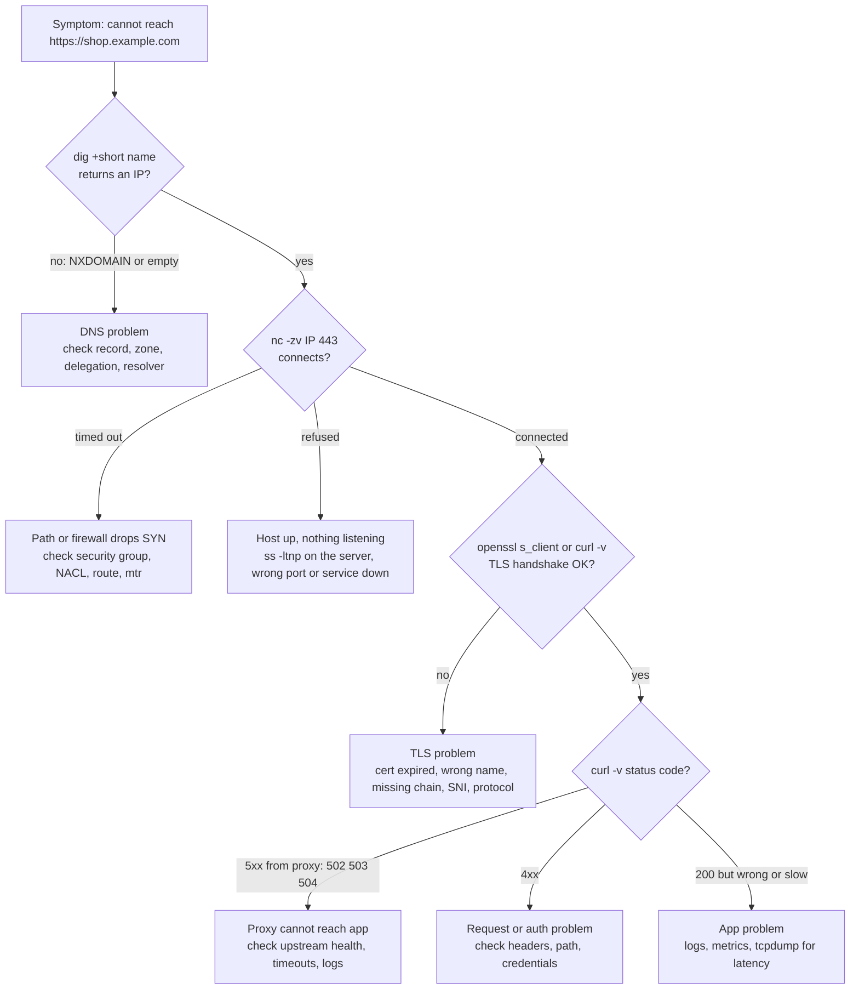
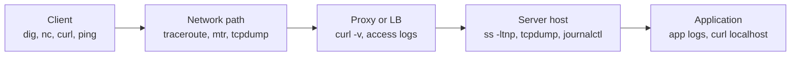

# L2.10 — Network Debugging Tools

> **Level 2: Networking** · Topic 10 of 11 · ⏱ ~6 hours · Difficulty: Intermediate

## 1. What it is

Network debugging is the skill of answering one question quickly: **at which step between "client" and "application" does the request stop working?** The tools each examine one layer, so the trick is choosing them in the right order.

| Tool | Layer it inspects | The question it answers |
|------|-------------------|--------------------------|
| `ping` | IP / ICMP | Is the host reachable and how long is the round trip? |
| `traceroute`, `tracepath`, `mtr` | IP routing | Where along the path do packets stop or slow down? |
| `dig`, `nslookup`, `host`, `getent hosts` | DNS | What does this name resolve to, and who says so? |
| `nc` (netcat) | TCP / UDP | Can I open a connection to this port? |
| `ss` | Sockets on this machine | What is listening here, and what connections exist? |
| `curl -v` | TLS and HTTP | What does the HTTP exchange (and the handshakes before it) look like? |
| `tcpdump` (and Wireshark) | Packets on the wire | What actually crossed the network interface? |
| `openssl s_client` | TLS | Which certificate and protocol does the server present? |

## 2. Why it matters in DevOps

- Outages are time-boxed. An engineer who can prove "DNS is fine, TCP connects, TLS fails with an expired certificate" in two minutes ends the incident; one who guesses burns an hour.
- "It's the network" is the default blame for every failure. The tools turn blame into evidence you can hand to the cloud provider, the network team or the application team.
- Containers and Kubernetes hide the network behind overlays, NAT and sidecars. The same tools, run from the right place (inside the Pod, on the node), still work.
- Security groups, NACLs, firewalls and proxies fail silently ("timeout") in ways only a method of elimination can pin down; see [L2.4](04-routing-nat-ports-firewalls.md) and [Level 6: security groups](../level-06-cloud-aws/06-security-groups-and-nacls.md).
- These tools are the backbone of the Level 2 capstone and of every later troubleshooting chapter.

## 3. Real-world system example

**Cloudflare** and **AWS** both publish troubleshooting guidance built on exactly these tools: Cloudflare's support documentation walks customers through `dig`, `curl -v` and `traceroute`/`mtr` output to separate origin problems from network path problems, and AWS's VPC Reachability Analyzer and troubleshooting guides step through route tables, security groups and NACLs, which is the same elimination logic applied to cloud primitives. **Linux kernel networking** is observable through the same utilities: `ss` reads socket state from the kernel's netlink interface, and `tcpdump` uses libpcap to read packets (it was built at Lawrence Berkeley Laboratory and is still the standard capture tool). **Kubernetes** documents using `kubectl exec` with `nslookup`/`dig` and `curl` (or `kubectl debug` with an ephemeral container such as `nicolaka/netshoot`) to diagnose Service and DNS problems from inside a Pod, because a Pod's view of the network differs from your laptop's.

## 4. Diagram

A debugging decision tree: start at the symptom, descend only as far as needed. Each branch ends at the owner of the fix.



Where each tool "stands" on the path of a request:



## 5. How it works

### The method: bottom-up and top-down

1. **Define the failing path precisely**: from where, to what name or IP, which port, which protocol, since when, for everyone or one client.
2. **Walk the layers in order**: name resolution, reachability, port, TLS, HTTP, application. Stop at the first layer that fails; everything above it is irrelevant until it is fixed.
3. **Compare with something that works**: a different client, a different path, the same request from the server itself (`curl localhost`). The difference is the bug.
4. **Change one thing at a time** and re-test with the same command.

### Reading the classic symptoms ([L2.2](02-tcp-udp-icmp.md))

| Output | Meaning |
|--------|---------|
| `Could not resolve host` / `NXDOMAIN` / `SERVFAIL` | DNS layer |
| `Connection refused` (immediately) | Host answered with RST: nothing listens on that port |
| `Connection timed out` (after a long wait) | SYN unanswered: firewall drop, wrong IP, routing |
| `Connection reset by peer` | Connected, then the peer or a middlebox aborted |
| `SSL certificate problem`, `handshake failure` | TLS layer |
| `HTTP 502/503/504` | A proxy or load balancer answered; upstream is the problem |
| Works to IP, fails to name | DNS or SNI/Host-header problem |

### Tool reference

| Tool and common invocation | Notes |
|----------------------------|-------|
| `ping -c 4 host` | ICMP echo. **A failed ping proves little**: many networks drop ICMP. A successful ping proves IP reachability only |
| `traceroute -n host`, `tracepath host`, `mtr -rwn -c 20 host` | Per-hop path with TTL probes. `* * *` hops can be filtered routers, not necessarily failures. `mtr` shows loss per hop: loss that starts at a hop and continues to the end is real, loss only at one middle hop is often just ICMP rate limiting |
| `dig +short name`, `dig @8.8.8.8 name`, `dig +trace name`, `dig -x IP` | Compare resolvers. `getent hosts name` shows what applications get ([L2.5](05-dns-resolution.md)) |
| `nslookup name [server]` | Older, simpler; works on Windows too |
| `nc -zv host 443`, `nc -zvu host 53`, `nc -l 9000` | Connect test; UDP "success" only means no ICMP error came back. `-l` makes a quick listener or lets you hand-craft requests |
| `ss -ltnp` | Listening TCP sockets with owning process; shows `127.0.0.1` vs `0.0.0.0` binding mistakes |
| `ss -tan state established '( dport = :443 )'` | Live connections; `ss -s` for totals; `ss -tan state time-wait \| wc -l` |
| `curl -v URL`, `curl -I URL` | `*` connection info, `>` request, `<` response. Add `--resolve host:443:IP` to pin a backend, `-H 'Host: x'` to fake a virtual host, `-k` only for diagnosis, `--connect-timeout 5 -m 10` to bound waits |
| `curl -w '%{time_namelookup} %{time_connect} %{time_appconnect} %{time_starttransfer} %{time_total}'` | Latency broken down by phase ([L2.6](06-tcp-and-tls-handshakes.md)) |
| `openssl s_client -connect host:443 -servername host` | Certificate chain, protocol version, verify errors |
| `tcpdump -nn -i any 'host IP and port 443'` | `-nn` no name lookups, `-i any` all interfaces, `-w file.pcap` to save, `-r` to read, `-c N` to stop after N packets, `-A` ASCII payload |
| `ip addr`, `ip route get IP`, `ip neigh` | Local addresses, which route/interface a destination will use, ARP table ([L2.1](01-ip-mac-arp-dhcp.md)) |

### tcpdump filters worth memorizing

```text
host 203.0.113.10                      traffic to or from this IP
port 443                               either TCP or UDP port 443
tcp port 443 and host 203.0.113.10     combine with and, or, not
tcp[tcpflags] & tcp-syn != 0           SYN packets only (connection attempts)
udp port 53                            DNS queries and responses
icmp                                   ping and "unreachable" messages
```

Flag letters in the output: `[S]` SYN, `[S.]` SYN-ACK, `[.]` ACK, `[P.]` data (PSH+ACK), `[F.]` FIN, `[R]`/`[R.]` RST. A lone repeating `[S]` with no `[S.]` is a firewall drop; `[S]` answered by `[R.]` is a closed port.

### What tools cannot do

You can only capture what reaches the interface you are watching: if packets are dropped by a security group in the cloud, `tcpdump` on the destination shows nothing and the absence *is* the evidence. HTTPS payloads are encrypted, so `tcpdump` shows handshakes and sizes but not paths; use `curl -v` or the server logs for that.

## 6. Step-by-step guide

**Prerequisites:** a Linux shell. `curl`, `ss` (iproute2), `nc` (netcat-openbsd) and `tcpdump` are enough for steps 1-6 on localhost; install the rest with `sudo apt-get install -y dnsutils iputils-ping traceroute mtr-tiny netcat-openbsd tcpdump openssl curl`. `tcpdump` needs `sudo` (or root). Outputs shown for `curl`, `ss`, `nc` and `tcpdump` were checked in a sandbox; `ping`/`dig`/`traceroute` output is "similar to" what you will see.

1. **Start a service and find it with `ss`.**
   ```bash
   python3 -m http.server 18081 --bind 127.0.0.1 &
   ss -ltnp 'sport = :18081'
   ```
   Expect `LISTEN 0 5 127.0.0.1:18081 0.0.0.0:* users:(("python3",pid=...,fd=3))`. Note the local address `127.0.0.1`: this server is unreachable from other machines. Binding to `0.0.0.0` (all interfaces) is the usual fix when "it works on the server but not remotely".

2. **Test the port with `nc`: open versus closed.**
   ```bash
   nc -zv 127.0.0.1 18081          # Connection to 127.0.0.1 18081 port [tcp/*] succeeded!
   nc -zv -w 2 127.0.0.1 18999     # nc: connect to 127.0.0.1 port 18999 (tcp) failed: Connection refused
   ```
   Open and refused produce different messages. A third state, a firewall silently dropping, would show a timeout instead of "refused" - you practice that in T3.

3. **Read the whole HTTP exchange with `curl -v`.**
   ```bash
   curl -sv http://127.0.0.1:18081/ -o /dev/null 2>&1 | grep -E '^(\*|>|<)'
   ```
   `* Connected to ...` is TCP; `> GET / HTTP/1.1` is your request including the `Host:` header; `< HTTP/1.0 200 OK` is the status. The exit code reflects the failure type: `curl -s http://127.0.0.1:18999/; echo $?` prints `7` (could not connect). Other useful codes: `6` could not resolve host, `28` timeout, `35`/`60` TLS errors.

4. **Break down latency by phase.**
   ```bash
   curl -s -o /dev/null -w 'dns=%{time_namelookup} tcp=%{time_connect} tls=%{time_appconnect} ttfb=%{time_starttransfer} total=%{time_total} ip=%{remote_ip}\n' http://127.0.0.1:18081/
   ```
   On localhost everything is microseconds. Against a remote HTTPS site you will see `tcp` jump by about one RTT and `tls` by another; a large `ttfb - tls` means a slow application.

5. **Watch the packets with `tcpdump`.**
   ```bash
   sudo tcpdump -nn -i lo -c 10 'tcp port 18081' & TCPDUMP=$!
   sleep 1; curl -s -o /dev/null http://127.0.0.1:18081/
   wait $TCPDUMP
   ```
   You will see the three-way handshake `[S]`, `[S.]`, `[.]`, then `[P.]` with the HTTP request (`length 78` or similar), the response, and the closing flags. Save a capture to share with others: `sudo tcpdump -nn -i lo -w /tmp/demo.pcap 'tcp port 18081'`, stop with Ctrl-C, and read it with `tcpdump -nn -r /tmp/demo.pcap` or open it in Wireshark. Add `-A` to see the plaintext HTTP request.

6. **See a refused connection on the wire.**
   ```bash
   sudo tcpdump -nn -i lo -c 2 'tcp port 18999' & TCPDUMP=$!
   sleep 1; nc -z 127.0.0.1 18999
   wait $TCPDUMP
   ```
   One `[S]` is answered at once by `[R.]` (reset): this is what "connection refused" looks like at the packet level.

7. **Name resolution tools** (needs `dig`, internet).
   ```bash
   dig +short example.com
   dig @1.1.1.1 +short example.com
   getent hosts example.com
   nslookup example.com
   ```
   All should agree. If `dig` gives an answer but `getent` does not, look at `/etc/nsswitch.conf`, `/etc/hosts` and `resolv.conf`.

8. **Reachability and path tools** (needs internet; ICMP may be filtered in sandboxes).
   ```bash
   ping -c 4 example.com                  # similar to: 4 packets transmitted, 4 received, 0% packet loss, rtt min/avg/max
   traceroute -n example.com              # one line per hop; * * * means no reply
   mtr -rwn -c 10 example.com             # report mode: loss % and latency per hop
   ```
   Read `mtr` from the bottom: if the last hop shows 0 percent loss, intermediate loss is not affecting you.

9. **Run the complete decision tree against a real site.** Put it in a script `diagnose.sh`:
   ```bash
   #!/usr/bin/env bash
   # usage: ./diagnose.sh example.com [port]
   host=$1; port=${2:-443}
   echo "== DNS";      ip=$(dig +short "$host" | grep -E '^[0-9.]+$' | head -1); echo "resolved: ${ip:-NONE}"
   [ -z "$ip" ] && { echo "FAIL: DNS"; exit 1; }
   echo "== TCP";      nc -zv -w 5 "$ip" "$port" 2>&1 || { echo "FAIL: TCP (refused or timeout)"; exit 2; }
   echo "== TLS";      echo | openssl s_client -connect "$ip:$port" -servername "$host" -brief 2>&1 | grep -E "Protocol version|Verification|Peer certificate" || { echo "FAIL: TLS"; exit 3; }
   echo "== HTTP";     curl -s -o /dev/null -w "status=%{http_code} dns=%{time_namelookup} tcp=%{time_connect} tls=%{time_appconnect} ttfb=%{time_starttransfer}\n" --resolve "$host:$port:$ip" "https://$host:$port/" || echo "FAIL: HTTP"
   ```
   `chmod +x diagnose.sh && ./diagnose.sh example.com`. Stop the test server with `kill %1`.

## 7. Real-world scenario

*(Illustrative.)* At 10:40, the mobile app reports "cannot connect" for roughly 15 percent of users, all on one mobile carrier, while the website works from the office. The on-call engineer runs the decision tree from a cloud shell and from a friend's phone on that carrier. `dig` returns the correct IP both places; `nc -zv ip 443` succeeds from the cloud shell but **times out** from the carrier network, so the problem is before TLS and below HTTP. `mtr` from a VPS in the same region shows the path is fine; the carrier's path stops at a transit hop.

The server's `tcpdump -nn 'tcp port 443 and host <carrier-test-ip>'` shows **no SYN arriving at all** from the test phone, which proves the packets never reached the server: not a security group, not the application. They escalate to the CDN/network provider with the `mtr` output and the empty capture as evidence, and the provider reroutes within the hour. Meanwhile the team posts a status page note. **Lesson:** the absence of packets is evidence too; the method (DNS, port, TLS, HTTP) located the layer in under five minutes and produced something the provider could act on.

## 8. Common mistakes and best practices

**Don't**

- Treat a failed `ping` as proof the host is down (ICMP is often blocked), or a successful ping as proof the service works.
- Debug from your laptop only. Run the tools from the machine, container or Pod that actually fails.
- Use `curl -k` (skip verification) and forget that you have thereby hidden the very problem you are looking for.
- Run `tcpdump` without a filter on a busy production host or write captures to a small disk; use `-c`, `-w`, filters and `timeout`.
- Test by IP when the failure involves names, SNI or `Host` headers; use `--resolve` to keep the hostname.
- Change several things at once, then not know which one fixed it.

**Do**

- Go layer by layer: DNS, TCP, TLS, HTTP, application.
- Compare working and failing clients, and the server's own `curl localhost`.
- Capture evidence (command output, `.pcap`, timestamps) in the incident channel.
- Install a troubleshooting toolbox in your images or keep a debug image ready (`nicolaka/netshoot`), but do not ship it to production by default.
- Use `-nn` with `tcpdump` and `ss -n` to avoid slow DNS lookups clouding the picture.
- Turn the manual tree into a script or synthetic check so monitoring runs it continuously.

## 9. Tasks

- [ ] **T1 — Map every tool to a layer** *(≈30 min, beginner)*
  - **Goal:** know which tool answers which question.
  - **Steps:**
    1. Run each of `ping`, `dig`, `nc -zv`, `ss -ltn`, `curl -v`, `tcpdump -c 5` once against any host.
    2. Write a table: tool, layer, the question it answered, a line of output as evidence.
  - **Done when:** the table has six rows with real output pasted and no row mixes up layers.

- [ ] **T2 — Diagnose the three connect outcomes** *(≈40 min, beginner)*
  - **Goal:** distinguish open, refused and silent failure.
  - **Steps:**
    1. Connect with `nc -zv` to an open port and to a closed port on localhost.
    2. Add a firewall rule that drops instead of rejects (`sudo iptables -A INPUT -p tcp --dport 18998 -j DROP`), start a listener on 18998, and `nc -zv -w 3 127.0.0.1 18998` (on loopback you may need `-i lo`; or use a second VM or container).
    3. Capture each case with `tcpdump` and describe the packet pattern.
    4. Remove the rule (`sudo iptables -D INPUT -p tcp --dport 18998 -j DROP`).
  - **Done when:** you can show open (S, S., .), refused (S, R.) and dropped (S, S, S, no reply) patterns and the matching `nc` messages.

- [ ] **T3 — Find the wrong bind address** *(≈30 min, intermediate)*
  - **Goal:** use `ss` to explain "works locally, not remotely".
  - **Steps:**
    1. Start `python3 -m http.server 18082 --bind 127.0.0.1` and run `ss -ltnp`.
    2. From a container or second host (or via the host's non-loopback IP) try to connect: it fails.
    3. Restart with `--bind 0.0.0.0` and retry.
  - **Done when:** `ss` shows `127.0.0.1:18082` then `0.0.0.0:18082`, and the remote attempt fails then succeeds.

- [ ] **T4 — Build and run the diagnose script** *(≈60 min, intermediate)*
  - **Goal:** automate the decision tree.
  - **Steps:**
    1. Create `diagnose.sh` from step 9.
    2. Run it against `example.com`, against a nonexistent name, against a valid host on a closed port (`./diagnose.sh example.com 81`), and against `expired.badssl.com` if outbound access allows.
    3. Verify the exit codes 1, 2 and 3 appear in the right cases.
  - **Done when:** four runs produce four distinct, correct diagnoses and exit codes.

- [ ] **T5 — Break and debug a stack you did not build** *(≈75 min, advanced)*
  - **Goal:** use only the tools to find a fault.
  - **Steps:**
    1. Ask a friend (or write a script that randomly picks one) to introduce a fault in the Nginx + backends setup of [L2.8](08-reverse-proxies-and-load-balancers.md): wrong `proxy_pass` port, backend bound to `127.0.0.1` on a remote host, wrong `Host` header, expired certificate, or a dropped port.
    2. Without reading the config, find the fault using only `dig`, `nc`, `ss`, `curl -v` and `tcpdump`.
    3. Write down the sequence of commands you ran and the evidence at each step.
  - **Done when:** you name the faulty layer and component, and your command log shows the elimination order.

- [ ] **T6 — Prove it: trace one request in your own words** *(≈40 min, advanced)*
  - **Goal:** produce a blameless-style diagnosis note.
  - **Steps:**
    1. Choose any HTTPS site. Using the tools, collect: resolved IP and TTL, TCP connect time, TLS version and certificate issuer, HTTP status and server header, and a short `tcpdump` snippet showing the handshake.
    2. Write a half-page explanation of what each command proved, in order.
    3. Explain which of your findings would change if the site were behind a CDN.
  - **Done when:** a colleague can reproduce each of your findings from the note alone.

## 10. Self-check questions

1. `curl` hangs for 2 minutes and then reports `Connection timed out`. Which layer, and which two things would you check first?
2. `Connection refused` comes back instantly. What does it tell you that a timeout does not?
3. Why is `ping` a poor test of service health?
4. How do you test a specific backend behind a load balancer using the correct hostname for TLS?
5. `dig` resolves a name but your app cannot. Name three places to look.
6. You run `tcpdump` on the server and see no packets from a client who says they are connecting. What does that prove?

<details>
<summary>Answers</summary>

1. The network/transport layer: SYN packets get no answer. Check security groups/firewalls/NACLs and routing (or a wrong IP), plus whether the destination host is up and has the right IP.
2. The host is reachable and replied with RST, so the network and firewall are fine; nothing is listening on that port (service down, wrong port, bound to a different interface).
3. ICMP may be blocked while TCP works, or allowed while the application is dead. It only tests IP reachability.
4. `curl --resolve shop.example.com:443:<backend-ip> https://shop.example.com/` (or `openssl s_client -connect <ip>:443 -servername shop.example.com`), which keeps SNI and Host correct.
5. `/etc/hosts` and `/etc/nsswitch.conf`, the app's or JVM's own DNS cache, the container's `resolv.conf` / search domains and `ndots`, or a different resolver than `dig` used.
6. The packets are not reaching that interface: they were dropped before (client-side network, a firewall or security group upstream, wrong IP/DNS answer) or sent somewhere else. It rules out the server application.
</details>

## 11. Further reading

- Man pages: `ss(8)`, `tcpdump(8)`, `pcap-filter(7)`, `curl(1)`, `nc(1)`, `dig(1)`, `mtr(8)`.
- Brendan Gregg, *Systems Performance* (network chapter) and his Linux performance tools pages.
- Julia Evans' zines and blog posts on networking tools (for example "Networking! ACK!").
- Wireshark User's Guide (official documentation) for reading `.pcap` files.
- Kubernetes documentation — "Debug Services" and "Debugging DNS Resolution".
- AWS documentation — "VPC Reachability Analyzer" and "Troubleshoot connecting to your instance".
- Next: [L2.11 What Happens When You Visit https://example.com](11-what-happens-when-you-visit-a-url.md).

<!-- nav -->
---
← Previous: [L4 versus L7 Load Balancing](09-l4-vs-l7-load-balancing.md) · [Level 2 index](README.md) · Next: [What Happens When You Visit https://example.com](11-what-happens-when-you-visit-a-url.md) →
