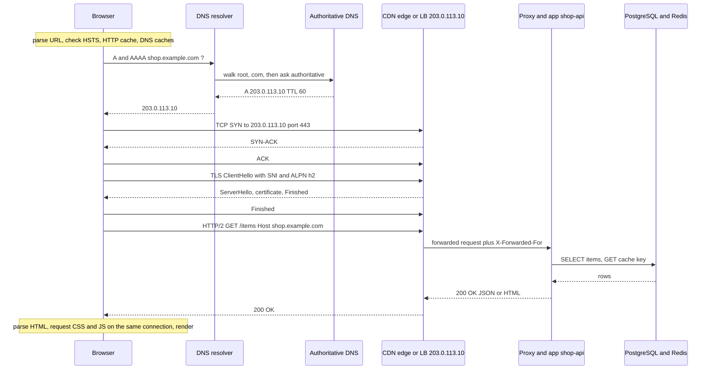
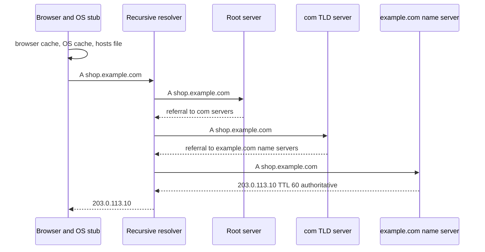
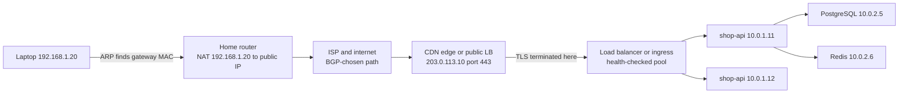

# L2.11 — What Happens When You Visit https://example.com

> **Level 2: Networking** · Topic 11 of 11 · ⏱ ~6 hours · Difficulty: Advanced

## 1. What it is

This is the synthesis of the whole level. You type `https://shop.example.com/items` into a browser and press Enter. A few hundred milliseconds later a page appears. In between, roughly a dozen separate systems cooperate, each solving one problem, each able to fail in its own recognisable way:

1. The **browser** parses the URL, checks its caches and security rules (HSTS), and decides it needs a connection.
2. **DNS** turns the name into an IP address ([L2.5](05-dns-resolution.md)).
3. The **local network** (IP, ARP, DHCP-provided gateway and DNS server) and **routing, NAT and firewalls** carry packets from your device towards the internet and back ([L2.1](01-ip-mac-arp-dhcp.md), [L2.3](03-ipv4-ipv6-cidr-subnets.md), [L2.4](04-routing-nat-ports-firewalls.md)).
4. A **TCP three-way handshake** opens a reliable connection to port 443 ([L2.2](02-tcp-udp-icmp.md), [L2.6](06-tcp-and-tls-handshakes.md)).
5. A **TLS handshake** authenticates the server with its certificate (using SNI to pick it) and sets up encryption ([L2.6](06-tcp-and-tls-handshakes.md)).
6. The browser sends an **HTTP request** ([L2.7](07-http-methods-and-status-codes.md)).
7. A **CDN, load balancer and reverse proxy** accept it and route it to a healthy backend ([L2.8](08-reverse-proxies-and-load-balancers.md), [L2.9](09-l4-vs-l7-load-balancing.md)).
8. The **application** (`shop-api`) runs code, queries PostgreSQL and Redis, and builds a response.
9. The **response** travels back through the same layers; the browser parses the HTML, fetches more resources over the already open connection, and renders the page.

If you can narrate that list, with the packets, the names of the servers and the failure symptom at each step, you can debug almost any "the site is down" report. The tools in [L2.10](10-network-debugging-tools.md) let you observe every step. (The domain `example.com` is reserved by IANA for documentation; this topic uses `shop.example.com` as the name of our imaginary `shop-api` service and RFC 5737 addresses like `203.0.113.10` for illustration.)

## 2. Why it matters in DevOps

- **It is the mental map for every incident.** "Users can't reach the site" is not a diagnosis; "DNS answers, TCP connects, TLS fails with an expired certificate" is. Each stage has an owner (registrar, DNS team, network team, platform team, application team).
- **It is the most common senior-engineer interview question**, precisely because it exposes whether you understand the whole path rather than one tool.
- **Performance work follows the same map.** Time to first byte is the sum of DNS + TCP + TLS + server time; every optimisation (CDN, keep-alive, TLS 1.3, HTTP/2, caching, connection pooling) removes a round trip or a computation from this path.
- **Architecture decisions are placements on the path:** where TLS ends, where load is balanced, where caching lives, where a firewall sits.
- **It ties directly to later levels:** Route 53 and ALB ([Level 6](../level-06-cloud-aws/12-route-53.md)), Kubernetes Ingress ([Level 8](../level-08-kubernetes/05-ingress.md)), TLS termination and mTLS ([Level 12](../level-12-advanced-networking/11-tls-termination.md)).

## 3. Real-world system example

The full path is publicly described by the organisations that operate it. **Browsers**: the Chromium project documents its network stack, including the host resolver cache, socket pools that reuse connections, the HSTS preload list, and the HTTP cache; Firefox documents the same concepts. **DNS**: the root zone is served by anycast root servers, `.com` by Verisign, and many sites use a managed authoritative service such as Amazon Route 53 or Cloudflare. **CDNs and edges**: Cloudflare, Akamai, Fastly and Amazon CloudFront publish that they terminate TLS and often HTTP at an edge location close to the user, serve cached responses without touching the origin, and open a separate, often long-lived connection to the origin; this is why the TCP and TLS round trips users pay are short. **Load balancing**: AWS describes the common pattern of a public Application Load Balancer (or NLB then ALB) in front of an Auto Scaling group or Kubernetes Ingress, terminating TLS with an ACM certificate. **Protocol evolution**: Google and Cloudflare publicly serve HTTP/3 over QUIC; browsers learn about it from an `Alt-Svc` response header and use it on later visits. **Open-source reference**: the GitHub repository "What happens when..." by Alex Gaynor and contributors is a well-known deep dive into the same question. A typical shape for a modern production site is therefore: Browser, recursive DNS, CDN edge, load balancer, reverse proxy or ingress, application, database and cache.

## 4. Diagram

The whole journey in one sequence (cold caches, TLS 1.3, request served by the application):



The names-to-numbers step in detail (this is what the resolver does for the browser):



Where the packets physically go, and where each component sits:



## 5. How it works

### Stage by stage

| # | Stage | What happens | Protocol and layer | Typical failure and symptom | First tool |
|---|-------|--------------|--------------------|-----------------------------|------------|
| 1 | URL parsing | Scheme `https` implies port 443; host `shop.example.com`; path `/items`. If the host is on the HSTS list the browser refuses plain HTTP | Browser | Typo, mixed content, HSTS error page | Browser dev tools |
| 2 | Caches | Browser HTTP cache (maybe no request at all), browser DNS cache, OS DNS cache (`systemd-resolved`), `/etc/hosts` | OS | Stale DNS or cached redirect | `getent hosts`, hard refresh |
| 3 | DNS resolution | Stub asks the recursive resolver learned from DHCP; resolver walks root, TLD, authoritative; answers cached for TTL. Browsers ask for `A` and `AAAA` and may prefer IPv6 ("happy eyeballs") | UDP 53 (TCP for big answers), L7 | `NXDOMAIN`, `SERVFAIL`, wrong IP, slow first lookup | `dig`, `dig +trace` |
| 4 | Getting off the LAN | Destination is not in my subnet, so the packet goes to the **default gateway**: ARP resolves the gateway's MAC address (never the remote server's). The home router performs **NAT**, replacing the private source address and port with its public ones | Ethernet, ARP, IP | No default route, wrong gateway, captive portal | `ip route get`, `ip neigh` |
| 5 | Routing across the internet | Each router forwards by longest-prefix match on the destination IP; ISPs exchange routes with BGP; the destination is often an **anycast** edge address, so the nearest site answers | IP | Packet loss, black hole, asymmetric path | `traceroute`, `mtr` |
| 6 | Firewalls and security groups | Stateful filters on the path accept outbound 443 and return traffic; at the destination, the security group must allow inbound 443 | L3/L4 | `Connection timed out` (silent drop) | `nc -zv`, `tcpdump` |
| 7 | TCP handshake | `SYN`, `SYN-ACK`, `ACK`: 1 RTT. Source port is ephemeral, destination 443. A load balancer or the edge's kernel answers | TCP | `Connection refused` (RST), timeout | `curl -v`, `ss` |
| 8 | TLS handshake | `ClientHello` (SNI, ALPN, key share), server certificate chain, key agreement, `Finished`: 1 RTT in TLS 1.3. Client verifies chain, SAN, dates | TLS | Expired or wrong certificate, protocol mismatch | `openssl s_client` |
| 9 | HTTP request | `GET /items` with `Host`, `Accept`, cookies; HTTP/2 chosen via ALPN (or HTTP/3 on later visits) | HTTP | `4xx`: request/auth problem | `curl -v` |
| 10 | Edge and load balancer | CDN checks its cache (hit means done), else forwards to origin; the load balancer picks a healthy backend by algorithm; may be NLB (L4) then ALB/Nginx (L7) routing by host and path; adds `X-Forwarded-For` | L4/L7 | `502`, `503`, `504` | LB metrics, `curl -v` |
| 11 | Application | Router, auth, business logic; queries PostgreSQL and Redis through connection pools; renders JSON/HTML | App | `500`, slow responses, pool exhaustion | App logs, tracing |
| 12 | Response | Status line, headers (`Cache-Control`, `Set-Cookie`, `Content-Type`), body travel back over the same connection through the same hops; NAT table maps replies to the laptop | HTTP/TCP | Truncated responses, wrong cache headers | `curl -i` |
| 13 | Rendering | Browser parses HTML, discovers CSS/JS/images, requests them over the **same** HTTP/2 connection (no new TCP or TLS) or other hosts (new DNS, TCP, TLS each) | Browser | Slow page despite fast API | Browser network panel |
| 14 | Reuse and close | Connection stays open (keep-alive) for later requests; idle timeouts at browser, CDN and LB eventually close it with FIN | TCP | Resets on idle reuse | `ss`, LB idle timeout |

### What is, and is not, in the packets

- **Layer by layer on the wire:** an Ethernet frame (MAC addresses of this hop only) carries an IP packet (end-to-end source and destination) which carries a TCP segment (ports, sequence numbers) which carries TLS records (encrypted) which carry HTTP messages. MAC addresses change at every router; IP addresses stay the same (except at NAT); ports stay the same (except at NAT); the HTTP request is unchanged until a proxy re-creates it.
- **What an observer on the network sees:** the destination IP, the SNI hostname (unless Encrypted Client Hello is used), packet sizes and timing, and the DNS query (unless DNS over HTTPS/TLS). The path, headers, cookies and body are encrypted.
- **How many round trips for a new connection to a new site (TLS 1.3, HTTP/2):** DNS (1 RTT to the resolver, more if uncached), TCP (1), TLS (1), HTTP request and response (1). Roughly 3 to 4 RTTs before the first byte arrives, plus server time. For a user 80 ms away from the server, that is over 240 ms before any application work counts. This is why CDNs (shorter RTT), keep-alive and connection pooling (skip TCP and TLS), TLS session resumption and HTTP/3 (fewer round trips) exist.

### Cold versus warm

| | First visit (cold) | Repeat visit (warm) |
|---|-------------------|---------------------|
| DNS | Full resolution, possibly several RTTs | Browser or OS cache, about 0 ms |
| TCP | New handshake | Existing connection reused, 0 RTT |
| TLS | Full handshake | Reused connection, or resumption ticket |
| HTTP | Full request | Cache hit (no request) or `304 Not Modified` after revalidation |
| Order of magnitude (illustrative, 40 ms RTT) | 150 to 300 ms before first byte | Under 50 ms, or instant from cache |

### Mapping the stages to the tools and files

| Question | Command |
|----------|---------|
| Which resolver do I use? | `cat /etc/resolv.conf`, `resolvectl status` |
| What does the OS resolve? | `getent hosts shop.example.com` |
| What does DNS say, and who is authoritative? | `dig shop.example.com`, `dig +trace shop.example.com` |
| Which gateway and interface leave my machine? | `ip route get 203.0.113.10`, `ip neigh show` |
| Is the port open? | `nc -zv 203.0.113.10 443` |
| What does the TLS handshake look like? | `openssl s_client -connect 203.0.113.10:443 -servername shop.example.com` |
| What does the full request look like and how long did each phase take? | `curl -v` and `curl -w` |
| What happened on the wire? | `sudo tcpdump -nn -i any host 203.0.113.10 and port 443` |
| Which connections exist now? | `ss -tan dst 203.0.113.10` |

## 6. Step-by-step guide

**Prerequisites:** a Linux shell with `curl`, `dig`, `openssl`, `ss`, `nc` and `tcpdump` (install: `sudo apt-get install -y dnsutils curl openssl iproute2 netcat-openbsd tcpdump`). You need outbound internet. We trace the real, harmless `example.com`; the capstone builds a local copy of the whole stack. If you are behind a corporate or sandbox proxy (`env | grep -i proxy`), `curl` talks to the proxy, not the site: add `--noproxy '*'` or unset `https_proxy`, otherwise DNS, TCP and TLS happen to the proxy and `tcpdump` will not show what you expect. Outputs are "similar to" what you will see; addresses and issuers change.

1. **Stage 2-3: name resolution, from the OS and from DNS.**
   ```bash
   cat /etc/resolv.conf | grep -E '^(nameserver|search)'
   getent hosts example.com
   dig example.com A +noall +answer +stats
   dig +trace example.com A | grep -E '^(\.|com\.|example\.com\.)' | head -12
   ```
   You see which resolver you use, the OS answer, the DNS answer with its TTL and query time, and the trace through root, `com.` and the authoritative servers. Write down the IP; call it `IP`.

2. **Stage 4-5: how packets leave your machine.**
   ```bash
   IP=$(dig +short example.com A | head -1)
   ip route get "$IP"            # via <gateway> dev <iface> src <your-ip>
   ip neigh show | head -3       # ARP entry for the gateway (not for $IP)
   mtr -rwn -c 5 "$IP" 2>/dev/null || traceroute -n -m 12 "$IP"
   ```
   `via` shows the default gateway: the first hop is the gateway's MAC found by ARP. Count the hops and note the round-trip time at the end - that is your RTT.

3. **Stage 7: TCP, in `ss` and on the wire.** Open two terminals. Terminal A starts a capture:
   ```bash
   sudo tcpdump -nn -i any -c 25 "host $IP and tcp port 443"
   ```
   Terminal B makes a request with the proxy bypassed:
   ```bash
   curl --noproxy '*' -s -o /dev/null https://example.com/
   ```
   In the capture find, in order: `[S]` (SYN), `[S.]` (SYN-ACK), `[.]` (ACK) - the handshake; then `[P.]` packets carrying the TLS ClientHello (small, about 500 bytes), the server's large flight (certificate chain, several KB), and the encrypted HTTP exchange; finally `[F.]` closing. The time between your SYN and the SYN-ACK is the RTT. To see the connection in `ss` while it is open, run `curl --noproxy '*' -s --limit-rate 1k -o /dev/null https://example.com/` in one terminal and `ss -tnp dst "$IP"` in another: `ESTAB` with your ephemeral source port and destination `:443`.

4. **Stage 8: TLS handshake and certificate.**
   ```bash
   echo | openssl s_client -connect "$IP:443" -servername example.com -brief 2>&1 | head -8
   echo | openssl s_client -connect "$IP:443" -servername example.com 2>/dev/null | openssl x509 -noout -subject -issuer -dates -ext subjectAltName
   ```
   Look at: protocol (`TLSv1.3`), cipher, `Verification: OK`, subject and SAN containing `example.com`, issuer, and the validity dates. Now remove SNI (`-noservername`) and compare the certificate: with no hostname, a shared IP presents a default certificate, which proves what SNI is for.

5. **Stages 6-14: the whole HTTP exchange with `curl -v`.**
   ```bash
   curl --noproxy '*' -sv https://example.com/ -o /dev/null 2>&1 | grep -vE '^\{|^\}' | head -60
   ```
   Annotate each block as you read:
   - `* Trying <IP>:443...` and `* Connected to example.com` - TCP established (stage 7).
   - `* ALPN: curl offers h2,http/1.1`, `* TLSv1.3 (OUT), TLS handshake, Client hello`, `Server hello`, `Certificate`, `Finished` - TLS (stage 8). `* SSL connection using TLSv1.3 / ...`, `* ALPN: server accepted h2`.
   - `* Server certificate:` with `subject`, `issuer`, `expire date`, `SSL certificate verify ok.` - authentication.
   - `* [HTTP/2] [1] [:method: GET]`, `:authority`, `:path` and `> GET / HTTP/2` - the request (stage 9).
   - `< HTTP/2 200` and headers such as `content-type`, `cache-control`, `server`, `age`, `cf-cache-status` or `x-cache` - the response. The presence of CDN-specific headers tells you a CDN or proxy sits in front of the origin (stage 10).

6. **Measure each phase.**
   ```bash
   curl --noproxy '*' -s -o /dev/null https://example.com/ -w 'dns=%{time_namelookup}\ntcp=%{time_connect}\ntls=%{time_appconnect}\nttfb=%{time_starttransfer}\ntotal=%{time_total}\nip=%{remote_ip}\nhttp=%{http_version}\n'
   ```
   Convert the cumulative numbers to per-phase costs: DNS = `dns`; TCP = `tcp - dns`; TLS = `tls - tcp`; wait for server = `ttfb - tls`; download = `total - ttfb`. Run it twice: DNS drops to about 0 the second time (OS cache). Add `--http1.1` and compare; add `--tlsv1.2 --tls-max 1.2` and watch the TLS phase grow by about one RTT.

7. **See warm versus cold connections.** Request the same URL twice in one `curl` invocation, which reuses the connection:
   ```bash
   curl --noproxy '*' -sv https://example.com/ https://example.com/ -o /dev/null -o /dev/null 2>&1 | grep -E 'Connected to|Re-using|Connection #'
   ```
   The second request prints `Re-using existing connection`: no DNS, no TCP, no TLS. That is why keep-alive and HTTP/2 matter.

8. **Reproduce a single stage without the others.** Bypass DNS and talk to a specific server: `curl --noproxy '*' --resolve example.com:443:"$IP" https://example.com/ -I`. Bypass TLS verification only for diagnosis: `curl -k`. Send the request by hand: `printf 'GET / HTTP/1.1\r\nHost: example.com\r\nConnection: close\r\n\r\n' | openssl s_client -quiet -connect "$IP:443" -servername example.com 2>/dev/null | head -12`. You have now typed the HTTP request that the browser sends, with only TCP and TLS underneath.

9. **Write the story.** In `my-trace.md`, write the nine numbered stages from section 1 in your own words, pasting one line of evidence from your own commands (an IP, a TTL, a SYN-ACK timestamp, a cipher, a status code) for each stage. This file is the deliverable of the Level 2 capstone as well.

## 7. Real-world scenario

*(Illustrative.)* Support reports that `shop.example.com` takes four seconds to load for customers in Singapore but is instant in Frankfurt, where the servers are. Engineers reproduce it from a Singapore VPS:

```bash
curl -s -o /dev/null https://shop.example.com/ -w 'dns=%{time_namelookup} tcp=%{time_connect} tls=%{time_appconnect} ttfb=%{time_starttransfer}\n'
# similar to: dns=0.210 tcp=0.380 tls=0.950 ttfb=1.300
```

Reading the cumulative numbers: DNS is 210 ms (the resolver is slow to reach the authoritative servers), TCP costs 170 ms (one round trip of about 170 ms to Frankfurt), TLS costs 570 ms (more than one RTT - the server only offers TLS 1.2, two round trips, plus a certificate chain that does not fit in the first flight), and the application itself needs only 350 ms. The server is fine; the **distance and the number of round trips** are the problem, repeated for every new connection and every extra hostname the page uses.

Fixes, each mapped to a stage: put a CDN (edge termination near the user, so TCP and TLS are around 15 ms and the origin connection is kept alive), enable TLS 1.3 and OCSP stapling, add anycast or geo-aware DNS with a lower-latency authoritative provider, enable HTTP/2 so the browser opens one connection rather than six, cache static assets, and preconnect to the API hostname. After the change the same `curl` from Singapore reports `tcp=0.015 tls=0.035 ttfb=0.250`. **Lesson:** a request is a chain of round trips and computations; measure each link before optimising or blaming any one of them.

## 8. Common mistakes and best practices

**Don't**

- Say "it's the network" or "it's DNS" without evidence from the layer you are blaming.
- Test only from inside the VPC or on the server itself; the user's path includes DNS, an ISP, NAT, a CDN and a different resolver.
- Optimise the application when the time is spent in DNS, TCP or TLS.
- Forget that MAC addresses are per hop and IPs are end to end; do not look for the server's MAC on your LAN.
- Test with `curl -k` and then conclude "TLS works".
- Assume one request equals one connection; browsers open many, reuse them, and talk to several hostnames per page.

**Do**

- Debug in the order of the path: name, address, port, TLS, HTTP, application ([L2.10](10-network-debugging-tools.md)).
- Keep a standard timing breakdown (`curl -w`) in your runbooks and synthetic monitors; alert on each phase.
- Know where each function lives in your own architecture: DNS provider, CDN, LB layer (L4 or L7), TLS termination point, proxies, app, data stores ([L2.8](08-reverse-proxies-and-load-balancers.md), [L2.9](09-l4-vs-l7-load-balancing.md)).
- Propagate a request ID from the edge ([Level 10](../level-10-observability/07-correlation-ids.md)) so you can follow one request through every hop.
- Practice the explanation until you can give it in two minutes without notes.

## 9. Tasks

- [ ] **T1 — Annotate a real `curl -v`** *(≈45 min, beginner)*
  - **Goal:** map every line of `curl -v` to a stage of the journey.
  - **Steps:**
    1. Run `curl --noproxy '*' -sv https://example.com/ -o /dev/null` and save the output.
    2. Colour or label each line with one of: DNS, TCP, TLS, HTTP request, HTTP response.
    3. Identify the TLS version, cipher, ALPN result, certificate issuer and expiry, status code, and any CDN-revealing header.
  - **Done when:** your annotated file has no unlabelled line and you can answer "which line proves TLS succeeded and which proves HTTP/2 was used".

- [ ] **T2 — Match packets to stages** *(≈60 min, intermediate)*
  - **Goal:** find each stage in a packet capture.
  - **Steps:**
    1. Capture with `sudo tcpdump -nn -i any -w trace.pcap "host $IP and (tcp port 443 or udp port 53)"` while you run `dig example.com` and then `curl --noproxy '*' -s https://example.com/ -o /dev/null`.
    2. Read it back with `tcpdump -nn -tt -r trace.pcap`.
    3. Label: DNS query and response, SYN, SYN-ACK, ACK, ClientHello, server flight, Finished, first encrypted application data, FIN. Compute RTT from SYN to SYN-ACK and compare with the `tcp` phase of `curl -w`.
  - **Done when:** you have a labelled timeline with timestamps and the two RTT estimates agree to within a few milliseconds.

- [ ] **T3 — Cold, warm and broken** *(≈60 min, intermediate)*
  - **Goal:** feel the cost of each stage by removing its cache or breaking it.
  - **Steps:**
    1. Record `curl -w` timings for cold DNS (`resolvectl flush-caches` first, or use `dig @1.1.1.1` with a never-queried subdomain), warm DNS, and a reused connection (step 7).
    2. Break each stage on purpose and record the exact error: unknown host (DNS), `nc -zv $IP 81` (TCP timeout or refused), `openssl s_client` with a wrong `-servername` plus verification, a path that returns `404`.
    3. Fill in a table: stage broken, command, exact error text, exit code.
  - **Done when:** the table has at least five rows with distinct errors, and your timing table shows DNS and connection reuse savings in milliseconds.

- [ ] **T4 — Draw your own architecture's journey** *(≈45 min, intermediate)*
  - **Goal:** place real components on the path.
  - **Steps:**
    1. For `shop-api` (Nginx, Node.js, PostgreSQL, Redis) on AWS, list: DNS provider and record type (alias to ALB), certificate source, where TLS terminates, LB type (ALB or NLB) and its health check, security groups at each hop, and where the client IP is preserved (`X-Forwarded-For`).
    2. Draw a Mermaid `sequenceDiagram` with at least six participants for one request, and a failure variant where one backend is down.
  - **Done when:** your diagram renders, every arrow is labelled with a protocol or port, and the failure variant shows what the user sees.

- [ ] **T5 — Diagnose three fault injections** *(≈75 min, advanced)*
  - **Goal:** locate the failing stage using only the tools.
  - **Steps:**
    1. Have a partner (or a script) break the lab from the capstone in three ways, for example: remove the DNS record, stop all backends, replace the certificate with one for another hostname. Do not look at the config.
    2. For each, run the decision tree of [L2.10](10-network-debugging-tools.md) and record the first failing layer and the evidence.
    3. State who would own the fix in a real company.
  - **Done when:** you identified all three faults, with a command and output for each, in under 15 minutes each.

- [ ] **T6 — Prove it: the two-minute explanation** *(≈45 min, advanced)*
  - **Goal:** deliver the key outcome of this roadmap level.
  - **Steps:**
    1. Without notes, explain aloud (record yourself) or write what happens from typing `https://example.com` to the application response: URL parsing and caches, DNS recursion and TTL, routing and NAT, TCP handshake, TLS with SNI and certificates, HTTP request, CDN and load balancer (L4 or L7), application and database, response and rendering.
    2. Name the tool and the failure symptom for each stage.
    3. Compare against sections 4 and 5, list anything you missed, and repeat until nothing is missed.
  - **Done when:** a colleague can follow your explanation, and you covered at least DNS, TCP, TLS, HTTP, load balancing, the application and the response, each with one diagnostic command.

## 10. Self-check questions

1. List, in order, the network exchanges that must happen before the first byte of an HTTPS response arrives on a first visit with cold caches.
2. Why does the packet to a remote server get a MAC address of the default gateway rather than of the server?
3. What changes and what stays the same in a packet as it crosses routers and a NAT gateway?
4. How does the server know which certificate to present, and how does the browser know to trust it?
5. A page loads fast in one country and slowly in another. Which measurements tell you whether the problem is DNS, distance, TLS or the application?
6. Where can TLS terminate in a modern architecture, and what does each choice mean for the backend (client IP, protocol, certificate management)?

<details>
<summary>Answers</summary>

1. DNS resolution (stub to recursive resolver, possibly root, TLD, authoritative), TCP three-way handshake, TLS handshake (ClientHello with SNI, ServerHello and certificate, Finished), then the HTTP request and response (through CDN/LB to the app).
2. A MAC address is only meaningful on the local link. The destination IP is off-subnet, so the host sends the frame to the default gateway (found by ARP), and each router re-frames the packet for the next hop.
3. MAC addresses change at every hop and the TTL decrements. IP addresses and ports stay the same until NAT rewrites the source address and port (and maps replies back). The TCP/TLS/HTTP payload is untouched except that proxies terminate and recreate connections.
4. The browser sends the hostname in the SNI extension of the ClientHello; the server (or LB) selects the matching certificate. The browser validates the chain to a CA in its trust store, checks that the hostname is in the SAN, checks the validity dates and revocation.
5. `curl -w` phase timings from both locations: high `dns` points to resolver or authoritative distance, `tcp` and `tls` scale with RTT (distance, no CDN, TLS 1.2), and `ttfb - tls` is server time; compare with `mtr` for loss and path.
6. At the CDN/edge, at the load balancer (ALB, ingress), at a proxy on the host, or at the application (or at multiple layers, re-encrypting). Terminating earlier simplifies certificate management and enables L7 features but exposes plaintext inside the network unless re-encrypted; the backend sees the proxy's IP and relies on `X-Forwarded-For` and `X-Forwarded-Proto`, or PROXY protocol at L4.
</details>

## 11. Further reading

- Ilya Grigorik, *High Performance Browser Networking* (free online) — the definitive treatment of DNS, TCP, TLS and HTTP latency.
- The "What happens when..." repository on GitHub (Alex Gaynor and contributors) — a community deep dive into the same question.
- RFC 9293 (TCP), RFC 8446 (TLS 1.3), RFC 9110 (HTTP semantics), RFC 1034/1035 (DNS), RFC 8305 (Happy Eyeballs).
- Chromium project documentation on the network stack; MDN Web Docs on HTTP and on the critical rendering path.
- *Computer Networking: A Top-Down Approach* by Kurose and Ross; *TCP/IP Illustrated, Volume 1* by W. Richard Stevens.
- Continue to the hands-on capstone: [L2 Capstone — Trace a full HTTPS request end to end](99-capstone-project.md), then [Level 3: Git and GitHub](../level-03-git-and-github/01-branching-and-merging.md) and later [Level 12: Advanced Networking](../level-12-advanced-networking/01-osi-and-tcpip-models.md).

<!-- nav -->
---
← Previous: [Network Debugging Tools](10-network-debugging-tools.md) · [Level 2 index](README.md) · Next: [Level capstone project](99-capstone-project.md) →
