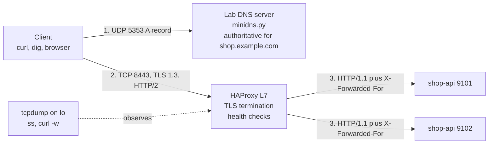
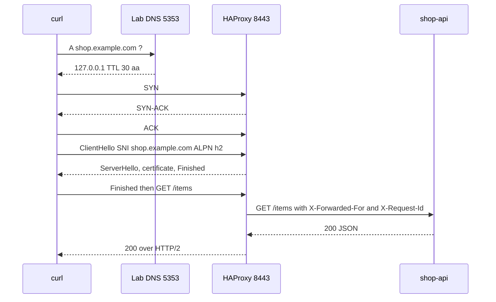

# L2 Capstone — Trace a full HTTPS request end to end

> **Level 2: Networking** · Capstone · ⏱ ~6 hours

## 1. Goal and outcome

You will do two things and connect them:

1. **Build a miniature copy of the real path** on one machine: a DNS server that is authoritative for `shop.example.com`, an HTTPS load balancer (HAProxy) that terminates TLS and speaks HTTP/2, and two `shop-api` backends with health checks.
2. **Trace a request through it, and through the real internet**, with `dig`, `curl -v`, `ss` and `tcpdump`, then write the whole story in your own words.

**Outcome:** you can explain, with evidence from your own captures, what happens from typing `https://example.com` into a browser to the application response: URL and caches, DNS, routing and NAT, the TCP handshake, TLS with SNI and certificates, the HTTP request, the load balancer, the application, and the return path. You will also be able to break each stage deliberately and name the symptom. This is the practice project of the roadmap's Level 2.

## 2. Architecture



The sequence you will capture and label:



The same shape exists in production with different parts: Route 53 instead of `minidns.py`, CloudFront or an ALB instead of HAProxy, Kubernetes Pods or EC2 instances instead of two Python processes. See [L2.11](11-what-happens-when-you-visit-a-url.md).

## 3. Prerequisites and cost

- **Cost:** none. Everything runs on localhost; the real-internet part only fetches `example.com`, a public documentation site.
- **OS and tools:** Linux (or WSL2 / a free VM) with `python3`, `curl` (8.x with HTTP/2), `openssl`, `haproxy` 2.4 or newer, `dig`, `ss`, `nc`, `tcpdump`. Install on Ubuntu/Debian: `sudo apt-get install -y python3 curl openssl haproxy dnsutils iproute2 netcat-openbsd tcpdump mtr-tiny`, then stop any auto-started system HAProxy: `sudo systemctl disable --now haproxy`.
- **Root:** `tcpdump` needs `sudo`. Ports used: UDP 5353, TCP 8443, 9101, 9102.
- **Proxy note:** if your shell has `https_proxy`/`HTTPS_PROXY` set, add `--noproxy '*'` to every `curl` below (or `unset https_proxy HTTPS_PROXY http_proxy`).
- **Knowledge:** topics L2.1 to L2.10. Outputs below are representative ("similar to"); addresses, ports and timings will differ.

## 4. Build it step by step

Work in a fresh directory: `mkdir -p ~/l2-capstone && cd ~/l2-capstone`.

### Milestone 1 — Know your own network path (topics 1, 3, 4)

```bash
ip -br addr                                  # your interfaces and addresses
ip route                                     # default via <gateway> dev <iface>
ip route get 8.8.8.8                         # which gateway and source IP a public destination uses
ip neigh show                                # ARP table: the gateway's MAC, not the destination's
python3 -c "import ipaddress as i; n=i.ip_interface('192.168.1.20/24').network; print(n, n.num_addresses, n.broadcast_address)"
```

You should see a `default via <gateway>` line, a `src` address in a private range (RFC 1918) when you are behind a home or cloud NAT, and an ARP entry for the gateway only. Write down: your IP, subnet, gateway, and your public IP (`curl -s https://ifconfig.me` shows what NAT presents to the internet).

### Milestone 2 — A DNS server you control (topic 5)

Save as `minidns.py`:

```python
"""Tiny authoritative DNS server for the lab: answers A for shop.example.com only."""
import socket, struct

ZONE = {"shop.example.com": "127.0.0.1"}
TTL = 30

def qname(data):
    labels, i = [], 12
    while data[i]:
        labels.append(data[i + 1:i + 1 + data[i]].decode())
        i += 1 + data[i]
    return ".".join(labels).lower(), i + 1          # name, offset of QTYPE

sock = socket.socket(socket.AF_INET, socket.SOCK_DGRAM)
sock.bind(("127.0.0.1", 5353))
print("lab DNS listening on 127.0.0.1:5353", flush=True)
while True:
    data, addr = sock.recvfrom(512)
    name, off = qname(data)
    qtype = struct.unpack("!H", data[off:off + 2])[0]
    question = data[12:off + 4]
    tid, rd = data[:2], data[2] & 1
    if name in ZONE and qtype == 1:                 # A record
        head = tid + struct.pack("!HHHHH", 0x8400 | (rd << 8), 1, 1, 0, 0)
        answer = b"\xc0\x0c" + struct.pack("!HHIH", 1, 1, TTL, 4) + socket.inet_aton(ZONE[name])
        reply = head + question + answer
    elif name in ZONE:                              # name exists, other type: NOERROR no data
        reply = tid + struct.pack("!HHHHH", 0x8400 | (rd << 8), 1, 0, 0, 0) + question
    else:                                           # NXDOMAIN
        reply = tid + struct.pack("!HHHHH", 0x8403 | (rd << 8), 1, 0, 0, 0) + question
    sock.sendto(reply, addr)
```

```bash
python3 minidns.py & echo $! >> pids.txt
dig @127.0.0.1 -p 5353 shop.example.com A          # status NOERROR, flags include aa, answer 127.0.0.1 TTL 30
dig @127.0.0.1 -p 5353 nope.example.com A          # status NXDOMAIN
dig @127.0.0.1 -p 5353 shop.example.com AAAA       # NOERROR with an empty answer (name exists, no such type)
```

Now compare with the real hierarchy: `dig example.com A`, then `dig +trace example.com A | tail -15`, then `dig @1.1.1.1 example.com A +noall +answer` twice (TTL counts down). Your lab server is authoritative (the `aa` flag) and does not cache; the resolver does.

### Milestone 3 — Certificate and backends (topics 2, 6, 7)

```bash
openssl req -x509 -newkey rsa:2048 -nodes -keyout shop.key -out shop.crt -days 7 \
  -subj "/CN=shop.example.com" -addext "subjectAltName=DNS:shop.example.com"
cat shop.crt shop.key > shop.pem
openssl x509 -in shop.crt -noout -subject -issuer -dates -ext subjectAltName
```

Save as `shop_api.py` (a stand-in for the Node.js `shop-api`; it echoes what the proxy told it):

```python
import json, sys
from http.server import BaseHTTPRequestHandler, ThreadingHTTPServer

PORT = int(sys.argv[1])

class H(BaseHTTPRequestHandler):
    protocol_version = "HTTP/1.1"
    def do_GET(self):
        if self.path == "/healthz":
            body = b"ok\n"
        else:
            body = (json.dumps({
                "app": f"shop-api:{PORT}",
                "path": self.path,
                "client_seen_by_app": self.client_address[0],
                "x_forwarded_for": self.headers.get("X-Forwarded-For"),
                "x_forwarded_proto": self.headers.get("X-Forwarded-Proto"),
                "x_request_id": self.headers.get("X-Request-Id"),
                "host": self.headers.get("Host"),
            }) + "\n").encode()
        self.send_response(200)
        self.send_header("Content-Type", "application/json")
        self.send_header("Content-Length", str(len(body)))
        self.end_headers()
        self.wfile.write(body)
    def log_message(self, *a):
        pass
    def handle(self):
        try:
            super().handle()
        except ConnectionError:
            pass

ThreadingHTTPServer(("127.0.0.1", PORT), H).serve_forever()
```

```bash
for p in 9101 9102; do python3 shop_api.py $p & echo $! >> pids.txt; done
curl -s http://127.0.0.1:9101/items          # JSON with x_forwarded_for null: no proxy yet
```

### Milestone 4 — The load balancer (topics 8, 9)

```bash
cat > haproxy.cfg <<EOF
global
    log stdout format raw local0

defaults
    mode http
    log global
    option httplog
    timeout connect 2s
    timeout client  30s
    timeout server  30s

frontend fe_https
    bind 127.0.0.1:8443 ssl crt $PWD/shop.pem alpn h2,http/1.1
    http-request set-header X-Forwarded-Proto https
    unique-id-format %{+X}o\ %ci:%cp_%fi:%fp_%Ts_%rt
    unique-id-header X-Request-Id
    option forwardfor
    default_backend be_shop_api

backend be_shop_api
    balance roundrobin
    option httpchk
    http-check send meth GET uri /healthz
    http-check expect status 200
    default-server inter 1s fall 2 rise 2
    server app1 127.0.0.1:9101 check
    server app2 127.0.0.1:9102 check
EOF
haproxy -c -f haproxy.cfg                     # Configuration file is valid
haproxy -D -f haproxy.cfg -p hap.pid
sleep 3
IP=$(dig @127.0.0.1 -p 5353 +short shop.example.com)        # 127.0.0.1 from YOUR dns server
for i in 1 2 3 4; do curl -s --cacert shop.crt --resolve shop.example.com:8443:$IP https://shop.example.com:8443/items; done
```

Expect alternating `shop-api:9101` and `shop-api:9102`, `x_forwarded_proto: https`, a unique `x_request_id` on each line, and `host: shop.example.com:8443`. The app sees `127.0.0.1` as its client (the proxy) and learns the real client only from `X-Forwarded-For`.

### Milestone 5 — Trace one request across all layers (topics 2, 5, 6, 7, 10)

Terminal A (capture DNS and the HTTPS port; stops after 40 packets):

```bash
sudo tcpdump -nn -tt -i lo -c 40 'udp port 5353 or tcp port 8443' | tee trace.txt
```

Terminal B (the request, with every phase timed):

```bash
IP=$(dig @127.0.0.1 -p 5353 +short shop.example.com)
curl -sv --cacert shop.crt --resolve shop.example.com:8443:$IP https://shop.example.com:8443/items \
  -w '\ndns_skipped_by_resolve tcp=%{time_connect} tls=%{time_appconnect} ttfb=%{time_starttransfer} total=%{time_total} http=%{http_version}\n' 2>&1 | grep -vE '^\{|^\}' | tee curl-v.txt
ss -tn state established '( sport = :8443 or dport = :8443 )'
```

Because `--resolve` bypasses DNS, also run `dig @127.0.0.1 -p 5353 shop.example.com` while the capture is running so the DNS exchange appears. In `trace.txt` find, in order: the UDP query and response on port 5353; `[S]`, `[S.]`, `[.]`; the first `[P.]` packets (ClientHello, then the server's flight with the certificate); the encrypted exchange; `[F.]`. In `curl-v.txt` find `ALPN: server accepted h2`, `SSL connection using TLSv1.3`, the `subjectAltName` match, and `HTTP/2 200`.

### Milestone 6 — The real internet (all topics)

Repeat the investigation against `https://example.com` (see [L2.11 section 6](11-what-happens-when-you-visit-a-url.md) for each command):

```bash
dig +trace example.com A | tail -20
IP=$(dig +short example.com A | head -1)
ip route get "$IP"
mtr -rwn -c 5 "$IP" 2>/dev/null || traceroute -n -m 12 "$IP"
sudo tcpdump -nn -tt -i any -c 30 "host $IP and tcp port 443" > real-trace.txt & TCPDUMP=$!
sleep 1
curl -sv https://example.com/ -o /dev/null -w 'tcp=%{time_connect} tls=%{time_appconnect} ttfb=%{time_starttransfer} total=%{time_total}\n' 2> real-curl-v.txt
wait $TCPDUMP
echo | openssl s_client -connect "$IP:443" -servername example.com 2>/dev/null | openssl x509 -noout -subject -issuer -dates -ext subjectAltName
```

Compare lab and real: the lab has no CDN and no ISP, so its RTT is microseconds; the real handshake shows the actual round-trip time to the server (or its nearest edge), a public CA chain and probably CDN headers.

### Milestone 7 — Break each layer (topics 4, 5, 6, 7, 8, 10)

With a short helper, `diagnose.sh` (from [L2.10](10-network-debugging-tools.md)), or by hand:

| Fault to inject | Command | Expected symptom | Layer |
|-----------------|---------|------------------|-------|
| DNS record missing | `dig @127.0.0.1 -p 5353 nope.example.com` | `NXDOMAIN` | DNS |
| Stop the proxy | `kill $(cat hap.pid)` then the curl | `curl: (7) Failed to connect ... Connection refused`, exit 7 | TCP |
| Drop the port | `sudo iptables -A INPUT -p tcp --dport 8443 -j DROP` (with HAProxy running), curl with `--connect-timeout 3` | `Connection timed out`, exit 28; tcpdump shows repeated `[S]` and no reply | Firewall |
| Wrong name | `curl --cacert shop.crt --resolve other.example.com:8443:127.0.0.1 https://other.example.com:8443/` | `SSL: no alternative certificate subject name matches` | TLS |
| No trust | same request without `--cacert` | `SSL certificate problem: self-signed certificate`, exit 60 | TLS |
| Stop one backend | kill the PID of 9102 | still `200` from 9101 after about 2 s of health checks; stats show app2 DOWN | LB |
| Stop both backends | kill both | HAProxy answers `503 Service Unavailable` | LB / app |

Remove the iptables rule afterwards: `sudo iptables -D INPUT -p tcp --dport 8443 -j DROP`.

### Milestone 8 — Write the explanation

Create `my-trace.md` with these headings and fill each with 3-6 sentences in your own words plus one line of pasted evidence from your own files: **1 URL and caches, 2 DNS, 3 Local network, routing and NAT, 4 TCP handshake, 5 TLS (SNI, certificate, version), 6 HTTP request and response, 7 Load balancer (L4 vs L7, health checks), 8 Application and response, 9 Rendering and connection reuse**. Finish with a table of the lab's `curl -w` timings and a paragraph: what would change in production with a CDN, Route 53 and an ALB.

## 5. Tasks

- [ ] **T1 — Map your own path (Milestone 1)** *(≈30 min, beginner)*
  - **Goal:** identify IP, subnet, gateway, ARP and NAT for your machine. *Exercises topics L2.1, L2.3, L2.4.*
  - **Steps:**
    1. Run the Milestone 1 commands and record address, prefix, gateway, MAC of the gateway and public IP.
    2. Compute the subnet's network, broadcast and usable-host count with Python's `ipaddress`.
    3. Explain in two sentences why `ip neigh` lists the gateway but never a public destination such as `8.8.8.8`.
  - **Done when:** your note has all six values and a correct explanation of the ARP/gateway behaviour.

- [ ] **T2 — Stand up and query your own authoritative DNS (Milestone 2)** *(≈45 min, intermediate)*
  - **Goal:** distinguish authoritative from recursive behaviour and read `dig` fully. *Exercises L2.5.*
  - **Steps:**
    1. Run `minidns.py`, query `A`, `AAAA` and a missing name; record status and flags for each.
    2. Add a second name (`api.example.com` to `127.0.0.1`) to `ZONE`, restart, and verify.
    3. Run `dig +trace example.com` and list root, TLD and authoritative servers; compare TTLs from `@1.1.1.1` over time with your server's constant TTL.
  - **Done when:** you show `aa` on your server's answers, `NXDOMAIN` for a missing name, a counting-down TTL from the public resolver, and the traced delegation chain.

- [ ] **T3 — Inspect TCP and TLS by hand (Milestone 3 and 4)** *(≈60 min, intermediate)*
  - **Goal:** observe the handshakes and certificate checks directly. *Exercises L2.2, L2.6.*
  - **Steps:**
    1. With HAProxy running, run `openssl s_client -connect 127.0.0.1:8443 -servername shop.example.com -brief` and record version, cipher and verification result; repeat with `-tls1_2`.
    2. Run with `-CAfile shop.crt -verify_hostname shop.example.com` and then `-verify_hostname other.example.com`.
    3. Show listening and established sockets with `ss -ltnp 'sport = :8443'` and `ss -tn state established`.
  - **Done when:** you have TLS 1.3 and 1.2 results, one passing and one failing hostname check, and the `ss` output showing HAProxy bound to 8443.

- [ ] **T4 — Prove load balancing and failover (Milestone 4)** *(≈45 min, intermediate)*
  - **Goal:** show round robin, health checks and header forwarding. *Exercises L2.7, L2.8, L2.9.*
  - **Steps:**
    1. Send 10 requests and count responses per backend.
    2. Kill backend 9102, wait 3 seconds, send 10 more requests and count status codes; check `show servers state` or stats for `DOWN`.
    3. Change `balance roundrobin` to `balance leastconn`, reload, and verify. Add a second `frontend` in `mode tcp` on port 8444 with `req_ssl_sni` routing (see [L2.9](09-l4-vs-l7-load-balancing.md)) and compare what it can and cannot see.
  - **Done when:** counts show an even split, then all `200` from the surviving backend, and you can state one thing the L4 frontend cannot do.

- [ ] **T5 — Capture and label the full request (Milestones 5 and 6)** *(≈75 min, advanced)*
  - **Goal:** produce an annotated timeline for both the lab and the real `example.com`. *Exercises L2.2, L2.5, L2.6, L2.10.*
  - **Steps:**
    1. Create the lab capture (`trace.txt`) and the real capture (`real-trace.txt`).
    2. Label each packet: DNS query/response, SYN, SYN-ACK, ACK, ClientHello, server certificate flight, Finished, application data, FIN.
    3. Compute the RTT (SYN to SYN-ACK) and compare with `time_connect`; compute the TLS handshake duration from the capture and compare with `time_appconnect - time_connect`.
  - **Done when:** both captures are labelled, the packet-derived and `curl`-derived times agree within a few milliseconds, and you can say which stages are absent from the lab.

- [ ] **T6 — Break each layer and name it (Milestone 7)** *(≈60 min, advanced)*
  - **Goal:** match symptoms to layers under pressure. *Exercises L2.4, L2.5, L2.6, L2.7, L2.8, L2.10.*
  - **Steps:**
    1. Inject each fault in the Milestone 7 table (ask a partner to inject them blindly if possible).
    2. For each, run the decision tree from [L2.10](10-network-debugging-tools.md) and record the command, error text, curl exit code and the layer.
    3. Restore the lab after every fault and re-verify with a `200`.
  - **Done when:** your table has all seven faults with exact errors and correct layers, and the lab is healthy at the end.

- [ ] **T7 — Prove it: explain the whole journey (Milestone 8)** *(≈60 min, advanced)*
  - **Goal:** deliver the written and spoken explanation of what happens from typing `https://example.com` to the application response. *Exercises all topics, especially L2.11.*
  - **Steps:**
    1. Without the guide, write `my-trace.md` as described, using your own evidence lines.
    2. Draw your own Mermaid `sequenceDiagram` of the production version of `shop-api` (Route 53, CloudFront or ALB, Nginx, Node.js, PostgreSQL, Redis).
    3. Present it in two minutes to a colleague (or record it) and answer two of their questions.
  - **Done when:** `my-trace.md` covers DNS, TCP, TLS, HTTP, load balancing, application and response with real evidence, your diagram renders, and the colleague can retell the journey.

## 6. Verification checklist

- [ ] `dig @127.0.0.1 -p 5353 shop.example.com` returns `127.0.0.1` with the `aa` flag and TTL 30.
- [ ] `haproxy -c -f haproxy.cfg` says the configuration is valid and `ss -ltnp 'sport = :8443'` shows `haproxy`.
- [ ] `curl --cacert shop.crt --resolve ...` returns JSON alternating between 9101 and 9102.
- [ ] `curl -v` shows `TLSv1.3`, `ALPN: server accepted h2`, a matching `subjectAltName`, and `HTTP/2 200`.
- [ ] The JSON shows `x_forwarded_for`, `x_forwarded_proto: https` and a distinct `x_request_id` per request.
- [ ] Killing one backend causes no failed requests after the health check interval; killing both gives `503`.
- [ ] `trace.txt` contains the DNS exchange, the SYN/SYN-ACK/ACK sequence, the TLS records and the FIN, all labelled.
- [ ] You captured the same sequence for the real `example.com` and compared RTT and TLS time.
- [ ] You can explain the exact difference between `refused`, `timed out`, `NXDOMAIN`, a certificate error and a `503`.
- [ ] `my-trace.md` exists and a colleague has read it.

## 7. Teardown

```bash
kill $(cat hap.pid) 2>/dev/null
kill $(cat pids.txt) 2>/dev/null          # minidns.py and both shop_api.py processes
sudo iptables -D INPUT -p tcp --dport 8443 -j DROP 2>/dev/null   # only if you added it in Milestone 7
ss -ltn | grep -E ':(5353|8443|9101|9102)\b' || echo "all lab ports free"
```

Keep `my-trace.md` and the capture files (`trace.txt`, `real-trace.txt`, `curl-v.txt`) as your portfolio evidence; delete the rest with `rm -rf ~/l2-capstone` when finished. Do not reuse the generated `shop.key` anywhere: it was created only for this lab.

## 8. Stretch goals and what to learn next

- Add an **L4 layer in front** (HAProxy `mode tcp` with `send-proxy`, or an Nginx `stream` block) and re-terminate TLS behind it; show how the client IP survives via the PROXY protocol ([L2.9](09-l4-vs-l7-load-balancing.md)).
- Run **HTTP/3**: put Caddy or an Nginx build with QUIC in front, check `curl --http3` and the `Alt-Svc` header, and compare the handshake in `tcpdump` (UDP 443).
- Replace `minidns.py` with **CoreDNS** or **BIND** serving a real zone file with `A`, `CNAME`, `MX` and `TXT`; add a caching resolver (`unbound`) and measure a TTL-based cut-over.
- Rebuild the same stack in the cloud: Route 53 alias record to an ALB with an ACM certificate and a two-instance target group, then repeat the trace from your laptop ([Level 6: Route 53](../level-06-cloud-aws/12-route-53.md), [ALB](../level-06-cloud-aws/14-alb.md)). Set a billing alarm first and tear it down immediately.
- Put the lab in Docker Compose and then Kubernetes with an Ingress ([Level 4](../level-04-docker/08-docker-compose.md), [Level 8](../level-08-kubernetes/05-ingress.md)).
- Go deeper on the same path: [Level 12: Advanced Networking](../level-12-advanced-networking/01-osi-and-tcpip-models.md) (BGP, TLS internals, HTTP/2 and QUIC, CDNs, connection pooling, mTLS).
- **Next:** [Level 3: Git and GitHub](../level-03-git-and-github/01-branching-and-merging.md), where you start version-controlling the configuration you wrote here.

<!-- nav -->
---
← Previous: [What Happens When You Visit https://example.com](11-what-happens-when-you-visit-a-url.md) · [Level 2 index](README.md) · Next level: [Level 3 — Git & GitHub](../level-03-git-and-github/README.md) →
