# Level 2 — Networking

> **Goal:** Build the networking foundation senior DevOps work depends on; explain exactly what happens from typing https://example.com to the application response.

| | |
|---|---|
| **Recommended time** | 2-4 weeks |
| **Topics** | 11 |
| **Practice / capstone** | Trace a full HTTPS request end to end using dig, curl -v, ss and tcpdump, and write the explanation in your own words. |

## Topics

| # | Topic | What you will learn |
|---|-------|---------------------|
| 1 | [IP, MAC, ARP and DHCP](01-ip-mac-arp-dhcp.md) | addressing layers, how a host gets an address, ARP resolution |
| 2 | [TCP, UDP and ICMP](02-tcp-udp-icmp.md) | reliability, handshakes, when UDP, ping/traceroute via ICMP |
| 3 | [IPv4, IPv6, CIDR and Subnets](03-ipv4-ipv6-cidr-subnets.md) | CIDR math, subnetting a VPC, IPv6 basics |
| 4 | [Routing, NAT, Ports and Firewalls](04-routing-nat-ports-firewalls.md) | routing tables, default gateway, SNAT/DNAT, port ranges, stateful firewalls, iptables/nftables |
| 5 | [DNS Resolution and Domain Architecture](05-dns-resolution.md) | recursive vs authoritative, record types, TTL, zones, delegation |
| 6 | [TCP Connections and TLS Handshakes](06-tcp-and-tls-handshakes.md) | 3-way handshake, TLS 1.2/1.3 handshake, certificates, SNI |
| 7 | [HTTP Methods and Status Codes](07-http-methods-and-status-codes.md) | GET/POST/PUT/PATCH/DELETE, idempotency, 2xx/3xx/4xx/5xx, headers |
| 8 | [Reverse Proxies and Load Balancers](08-reverse-proxies-and-load-balancers.md) | Nginx/HAProxy/Envoy, health checks, balancing algorithms |
| 9 | [L4 versus L7 Load Balancing](09-l4-vs-l7-load-balancing.md) | transport vs application routing, NLB vs ALB, trade-offs |
| 10 | [Network Debugging Tools](10-network-debugging-tools.md) | ping traceroute curl dig nslookup ss tcpdump nc, a debugging decision tree |
| 11 | [What Happens When You Visit https://example.com](11-what-happens-when-you-visit-a-url.md) | end-to-end synthesis of every previous topic |
| ★ | [Level capstone project](99-capstone-project.md) | Trace a full HTTPS request end to end using dig, curl -v, ss and tcpdump, and write the explanation in your own words. |

## How to work through this level

1. Read each topic in order: *what it is → why it matters → real-world example → diagram → guide*.
2. Do **every task** in the topic's *Tasks* section and tick the box (`- [x]`) in your own fork or notes.
3. Answer the *Self-check questions* without looking, then reveal the answers.
4. Finish with the **capstone project**, which combines all topics of the level.
5. Move on only when you can do the capstone's *Prove it* task without the guide.

## Topic flow

```mermaid
flowchart LR
    T1["1. IP, MAC, ARP and DHCP"]
    T2["2. TCP, UDP and ICMP"]
    T3["3. IPv4, IPv6, CIDR and Subnets"]
    T4["4. Routing, NAT, Ports and Firewalls"]
    T5["5. DNS Resolution and Domain Architecture"]
    T6["6. TCP Connections and TLS Handshakes"]
    T7["7. HTTP Methods and Status Codes"]
    T8["8. Reverse Proxies and Load Balancers"]
    T9["9. L4 versus L7 Load Balancing"]
    T10["10. Network Debugging Tools"]
    T11["11. What Happens When You Visit https://example.com"]
    CAP(["Capstone"])
    T1 --> T2 --> T3 --> T4 --> T5 --> T6 --> T7 --> T8 --> T9 --> T10 --> T11 --> CAP
```

---
← [Level 1 — Linux Fundamentals](../level-01-linux-fundamentals/README.md) · [Roadmap home](../README.md) · [Level 3 — Git & GitHub](../level-03-git-and-github/README.md) →
