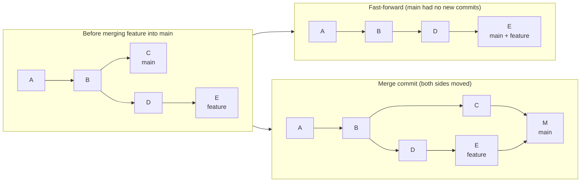
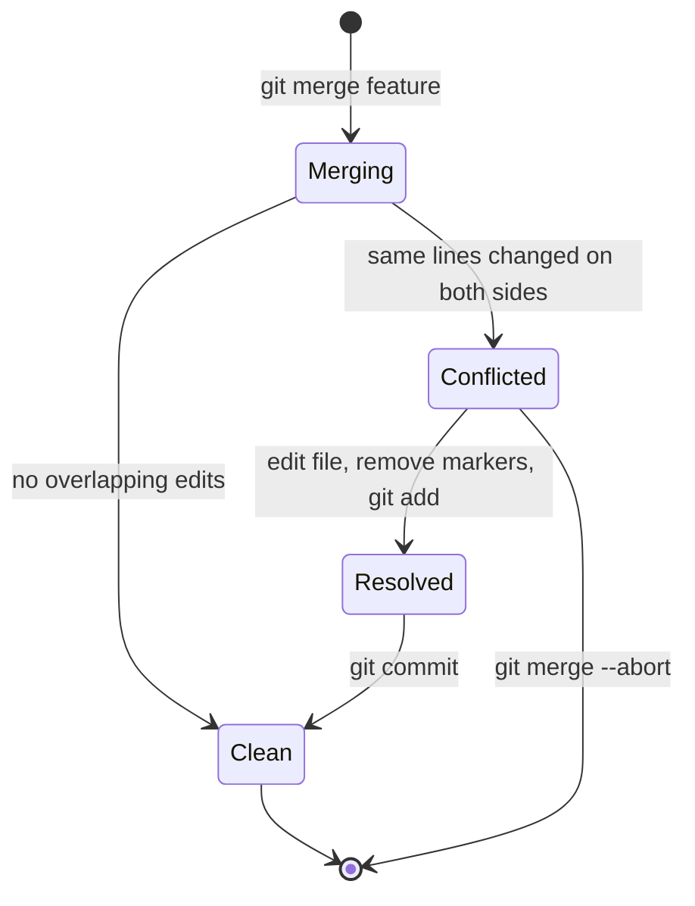

# L3.1 — Branching and Merging

> **Level 3: Git & GitHub** · Topic 1 of 13 · ⏱ ~3 hours · Difficulty: Beginner

## 1. What it is

A Git **commit** is a snapshot of your project plus a pointer to its parent commit(s). A **branch** is nothing more
than a movable, named pointer to one commit — a 41-byte file in `.git/refs/heads/`. Creating a branch is therefore
instant and free: Git writes a name and a hash, it does not copy any files. `HEAD` is a pointer to "the branch (or
commit) you are on right now".

**Merging** combines the work of one branch into another. Git has two shapes of merge. A **fast-forward** simply
slides the branch pointer forward when the target has not moved. A **merge commit** (a "three-way merge") creates a
new commit with *two* parents when both branches have new work. When both sides changed the same lines, Git cannot
decide for you and reports a **conflict** that a human must resolve.

## 2. Why it matters in DevOps

- **Isolation:** every change (feature, fix, infra tweak) lives on its own branch, so `main` stays deployable. CI/CD
  pipelines ([CI/CD](../level-00-what-devops-is/02-ci-cd.md)) run per branch and per pull request.
- **History is an audit log:** the shape of the history (merge commits vs a straight line) decides how easy it is to
  find who changed a Terraform file, revert a release or bisect a regression.
- **Conflicts at 5 p.m. on release day** are a process smell. Short-lived branches and frequent merges keep conflicts small.
- **Infrastructure repos are shared state:** two people editing the same `values.yaml` or `main.tf` will conflict.
  Knowing how to read and resolve one safely is a daily skill.

## 3. Real-world system example

**The Linux kernel and Git itself.** Git was created by Linus Torvalds in 2005 to manage Linux kernel development,
where thousands of contributors work on many branches at once. Maintainers keep subsystem branches and Linus merges
them into the mainline tree; the resulting history is full of deliberate merge commits that record "this subsystem
tree was pulled at this point".

**GitHub and GitLab pull/merge requests.** A pull request is a branch plus a discussion, and the "Merge" button on
GitHub offers exactly the three strategies in this topic's family: *Create a merge commit* (a `--no-ff` merge),
*Squash and merge* (one new commit on the target) and *Rebase and merge* (replay commits, covered in
[Rebasing](02-rebasing.md)). Which one a team picks is a policy decision about the shape of history.

## 4. Diagram

How a branch is just a pointer, and how the two kinds of merge differ:



The life of a merge conflict:



## 5. How it works

| Command | What it does |
|---------|--------------|
| `git branch` | list local branches (`-a` adds remote-tracking ones) |
| `git switch <b>` / `git switch -c <b>` | move to a branch / create and move (modern replacement for `git checkout <b>`) |
| `git merge <b>` | merge `<b>` into the current branch; fast-forwards when possible |
| `git merge --no-ff <b>` | always create a merge commit, even if a fast-forward is possible |
| `git merge --ff-only <b>` | refuse to merge unless it can fast-forward (safe for "update my local main") |
| `git merge --abort` | abandon a conflicted merge and return to the pre-merge state |
| `git branch --merged` / `--no-merged` | which branches are (not) fully contained in the current one |
| `git branch -d <b>` / `-D <b>` | delete if merged / delete regardless |
| `git log --oneline --graph --all` | draw the history as a graph |

**Fast-forward vs merge commit — the trade-off**

| | Fast-forward | Merge commit (`--no-ff`) |
|--|--------------|--------------------------|
| History shape | straight line | branches visible, with a merge point |
| Records "this feature was one unit" | no | yes: one commit to revert (`git revert -m 1`) |
| Possible when | target has no new commits | always |
| Noise | none | extra merge commits |

**Conflict markers.** During a conflict Git rewrites the file like this:

```text
<<<<<<< HEAD
PORT=9000
=======
PORT=8080
>>>>>>> feature/port-8080
```

Everything between `<<<<<<<` and `=======` is *your* side (the branch you are on); between `=======` and `>>>>>>>`
is *theirs* (the branch being merged). Resolve by editing the file to the final text you want and **deleting all
three marker lines**. `git status` lists such files as `UU` ("both modified").

## 6. Step-by-step guide

**Prerequisites:** Git 2.30+ (`git --version`). Everything below happens in a throwaway local folder; no GitHub account needed.
First-time setup, once per machine:

```bash
git config --global user.name  "Your Name"
git config --global user.email "you@example.com"
git config --global init.defaultBranch main
```

1. **Create a repo with one commit.**
   ```bash
   git init shop-api && cd shop-api
   echo '{"name":"shop-api","version":"1.0.0"}' > package.json
   echo "# shop-api" > README.md
   git add . && git commit -m "Initial commit"
   ```

2. **Branch, commit, and fast-forward merge.**
   ```bash
   git switch -c feature/health-endpoint
   echo "app.get('/health', ok)" > health.js
   git add . && git commit -m "Add /health endpoint"
   git switch main
   git merge feature/health-endpoint
   ```
   Expected output ends with `Fast-forward` and a one-line diffstat. `git log --oneline --graph --all` shows one straight line.

3. **Force a merge commit with `--no-ff`.**
   ```bash
   git switch -c feature/cart
   echo cart > cart.js && git add . && git commit -m "Add cart module"
   git switch main
   git merge --no-ff feature/cart -m "Merge branch 'feature/cart'"
   git log --oneline --graph
   ```
   You should see `Merge made by the 'ort' strategy.` and a graph similar to:
   ```text
   *   f81a2ae Merge branch 'feature/cart'
   |\
   | * 4df4226 Add cart module
   |/
   * e8229a4 Add /health endpoint
   * b5dad63 Initial commit
   ```
   (Hashes will differ on your machine.)

4. **Produce a real three-way merge** (both branches have new commits, different files, so no conflict):
   ```bash
   git switch -c feature/search
   echo search > search.js && git add . && git commit -m "Add search"
   git switch main
   echo "// logging" > logging.js && git add . && git commit -m "Add logging"
   git merge feature/search -m "Merge branch 'feature/search'"
   ```

5. **Create and resolve a conflict.**
   ```bash
   printf 'PORT=3000\nLOG_LEVEL=info\n' > config.env
   git add . && git commit -m "Add config.env"
   git switch -c feature/port-8080
   sed -i 's/PORT=3000/PORT=8080/' config.env && git commit -am "Use port 8080"
   git switch main
   sed -i 's/PORT=3000/PORT=9000/' config.env && git commit -am "Use port 9000"
   git merge feature/port-8080
   ```
   (On macOS use `sed -i ''`.) Expected output:
   ```text
   Auto-merging config.env
   CONFLICT (content): Merge conflict in config.env
   Automatic merge failed; fix conflicts and then commit the result.
   ```
   Inspect, fix and finish:
   ```bash
   git status --short          # UU config.env
   cat config.env              # shows the <<<<<<< ======= >>>>>>> markers
   printf 'PORT=8080\nLOG_LEVEL=info\n' > config.env   # the final text you decided on
   git add config.env
   git commit                  # accept the default merge message
   ```
   If you panic at any point before the final commit: `git merge --abort` puts everything back.

6. **Clean up merged branches.**
   ```bash
   git branch --merged         # branches safe to delete
   git branch -d feature/cart feature/search feature/health-endpoint feature/port-8080
   ```

7. **Make `git pull` safe by default** (avoids accidental merge commits when updating a shared branch):
   ```bash
   git config --global pull.ff only
   ```

## 7. Real-world scenario

*(Illustrative.)* Two engineers on the `shop-api` team both edit `deploy/values.yaml` on separate branches: Maya
changes the replica count from 2 to 4 for a sale, Tunde changes the same block to add a memory limit. Maya merges
first. When Tunde opens his pull request, GitHub shows "This branch has conflicts that must be resolved". Tunde runs
`git fetch origin && git merge origin/main` locally, opens `values.yaml`, sees both sides, keeps **both** changes
(replicas: 4 *and* the memory limit), runs `helm template` to confirm the file still renders, commits the merge and
pushes. The PR turns green.
**Lesson:** a conflict is not a failure, it is Git asking a human to make an intent decision. The dangerous move is
choosing "ours" or "theirs" blindly, or resolving without re-running the tests — always validate after resolving.

## 8. Common mistakes and best practices

**Don't**

- Leave conflict markers in a file and commit it (a CI lint such as `grep -rn '^<<<<<<<' .` catches this).
- Use `git merge -X ours/theirs` or `git checkout --ours .` on a whole tree without reading what you discard.
- Keep a feature branch alive for weeks — the longer it lives, the worse the eventual merge.
- Commit directly on `main` when a team policy says use pull requests.
- Delete a branch you have not merged with `-D` unless you are sure (you can still recover it, see [reset and revert](04-reset-and-revert.md)).

**Do**

- Branch from an up-to-date `main` (`git switch main && git pull --ff-only` first).
- Merge `main` into (or rebase onto) your branch regularly so conflicts surface in small pieces.
- Use `git log --oneline --graph --all` and `git diff main...feature` (three dots = changes on the feature since it diverged) before merging.
- Re-run tests after resolving a conflict; a clean merge can still be a broken build.
- Pick one merge policy per repo and write it down in `CONTRIBUTING.md` (see [Protected Branches and Pull Requests](08-protected-branches-and-pull-requests.md)).

## 9. Tasks

- [ ] **T1 — Watch a fast-forward and a merge commit** *(≈25 min, beginner)*
  - **Goal:** see both merge shapes in the history graph.
  - **Steps:**
    1. Follow steps 1-3 of the guide in a fresh folder.
    2. Run `git log --oneline --graph --all` after each merge.
    3. Run `git cat-file -p HEAD` after the `--no-ff` merge and count the `parent` lines.
  - **Done when:** the fast-forward merge shows a straight line, the `--no-ff` merge shows two `parent` lines.

- [ ] **T2 — Resolve a conflict by hand** *(≈30 min, beginner)*
  - **Goal:** resolve a content conflict and finish the merge.
  - **Steps:**
    1. Reproduce step 5.
    2. Resolve it so the file contains `PORT=8080` and `LOG_LEVEL=info`, with no markers.
    3. Complete the merge and verify with `grep -c '<<<<<<<' config.env` (expect `0`).
  - **Done when:** `git status` is clean and `git log --graph` shows the merge commit.

- [ ] **T3 — Abort and retry** *(≈20 min, intermediate)*
  - **Goal:** learn the escape hatch.
  - **Steps:**
    1. Recreate the conflict from step 5 on a new pair of branches.
    2. Run `git merge --abort`.
    3. Confirm with `git status` and `git log --oneline -3` that nothing changed on `main`.
    4. Re-run the merge and resolve it using `git mergetool` or your editor's merge view.
  - **Done when:** after the abort `git status` says "nothing to commit, working tree clean" and `config.env` has no markers.

- [ ] **T4 — Break and fix: the committed conflict marker** *(≈30 min, intermediate)*
  - **Goal:** catch a classic mistake automatically.
  - **Steps:**
    1. Deliberately commit a file that still contains `<<<<<<< HEAD`.
    2. Write a pre-commit hook in `.git/hooks/pre-commit` that runs `git diff --cached | grep -n '^+<<<<<<<' && exit 1 || exit 0` and make it executable.
    3. Try the commit again.
  - **Done when:** the commit is rejected with the offending line number printed.

- [ ] **T5 — Enforce a merge policy** *(≈20 min, intermediate)*
  - **Goal:** make a repo refuse unsafe merges.
  - **Steps:**
    1. Set `git config pull.ff only`.
    2. Make `main` diverge from a clone of it (commit locally and in a second clone, push from the second), then run `git pull` in the first.
    3. Observe the refusal and fix it with `git pull --rebase` or an explicit merge.
  - **Done when:** you can explain why `pull.ff only` refused and show the two commands that resolve it.

- [ ] **T6 — Prove it: explain the graph** *(≈30 min, advanced)*
  - **Goal:** read history like a map.
  - **Steps:**
    1. Without the guide, build a repo where `git log --oneline --graph --all` shows exactly: one fast-forwarded branch, one `--no-ff` merge and one conflict-resolved merge.
    2. Explain out loud (or in writing) which command produced each shape and how you would revert the `--no-ff` feature as a single operation.
  - **Done when:** your graph matches the three shapes and the explanation mentions `git revert -m 1`.

## 10. Self-check questions

1. What exactly is a branch in Git, and why is creating one cheap?
2. When can a merge fast-forward, and what does `--no-ff` change?
3. In a conflicted file, which side is `HEAD` and which is the incoming branch?
4. Why might a team prefer merge commits over fast-forwards for feature branches?
5. What is the difference between `git diff main..feature` and `git diff main...feature`?

<details>
<summary>Answers</summary>

1. A movable pointer (a file containing a commit hash). Creating it writes one small file; no project files are copied.
2. When the target branch has no commits the other branch lacks, so Git only moves the pointer. `--no-ff` forces a merge commit anyway, preserving the fact that a feature was developed as a unit.
3. Above `=======` is `HEAD` (the branch you are on); below is the incoming branch being merged.
4. One merge commit marks the whole feature, so you can revert or inspect it as a unit and see where it was integrated. The cost is a busier graph.
5. Two dots compare the two tips directly; three dots compare the feature tip against the merge base, i.e. only what the feature added since it diverged.
</details>

## 11. Further reading

- *Pro Git* by Scott Chacon and Ben Straub (free at git-scm.com/book) — chapter 3, "Git Branching".
- `man git-merge` and `man gitglossary` — official reference for merge strategies and terminology.
- GitHub Docs — "About merge methods on GitHub".

<!-- nav -->
---
← Previous level: [Level 2 — Networking](../level-02-networking/README.md) · [Level 3 index](README.md) · Next: [Rebasing](02-rebasing.md) →
