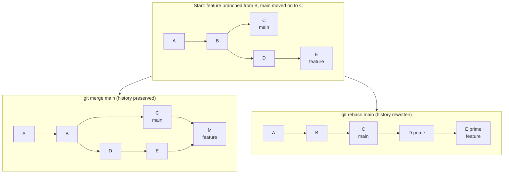
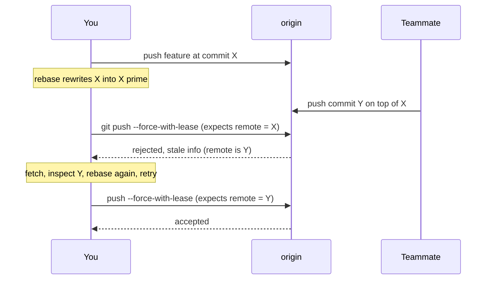

# L3.2 — Rebasing

> **Level 3: Git & GitHub** · Topic 2 of 13 · ⏱ ~3 hours · Difficulty: Intermediate

## 1. What it is

**Rebasing** takes the commits you made on a branch and *replays* them, one by one, on top of a different base
commit. The content of each change stays the same, but every replayed commit is a **brand-new commit with a new
hash**, because a commit's hash includes its parent. Think of it as "pretend I had started my work from the latest
`main`".

**Interactive rebase** (`git rebase -i`) opens a to-do list of your commits so you can reorder, reword, squash
(combine), drop or edit them before they are shared. It is the tool for turning a messy "wip / fix typo / fix typo
again" series into a few clean, reviewable commits.

## 2. Why it matters in DevOps

- **Readable history = faster incidents.** A linear history with meaningful commits makes `git log`, `git blame` and
  [bisect](07-bisect.md) far more useful when production breaks.
- **Reviewable pull requests:** reviewers read commits, not a diary of your afternoon. Squashing fix-up commits is basic courtesy.
- **The danger is real:** rewriting history that others already pulled forces them to untangle duplicate commits,
  and a careless force-push can erase a colleague's work. Knowing the safe pattern (`--force-with-lease`) is
  part of working on shared repositories.
- **Branch hygiene feeds CI/CD:** many teams require "branch is up to date with `main`" before merging; rebasing is how you satisfy that without merge-commit noise.

## 3. Real-world system example

**Kubernetes and the Linux kernel mailing-list workflow.** The Kubernetes project asks contributors to keep pull
requests tidy, and its contributor guide asks for commits to be squashed so each PR carries a small number of
meaningful commits. The Linux kernel goes further: patch series sent to maintainers are expected to be clean, bisectable
commits, which is why kernel developers routinely rebase their local work before submitting.

**GitHub itself** offers rebasing as a merge strategy: the **"Rebase and merge"** button replays a PR's commits onto
the base branch without a merge commit, and **"Squash and merge"** collapses the whole PR into one commit. Teams that
choose these produce a straight-line `main`, which is the shape [trunk-based development](09-trunk-based-vs-gitflow.md)
favours.

## 4. Diagram

Merge versus rebase, starting from the same situation:



Why a force-push is needed after rebasing a branch that is already on the remote, and how the lease protects you:



## 5. How it works

| Command | Purpose |
|---------|---------|
| `git rebase main` | replay current branch's commits onto the tip of `main` |
| `git rebase -i main` | same, but edit the to-do list first |
| `git rebase -i HEAD~4` | edit just the last 4 commits |
| `git rebase --continue` / `--skip` / `--abort` | after resolving a conflict / skip the commit / give up and restore the original |
| `git commit --fixup <hash>` | create a commit marked to be squashed into `<hash>` |
| `git rebase -i --autosquash main` | automatically order and mark `fixup!` commits |
| `git push --force-with-lease` | force-push only if the remote is exactly what you last fetched |
| `git pull --rebase` | fetch, then rebase local commits onto the updated upstream |
| `git reflog` | the safety net: every previous position of `HEAD` |

**Interactive rebase to-do verbs** (the list opens in your editor, oldest commit on top):

| Verb | Effect |
|------|--------|
| `pick` | keep the commit as is |
| `reword` | keep the change, edit the message |
| `edit` | stop here so you can amend or split the commit |
| `squash` | meld into the previous commit and combine the messages |
| `fixup` | meld into the previous commit and discard this message |
| `drop` | delete the commit |

**The golden rule of rebasing:** *never rebase commits that other people have based work on* — i.e. do not rewrite
the history of shared branches such as `main`, `release/*`. Rebase your **own, private** feature branch, and
expect to force-push it. If a branch is shared by several people, agree first or use merge instead.

**Force-push options, from worst to best**

| Command | Behaviour |
|---------|-----------|
| `git push --force` | overwrites the remote branch no matter what is there — can destroy a teammate's pushed commit |
| `git push --force-with-lease` | refuses if the remote branch moved since you last fetched it |
| `git push --force-with-lease --force-if-includes` | additionally refuses if your local branch has not integrated the remote tip you fetched (Git 2.30+) |

Note that the lease compares against your *remote-tracking ref* (`origin/feature/cart`). If something runs
`git fetch` in the background (an IDE, for instance), the lease can be silently refreshed without you reviewing the new
commits; `--force-if-includes` closes that gap.

## 6. Step-by-step guide

**Prerequisites:** Git 2.30+. We use a local bare repository as "origin", so no GitHub account is needed.

1. **Set up an origin and a working clone.**
   ```bash
   mkdir rebase-lab && cd rebase-lab
   git init -q --bare origin.git
   git clone origin.git shop-api && cd shop-api
   echo "app" > app.js && git add . && git commit -m "Initial commit"
   git push origin HEAD:main
   ```
   (Cloning an empty repo prints `warning: You appear to have cloned an empty repository.` — that is fine.)

2. **Create a feature branch with messy commits, while `main` moves on.**
   ```bash
   git switch -c feature/cart
   echo c1 > cart.js    && git add . && git commit -m "Add cart"
   echo c2 >> cart.js   && git commit -am "Fix typo in cart"
   echo c3 >> cart.js   && git commit -am "wip"
   git switch main
   echo m1 > logging.js && git add . && git commit -m "Add logging"
   git push origin main
   git switch feature/cart
   git log --oneline --graph --all
   ```
   The graph shows `main` and `feature/cart` diverged from "Initial commit".

3. **Rebase the feature onto the new `main`.**
   ```bash
   git rebase main
   ```
   Expected output ends with `Successfully rebased and updated refs/heads/feature/cart.` Run
   `git log --oneline --graph --all` again: one straight line, and your three commits now have **new hashes**.

4. **Clean up with an interactive rebase.**
   ```bash
   git rebase -i main
   ```
   Your editor opens with:
   ```text
   pick deceb07 Add cart
   pick 0120f5c Fix typo in cart
   pick 1c82045 wip
   ```
   Change the second and third `pick` to `fixup`, save and close. Result: `git log --oneline` shows a single
   `Add cart` commit sitting on top of `Add logging`.
   *(Non-interactive version for scripts and CI: `GIT_SEQUENCE_EDITOR="sed -i -e '2s/^pick/fixup/' -e '3s/^pick/fixup/'" git rebase -i main`.)*

5. **Use `--fixup` and `--autosquash` the idiomatic way.**
   ```bash
   echo more >> cart.js && git commit -am "Add cart totals"
   echo bug  >> cart.js
   git commit --fixup HEAD -a          # creates "fixup! Add cart totals"
   git rebase -i --autosquash main     # to-do list is pre-arranged; just save
   git log --oneline -3
   ```
   Tip: `git config --global rebase.autosquash true` makes `--autosquash` the default.

6. **Publish a rebased branch safely.**
   ```bash
   git push -u origin feature/cart                 # first push, no force needed
   git commit --amend -m "Add cart module"         # rewrite the pushed commit
   git push origin feature/cart                    # rejected
   git push --force-with-lease origin feature/cart # accepted
   ```
   The plain push is rejected with `! [rejected] feature/cart -> feature/cart (non-fast-forward)`; the lease push
   prints `+ <old>...<new> feature/cart -> feature/cart (forced update)`.

7. **See the lease protect a teammate.** In a second clone (`git clone origin.git mate`), switch to `feature/cart`,
   add a commit and push it. Back in your clone, amend again and run `git push --force-with-lease origin feature/cart`:
   ```text
    ! [rejected]        feature/cart -> feature/cart (stale info)
   error: failed to push some refs to '...'
   ```
   Your push was refused because the remote contained a commit you had never seen. A plain `--force` would have deleted it.

8. **Handle a rebase conflict.** When Git stops with `CONFLICT`, fix the file, then:
   ```bash
   git add <file>
   git rebase --continue      # or: git rebase --abort to go back to where you started
   ```
   Conflicts during a rebase are resolved *per replayed commit*, so a long series can conflict repeatedly.
   `git config --global rerere.enabled true` lets Git remember and reuse your resolutions.

9. **Rescue yourself if it went wrong.**
   ```bash
   git reflog                    # find the line "rebase (start)" and the entry just before it
   git reset --hard HEAD@{N}     # N = the entry before the rebase started
   ```

## 7. Real-world scenario

*(Illustrative.)* A `shop-api` pull request has 14 commits: "wip", "fix lint", "try again", "revert try again". The
reviewer is lost and CI fails on the middle commits, so `git bisect` later cannot test them. The author runs
`git rebase -i origin/main`, squashes down to three commits (`feat: add coupon model`, `feat: coupon API`,
`test: coupon edge cases`), checks `npm test` passes at *each* commit with
`git rebase -i origin/main --exec "npm test"`, then runs `git push --force-with-lease`. Meanwhile a teammate had
pushed a one-line suggestion to the same branch through the GitHub web UI; the lease rejects the push, the author
fetches, sees the suggestion, rebases it in, and pushes again.
**Lesson:** rewriting history is safe when the branch is yours and your push is protected by a lease. `--exec`
turns "each commit builds" from a hope into a fact.

## 8. Common mistakes and best practices

**Don't**

- Rebase `main`, `release/*` or any branch others have pulled — this is the golden rule.
- Use bare `git push --force`, especially in scripts and aliases.
- Rebase a branch you have already merged elsewhere, or you will duplicate commits.
- Panic during a conflict: `git rebase --abort` always returns you to the starting state.

**Do**

- Rebase **local, unpublished** work freely; it is the cleanest way to tidy before a PR.
- Keep PR branches short-lived so rebases are small.
- Alias a safe push: `git config --global alias.pushf "push --force-with-lease --force-if-includes"`.
- Run tests during the rebase with `--exec "npm test"` when history cleanliness matters (bisectability).
- Remember `reflog` keeps the pre-rebase commits for about 90 days by default (see [reset and revert](04-reset-and-revert.md)).
- Compare with [merging](01-branching-and-merging.md): choose rebase for tidying your own branch, merge for integrating shared branches.

## 9. Tasks

- [ ] **T1 — Rebase onto a moved main** *(≈25 min, beginner)*
  - **Goal:** feel the difference between merge and rebase.
  - **Steps:**
    1. Follow guide steps 1-3.
    2. Before rebasing, note the three feature commit hashes (`git log --oneline`).
    3. After rebasing, list them again.
  - **Done when:** the hashes differ, the content of `cart.js` is unchanged, and `git log --graph --all` is a single line.

- [ ] **T2 — Squash with interactive rebase** *(≈30 min, beginner)*
  - **Goal:** turn five messy commits into two good ones.
  - **Steps:**
    1. Create five commits ("Add X", "typo", "wip", "Add Y", "fix Y").
    2. Run `git rebase -i --root` or `git rebase -i HEAD~5`.
    3. Use `reword`, `fixup` and `drop` so two meaningful commits remain.
  - **Done when:** `git log --oneline` shows exactly two commits with clear messages.

- [ ] **T3 — Autosquash workflow** *(≈25 min, intermediate)*
  - **Goal:** use `--fixup` the way reviewers expect.
  - **Steps:**
    1. Make three commits, then discover a bug in the first one.
    2. Fix it and run `git commit --fixup <hash-of-first>`.
    3. Run `git rebase -i --autosquash main`.
  - **Done when:** the fixup commit has disappeared and the bug fix is inside the first commit (`git show <first>`).

- [ ] **T4 — Break it: the stale lease** *(≈30 min, intermediate)*
  - **Goal:** see `--force-with-lease` save a colleague's work.
  - **Steps:**
    1. Reproduce guide step 7 with a second clone.
    2. Try the push with `--force-with-lease`, then (in a throwaway repo only) with `--force`.
    3. Run `git log origin/feature/cart` after each attempt.
  - **Done when:** you can show that the lease attempt kept the teammate's commit and the `--force` attempt destroyed it.

- [ ] **T5 — Recover from a bad rebase** *(≈30 min, intermediate)*
  - **Goal:** use the reflog as an undo button.
  - **Steps:**
    1. Rebase a branch and deliberately `drop` a commit in the to-do list.
    2. Find the pre-rebase tip with `git reflog`.
    3. Restore it with `git reset --hard <hash>`.
  - **Done when:** the dropped commit is back and `git diff <hash>` shows no differences.

- [ ] **T6 — Prove it: safe publishing rules** *(≈30 min, advanced)*
  - **Goal:** explain the golden rule and demonstrate the safe workflow.
  - **Steps:**
    1. Without the guide, push a feature branch, rewrite it, and publish it with `--force-with-lease`.
    2. Write five sentences: when rebase is safe, when merge is safer, why a lease beats `--force`, what `reflog` is for, and which branches must never be rebased.
  - **Done when:** the push succeeds with `(forced update)` and your written rules match section 5.

## 10. Self-check questions

1. Why does a rebased commit get a different hash even if its diff is identical?
2. State the golden rule of rebasing and give one reason for it.
3. What does `--force-with-lease` check that `--force` does not?
4. What is the difference between `squash` and `fixup` in an interactive rebase?
5. You finished a rebase and realise you lost a commit. What do you do?

<details>
<summary>Answers</summary>

1. The hash covers the parent hash (plus tree, author, message and timestamps). A new base means a new parent, hence a new hash.
2. Do not rebase commits that others have built on (shared branches). Their copies still contain the old commits, so integrating your rewritten ones produces duplicates and confusing conflicts.
3. That the remote branch still points to where your last fetch saw it; if someone pushed since, the push is refused.
4. `squash` keeps the commit's message and lets you combine it with the previous one; `fixup` discards the message.
5. `git reflog`, find the entry from before `rebase (start)`, and `git reset --hard <hash>` (or `git branch rescue <hash>`).
</details>

## 11. Further reading

- *Pro Git* (git-scm.com/book) — chapter 3.6 "Rebasing" and chapter 7 "Rewriting History".
- `man git-rebase` and `man git-push` (the `--force-with-lease` section).
- GitHub Docs — "About pull request merges" (Squash and rebase options).
- Kubernetes contributor guide — pull request and commit guidance.

<!-- nav -->
---
← Previous: [Branching and Merging](01-branching-and-merging.md) · [Level 3 index](README.md) · Next: [Cherry-picking](03-cherry-picking.md) →
