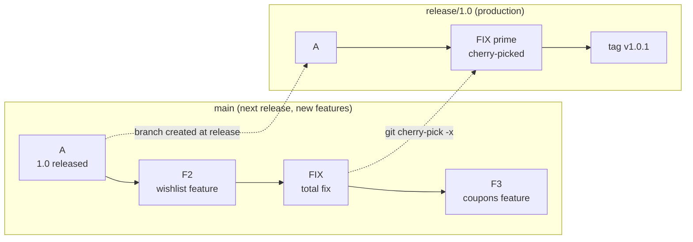
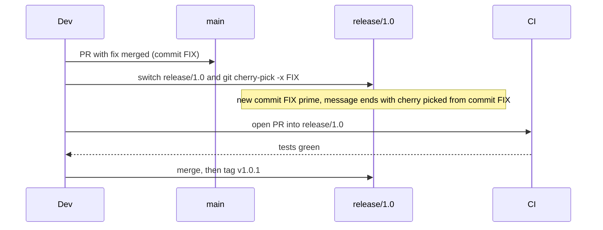

# L3.3 — Cherry-picking

> **Level 3: Git & GitHub** · Topic 3 of 13 · ⏱ ~2 hours · Difficulty: Intermediate

## 1. What it is

`git cherry-pick <commit>` takes the **change introduced by one existing commit** (its diff against its parent) and
re-applies it on top of your current branch as a **new commit** with a new hash. It copies *one commit*, not a whole
branch history. The original and the copy are unrelated as far as Git's graph is concerned; they merely contain the
same patch.

The classic use is the **backport**: a bug is fixed on `main`, but the version running in production (or a supported
older release) is on a `release/*` branch that must receive *only that fix*, not all the new features that landed on `main`.

## 2. Why it matters in DevOps

- **Hotfixes without shipping unfinished work.** `main` may contain half-finished features; you cannot just merge it into the release.
- **Supporting multiple versions.** Libraries, operators and platforms keep several maintained releases (`1.4.x`, `1.5.x`);
  security fixes must reach all of them.
- **Rescuing a commit** that landed on the wrong branch.
- **Risk:** a copied commit can silently depend on code that only exists on `main`, and duplicates make history confusing
  (the same fix appears twice, with different hashes). Good practice is to record where the copy came from and to test the result.

## 3. Real-world system example

**Kubernetes release branches.** Kubernetes maintains release branches such as `release-1.xx`. Fixes are merged to
`master`/`main` first and then *cherry-picked* to the supported release branches through a documented process:
the contributor runs the project's cherry-pick helper script (`hack/cherry_pick_pull.sh`) which opens a new pull
request against the release branch, and release managers approve it. The exact steps are described in the
cherry-pick section of the Kubernetes contributor documentation.

**The Linux stable kernels.** Bug fixes go into the mainline kernel first. Maintainers mark fixes that should also go
to supported stable series with a `Cc: stable@vger.kernel.org` tag, and the stable team backports those commits (a
cherry-pick, typically recording the original upstream commit ID in the backported commit message).

Both projects follow the same rule: **fix in the newest branch first, then backport**, so the fix cannot be lost
when you upgrade.

## 4. Diagram



The backport flow as a team process:



## 5. How it works

| Command | Meaning |
|---------|---------|
| `git cherry-pick <hash>` | apply one commit onto the current branch |
| `git cherry-pick -x <hash>` | same, and append `(cherry picked from commit <hash>)` to the message — **use this for backports** |
| `git cherry-pick A B C` | several commits, in the order given |
| `git cherry-pick A..B` | commits after `A` up to and including `B` (A itself excluded) |
| `git cherry-pick -n <hash>` | apply to the working tree and index but do not commit (squash several picks) |
| `git cherry-pick -m 1 <merge-hash>` | pick a **merge commit**, choosing parent 1 (the mainline) as the baseline |
| `git cherry-pick --continue / --skip / --abort` | after a conflict |
| `git cherry <upstream> <head> -v` | show which commits on `<head>` have an equivalent patch in `<upstream>` (`-` = already there, `+` = not yet) |
| `git log --cherry-pick --left-right main...release/1.0` | list commits unique to each side, hiding patch-equivalents |

**Release-branch workflow in practice**

1. Cut `release/1.0` from the commit that shipped `v1.0.0`.
2. Fix bugs on `main` first (so they cannot be forgotten).
3. Cherry-pick the fix commit(s) onto `release/1.0` with `-x`.
4. Tag `v1.0.1` on the release branch (see [Tags](06-tags.md)) and deploy that tag.

**Conflicts.** If the target branch has diverged around the changed lines, the cherry-pick stops with a conflict just
like a merge. Resolve, `git add`, `git cherry-pick --continue`. A conflict is a warning: the fix may rely on surrounding
code that does not exist in the release; read it, do not just accept it.

**Merge commits.** A merge has two parents, so Git cannot know which diff you want; it refuses with `commit … is a
merge but no -m option was given`. `-m 1` means "diff against the first parent". Usually it is better to cherry-pick
the individual commits instead.

## 6. Step-by-step guide

**Prerequisites:** Git 2.30+. Everything is local.

1. **Create a "released" codebase and a release branch.**
   ```bash
   git init shop-api && cd shop-api
   printf 'const total = (a, b) => a - b;\n' > price.js
   echo "1.0.0" > VERSION
   git add . && git commit -m "Release 1.0 code"
   git tag -a v1.0.0 -m "Release 1.0.0"
   git branch release/1.0
   ```

2. **Continue developing on `main`: a feature, then a bug fix, then another feature.**
   ```bash
   echo wishlist > wishlist.js && git add . && git commit -m "Add wishlist"
   sed -i 's/a - b/a + b/' price.js && git commit -am "Fix: total() must add, not subtract"
   echo coupons > coupons.js && git add . && git commit -m "Add coupons"
   git log --oneline
   ```
   Expected (hashes will differ):
   ```text
   6941c05 Add coupons
   04ba75a Fix: total() must add, not subtract
   737f1e6 Add wishlist
   6d31d5d Release 1.0 code
   ```

3. **Backport only the fix to the release branch.**
   ```bash
   FIX=$(git log --grep="Fix: total" --format=%h)
   git switch release/1.0
   git cherry-pick -x "$FIX"
   ```
   Expected: `[release/1.0 77a57ce] Fix: total() must add, not subtract` and a one-file diffstat.

4. **Inspect the result.**
   ```bash
   git log --oneline          # two commits only: the fix and "Release 1.0 code"
   git log -1                 # message ends with: (cherry picked from commit 04ba75a...)
   ls                         # no wishlist.js or coupons.js: features did not come along
   ```

5. **Tag the patch release.**
   ```bash
   git tag -a v1.0.1 -m "Release 1.0.1: fix total()"
   ```

6. **Confirm what is and is not backported.**
   ```bash
   git cherry -v main release/1.0
   ```
   Output similar to `- 77a57ce... Fix: total() must add, not subtract` — the `-` means an equivalent patch already exists on `main`.
   `git log --cherry-pick --left-right --oneline main...release/1.0` shows the remaining differences (features that exist
   only on `main`).

7. **Provoke and resolve a conflict.**
   ```bash
   git switch main
   echo "line" > price2.js && git add . && git commit -m "Add price2"
   echo "changed on main" >> price2.js && git commit -am "Edit price2"
   git switch release/1.0
   echo "different" > price2.js && git add . && git commit -m "Release price2"
   git cherry-pick main
   ```
   Output:
   ```text
   Auto-merging price2.js
   CONFLICT (content): Merge conflict in price2.js
   error: could not apply b0774b9... Edit price2
   ```
   Fix the file, then `git add price2.js && git cherry-pick --continue`, or bail out with `git cherry-pick --abort`.

8. **Pick a merge commit (only if you must).**
   ```bash
   git cherry-pick -m 1 <merge-commit-hash>
   ```
   Without `-m 1` Git stops with `error: commit <hash> is a merge but no -m option was given.`

9. **Real GitHub flow (optional).** On GitHub, open a PR whose *base* is `release/1.0` and whose branch was created
   from it (`git switch -c backport/fix-total release/1.0 && git cherry-pick -x <hash> && git push -u origin HEAD`).
   Reviewers see only the one commit, and branch protection (see [Protected Branches and Pull Requests](08-protected-branches-and-pull-requests.md))
   still applies to release branches.

## 7. Real-world scenario

*(Illustrative.)* The `shop-api` team shipped v2.3.0 on Tuesday. On Thursday support reports that discount codes
are applied twice at checkout, costing real money. `main` already contains a week of unfinished refactoring for v2.4.
The on-call engineer fixes the bug on a branch off `main` with a regression test, merges the PR, then creates
`backport/double-discount` from `release/2.3`, runs `git cherry-pick -x <fix-hash>`, and opens a PR into `release/2.3`.
CI runs the v2.3 test suite, a second engineer approves, the PR merges, and the team tags `v2.3.1` and deploys it. The
two-hour fix reaches customers without a single line of v2.4 code. On Monday, when v2.4 is released, the fix is already
in because it was made on `main` first.
**Lesson:** fix forward on the newest branch, backport with `-x`, tag the patch release, and never merge `main`
into a release branch just to get one fix.

## 8. Common mistakes and best practices

**Don't**

- Cherry-pick *instead of* fixing on `main`: the next release will regress the bug.
- Cherry-pick large numbers of commits regularly — that is a sign your branching model (see [Trunk-based vs GitFlow](09-trunk-based-vs-gitflow.md)) fights you.
- Cherry-pick a commit without its prerequisites (a refactor it depends on) and assume it works because it applied cleanly.
- Later merge `main` into the release branch and be surprised by duplicate or conflicting versions of the same fix (Git usually reconciles identical patches, but not always).

**Do**

- Always use `-x` for backports so `git log` tells future readers where the copy came from.
- Run the test suite on the release branch after cherry-picking, in CI, before tagging.
- Keep fix commits **small and self-contained** (one logical change) so they are easy to backport.
- Use `git cherry` or a "backport needed" label to track which fixes are still pending.
- For recovering from a mistaken pick use `git reset --hard HEAD~1` (see [reset and revert](04-reset-and-revert.md)) on an unpublished branch, or `git revert` on a shared one.

## 9. Tasks

- [ ] **T1 — Backport a one-line fix** *(≈25 min, beginner)*
  - **Goal:** move exactly one commit to a release branch.
  - **Steps:**
    1. Follow guide steps 1-3.
    2. Confirm with `ls` and `git log --oneline` that the features are absent from `release/1.0`.
  - **Done when:** `release/1.0` has exactly two commits and `price.js` contains `a + b`.

- [ ] **T2 — Trace a backport** *(≈20 min, beginner)*
  - **Goal:** prove where a commit came from.
  - **Steps:**
    1. Run `git log -1 release/1.0` and find the `(cherry picked from commit …)` line.
    2. Run `git show <that-hash>` on `main` and compare with `git show HEAD` on the release branch.
    3. Run `git cherry -v main release/1.0`.
  - **Done when:** you can state which hash is the original, which is the copy, and why their hashes differ.

- [ ] **T3 — Pick a range, squashed** *(≈30 min, intermediate)*
  - **Goal:** backport three related commits as one.
  - **Steps:**
    1. On `main`, make three commits that together implement a fix.
    2. On a release branch run `git cherry-pick -n A^..C` (changes are staged but not committed).
    3. Commit once with a message that lists the three source hashes.
  - **Done when:** `git log --oneline` on the release branch shows one new commit and `git diff main -- <file>` is empty for the fixed file.

- [ ] **T4 — Break it and fix it: the conflict** *(≈30 min, intermediate)*
  - **Goal:** resolve a cherry-pick conflict safely.
  - **Steps:**
    1. Reproduce guide step 7.
    2. Resolve it by keeping the release branch's text plus the new line from `main`.
    3. Finish with `git cherry-pick --continue`.
    4. Repeat once and finish with `--abort` instead.
  - **Done when:** after the abort `git status` is clean and `git log` is unchanged; after the continue the new commit exists.

- [ ] **T5 — Automate the backport check** *(≈35 min, advanced)*
  - **Goal:** list fixes that have not reached the release branch.
  - **Steps:**
    1. Write a shell script that runs `git cherry release/1.0 main` and prints only lines starting with `+` whose message starts with `Fix`.
    2. Run it before and after a backport.
  - **Done when:** the script lists the fix before the backport and prints nothing afterwards.

- [ ] **T6 — Prove it: ship a patch release** *(≈40 min, advanced)*
  - **Goal:** run the entire hotfix process without the guide.
  - **Steps:**
    1. Create `release/1.0`, add a bug to `main`, fix it, then backport with `-x` and tag `v1.0.1`.
    2. Explain in writing why the fix was made on `main` first and why merging `main` into the release branch would have been wrong.
  - **Done when:** `git describe --tags` on the release branch prints `v1.0.1` and your explanation covers unfinished features and `-x`.

## 10. Self-check questions

1. How does a cherry-picked commit differ from the original?
2. Why should you use `-x` when backporting?
3. Why is fixing on the newest branch first the safer policy?
4. What does `git cherry-pick A..B` include and exclude?
5. Why can't you cherry-pick a merge commit without `-m`?

<details>
<summary>Answers</summary>

1. Same diff, new hash, new parent, possibly new author date/committer; it is not linked to the original in the graph.
2. It appends the original commit ID to the message, making backports traceable and auditable.
3. Otherwise the next release (built from the newest branch) would be missing the fix and the bug would reappear.
4. It includes every commit after `A` up to and including `B`; `A` itself is excluded.
5. A merge has two parents, so there are two possible diffs; `-m N` selects which parent to diff against.
</details>

## 11. Further reading

- *Pro Git* (git-scm.com/book) — "Rebasing" chapter covers cherry-pick; `man git-cherry-pick`.
- Kubernetes contributor documentation — the "cherry-pick" release process.
- Linux kernel documentation — "Stable kernel rules" (Documentation/process/stable-kernel-rules).
- Related: [Branching and Merging](01-branching-and-merging.md), [Semantic Versioning and Release Management](10-semantic-versioning-and-releases.md).

<!-- nav -->
---
← Previous: [Rebasing](02-rebasing.md) · [Level 3 index](README.md) · Next: [reset and revert](04-reset-and-revert.md) →
