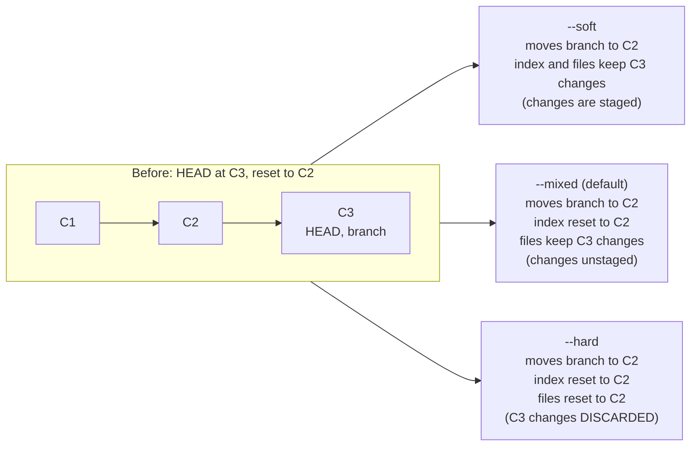
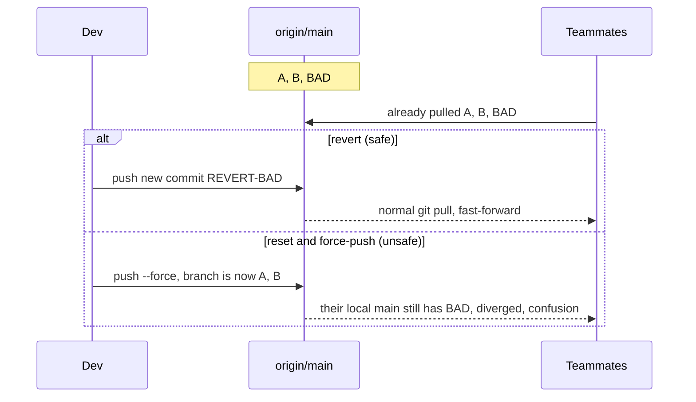

# L3.4 — reset and revert

> **Level 3: Git & GitHub** · Topic 4 of 13 · ⏱ ~3 hours · Difficulty: Intermediate

## 1. What it is

Both commands "undo" things, but in opposite ways.

- **`git reset`** moves the current branch pointer **backwards** (to an earlier commit) and, depending on the mode,
  also rewinds the staging area (the **index**) and your working files. It *rewrites history*: the commits you reset
  past are no longer on the branch.
- **`git revert`** creates a **new commit that applies the inverse** of an earlier commit. History only moves
  forward; the bad commit and its undo both stay visible.

The rule of thumb: **reset for your own unpublished work, revert for anything already shared.** And when you get it
wrong, the **reflog** — Git's private log of every place `HEAD` has been — usually lets you get everything back.

## 2. Why it matters in DevOps

- **A bad change reached `main` and production is burning.** `git revert` is the safe, auditable rollback that every
  teammate's clone will accept. `git reset --hard` plus a force-push on `main` breaks every clone and the CI history.
- **Lost work.** `git reset --hard` is one of the few Git commands that can destroy uncommitted changes forever. Knowing
  which modes are safe is part of working safely.
- **Rollback in pipelines and GitOps.** When the desired state of production lives in Git, "revert the commit" *is* the rollback
  (see [CI/CD](../level-00-what-devops-is/02-ci-cd.md)).
- **Recovery skills** (`reflog`) turn a "I deleted the branch / lost my commits" crisis into a one-minute fix.

## 3. Real-world system example

**GitHub's own "Revert" button.** On a merged pull request GitHub offers *Revert*, which opens a new PR containing a
`git revert` of the merge commit — exactly the operation in this topic, because a shared protected branch cannot (and
should not) be rewritten. Teams practising continuous delivery typically keep a "revert first, investigate later"
rule for broken `main`.

**Git's own safety net.** Git keeps the reflog locally (by default unreachable commits are retained for roughly 30 days
and reflog entries for about 90 days; both are configurable via `gc.reflogExpire` and `gc.reflogExpireUnreachable`).
Hosting providers do not give you your local reflog, which is why *local* recovery must happen on the machine where you did the work.

## 4. Diagram

What each reset mode moves (the three "trees": commit history, index/staging, working directory):



Reset vs revert on a shared branch:



## 5. How it works

| Command | Branch pointer | Index | Working files | Safe on shared branches? |
|---------|----------------|-------|---------------|--------------------------|
| `git reset --soft <c>` | moves to `<c>` | unchanged | unchanged | no (rewrites history) |
| `git reset [--mixed] <c>` | moves to `<c>` | reset to `<c>` | unchanged | no |
| `git reset --hard <c>` | moves to `<c>` | reset | **reset (changes lost)** | no |
| `git reset --keep <c>` | moves | reset | reset, but aborts if it would lose local edits | no |
| `git revert <c>` | new commit on top | updated | updated | **yes** |
| `git revert -m 1 <merge>` | new commit undoing a merge relative to parent 1 | updated | updated | **yes** |

Related "undo" commands that are *not* reset:

| Goal | Command |
|------|---------|
| Discard uncommitted edits to a file | `git restore <file>` (older: `git checkout -- <file>`) |
| Unstage a file but keep edits | `git restore --staged <file>` |
| Fix the last commit message / add a forgotten file (unpushed) | `git commit --amend` |
| Move commits to another branch | [cherry-pick](03-cherry-picking.md) then `git reset --hard HEAD~N` |

**Common use of each reset mode**

- `--soft HEAD~3`: "squash the last three commits into one" — then `git commit` again.
- `--mixed HEAD~1` (the default): "un-commit and re-stage selectively" (`git add -p`).
- `--hard origin/main`: "throw away everything local, make my branch identical to the remote".

**Reverting a merge commit.** A merge has two parents. `git revert -m 1 <merge>` says "undo the changes the merge
brought in, relative to parent 1 (the branch that was merged *into*)". Caveat: afterwards Git considers that branch's commits
already merged, so merging the same branch again later brings nothing; to re-apply it you must first revert the revert
(`git revert <the-revert-commit>`). This is a classic trap.

**The reflog.** `git reflog` lists `HEAD@{0}`, `HEAD@{1}`, … — each previous position of `HEAD`, with the action
that moved it. Any commit you can find there can be restored: `git reset --hard HEAD@{N}`, or safer, `git branch rescue <hash>`.
Per-branch history is available as `git reflog show <branch>`. It only helps for **committed** work: files you never
committed or staged and then destroyed with `--hard` are not in the reflog (staged ones may be recoverable with `git fsck --lost-found`).

## 6. Step-by-step guide

**Prerequisites:** Git 2.30+. A throwaway repo.

1. **Make three commits.**
   ```bash
   git init shop-api && cd shop-api
   for i in 1 2 3; do echo "line $i" >> notes.txt; git add .; git commit -m "Commit $i"; done
   git log --oneline
   ```
   Output similar to:
   ```text
   1a60675 Commit 3
   33167bf Commit 2
   2f68067 Commit 1
   ```

2. **`--soft`: un-commit but keep everything staged.**
   ```bash
   git reset --soft HEAD~1
   git status --short        # M  notes.txt   (staged, first column)
   git log --oneline         # only Commit 2 and Commit 1 remain
   git commit -m "Commit 3 again"
   ```

3. **`--mixed` (default): un-commit and unstage.**
   ```bash
   git reset HEAD~1
   git status --short        #  M notes.txt   (modified, NOT staged, second column)
   git diff                  # still shows the "line 3" addition
   git add . && git commit -m "Commit 3 third time"
   ```

4. **`--hard`: throw changes away (this is the dangerous one).**
   ```bash
   echo "junk" >> notes.txt
   git reset --hard HEAD~1
   cat notes.txt             # only line 1 and line 2: both the junk and Commit 3 are gone from the working tree
   ```
   Output: `HEAD is now at 33167bf Commit 2`.

5. **Undo the `--hard` with the reflog.**
   ```bash
   git reflog
   ```
   Output similar to:
   ```text
   33167bf HEAD@{0}: reset: moving to HEAD~1
   e79eac5 HEAD@{1}: commit: Commit 3 third time
   33167bf HEAD@{2}: reset: moving to HEAD~1
   ...
   ```
   The "Commit 3 third time" commit is still there. Restore it:
   ```bash
   git reset --hard HEAD@{1}
   cat notes.txt             # line 3 is back
   ```
   (The `junk` line was never committed, so it is gone for good — that is the real cost of `--hard`.)

6. **`revert`: the safe undo.**
   ```bash
   git revert --no-edit HEAD
   git log --oneline
   cat notes.txt             # line 3 is gone again
   ```
   Output: `[main 45e05b8] Revert "Commit 3 third time"` and a log with the original *and* its revert:
   ```text
   45e05b8 Revert "Commit 3 third time"
   e79eac5 Commit 3 third time
   33167bf Commit 2
   2f68067 Commit 1
   ```
   To bring the change back, revert the revert: `git revert --no-edit HEAD` (Git titles it `Reapply "Commit 3 third time"`).

7. **Revert a merge commit.**
   ```bash
   git switch -c feature/f && echo f > f.txt && git add . && git commit -m "feature f"
   git switch main && git merge --no-ff -m "Merge f" feature/f
   git revert -m 1 --no-edit HEAD
   ls                        # f.txt is gone
   ```
   Without `-m 1`: `error: commit <hash> is a merge but no -m option was given.`

8. **Recover a deleted branch.**
   ```bash
   git branch -D feature/f
   ```
   Git prints `Deleted branch feature/f (was 2a6b175).` — that hash is your lifeline:
   ```bash
   git branch feature/f-rescued 2a6b175
   git log --oneline feature/f-rescued -1
   ```
   If you lost the message, `git reflog` shows the branch tip from when you last checked it out
   (`checkout: moving from feature/f to main`), and `git fsck --lost-found` lists dangling commits.

9. **Undo uncommitted edits to a single file, the modern way.**
   ```bash
   echo oops >> notes.txt
   git restore notes.txt            # discards the edit (cannot be undone!)
   echo oops2 >> notes.txt && git add notes.txt
   git restore --staged notes.txt   # unstage only; edit remains
   ```

## 7. Real-world scenario

*(Illustrative.)* At 16:40 a `shop-api` PR that changes a database query is merged to `main` and auto-deployed. Within
minutes error rates climb and checkout slows. The on-call engineer does **not** debate a fix. They click *Revert* on the
merged PR (or run `git revert -m 1 <merge-sha>`), get the revert PR approved by the second reviewer, merge it, and the
pipeline redeploys the previous behaviour in minutes. Error rates return to normal. The next morning the original author
fixes the query on a new branch and *reverts the revert* so the original change comes back with the fix on top; a
postmortem notes that the missing load test is the real defect.
**Lesson:** on shared branches the undo is a new commit. History stays truthful, nobody's clone breaks, and the
fix-forward can happen calmly.

## 8. Common mistakes and best practices

**Don't**

- `git reset --hard` followed by `git push --force` on a shared branch such as `main`.
- Run `git reset --hard` without checking `git status` first — uncommitted work is not in the reflog.
- Forget that reverting a merge makes a later re-merge of that branch a no-op.
- Rely on the reflog as a backup: it is local, expires, and does not exist on a fresh clone.

**Do**

- Reset **local, unpublished** commits; revert **published** ones.
- Before anything destructive, make a rescue pointer: `git branch backup/before-reset`.
- Prefer `git restore` and `git switch` over overloaded `git checkout` for clarity.
- Write good revert messages: "Revert X because Y (incident #123)".
- Treat `git reflog` + `git reset --hard HEAD@{N}` as your first-aid kit; run it immediately, before `git gc` can run.
- For stuff that should leave the working directory temporarily, use [stash](05-stash.md) instead of committing junk and resetting.

## 9. Tasks

- [ ] **T1 — Compare the three reset modes** *(≈30 min, beginner)*
  - **Goal:** see exactly what each mode moves.
  - **Steps:**
    1. Create three commits as in guide step 1.
    2. For each of `--soft`, `--mixed`, `--hard`: run `git reset <mode> HEAD~1`, then `git status --short` and `cat notes.txt`, then restore with `git reset --hard <hash-of-commit-3>`.
    3. Fill in a table: branch moved? index changed? working file changed?
  - **Done when:** your table matches section 5 and you can explain the output of `git status --short` for each mode.

- [ ] **T2 — Recover from a hard reset** *(≈20 min, beginner)*
  - **Goal:** resurrect "lost" commits.
  - **Steps:**
    1. Make 3 commits, then `git reset --hard HEAD~2`.
    2. Find the old tip in `git reflog` and restore it.
  - **Done when:** `git log --oneline` shows all three commits again.

- [ ] **T3 — Revert a pushed commit safely** *(≈30 min, intermediate)*
  - **Goal:** undo a shared change without rewriting history.
  - **Steps:**
    1. Create a bare "origin" (`git init --bare origin.git`), clone it twice (`alice`, `bob`).
    2. In `alice`, commit a bad change and push. In `bob`, `git pull`.
    3. In `alice`, `git revert` the bad commit and push; in `bob`, `git pull`.
  - **Done when:** `bob` pulls with a plain fast-forward and the bad change is gone from his working tree.

- [ ] **T4 — Break it: the force-push disaster** *(≈30 min, intermediate)*
  - **Goal:** feel why reset + force-push on shared history hurts.
  - **Steps:**
    1. Same setup as T3, but in `alice` run `git reset --hard HEAD~1 && git push --force`.
    2. In `bob`, run `git pull` and `git status`.
    3. Fix `bob`'s clone (`git fetch && git reset --hard origin/main`, after saving any local work on a branch).
  - **Done when:** you can describe the "diverged" state in `bob`'s clone and why revert would have avoided it.

- [ ] **T5 — Revert a merge, then reapply it** *(≈40 min, advanced)*
  - **Goal:** understand the revert-a-merge trap.
  - **Steps:**
    1. Create a feature branch, merge it with `--no-ff`, then `git revert -m 1 HEAD`.
    2. Try `git merge feature` again and note the "Already up to date" message.
    3. Fix by reverting the revert, then confirm the feature files return.
  - **Done when:** the feature files are back and you can explain why step 2 did nothing.

- [ ] **T6 — Prove it: build a recovery runbook** *(≈40 min, advanced)*
  - **Goal:** teach recovery to a teammate.
  - **Steps:**
    1. Write a one-page runbook with four scenarios: "I reset too far", "I deleted a branch", "bad commit on main", "I hard-reset uncommitted work".
    2. For each, give the exact commands and whether recovery is guaranteed, likely or impossible.
    3. Test each scenario on a throwaway repo.
  - **Done when:** every scenario's commands were executed successfully (or shown to be impossible) in the sandbox.

## 10. Self-check questions

1. What is the difference between `--soft`, `--mixed` and `--hard`?
2. Why is `git revert` preferred on shared branches?
3. What does `git revert -m 1` mean and what trap follows reverting a merge?
4. Which kinds of lost work can the reflog recover, and which can it not?
5. A teammate force-pushed over `main`. How do you find the commits that were on it before?

<details>
<summary>Answers</summary>

1. All three move the branch; `--soft` leaves index and files, `--mixed` also resets the index, `--hard` resets the files too.
2. It adds a commit instead of rewriting history, so every clone can simply pull it.
3. Undo the merge relative to parent 1 (the branch merged into). Afterwards Git treats the merged branch as already integrated, so re-merging it does nothing until you revert the revert.
4. It recovers anything that was ever a commit (and was pointed to by HEAD) while entries have not expired. It cannot recover never-staged working-tree edits, and it does not exist on other machines.
5. On a clone that had pulled it: `git reflog show origin/main` (or `git log origin/main@{1}`) shows the previous remote-tracking positions; then restore with a branch/force-push agreed with the team. On GitHub, the "Activity" view of the repository also records force pushes.
</details>

## 11. Further reading

- *Pro Git* (git-scm.com/book) — chapter 7.7 "Reset Demystified" is the best explanation of the three trees.
- `man git-reset`, `man git-revert`, `man git-reflog`.
- GitHub Docs — "Reverting a pull request".
- Related: [Rebasing](02-rebasing.md) (rewriting private history), [Branching and Merging](01-branching-and-merging.md).

<!-- nav -->
---
← Previous: [Cherry-picking](03-cherry-picking.md) · [Level 3 index](README.md) · Next: [stash](05-stash.md) →
