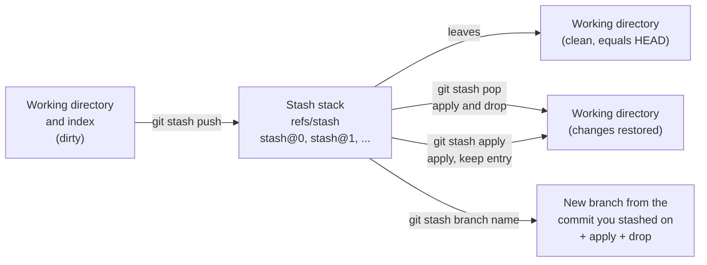
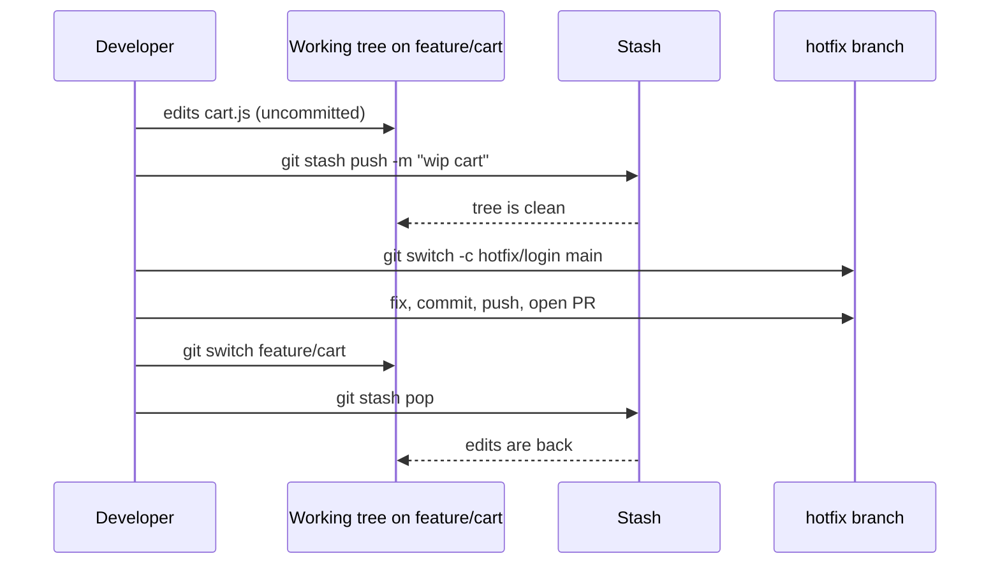

# L3.5 — stash

> **Level 3: Git & GitHub** · Topic 5 of 13 · ⏱ ~2 hours · Difficulty: Beginner

## 1. What it is

`git stash` takes your **uncommitted work** (modified tracked files and, optionally, staged and untracked files),
saves it on a private shelf, and gives you back a **clean working directory** that matches `HEAD`. Later you bring the
work back with `git stash pop` or `git stash apply`.

It exists for one situation: *"I am in the middle of something, and I must switch context right now."* A teammate asks
for a review on another branch, production needs a hotfix, or you pulled and Git refuses because your local changes would
be overwritten. Committing half-finished work just to switch branches pollutes history; stash keeps it off the record.

Under the hood a stash is a **real commit** (actually a small merge commit capturing the working tree and the index) stored in
the special ref `refs/stash`. Older stashes form a stack behind it, addressed as `stash@{0}` (newest), `stash@{1}`, and so on.
Stashes are **local only**: they are never pushed, and they are not part of any branch.

## 2. Why it matters in DevOps

- **Hotfix interrupts feature work.** Production is down; you stash, branch off `main`, fix, ship, then resume. See
  [branching and merging](01-branching-and-merging.md) for the branch side of that flow.
- **Safe `pull --rebase`.** Rebasing or pulling with a dirty tree is refused or risky; stash first
  (or use `git pull --rebase --autostash`). See [rebasing](02-rebasing.md).
- **Quick experiments.** Try a config change, stash it, compare behaviour with and without.
- **Pitfall: forgotten stashes.** A stash is the only copy of that work and it sits outside every branch.
  Engineers regularly lose a day of work because a stash was dropped, or never noticed it existed.
  Treat `git stash list` as part of your end-of-day check.

## 3. Real-world system example

**GitHub-flow style teams (GitHub itself, and many companies following the same short-branch pattern)** work from short-lived
feature branches off `main`. Interruptions are constant: review requests, a failing CI check on another branch, an urgent bug.
Stash (or a second working directory via `git worktree`) is the standard local tool for context switching, because none of
that scratch state should ever enter the shared history.

**Git itself** acknowledges the pattern: `git rebase` and `git pull` have a documented `--autostash` option (and the
`rebase.autoStash` configuration) that automatically stashes a dirty tree, runs the operation, and re-applies the stash
afterwards. That is the same stash-then-replay dance, automated.

The general pattern: stash is *personal scratch space*; anything that matters to the team goes on a branch.

## 4. Diagram

Where stashed changes go and how they come back:



Context switch for a hotfix:



## 5. How it works

| Command | What it does |
|---------|--------------|
| `git stash push -m "msg"` | Save tracked changes (staged and unstaged) with a description. `git stash` alone is the same without a message. |
| `git stash push -u` | Also stash **untracked** files (`--include-untracked`). Not ignored files. |
| `git stash push -a` | Also stash **ignored** files (`--all`). Use with care: it can sweep up `node_modules` and build output. |
| `git stash push -- path/file` | Stash only the given paths (pathspec). |
| `git stash push -p` | Interactively pick hunks to stash. |
| `git stash push --keep-index` | Stash, but leave staged changes in the working tree (handy to test only what is staged). |
| `git stash list` | Show the stack, newest first. |
| `git stash show [-p] [stash@{n}]` | Summary (`--stat` style) or full diff of a stash. |
| `git stash apply [stash@{n}]` | Re-apply but **keep** the entry. |
| `git stash pop [stash@{n}]` | Re-apply and **drop** the entry, but only if it applied without conflicts. |
| `git stash branch <name> [stash@{n}]` | Create a branch from the commit the stash was made on, apply the stash there, drop it on success. |
| `git stash drop [stash@{n}]` / `git stash clear` | Delete one entry / all entries. |

Key behaviours to remember:

- **Conflicts:** if the working tree changed since you stashed, `pop` can conflict. Git leaves the conflict markers in the files
  **and keeps the stash entry**, so nothing is lost. Resolve the files, then `git stash drop` yourself.
- **Staged vs unstaged:** `pop` and `apply` restore changes as unstaged by default. Add `--index` to also restore what was staged.
- **Message matters:** the default label is `WIP on <branch>: <sha> <subject>`, which is useless a week later. Always use `-m`.
- **Recovery:** a dropped stash is just an unreachable commit for a while. `git fsck --no-reflog | grep commit`
  can list candidates, but do not rely on it.

## 6. Step-by-step guide

**Prerequisites:** Git 2.13 or newer (for `stash push`). Everything runs locally and is free. Use a scratch directory.

1. **Create a repo with some history.**
   ```bash
   git init -b main shop-api-stash && cd shop-api-stash
   git config user.name "Dev" && git config user.email "dev@example.com"
   printf 'line1\nline2\n' > app.txt
   echo 'cfg' > config.txt
   git add . && git commit -m "initial"
   ```

2. **Make uncommitted work: one staged, one unstaged, one untracked.**
   ```bash
   echo "cart feature" >> app.txt
   echo "new file" > cart.txt && git add cart.txt
   echo "notes" > scratch.txt
   git status -s
   ```
   Expected (similar to):
   ```text
   A  cart.txt
    M app.txt
   ?? scratch.txt
   ```

3. **Stash with a message, then look at the tree.**
   ```bash
   git stash push -m "wip: cart feature"
   git status -s
   git stash list
   ```
   Expected: `Saved working directory and index state On main: wip: cart feature`. `git status -s` now prints only
   `?? scratch.txt` (untracked files are left alone by default) and the list shows
   `stash@{0}: On main: wip: cart feature`.

4. **Include untracked files.**
   ```bash
   git stash push -u -m "scratch notes"
   git status -s          # prints nothing: the tree is clean
   git stash list
   ```
   Now there are two entries: `stash@{0}` (scratch notes) and `stash@{1}` (wip: cart feature).

5. **Inspect without applying.**
   ```bash
   git stash show stash@{1}          # file summary
   git stash show -p stash@{1}       # full diff
   ```

6. **Restore the newest, keeping or dropping it.**
   ```bash
   git stash apply stash@{0}    # restores scratch.txt, entry stays
   git stash list               # still two entries
   git stash drop stash@{0}     # now remove it
   ```
   `git stash pop` is the same as `apply` followed by `drop`.

7. **Provoke and resolve a conflict.** Stash an edit, change the same line on `main`, then pop:
   ```bash
   git stash pop                                      # bring back the cart feature edits first
   git stash push -m "edit to app.txt" -- app.txt     # stash only app.txt
   echo "main edit" >> app.txt && git commit -m "main edit" app.txt
   git stash pop
   ```
   Output includes `CONFLICT (content): Merge conflict in app.txt` and, importantly,
   `The stash entry is kept in case you need it again.` Fix the markers (`<<<<<<< Updated upstream` ...
   `>>>>>>> Stashed changes`), run `git add app.txt`, `git restore --staged app.txt` if you want it unstaged, then `git stash drop`.

8. **Turn a stash into a branch** (the clean answer to "this has grown, it should be a feature").
   ```bash
   git stash list
   git stash branch feature/cart stash@{0}
   ```
   Git checks out a new branch at the commit where the stash was created, applies the changes (so no conflicts with newer
   `main` work), and drops the entry. Output ends with `Dropped refs/stash@{0} (<sha>)`.

9. **Let Git automate it for pulls.**
   ```bash
   git config --global rebase.autoStash true
   git pull --rebase --autostash      # works with a dirty tree
   ```

## 7. Real-world scenario

*(Illustrative.)* On a Friday afternoon, Priya has half-finished a Redis caching change in `shop-api` on `feature/cache`.
The on-call channel lights up: login returns 500 after the last deploy. She runs `git stash push -u -m "wip: redis cache layer"`,
`git switch -c hotfix/login-500 main`, fixes a null check, opens a PR, and CI is green in minutes. She switches back, runs
`git stash pop`, and carries on. On Monday a colleague asks "where did your caching code go?" because Priya had instead used
a plain `git stash` earlier in the week and forgotten it: the entry was labelled `WIP on feature/cache: a1b2c3d fix typo`, which
nobody could identify.
**Lesson:** always add a message, never keep a stash for days (promote it with `git stash branch`), and list stashes
before you leave.

## 8. Common mistakes and best practices

**Don't**

- Treat the stash as storage. It is local, unpushed, and easy to clear by accident; it is a clipboard, not a backup.
- Run `git stash clear` or `git stash drop` without checking `git stash show -p` first.
- Stash with `-a` in a Node.js repo unless you want `node_modules/` swept into a commit.
- Assume `git stash` saved your new files; untracked files stay behind unless you pass `-u`.

**Do**

- Name every stash (`-m`) and keep the stack short (one or two entries).
- Prefer `apply` when you are unsure, then `drop` after you have confirmed the result.
- Promote long-lived work with `git stash branch <name>` or a normal WIP commit on a branch you can push.
- Consider `git worktree add ../shop-api-hotfix main` for context switches that need the original tree untouched.

## 9. Tasks

- [ ] **T1 — Stash and restore** *(≈15 min, beginner)*
  - **Goal:** feel the save/restore cycle.
  - **Steps:**
    1. Follow steps 1-3 of the guide in a fresh directory.
    2. Run `git stash pop`.
  - **Done when:** `git status -s` shows your edits back and `git stash list` prints nothing.

- [ ] **T2 — Untracked and partial stashes** *(≈25 min, beginner)*
  - **Goal:** control exactly what gets stashed.
  - **Steps:**
    1. Create three changes: a modified tracked file, a new untracked file, and a change to a second tracked file.
    2. Stash only the second tracked file with `git stash push -m "only cfg" -- config.txt`.
    3. Stash the rest including untracked with `-u`.
    4. Show each entry with `git stash show -p stash@{n}`.
  - **Done when:** two entries exist, each containing exactly the files you intended, confirmed by `git stash show --stat`.

- [ ] **T3 — Promote a stash to a branch** *(≈20 min, intermediate)*
  - **Goal:** use `git stash branch` to escape a conflict-prone pop.
  - **Steps:**
    1. Stash an edit to `app.txt`, then commit a different change to the same line on `main`.
    2. Run `git stash pop` and note the conflict.
    3. Abandon the conflicted pop with `git reset --hard` (the stash entry is still there), then run `git stash branch feature/recovered`.
  - **Done when:** you are on `feature/recovered` with your edit applied, no conflict markers, and the stash list is empty.

- [ ] **T4 — Break and fix: the surviving stash** *(≈25 min, intermediate)*
  - **Goal:** prove that a conflicted pop does not lose data.
  - **Steps:**
    1. Reproduce the conflict from guide step 7.
    2. Confirm `git stash list` still shows the entry.
    3. Resolve the file by hand, `git add` it, then `git stash drop`.
  - **Done when:** the file has no markers, `git diff --check` is clean, and the stash is gone only after you resolved it.

- [ ] **T5 — Automate with autostash** *(≈20 min, intermediate)*
  - **Goal:** make `pull --rebase` work on a dirty tree.
  - **Steps:**
    1. Clone a local bare repo twice (`git init --bare origin.git`, clone to `a/` and `b/`).
    2. Commit and push from `a/`; in `b/`, leave an uncommitted edit to a different file.
    3. In `b/` run `git pull --rebase --autostash`.
  - **Done when:** `b/` has the new commit from `a/` *and* your uncommitted edit, with no manual stash commands.

- [ ] **T6 — Prove it: the hotfix drill** *(≈30 min, intermediate)*
  - **Goal:** perform and explain a clean context switch.
  - **Steps:**
    1. Without the guide, start a feature with staged, unstaged and untracked changes.
    2. Switch to a new `hotfix/...` branch from `main`, commit a fix, switch back, and restore everything including the staged state (`--index`).
    3. Write 5 lines explaining why `stash` was or was not the right tool versus a WIP commit or a worktree.
  - **Done when:** `git status` before the interruption and after the restore is identical, and your explanation names one risk of stash.

## 10. Self-check questions

1. What is the difference between `git stash pop` and `git stash apply`?
2. Does `git stash` save untracked files? How do you include them?
3. Your `pop` produced a conflict. Is the stash entry gone? What do you do next?
4. Why is a stash a poor place to keep work you care about?
5. When would you pick `git worktree` over `git stash`?

<details>
<summary>Answers</summary>

1. `apply` restores the changes and keeps the entry; `pop` restores and then drops it (only if there was no conflict).
2. Not by default. Use `-u` (`--include-untracked`); `-a` additionally includes ignored files.
3. No, Git keeps the entry on conflict. Resolve the files, `git add` them, then `git stash drop`.
4. It is local only, unpushed, not on any branch, easy to clear or forget, and old entries may not apply cleanly later.
5. When you need two branches checked out at once (long builds or tests on one while editing another) or you want to avoid disturbing the original working tree.
</details>

## 11. Further reading

- *Pro Git* by Scott Chacon and Ben Straub (free at git-scm.com), the "Stashing and Cleaning" section.
- `git help stash` and `git help worktree` (the official manual pages).
- Git documentation root: https://git-scm.com/doc

<!-- nav -->
---
← Previous: [reset and revert](04-reset-and-revert.md) · [Level 3 index](README.md) · Next: [Tags](06-tags.md) →
